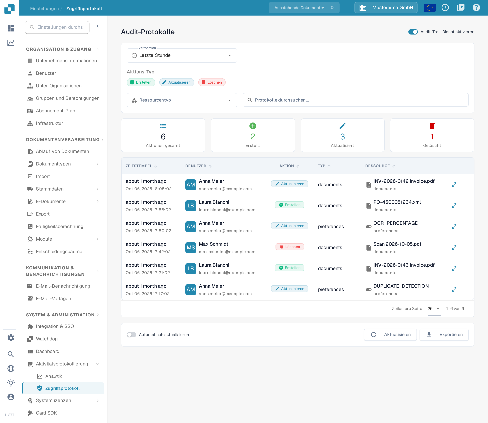
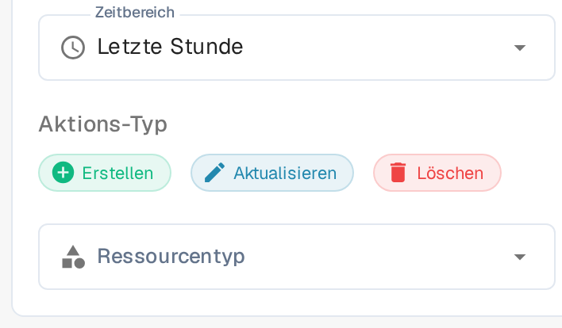

# Zugriffsprotokoll

## Video-Tutorial: Unternehmen, Abonnement und Audit


Unternehmensinformationen, Abonnement-Plan und Audit-Protokoll in DocBits


Das Video zeigt die Unternehmensinformationen und -präferenzen, den Abonnement-Plan, die Anmeldeaktivität und das Audit-Protokoll.

Das Zugriffsprotokoll zeichnet auf, wer eine Ressource erstellt, geändert oder gelöscht hat und wann das geschehen ist. Sie öffnen die Seite über **Einstellungen → Aktivitätsprotokollierung → Zugriffsprotokoll**; die Seite selbst trägt die Überschrift **Audit-Protokolle**. Aktivieren Sie den Dienst für eine Organisation nur dann, wenn Sie Audit-Ereignisse sammeln möchten.

<figure><figcaption>
Die vollständige Arbeitsfläche in der deutschen Oberfläche. Der Audit-Trail-Dienst ist im gezeigten Beispiel bereits aktiviert; das ist keine Aussage über die Standardeinstellung.
</figcaption></figure>

## Wenn die Protokollierung ausgeschaltet ist

Beim ersten Aufruf in einer Browsersitzung kann ein Hinweisdialog erscheinen. **Schließen** blendet ihn aus; die Protokollierung bleibt dann ausgeschaltet. **Enable Audit Trail** schaltet den Dienst für die aktuelle Organisation ein. Dieser Dialog ist derzeit englisch beschriftet: Titel, Erklärtext und Nutzenliste sind auf Englisch, nur **Schließen** ist deutsch.

Auch ohne den Dialog lässt sich der Dienst einschalten: Die leere Seite zeigt **Audit Trail ist deaktiviert** mit der Schaltfläche **Jetzt aktivieren**, und oben rechts schaltet der Schalter **Audit-Trail-Dienst aktivieren** den Dienst ein. Diese Bedienelemente ändern die Organisationseinstellung; sie zeigen die Funktion nicht nur an.

Solange der Dienst ausgeschaltet ist, können Filter und Tabelle keine Ereignisse anzeigen. Ereignisse stehen nur zur Verfügung, wenn der Dienst eingeschaltet ist und Daten gesammelt hat. Nach dem Einschalten können Sie den Dienst über denselben Schalter wieder ausschalten.

## Ein Ereignis finden

<figure><figcaption>
Zeitbereich, Aktions-Typ und Ressourcentyp in der deutschen Oberfläche.
</figcaption></figure>

| Steuerelement | Funktion |
|---|---|
| **Zeitbereich** | Beschränkt die Liste auf einen Zeitraum, etwa **Letzte Stunde**. |
| **Erstellen**, **Aktualisieren**, **Löschen** | Nehmen diese Aktionsarten in die Liste auf oder schließen sie aus. |
| **Ressourcentyp** | Beschränkt die Ergebnisse auf einen Ressourcentyp. |
| **Protokolle durchsuchen...** | Durchsucht die sichtbaren Protokolleinträge nach Text. |
| **Aktualisieren** | Lädt die passenden Einträge einmal neu. |
| **Automatisch aktualisieren** | Hält die Liste automatisch aktuell, solange die Seite geöffnet ist. |
| **Exportieren** | Lädt die aktuellen Protokolldaten als JSON-Datei herunter. |
| **Zeilen pro Seite** | Legt fest, wie viele Einträge die Tabelle auf einer Seite zeigt. |

Die Übersichtskarten zeigen **Aktionen gesamt**, **Erstellt**, **Aktualisiert** und **Gelöscht** für die gewählten Filter. In der Tabelle nennt **ZEITSTEMPEL** den Zeitpunkt, **BENUTZER** die handelnde Person, **AKTION** die Art der Änderung, **TYP** den betroffenen Bereich und **RESSOURCE** das betroffene Objekt. Das Symbol am Zeilenende (**Detaillierte Änderungen anzeigen**) öffnet die aufgezeichnete Änderung im Vorher-Nachher-Vergleich; erfasste Ereignisse können dabei auch IP-Adressen enthalten.

Einige Werte zeigt die deutsche Oberfläche derzeit noch auf Englisch: die relative Zeit (**about 1 month ago**), das Datum (**Oct 06, 2026 18:05:02**) und die Werte der Spalte **TYP** (**documents**, **preferences**). Das sind Beschriftungen der Anwendung und kein Fehler in Ihren Filtern.

Wenn keine Ereignisse erscheinen, prüfen Sie zuerst, ob der Dienst eingeschaltet ist, und erweitern Sie den Zeitraum, bevor Sie die übrigen Filter ändern. Ein leeres Protokoll allein belegt nicht, dass der Dienst ausgeschaltet ist, denn Zeitraum und Filter können die Liste ebenfalls leeren.
