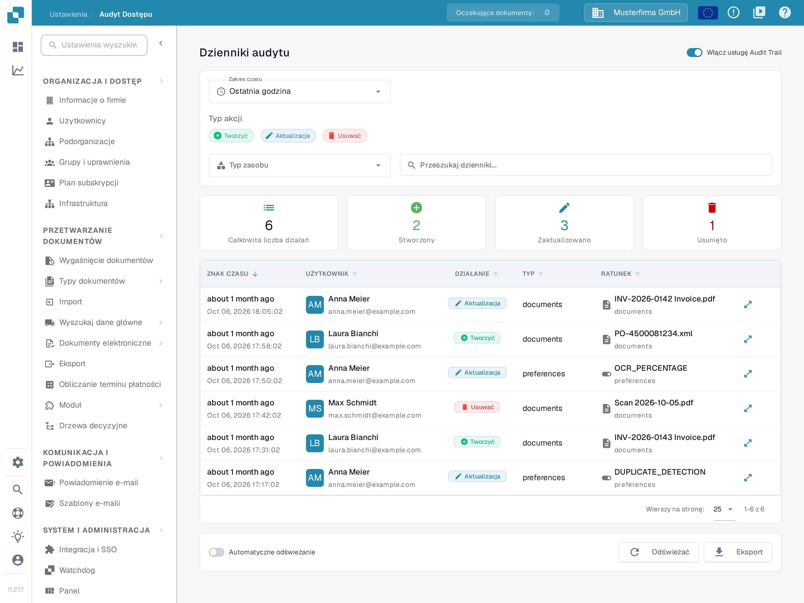
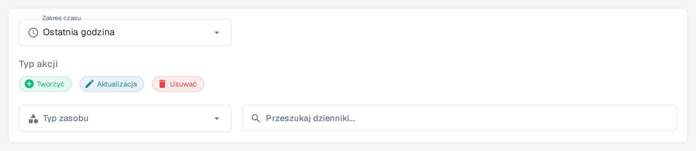

# Audyt Dostępu

## Samouczek wideo: Firma, subskrypcja i audyt


Informacje o firmie, plan subskrypcji i dzienniki audytu w DocBits


Film pokazuje informacje o firmie i preferencje, plan subskrypcji, aktywność logowania oraz dzienniki audytu.

<figure><figcaption>
W tym przykładzie usługa śledzenia audytu jest już włączona. Karty podsumowania opisują wybrany zakres czasu.
</figcaption></figure>

Audyt Dostępu rejestruje, kto utworzył, zmienił lub usunął zasób i kiedy. Otwórz **Ustawienia → Rejestrowanie aktywności → Audyt dostępu**, aby przejrzeć dziennik. Włącz usługę dla organizacji tylko wtedy, gdy zamierzasz zbierać zdarzenia audytu.

## Gdy rejestrowanie audytu jest wyłączone

Pierwsza wizyta w sesji przeglądarki może pokazać okno **Audit Trail is Disabled**. Przycisk **Zamknąć** zamyka okno dialogowe i pozostawia rejestrowanie audytu wyłączone. Przycisk **Enable Audit Trail** włącza usługę dla bieżącej organizacji. Na stronie za oknem dialogowym **Włącz teraz** oraz przełącznik **Włącz usługę Audit Trail** również ją włączają. Te elementy sterujące zmieniają ustawienie organizacji; nie służą jedynie do podglądu funkcji.

W tej wersji tytuł i treść okna dialogowego są jeszcze po angielsku; przetłumaczony jest tylko przycisk **Zamknąć**.

Dopóki usługa jest wyłączona, filtry i tabela dziennika nie mogą pokazywać zdarzeń. Pusty stan **Ślad audytu jest wyłączony** wyjaśnia, jak włączyć rejestrowanie: **Włącz usługę śledzenia audytu, aby rozpocząć zbieranie i przeglądanie dzienników audytu.** Po włączeniu użyj przełącznika, aby w razie potrzeby wyłączyć usługę ponownie. Zdarzenia są dostępne tylko wtedy, gdy usługa jest włączona i zebrała dane.

## Wyszukiwanie zdarzenia

<figure><figcaption>
Filtry Zakres czasu, Typ akcji, Typ zasobu oraz Przeszukaj dzienniki...
</figcaption></figure>

| Element sterujący | Co robi |
|---|---|
| **Zakres czasu** | Ogranicza listę do okresu: **Ostatnia godzina**, **Dzisiaj**, **Ostatnie 7 dni**, **Ostatnie 30 dni** lub **Niestandardowy**. |
| **Tworzyć**, **Aktualizacja**, **Usuwać** | Uwzględnia lub wyklucza te rodzaje działań. |
| **Typ zasobu** | Ogranicza wyniki do typu zasobu, na przykład **Dokumenty** lub **Zmiany modułów**. |
| **Przeszukaj dzienniki...** | Wyszukuje widoczne wpisy audytu według tekstu. |
| **Odświeżać** | Jednorazowo ładuje najnowsze pasujące wpisy. |
| **Automatyczne odświeżanie** | Utrzymuje listę aktualną automatycznie, dopóki strona jest otwarta. |
| **Eksport** | Pobiera bieżące dane dziennika audytu do pliku JSON. |
| **Wierszy na stronę:** | Ustawia liczbę zdarzeń na stronie; **1-6 z 6** wskazuje wyświetlany zakres. |

Karty podsumowania pokazują **Całkowita liczba działań** oraz **Stworzony**, **Zaktualizowano** i **Usunięto** dla wybranych filtrów. W tabeli **ZNAK CZASU** wskazuje, kiedy zdarzenie miało miejsce, **UŻYTKOWNIK** identyfikuje wykonawcę, **DZIAŁANIE** nazywa zmianę, **TYP** podaje typ zasobu, a **RATUNEK** wskazuje element, którego dotyczy zmiana; nazwa tej kolumny pochodzi z interfejsu aplikacji i oznacza zasób. Kolumna **TYP** pokazuje wartości `documents` i `preferences`, podczas gdy filtr **Typ zasobu** używa pozycji **Dokumenty** i **Zmiany modułów**. Ikona szczegółów po prawej stronie wiersza (**Zobacz szczegółowe zmiany w oknie dialogowym**) otwiera okno z zapisaną zmianą. Jeśli nie pojawiają się żadne zdarzenia, sprawdź, czy usługa jest włączona, i poszerz zakres czasu przed zmianą pozostałych filtrów.
