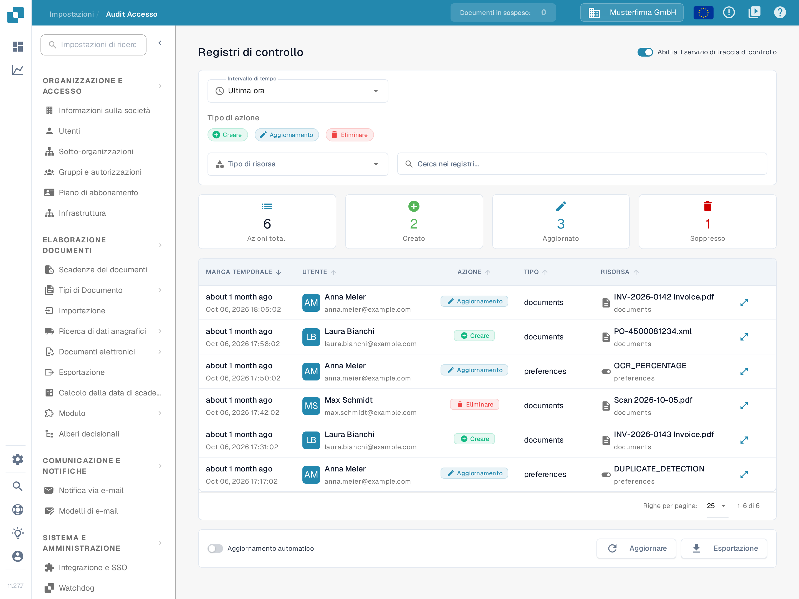
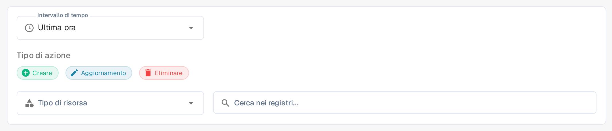

# Audit Accesso

## Video tutorial: Società, abbonamento e controllo


Informazioni sulla società, piano di abbonamento e registri di controllo in DocBits


Il video mostra le informazioni e le preferenze della società, il piano di abbonamento, l'attività di accesso e i registri di controllo.

<figure><figcaption>
Il servizio di traccia di controllo è già attivo in questo esempio. Le schede di riepilogo descrivono l'intervallo di tempo selezionato.
</figcaption></figure>

Audit Accesso registra chi ha creato, modificato o eliminato una risorsa e quando. Apri **Impostazioni → Registro Attività → Audit Accesso** per consultare il registro. Attiva il servizio per un'organizzazione solo quando intendi raccogliere eventi di audit.

## Quando la registrazione audit è disattivata

La prima visita in una sessione del browser può mostrare **Audit Trail is Disabled**. **Chiudere** chiude la finestra di dialogo e lascia la registrazione audit disattivata. **Enable Audit Trail** la attiva per l'organizzazione corrente. Nella pagina dietro la finestra di dialogo, anche **Abilita ora** e l'interruttore **Abilita il servizio di traccia di controllo** lo attivano. Questi controlli modificano l'impostazione dell'organizzazione; non si limitano a mostrare un'anteprima della funzione.

In questa versione il titolo e il testo della finestra di dialogo sono ancora in inglese; solo **Chiudere** è tradotto.

Finché il servizio è disattivato, i filtri e la tabella dei registri non possono mostrare eventi. Lo stato vuoto **La traccia di controllo è disabilitata.** spiega come attivare la registrazione. Dopo l'attivazione, usa l'interruttore per disattivarla di nuovo se necessario. Gli eventi sono disponibili solo quando il servizio è attivo e ha raccolto dati.

## Trovare un evento

<figure><figcaption>
Filtri Intervallo di tempo, Tipo di azione, Tipo di risorsa e Cerca nei registri...
</figcaption></figure>

| Controllo | Cosa fa |
|---|---|
| **Intervallo di tempo** | Limita l'elenco a un periodo, ad esempio **Ultima ora**, **Oggi** o **Ultimi 7 giorni**. |
| **Creare**, **Aggiornamento**, **Eliminare** | Include o esclude questi tipi di azione. |
| **Tipo di risorsa** | Limita i risultati a un tipo di risorsa, ad esempio **Documenti** o **Modifiche al modulo**. |
| **Cerca nei registri...** | Cerca per testo nelle voci di audit visibili. |
| **Aggiornare** | Carica una volta le voci corrispondenti più recenti. |
| **Aggiornamento automatico** | Mantiene l'elenco aggiornato automaticamente mentre la pagina è aperta. |
| **Esportazione** | Scarica i dati attuali del registro di audit in un file JSON. |
| **Righe per pagina** | Imposta quanti eventi vengono mostrati per pagina; **1-6 di 6** indica l'intervallo visualizzato. |

Le schede di riepilogo mostrano **Azioni totali**, **Creato**, **Aggiornato** e **Soppresso** per i filtri selezionati. Nella tabella **MARCA TEMPORALE** indica quando si è verificato un evento, **UTENTE** identifica l'autore, **AZIONE** nomina la modifica, **TIPO** riporta il tipo di risorsa e **RISORSA** identifica l'elemento interessato. La colonna **TIPO** mostra i valori `documents` e `preferences`, mentre il filtro **Tipo di risorsa** usa le voci **Documenti** e **Modifiche al modulo**. L'icona dei dettagli a destra di una riga apre la finestra con la modifica registrata. Se non compaiono eventi, verifica che il servizio sia attivo e amplia l'intervallo di tempo prima di modificare gli altri filtri.
