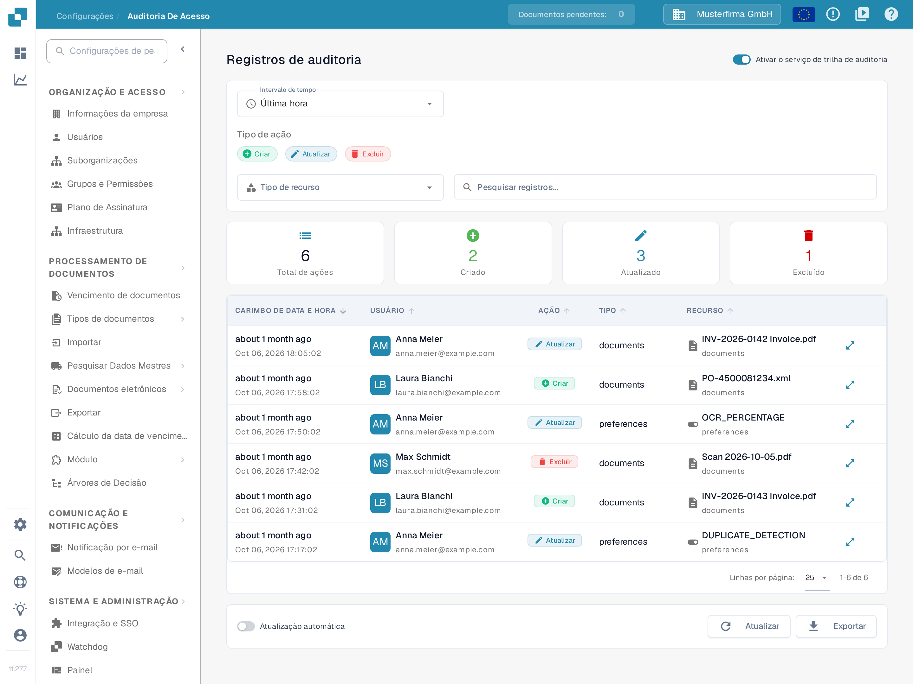
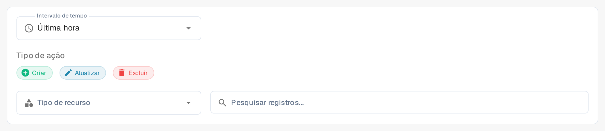

# Auditoria de Acesso

## Vídeo tutorial: Empresa, assinatura e auditoria


Informações da empresa, plano de assinatura e registros de auditoria no DocBits


O vídeo mostra as informações e as preferências da empresa, o plano de assinatura, a atividade de login e os registros de auditoria.

<figure><figcaption>
Neste exemplo o serviço de trilha de auditoria já está ativado. Os cartões de resumo descrevem o intervalo de tempo selecionado.
</figcaption></figure>

A Auditoria de Acesso registra quem criou, alterou ou excluiu um recurso e quando. Abra **Configurações → Registro de atividades → Auditoria de Acesso** para consultar o registro. Ative o serviço para uma organização apenas quando você pretender coletar eventos de auditoria.

## Quando a gravação de auditoria está desativada

A primeira visita em uma sessão do navegador pode exibir a caixa de diálogo **Audit Trail is Disabled**. **Fechar** fecha a caixa de diálogo e mantém a gravação de auditoria desativada. **Enable Audit Trail** ativa o serviço para a organização atual. Na página atrás da caixa de diálogo, **Ativar agora** e o interruptor **Ativar o serviço de trilha de auditoria** também o ativam. Esses controles alteram a configuração da organização; eles não apenas mostram uma prévia do recurso.

Nesta versão, o título, o texto e a lista de benefícios da caixa de diálogo ainda estão em inglês; apenas o botão **Fechar** está traduzido.

Enquanto o serviço estiver desativado, os filtros e a tabela de registros não podem mostrar eventos. O estado vazio **O registro de auditoria está desativado.** explica como ativar a gravação: **Ative o serviço de trilha de auditoria para começar a coletar e visualizar os registros de auditoria.** Depois da ativação, use o interruptor para desativar o serviço novamente, se necessário. Os eventos estão disponíveis somente quando o serviço está ativado e já coletou dados.

## Encontrar um evento

<figure><figcaption>
Os filtros Intervalo de tempo, Tipo de ação, Tipo de recurso e Pesquisar registros...
</figcaption></figure>

| Controle | O que faz |
|---|---|
| **Intervalo de tempo** | Limita a lista a um período: **Última hora**, **Hoje**, **Últimos 7 dias**, **Últimos 30 dias** ou **Personalizado**. |
| **Criar**, **Atualizar**, **Excluir** | Inclui ou exclui esses tipos de ação. |
| **Tipo de recurso** | Limita os resultados a um tipo de recurso, por exemplo **Documentos** ou **Alterações no módulo**. |
| **Pesquisar registros...** | Pesquisa por texto nas entradas de auditoria visíveis. |
| **Atualizar** | Carrega uma vez as entradas correspondentes mais recentes. |
| **Atualização automática** | Mantém a lista atualizada automaticamente enquanto a página estiver aberta. |
| **Exportar** | Baixa os dados atuais do registro de auditoria como um arquivo JSON. |
| **Linhas por página:** | Define quantos eventos aparecem por página; **1-6 de 6** indica o intervalo exibido. |

Os cartões de resumo mostram **Total de ações** e **Criado**, **Atualizado** e **Excluído** para os filtros selecionados. Na tabela, **CARIMBO DE DATA E HORA** indica quando um evento ocorreu, **USUÁRIO** identifica o autor, **AÇÃO** nomeia a alteração, **TIPO** indica o tipo do recurso e **RECURSO** identifica o item afetado. A coluna **TIPO** mostra os valores `documents` e `preferences`, enquanto o filtro **Tipo de recurso** oferece **Documentos** e **Alterações no módulo**. O ícone de detalhes à direita da linha (**Veja as alterações detalhadas na caixa de diálogo pop-up.**) abre a alteração registrada. Se nenhum evento aparecer, verifique se o serviço está ativado e amplie o intervalo de tempo antes de alterar os outros filtros.
