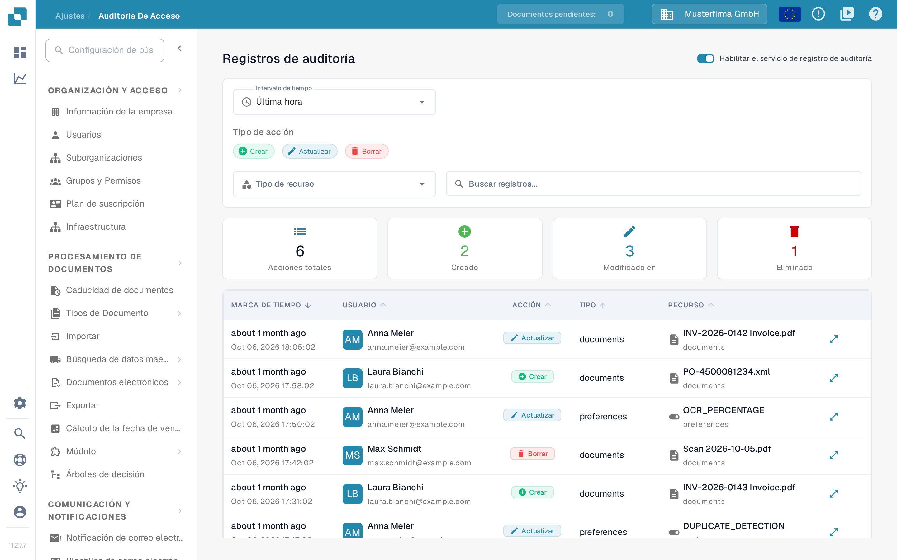
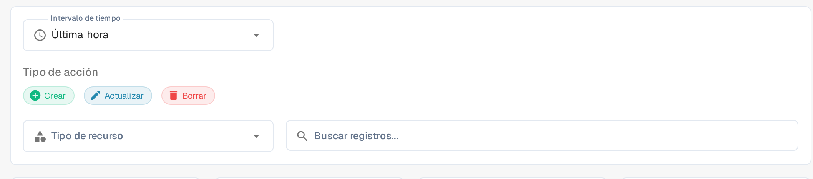

# Auditoría de Acceso

## Tutorial en vídeo: Empresa, suscripción y auditoría


Información de la empresa, plan de suscripción y registros de auditoría en DocBits


El vídeo muestra la información y las preferencias de la empresa, el plan de suscripción, la actividad de inicio de sesión y los registros de auditoría.

<figure><figcaption>
El servicio de registro de auditoría ya está activado en este ejemplo. Las tarjetas de resumen describen el intervalo de tiempo seleccionado.
</figcaption></figure>

La Auditoría de Acceso registra quién creó, modificó o eliminó un recurso y cuándo. Abra **Ajustes → Registro de Actividad → Auditoría de Acceso** para consultar el registro. Active el servicio para una organización solo cuando tenga previsto recopilar eventos de auditoría.

## Cuando el registro de auditoría está desactivado

La primera visita en una sesión de navegador puede mostrar el diálogo **Audit Trail is Disabled**. **Cerrar** cierra el diálogo y deja el registro de auditoría desactivado. **Enable Audit Trail** lo activa para la organización actual. En la página detrás del diálogo, **Habilitar ahora** y el interruptor **Habilitar el servicio de registro de auditoría** también lo activan. Estos controles cambian la configuración de la organización; no se limitan a previsualizar la función.

En esta versión, el título del diálogo, su texto y su botón principal siguen apareciendo en inglés; solo **Cerrar** está en español.

Mientras el servicio está desactivado, los filtros y la tabla del registro no pueden mostrar eventos. El estado vacío **El registro de auditoría está deshabilitado.** explica cómo activar el registro. Después de activarlo, utilice el interruptor para volver a desactivarlo si es necesario. Los eventos solo están disponibles cuando el servicio está activado y ha recopilado datos.

## Encontrar un evento

<figure><figcaption>
Filtros de intervalo de tiempo, tipo de acción, tipo de recurso y búsqueda de registros.
</figcaption></figure>

| Control | Qué hace |
|---|---|
| **Intervalo de tiempo** | Limita la lista a un intervalo, por ejemplo **Última hora**. |
| **Crear**, **Actualizar**, **Borrar** | Incluye o excluye esos tipos de acción. |
| **Tipo de recurso** | Limita los resultados a un tipo de recurso, como documents o preferences. |
| **Buscar registros...** | Busca por texto en las entradas de auditoría visibles. |
| **Actualizar** | Carga una vez las entradas coincidentes más recientes; es el botón de la barra inferior, no el filtro de acciones. |
| **Actualización automática** | Mantiene la lista actualizada automáticamente mientras la página está abierta. |
| **Exportar** | Descarga los datos actuales del registro de auditoría como archivo JSON. |

Las tarjetas de resumen muestran **Acciones totales**, **Creado**, **Modificado en** (las acciones actualizadas) y **Eliminado** para los filtros seleccionados. En la tabla, **Marca de tiempo** indica cuándo ocurrió un evento, **Usuario** identifica al actor, **Acción** nombra el cambio y **Recurso** identifica el elemento afectado. Abra el control de detalles de una fila para examinar el cambio registrado. Si no aparece ningún evento, compruebe que el servicio está activado y amplíe el intervalo de tiempo antes de modificar los demás filtros.
