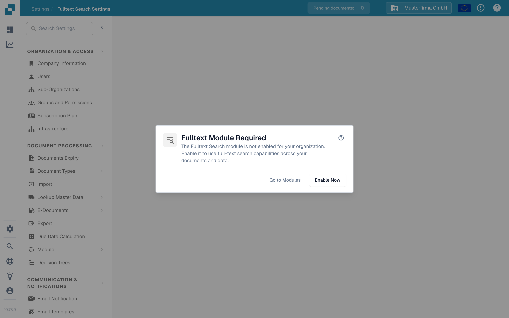

# Configuración de Búsqueda de Texto Completo

<figure><figcaption>
Cuando la Búsqueda de Texto Completo está desactivada, este diálogo explica los siguientes pasos.
</figcaption></figure>

La Configuración de Búsqueda de Texto Completo define qué indexa DocBits y cómo hace ese contenido buscable en documentos, datos maestros del ERP y plantillas. La página de configuración muestra un diálogo de requisito hasta que el **Fulltext Search module** está activado; consulte [Fulltext Search](../document-processing/module/fulltext-search.md) para el lenguaje de consulta del usuario final.

## Requisitos previos

El módulo Fulltext Search debe estar activado en **Settings → Module → Dashboards & Analytics → Full text search**. Si el módulo no está habilitado, el diálogo ofrece tres acciones:

* **Help (?)** — Abre la documentación de Fulltext Search en una pestaña nueva antes de cambiar cualquier ajuste.
* **Go to Modules** — Abre los ajustes del módulo Dashboards & Analytics para revisar la configuración.
* **Enable Now** — Abre el diálogo de suscripción. Revise y confirme ese diálogo antes de que el módulo se habilite; hacer clic solo en este botón no lo habilita.

La propia página de configuración está disponible una vez que el módulo está activo.

## Disposición de la página

La página de configuración está organizada en tres pestañas: **Documents**, **ERP** y **Templates**. Cada pestaña abarca un tipo de contenido distinto que Fulltext Search puede indexar.

### Pestaña Documents

La pestaña Documents cubre todo lo relacionado con la indexación de documentos procesados:

* **Indexing statistics** — totales de documentos indexados y pendientes, actualizados a petición.
* **Vector preferences** — tres conmutadores a nivel de organización que controlan si la indexación vectorial se ejecuta junto con el índice de texto para documentos. La indexación vectorial alimenta el modo de consulta `vector:` y la función "Find Similar".
* **Reindex actions** — inicie una reindexación completa o incremental. Mientras se ejecuta una reindexación, verá el progreso en vivo (documentos por minuto, tiempo estimado), el estado actual del flujo y el último fallo (si lo hay).
* **Sync diagnostics** — diagnóstico a petición para los casos en que el índice parece estar desincronizado con el almacén de documentos subyacente.

<mark>La reindexación no es destructiva: la búsqueda existente sigue funcionando mientras se reconstruye el nuevo índice.</mark>

### Pestaña ERP

La pestaña ERP controla la indexación de los datos maestros del ERP: proveedores, clientes, artículos y entidades similares. Cada entidad tiene sus propios conmutadores:

* **Indexing** — indexa el texto de la entidad para que sea buscable desde el Dashboard.
* **Vector** — indexa la entidad vectorialmente para que pueda encontrarse mediante consultas semánticas.

Use la acción **Toggle all** al principio de la lista para aplicar el mismo estado de activado/desactivado a todas las entidades a la vez. La indexación se inicia en segundo plano; un indicador en cada fila muestra cuándo está en curso.

### Pestaña Templates

La pestaña Templates enumera las versiones de plantilla conocidas por el índice Fulltext. Use esta vista para confirmar que las versiones de plantilla de las que depende están presentes en el índice tras un nuevo despliegue.

## Qué se indexa

Una vez habilitada y configurada, Fulltext Search permite a los usuarios:

* Buscar en todo el contenido de los documentos (no solo en los campos de metadatos).
* Encontrar documentos por el texto contenido en los archivos cargados.
* Usar operadores de búsqueda avanzados para consultas precisas.
* Acceder a los resultados de búsqueda directamente desde el Dashboard.
* Usar búsqueda semántica (prefijo `vector:`) cuando la indexación vectorial esté activada para ese tipo de contenido.

Consulte la página del módulo [Fulltext Search](../document-processing/module/fulltext-search.md) para la referencia completa del lenguaje de consulta, incluidas las consultas de rango, los filtros inteligentes y el modo de búsqueda con IA.
