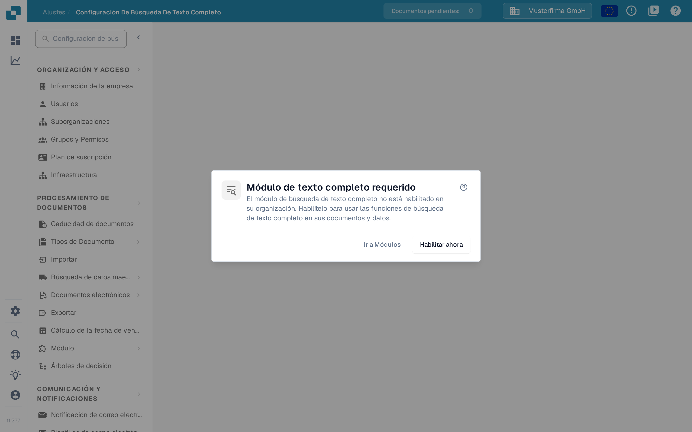

# Configuración de Búsqueda de Texto Completo

<figure><figcaption>
Cuando la Búsqueda de texto completo está desactivada, este diálogo explica los siguientes pasos.
</figcaption></figure>

La Configuración de Búsqueda de Texto Completo define qué indexa DocBits y cómo hace ese contenido buscable en documentos, datos maestros del ERP y plantillas. La página de configuración muestra un diálogo de requisito hasta que el **módulo Búsqueda de texto completo** está activado; consulte [Búsqueda de texto completo](../document-processing/module/fulltext-search.md) para el lenguaje de consulta del usuario final.

## Requisitos previos

El módulo Búsqueda de texto completo debe activarse en **Ajustes → Módulo → Tableros → Búsqueda de texto completo**. Si el módulo no está activado, el diálogo ofrece tres acciones:

* **Ayuda (?)** — El icono de signo de interrogación abre la documentación de Búsqueda de texto completo en una pestaña nueva antes de cambiar cualquier ajuste.
* **Ir a Módulos** — Abre la página del grupo de módulos **Tableros** para revisar la configuración.
* **Habilitar ahora** — Abre el diálogo de suscripción. Revise y confirme ese diálogo antes de que el módulo se active; hacer clic solo en este botón no lo activa.

La propia página de configuración está disponible una vez que el módulo está activo.

## Disposición de la página

La página de configuración está organizada en tres pestañas: **Documents**, **ERP** y **Templates**. Cada pestaña abarca un tipo de contenido distinto que la Búsqueda de texto completo puede indexar. Los nombres de las pestañas aparecen en inglés también en la interfaz en español.

### Pestaña Documents

La pestaña Documents cubre todo lo relacionado con la indexación de documentos procesados:

* **Estadísticas de indexación** — totales de documentos indexados y pendientes, actualizados a petición.
* **Preferencias de vectores** — tres conmutadores a nivel de organización que controlan si la indexación vectorial se ejecuta junto con el índice de texto de los documentos. La indexación vectorial alimenta el modo de consulta `vector:` y la búsqueda de documentos similares.
* **Acciones de reindexación** — inicie una reindexación completa o incremental. Mientras se ejecuta una reindexación, verá el progreso en vivo (documentos por minuto, tiempo estimado), el estado actual del flujo y el último fallo (si lo hay).
* **Diagnóstico de sincronización** — diagnóstico a petición para los casos en que el índice parece estar desincronizado con el almacén de documentos subyacente.

<mark>La reindexación no es destructiva: la búsqueda existente sigue funcionando mientras se reconstruye el nuevo índice.</mark>

### Pestaña ERP

La pestaña ERP controla la indexación de los datos maestros del ERP: proveedores, clientes, artículos y entidades similares. Cada entidad tiene sus propios conmutadores:

* **Indexación** — indexa el texto de la entidad para que se pueda buscar desde el panel de control.
* **Vector** — indexa la entidad de forma vectorial para que se pueda encontrar mediante consultas semánticas.

Use los botones de la parte superior de la lista para activar o desactivar todas las entidades a la vez. La indexación se inicia en segundo plano; un indicador en cada fila muestra cuándo está en curso.

### Pestaña Templates

La pestaña Templates enumera las versiones de plantilla conocidas por el índice de texto completo. Use esta vista para confirmar que las versiones de plantilla de las que depende están presentes en el índice tras un nuevo despliegue.

## Qué se indexa

Una vez activada y configurada, la Búsqueda de texto completo permite a los usuarios:

* Buscar en todo el contenido de los documentos (no solo en los campos de metadatos).
* Encontrar documentos por el texto contenido en los archivos cargados.
* Usar operadores de búsqueda avanzados para consultas precisas.
* Acceder a los resultados de búsqueda directamente desde el panel de control.
* Usar búsqueda semántica (prefijo `vector:`) cuando la indexación vectorial esté activada para ese tipo de contenido.

Consulte la página del módulo [Búsqueda de texto completo](../document-processing/module/fulltext-search.md) para la referencia completa del lenguaje de consulta, incluidas las consultas de rango, los filtros inteligentes y el modo de búsqueda con IA.
