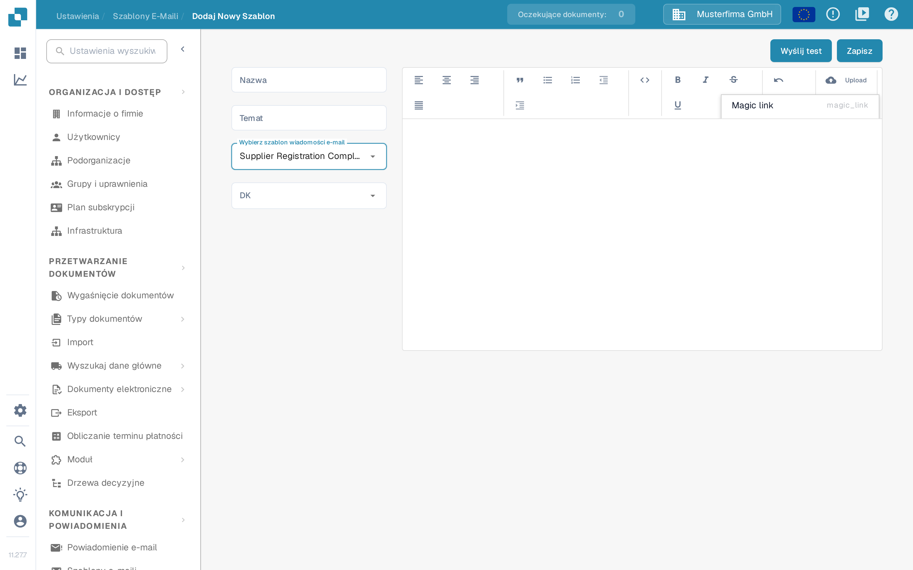

# Edytowanie szablonów e-maili

<figure><figcaption><p>Lista szablonów e-mail dla dostawców</p></figcaption></figure>

Strona **Szablony e-maili** w obszarze **Ustawienia** (w edytorze widoczna jest ścieżka **Ustawienia → Szablony E-Maili**) pozwala administratorom zaprojektować wiadomości e-mail, które DocBits wysyła dostawcom automatycznie. Każdy szablon jest przypisany do jednego z czterech stałych typów wiadomości, dzięki czemu właściwa treść jest wysyłana zawsze, gdy dostawca zostaje zaproszony, kończy rejestrację albo zostaje zatwierdzony lub odrzucony w portalu dostawcy.

Dostęp wymaga konta administratora. Role, które otrzymują sami dostawcy, opisuje strona [Uprawnienia dostawcy](supplier-permissions.md).

## Lista szablonów

Lista pokazuje jeden wiersz na szablon i zawiera następujące kolumny:

| Kolumna | Opis |
|---------|------|
| **Nazwa** | Wewnętrzna nazwa szablonu. |
| **Typ** | Typ wiadomości, dla którego szablon jest używany, np. E-mail z zaproszeniem do dostawcy. |
| **Temat** | Temat, który widzą odbiorcy. |
| **Ostatnia Modyfikacja Przez** | Użytkownik, który ostatnio edytował szablon. |
| **Ostatnia Modyfikacja:** | Data i godzina ostatniej zmiany szablonu. |

Listę można sortować według dowolnej kolumny. Kolumny **Nazwa**, **Typ** i **Temat** oferują dodatkowo filtr w menu kolumny; aktywne filtry pojawiają się jako usuwalne znaczniki nad tabelą. Nagłówki kolumn można przeciągnąć w wybranej kolejności, a ta kolejność jest zapamiętywana przy następnej wizycie.

**Akcje wiersza**: każdy wiersz ma w kolumnie **Akcje** przycisk z trzema kropkami, który otwiera menu z pozycjami **Redagować** (ikona ołówka) i **Usuwać** (ikona kosza). Pozycja **Usuwać** usuwa szablon po potwierdzeniu w oknie dialogowym. Kliknięcie dowolnego miejsca w wierszu również otwiera szablon do edycji.

<figure><figcaption><p>Menu akcji wiersza: Redagować i Usuwać</p></figcaption></figure>

Przycisk **Nowy** nad tabelą tworzy nowy szablon.

## Tworzenie i edycja szablonu

<figure><figcaption><p>Tworzenie nowego szablonu e-mail dla dostawców</p></figcaption></figure>

Kliknij **Nowy** (lub **Redagować** przy istniejącym szablonie), aby otworzyć edytor szablonu:

1. **Nazwa** — wpisz wewnętrzną nazwę szablonu. Nazwa pojawia się na liście, a nie w wiadomości.
2. **Temat** — wpisz temat wiadomości. Możesz używać symboli zastępczych, np. `{{supplier_name}}`.
3. **Wybierz szablon wiadomości e-mail** — wybierz typ wiadomości. Istnieją dokładnie cztery typy:
   * **Supplier Invitation Email** (E-mail z zaproszeniem do dostawcy) — wysyłany, gdy zapraszasz dostawcę do portalu dostawcy.
   * **Supplier Registration Completion Email** (E-mail z potwierdzeniem ukończenia rejestracji dostawcy) — wysyłany, gdy dostawca kończy rejestrację.
   * **Supplier Approval Email** (E-mail z zatwierdzeniem dostawcy) — wysyłany, gdy konto dostawcy zostaje zatwierdzone.
   * **Supplier Rejection Email** (E-mail z informacją o odrzuceniu dostawcy) — wysyłany, gdy konto dostawcy zostaje odrzucone.

   W polu wyboru nazwy typów są wyświetlane po angielsku, natomiast kolumna **Typ** na liście pokazuje je po polsku. Typu istniejącego szablonu nie można później zmienić: podczas edycji pole jest nieaktywne. W takim przypadku utwórz nowy szablon.
4. **DK** — opcjonalnie wybierz, kto jeszcze otrzyma kopię: **Przypisany użytkownik** (użytkownik odpowiedzialny za dostawcę) i/lub **Referrer** (użytkownik, który zaprosił dostawcę). Pozostaw pole puste, aby wysłać wiadomość tylko do dostawcy.
5. Treść wiadomości utwórz w edytorze tekstu po prawej stronie. Możesz formatować tekst, wstawiać listy i cytaty oraz wyrównywać zawartość. Przycisk **Upload** na pasku narzędzi wstawia przesłany obraz bezpośrednio do wiadomości lub dołącza inne pliki jako link. Ikona kodu (**Pokaż źródło**) przełącza widok na źródło HTML, w którym można bezpośrednio edytować kod HTML i formatować go.
6. **Symbole zastępcze**: menu właściwości na pasku narzędzi wstawia dostępne symbole zastępcze dla wybranego typu wiadomości, np. `{{magic_link}}` i `{{supplier_name}}`.
7. Kliknij **Zapisz**, aby zapisać szablon.

### Symbol zastępczy `{{magic_link}}`

Symbol `{{magic_link}}` jest zastępowany unikalnym adresem logowania w momencie wysłania wiadomości. Prowadzi odbiorcę do akcji w portalu dostawcy, na przykład ukończenia rejestracji. Aby zamienić go w klikalny przycisk, sformatuj go jako link w widoku źródła HTML:

```html
<a href="{{magic_link}}" target="_blank" style="
    background-color: #B7184B;
    border-radius: 25px;
    font-family: 'Montserrat', Arial, sans-serif;
    font-size: 14px;
    font-weight: bold;
    padding: 12px 25px;
    color: #FFFFFF;
    text-decoration: none;
    display: inline-block;
    cursor: pointer;">
    Complete Registration
</a>
```

Dostosuj tekst między znacznikami `<a>` i `</a>`, aby powiedzieć odbiorcy, co ma zrobić, na przykład "Complete Registration" lub "Access Your Account".

## Wysyłanie testowej wiadomości e-mail

Przed rozpoczęciem korzystania z szablonu sprawdź, jak wygląda wysyłana wiadomość:

<figure><figcaption><p>Okno wysyłania testowej wiadomości e-mail</p></figcaption></figure>

1. Kliknij **Wyślij test** w prawym górnym rogu edytora.
2. W polu **Adres e-mail odbiorcy** wpisz adres, na który ma zostać wysłana testowa wiadomość.
3. Wypełnij przykładowe wartości wyświetlane dla symboli zastępczych (np. przykładową nazwę dostawcy i przykładowy link).
4. Kliknij **Wysłać**. DocBits wysyła wiadomość z przykładowymi wartościami, dzięki czemu możesz sprawdzić układ, podstawienie symboli zastępczych i magic link.

Testowa wiadomość nie jest wysyłana do dostawcy i nie zmienia żadnych danych.

## Powiązane strony

* [Powiadomienie e-mail](../global-settings/email-notification/README.md) — powiadomienia o wewnętrznych zdarzeniach dokumentów
* [Ustawienia ogólne dostawcy](supplier-general-settings.md)
* [Uprawnienia dostawcy](supplier-permissions.md)
* [Portal dostawcy](../../setup/supplier-portal/README.md) — aktywacja portalu i zapraszanie dostawców
