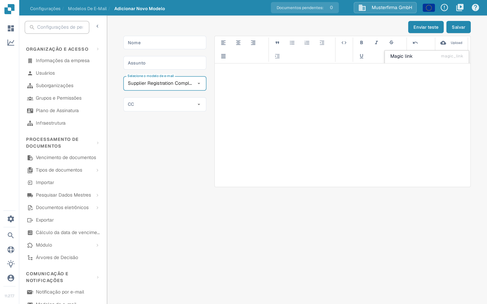
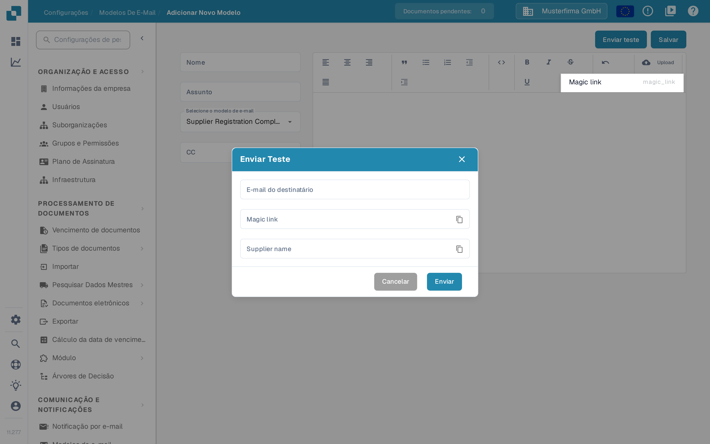

# Edição de Modelos de E-mail

<figure><figcaption><p>Lista de modelos de e-mail para fornecedores</p></figcaption></figure>

A página **Modelos de e-mail**, na área de configurações do fornecedor em **Configurações**, permite que administradores criem os e-mails que o DocBits envia automaticamente aos fornecedores. Cada modelo é atribuído a um dos quatro tipos fixos de e-mail, para que a mensagem correta seja sempre enviada quando um fornecedor é convidado, conclui o cadastro, ou é aprovado ou rejeitado no portal do fornecedor.

O acesso requer uma conta de administrador. Consulte [Permissões do Fornecedor](supplier-permissions.md) para as funções que os próprios fornecedores recebem.

## Lista de modelos

A lista mostra uma linha por modelo, com estas colunas:

| Coluna | Descrição |
|--------|-----------|
| **Nome** | O nome interno do modelo. |
| **Tipo** | O tipo de e-mail para o qual o modelo é usado, por exemplo E-mail de convite para fornecedores. |
| **Assunto** | A linha de assunto que os destinatários veem. |
| **Última Modificação Por** | O usuário que editou o modelo por último. |
| **Última Modificação Em** | Quando o modelo foi alterado pela última vez. |

Você pode ordenar a lista por qualquer coluna. As colunas **Nome**, **Tipo** e **Assunto** também oferecem um filtro nos menus das colunas; filtros ativos aparecem como etiquetas removíveis acima da tabela. Você pode arrastar os cabeçalhos das colunas para a ordem que preferir, e essa ordem é mantida na sua próxima visita.

**Ações de linha**: cada linha tem a ação **Editar** no menu de três pontos da coluna **Ações**, que abre o modelo no editor, e a ação **Excluir**, que remove o modelo após uma janela de confirmação. Clicar em qualquer ponto da linha também abre o modelo para edição.

<figure><figcaption><p>Ações de linha Editar e Excluir</p></figcaption></figure>

**Novo**: o botão **Novo** acima da tabela cria um novo modelo.

## Criar ou editar um modelo

<figure><figcaption><p>Criar um novo modelo de e-mail para fornecedores</p></figcaption></figure>

Clique em **Novo** (ou em **Editar** num modelo existente) para abrir o editor do modelo:

1. **Nome** — informe um nome interno para o modelo. Esse nome aparece na lista, não no e-mail.
2. **Assunto** — informe a linha de assunto do e-mail. Você pode usar espaços reservados como `{{supplier_name}}`.
3. **Selecione o modelo de e-mail** — escolha o tipo de e-mail. Existem exatamente quatro tipos:
   * **E-mail de convite para fornecedores** — enviado quando você convida um fornecedor para o portal do fornecedor.
   * **E-mail de confirmação de conclusão do cadastro do fornecedor** — enviado quando um fornecedor conclui o cadastro.
   * **E-mail de aprovação do fornecedor** — enviado quando a conta do fornecedor é aprovada.
   * **E-mail de rejeição do fornecedor** — enviado quando a conta do fornecedor é rejeitada.

   O tipo de um modelo existente não pode ser alterado depois; o campo fica somente leitura durante a edição. Nesse caso, crie um novo modelo.
4. **CC** — opcionalmente, selecione quem mais recebe uma cópia: **Usuário atribuído** (o usuário responsável pelo fornecedor) e **Referrer** (o usuário que convidou o fornecedor). Deixe vazio para enviar apenas ao fornecedor.
5. Crie o corpo do e-mail no editor de texto à direita. Você pode formatar o texto, inserir listas e citações e alinhar o conteúdo. O botão **Upload** da barra de ferramentas insere uma imagem carregada diretamente no e-mail ou anexa outros arquivos como link. O ícone de código alterna para a visualização do código-fonte HTML, onde você pode editar o HTML subjacente diretamente e formatá-lo.
6. **Espaços reservados**: o menu de propriedades da barra de ferramentas insere os espaços reservados disponíveis para o tipo de e-mail selecionado, por exemplo `{{magic_link}}` e `{{supplier_name}}`.
7. Clique em **Salvar** para armazenar o modelo.

### O espaço reservado `{{magic_link}}`

O espaço reservado `{{magic_link}}` é substituído por uma URL de acesso única quando o e-mail é enviado. Ele direciona o destinatário a uma ação no portal do fornecedor, como concluir o cadastro. Para torná-lo um botão clicável, formate-o como link na visualização do código-fonte HTML:

```html
<a href="{{magic_link}}" target="_blank" style="
    background-color: #B7184B;
    border-radius: 25px;
    font-family: 'Montserrat', Arial, sans-serif;
    font-size: 14px;
    font-weight: bold;
    padding: 12px 25px;
    color: #FFFFFF;
    text-decoration: none;
    display: inline-block;
    cursor: pointer;">
    Complete Registration
</a>
```

Ajuste o texto entre as tags `<a>` e `</a>` para indicar ao destinatário o que fazer, por exemplo "Concluir cadastro" ou "Acessar sua conta".

## Enviar um e-mail de teste

Antes de usar um modelo, verifique como ele fica:

1. Clique em **Enviar teste** no canto superior direito do editor.
2. Informe o endereço **E-mail do destinatário** para o qual o e-mail de teste deve ser enviado.
3. Preencha os valores de exemplo exibidos para os espaços reservados (por exemplo, um nome de fornecedor de exemplo e um link de exemplo).
4. Clique em **Enviar**. O DocBits envia o e-mail com os valores de exemplo, para que você possa verificar o layout, a substituição dos espaços reservados e o magic link.

O e-mail de teste não é enviado a um fornecedor e não altera nenhum dado.

<figure><figcaption><p>Enviar um e-mail de teste com valores de exemplo</p></figcaption></figure>

## Páginas relacionadas

* [Notificações por e-mail](../global-settings/email-notification/README.md) — notificações para eventos internos de documentos
* [Configurações Gerais do Fornecedor](supplier-general-settings.md)
* [Permissões do Fornecedor](supplier-permissions.md)
* [Portal do Fornecedor](../../setup/supplier-portal/README.md) — ativar o portal e convidar fornecedores
