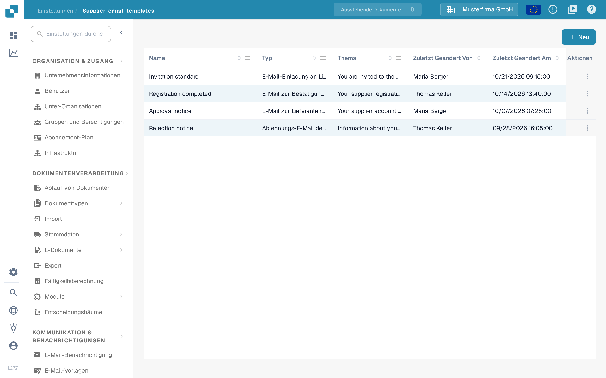
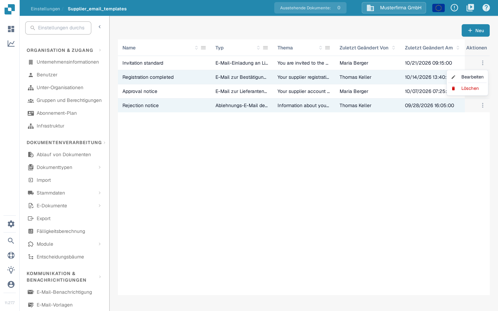
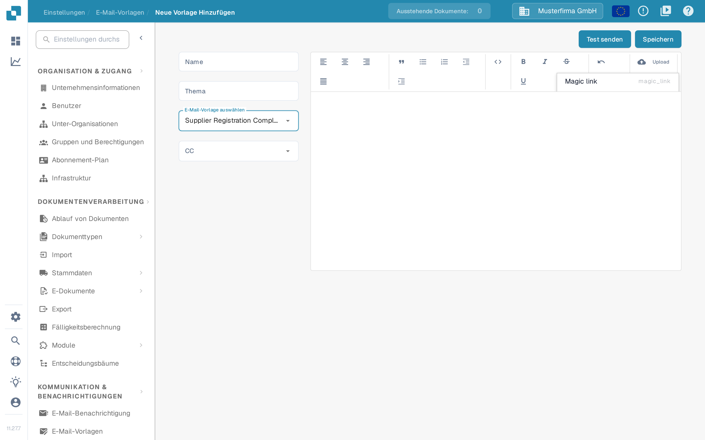

# E-Mail-Vorlagen bearbeiten

<figure><figcaption><p>Liste der E-Mail-Vorlagen für Lieferanten</p></figcaption></figure>

Auf der Seite **E-Mail-Vorlagen** unter **Einstellungen → Lieferanteneinstellungen → E-Mail-Vorlagen** legen Administratoren die E-Mails fest, die DocBits automatisch an Lieferanten sendet. Jede Vorlage gehört zu genau einem von vier festen E-Mail-Typen. So geht immer die passende Nachricht hinaus, wenn ein Lieferant eingeladen wird, seine Registrierung abschließt oder im Lieferantenportal genehmigt beziehungsweise abgelehnt wird.

Für den Zugriff ist ein Administratorkonto erforderlich. Welche Rollen die Lieferanten selbst erhalten, steht unter [Lieferantenberechtigungen](supplier-permissions.md).

## Vorlagenliste

Die Liste zeigt eine Zeile pro Vorlage mit diesen Spalten:

| Spalte | Beschreibung |
|--------|--------------|
| **Name** | Der interne Name der Vorlage. |
| **Typ** | Der E-Mail-Typ, für den die Vorlage verwendet wird, zum Beispiel E-Mail-Einladung an Lieferanten. |
| **Thema** | Die Betreffzeile, die Empfänger sehen. |
| **Zuletzt Geändert Von** | Der Benutzer, der die Vorlage zuletzt bearbeitet hat. |
| **Zuletzt Geändert Am** | Wann die Vorlage zuletzt geändert wurde. |

Sie können die Liste nach jeder Spalte sortieren. Die Spalten **Name**, **Typ** und **Thema** bieten über ihr Spaltenmenü zusätzlich einen Filter; aktive Filter erscheinen als entfernbare Markierungen über der Tabelle. Spaltenüberschriften lassen sich in die gewünschte Reihenfolge ziehen, und diese Reihenfolge bleibt für Ihren nächsten Besuch erhalten.

**Zeilenaktionen**: Am Ende jeder Zeile öffnet das Symbol mit den drei Punkten ein Menü mit **Bearbeiten** und **Löschen**. **Bearbeiten** öffnet die Vorlage im Editor, **Löschen** entfernt sie erst nach einer Rückfrage. Ein Klick auf eine beliebige Stelle der Zeile öffnet die Vorlage ebenfalls im Editor.

<figure><figcaption><p>Zeilenaktionen einer Vorlage: Bearbeiten und Löschen</p></figcaption></figure>

**Neu**: Die Schaltfläche **Neu** über der Tabelle legt eine neue Vorlage an.

## Vorlage erstellen oder bearbeiten

<figure><figcaption><p>Eine neue E-Mail-Vorlage für Lieferanten anlegen</p></figcaption></figure>

Klicken Sie auf **Neu** oder bei einer vorhandenen Vorlage auf **Bearbeiten**, um den Editor zu öffnen:

1. **Name** — Geben Sie einen internen Namen für die Vorlage ein. Dieser Name erscheint in der Liste, nicht in der E-Mail.
2. **Thema** — Geben Sie die Betreffzeile der E-Mail ein. Sie können Platzhalter wie `{{supplier_name}}` verwenden.
3. **E-Mail-Vorlage auswählen** — Wählen Sie den E-Mail-Typ. Es gibt genau vier Typen; das Auswahlfeld zeigt sie derzeit in englischer Bezeichnung:
   * **Supplier Invitation Email** — Einladung eines Lieferanten in das Lieferantenportal.
   * **Supplier Registration Completion Email** — Bestätigung, wenn ein Lieferant seine Registrierung abschließt.
   * **Supplier Approval Email** — Genehmigung des Kontos eines Lieferanten.
   * **Supplier Rejection Email** — Ablehnung des Kontos eines Lieferanten.

   In der Vorlagenliste erscheint derselbe Typ in der Spalte **Typ** übersetzt, zum Beispiel als E-Mail-Einladung an Lieferanten. Der Typ einer bestehenden Vorlage lässt sich später nicht mehr ändern; beim Bearbeiten ist das Feld schreibgeschützt. Legen Sie in diesem Fall eine neue Vorlage an.
4. **CC** — Wählen Sie optional, wer zusätzlich eine Kopie erhält: **Zugewiesener Benutzer** (der für den Lieferanten zuständige Benutzer) und/oder **Referrer** (der Benutzer, der den Lieferanten eingeladen hat). Bleibt das Feld leer, geht die E-Mail nur an den Lieferanten.
5. Gestalten Sie den Text der E-Mail im Editor rechts. Sie können Text formatieren, Listen und Zitate einfügen und Inhalte ausrichten. Die Schaltfläche **Upload** in der Werkzeugleiste fügt ein hochgeladenes Bild direkt in die E-Mail ein oder hängt andere Dateien als Link an. Das Code-Symbol wechselt in die HTML-Ansicht, in der Sie das zugrunde liegende HTML direkt bearbeiten und formatieren.
6. **Platzhalter**: Über das Eigenschaften-Menü in der Werkzeugleiste fügen Sie die Platzhalter des gewählten E-Mail-Typs ein, zum Beispiel `{{magic_link}}` und `{{supplier_name}}`.
7. Klicken Sie auf **Speichern**, um die Vorlage zu sichern.

### Der Platzhalter `{{magic_link}}`

Der Platzhalter `{{magic_link}}` wird beim Versand der E-Mail durch eine eindeutige Anmelde-URL ersetzt. Sie führt den Empfänger zu einer Aktion im Lieferantenportal, etwa zum Abschluss der Registrierung. Damit daraus eine anklickbare Schaltfläche wird, formatieren Sie ihn in der HTML-Ansicht als Link:

```html
<a href="{{magic_link}}" target="_blank" style="
    background-color: #B7184B;
    border-radius: 25px;
    font-family: 'Montserrat', Arial, sans-serif;
    font-size: 14px;
    font-weight: bold;
    padding: 12px 25px;
    color: #FFFFFF;
    text-decoration: none;
    display: inline-block;
    cursor: pointer;">
    Complete Registration
</a>
```

Passen Sie den Text zwischen `<a>` und `</a>` an, damit er beschreibt, was der Empfänger tun soll, zum Beispiel „Registrierung abschließen“ oder „Auf Ihr Konto zugreifen“.

## Test-E-Mail senden

Prüfen Sie vor dem Einsatz einer Vorlage, wie sie aussieht:

<figure><figcaption><p>Test-E-Mail senden: Empfängeradresse eingeben</p></figcaption></figure>

1. Klicken Sie oben rechts im Editor auf **Test senden**.
2. Geben Sie unter **E-Mail des Empfängers** die Adresse ein, an die die Test-E-Mail gehen soll.
3. Sobald ein E-Mail-Typ gewählt ist, zeigt der Dialog für jeden Platzhalter der Vorlage ein eigenes Feld. Die Feldnamen stammen aus den Beispieldaten des Typs und erscheinen derzeit englisch, zum Beispiel **Magic link** und **Supplier name**. Über das Kopiersymbol im Feld kopieren Sie den Platzhalter selbst, etwa `{{magic_link}}`, in die Zwischenablage.
4. Klicken Sie auf **Senden**. DocBits versendet die E-Mail an die angegebene Adresse, sodass Sie Layout, Platzhalter-Ersetzung und Magic Link prüfen können.

Die Test-E-Mail geht nicht an einen Lieferanten und ändert keine Daten.

## Verwandte Seiten

* [E-Mail-Benachrichtigungen](../global-settings/email-notification/README.md) — Benachrichtigungen für interne Dokumentereignisse
* [Allgemeine Lieferanteneinstellungen](supplier-general-settings.md)
* [Lieferantenberechtigungen](supplier-permissions.md)
* [Lieferantenportal](../../setup/supplier-portal/README.md) — Portal aktivieren und Lieferanten einladen
