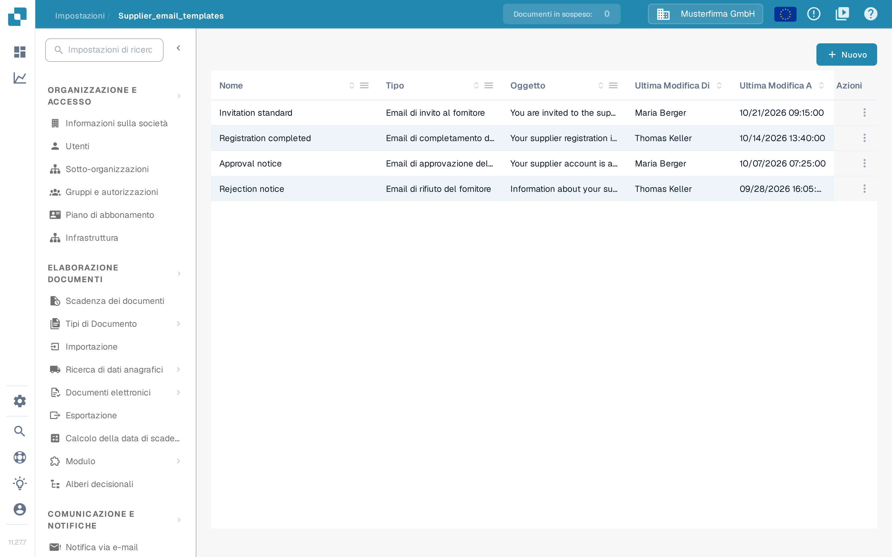
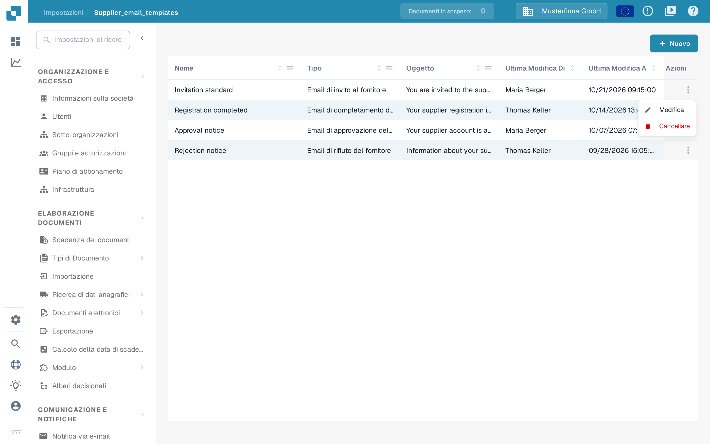
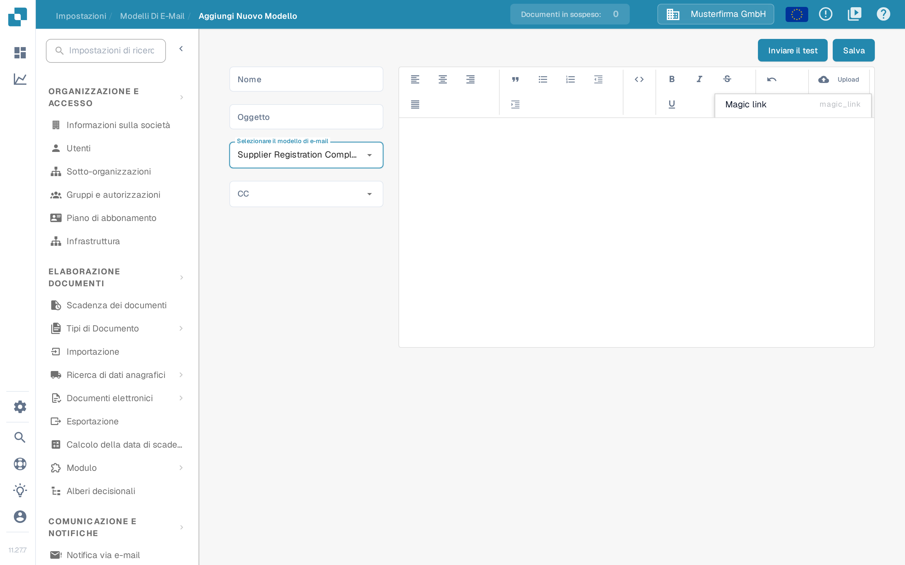

# Modifica dei Modelli di Email

<figure><figcaption><p>Elenco dei modelli di e-mail per i fornitori</p></figcaption></figure>

La pagina **Modelli di e-mail** in **Impostazioni** (il percorso in alto mostra **Impostazioni → Modelli Di E-Mail**) permette agli amministratori di progettare le e-mail che DocBits invia automaticamente ai fornitori. Ogni modello è assegnato a uno dei quattro tipi di e-mail fissi, così il messaggio corretto viene inviato sempre quando un fornitore viene invitato, completa la registrazione oppure viene approvato o rifiutato nel portale fornitori.

L'accesso richiede un account amministratore. Per i ruoli che ricevono i fornitori stessi, vedere [Permessi fornitore](supplier-permissions.md).

## Elenco dei modelli

L'elenco mostra una riga per modello con queste colonne:

| Colonna | Descrizione |
|---------|-------------|
| **Nome** | Il nome interno del modello. |
| **Tipo** | Il tipo di e-mail per cui viene usato il modello, ad es. Email di invito al fornitore. |
| **Oggetto** | L'oggetto che i destinatari vedono. |
| **Ultima Modifica Di** | L'utente che ha modificato il modello per ultimo. |
| **Ultima Modifica A** | Quando il modello è stato modificato l'ultima volta. |

È possibile ordinare l'elenco per qualsiasi colonna. Le colonne **Nome**, **Tipo** e **Oggetto** offrono inoltre un filtro tramite il menu della colonna; i filtri attivi compaiono come badge rimovibili sopra la tabella. È possibile trascinare le intestazioni delle colonne nell'ordine preferito e tale ordine viene memorizzato per la visita successiva.

**Azioni di riga**: ogni riga dispone dell'azione **Modifica** (l'icona della matita nell'ultima colonna), che apre il modello nell'editor, e dell'azione **Cancellare** (l'icona del cestino), che elimina il modello dopo una finestra di conferma. Facendo clic in un punto qualsiasi della riga si apre ugualmente il modello per la modifica.

<figure><figcaption><p>Azioni di riga Modifica e Cancellare</p></figcaption></figure>

**Nuovo**: il pulsante **Nuovo** sopra la tabella crea un nuovo modello.

## Creare o modificare un modello

<figure><figcaption><p>Creazione di un nuovo modello di e-mail per i fornitori</p></figcaption></figure>

Fare clic su **Nuovo** (oppure su **Modifica** in un modello esistente) per aprire l'editor del modello:

1. **Nome** — inserire un nome interno per il modello. Questo nome compare nell'elenco, non nell'e-mail.
2. **Oggetto** — inserire l'oggetto dell'e-mail. È possibile usare segnaposto come `{{supplier_name}}`.
3. **Selezionare il modello di e-mail** — scegliere il tipo di e-mail. Esistono esattamente quattro tipi:
   * **Supplier Invitation Email** (Email di invito al fornitore) — inviata quando si invita un fornitore al portale fornitori.
   * **Supplier Registration Completion Email** (Email di completamento della registrazione del fornitore) — inviata quando un fornitore completa la registrazione.
   * **Supplier Approval Email** (Email di approvazione del fornitore) — inviata quando l'account del fornitore viene approvato.
   * **Supplier Rejection Email** (Email di rifiuto del fornitore) — inviata quando l'account del fornitore viene rifiutato.

   Nel menu a discesa dell'editor i nomi dei tipi sono in inglese; nell'elenco la colonna **Tipo** li mostra in italiano. Il tipo di un modello esistente non può essere modificato in seguito: durante la modifica il campo è disattivato. In tal caso creare un nuovo modello.
4. **CC** — selezionare facoltativamente chi altro riceve una copia: **Utente assegnato** (l'utente responsabile del fornitore) e/o **Referrer** (l'utente che ha invitato il fornitore). Lasciare vuoto per inviare solo al fornitore.
5. Comporre il corpo dell'e-mail nell'editor di testo a destra. È possibile formattare il testo, inserire elenchi e citazioni e allineare il contenuto. Il pulsante **Upload** della barra degli strumenti inserisce un'immagine caricata direttamente nell'e-mail oppure allega altri file come link. L'icona del codice passa alla vista del codice sorgente HTML, dove è possibile modificare direttamente l'HTML sottostante e formattarlo.
6. **Segnaposto**: il menu delle proprietà nella barra degli strumenti inserisce i segnaposto disponibili per il tipo di e-mail selezionato, ad es. `{{magic_link}}` e `{{supplier_name}}`.
7. Fare clic su **Salva** per memorizzare il modello.

### Il segnaposto `{{magic_link}}`

Il segnaposto `{{magic_link}}` viene sostituito con un URL di accesso univoco quando l'e-mail viene inviata. Porta il destinatario a un'azione nel portale fornitori, ad esempio il completamento della registrazione. Per trasformarlo in un pulsante cliccabile, formattarlo come link nella vista del codice sorgente HTML:

```html
<a href="{{magic_link}}" target="_blank" style="
    background-color: #B7184B;
    border-radius: 25px;
    font-family: 'Montserrat', Arial, sans-serif;
    font-size: 14px;
    font-weight: bold;
    padding: 12px 25px;
    color: #FFFFFF;
    text-decoration: none;
    display: inline-block;
    cursor: pointer;">
    Complete Registration
</a>
```

Adattare il testo tra i tag `<a>` e `</a>` per indicare al destinatario cosa fare, ad esempio "Complete Registration" o "Access Your Account".

## Inviare un'e-mail di prova

Prima di usare un modello, verificarne l'aspetto:

<figure><figcaption><p>Finestra per inviare un'e-mail di prova</p></figcaption></figure>

1. Fare clic su **Inviare il test** nell'angolo in alto a destra dell'editor.
2. Inserire in **Email del destinatario** l'indirizzo a cui deve essere inviata l'e-mail di prova.
3. Compilare i valori di esempio mostrati per i segnaposto (ad es. un nome fornitore di esempio e un link di esempio).
4. Fare clic su **Inviare**. DocBits invia l'e-mail con i valori di esempio, così è possibile verificare il layout, la sostituzione dei segnaposto e il magic link.

L'e-mail di prova non viene inviata a un fornitore e non modifica alcun dato.

## Pagine correlate

* [Notifica via e-mail](../global-settings/email-notification/README.md) — notifiche per gli eventi dei documenti interni
* [Impostazioni Generali del Fornitore](supplier-general-settings.md)
* [Permessi fornitore](supplier-permissions.md)
* [Portale fornitori](../../setup/supplier-portal/README.md) — attivazione del portale e invito dei fornitori
