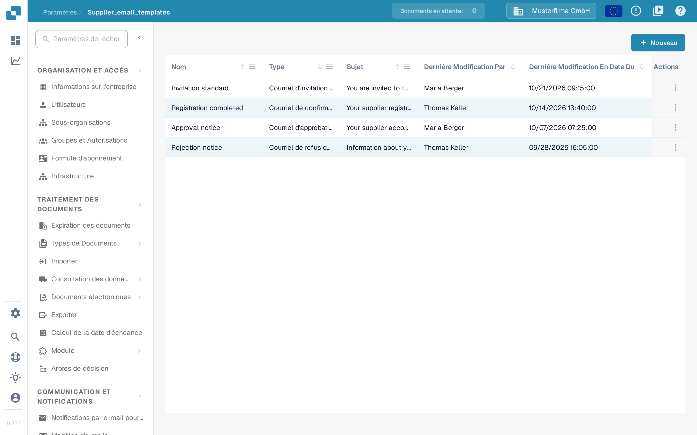
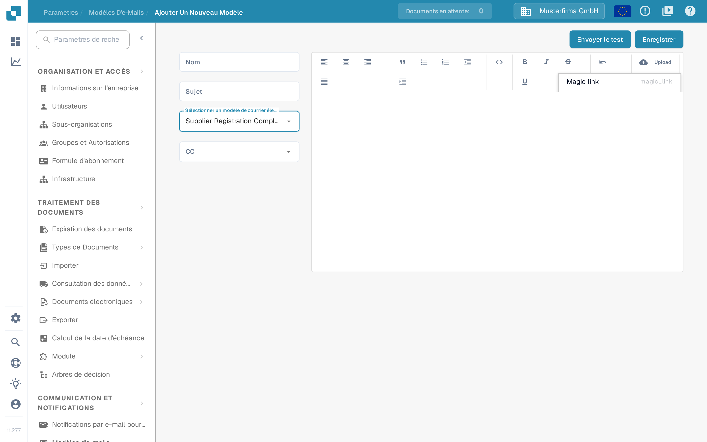

# Modification des modèles d'e-mails

<figure><figcaption><p>Liste des modèles de courriel fournisseur</p></figcaption></figure>

La page **Modèles d'e-mails**, sous **Paramètres → Paramètres du fournisseur → Modèles d'e-mails**, permet aux administrateurs de concevoir les e-mails que DocBits envoie automatiquement aux fournisseurs. Chaque modèle est affecté à l'un des quatre types d'e-mail fixes, afin que le bon message parte toujours lorsqu'un fournisseur est invité, termine son inscription, ou voit son compte approuvé ou refusé dans le portail fournisseurs.

> Sous **Communication et notifications** se trouve une autre entrée portant le même nom, **Modèles d'e-mails**. Cette page contient les [notifications des événements de documents internes](../global-settings/email-notification/README.md) et non les e-mails destinés aux fournisseurs. Pour les e-mails fournisseurs, ouvrez toujours l'entrée de **Paramètres du fournisseur**.

L'accès nécessite un compte administrateur. Consultez [Autorisations fournisseur](supplier-permissions.md) pour connaître les rôles attribués aux fournisseurs eux-mêmes.

L'icône en forme de point d'interrogation dans la barre supérieure ouvre la page d'aide correspondant à l'écran affiché ; consultez [Icônes d'aide](../../../end-user-and-partner-section/end-user-section/technical-support-in-docbits/help-icons.md) pour savoir comment elle fonctionne.

## Liste des modèles

La liste affiche une ligne par modèle avec les colonnes suivantes :

| Colonne | Description |
|---------|-------------|
| **Nom** | Le nom interne du modèle. |
| **Type** | Le type d'e-mail auquel le modèle sert, par exemple « Courriel d'invitation des fournisseurs ». |
| **Sujet** | La ligne d'objet que voient les destinataires. |
| **Dernière Modification Par** | L'utilisateur qui a modifié le modèle en dernier. |
| **Dernière Modification En Date Du** | La date de la dernière modification du modèle. |

Vous pouvez trier la liste par n'importe quelle colonne. Les colonnes **Nom**, **Type** et **Sujet** proposent en plus un filtre dans le menu de la colonne ; les filtres actifs apparaissent sous forme d'étiquettes supprimables au-dessus du tableau. Vous pouvez également faire glisser les en-têtes de colonnes pour les placer dans l'ordre de votre choix, et DocBits conserve cet ordre lors de votre prochaine visite.

**Actions de ligne** : chaque ligne dispose d'un menu à trois points dans la dernière colonne, avec l'action **Éditer**, qui ouvre le modèle dans l'éditeur, et l'action **Supprimer**, qui supprime le modèle après une boîte de dialogue de confirmation. Un clic n'importe où dans une ligne ouvre également le modèle pour le modifier.

**Nouveau** : le bouton **Nouveau**, au-dessus du tableau, crée un modèle.

## Créer ou modifier un modèle

<figure><figcaption><p>Création d'un nouveau modèle de courriel fournisseur</p></figcaption></figure>

Cliquez sur **Nouveau** (ou sur **Éditer** dans un modèle existant) pour ouvrir l'éditeur de modèle :

1. **Nom** — saisissez un nom interne pour le modèle. Ce nom apparaît dans la liste, pas dans l'e-mail.
2. **Sujet** — saisissez la ligne d'objet de l'e-mail. Vous pouvez utiliser des placeholders comme `{{supplier_name}}`.
3. **Sélectionner un modèle de courrier électronique** — choisissez le type d'e-mail. Il existe exactement quatre types :
   * **Courriel d'invitation des fournisseurs** — envoyé lorsque vous invitez un fournisseur sur le portail fournisseurs.
   * **Courriel de confirmation d'inscription du fournisseur** — envoyé lorsqu'un fournisseur termine son inscription.
   * **Courriel d'approbation du fournisseur** — envoyé lorsque le compte du fournisseur est approuvé.
   * **Courriel de refus du fournisseur** — envoyé lorsque le compte du fournisseur est refusé.

   Le type d'un modèle existant ne peut plus être modifié ensuite ; le champ est en lecture seule pendant la modification. Créez dans ce cas un nouveau modèle.
4. **CC** — sélectionnez éventuellement qui d'autre reçoit une copie : **Utilisateur assigné** (l'utilisateur responsable du fournisseur) et/ou **Referrer** (la personne qui a invité le fournisseur). Laissez le champ vide pour n'envoyer qu'au fournisseur.
5. Concevez le corps de l'e-mail dans l'éditeur de texte enrichi à droite. Vous pouvez mettre le texte en forme, insérer des listes et des citations et aligner le contenu. Le bouton **Upload** de la barre d'outils insère une image importée directement dans l'e-mail ; tout autre fichier importé y est inséré sous forme de lien. L'icône de code bascule vers la vue du code HTML, où vous pouvez modifier et mettre en forme directement le HTML sous-jacent.
6. **Placeholders** : le menu des propriétés de la barre d'outils insère les placeholders disponibles pour le type d'e-mail sélectionné, par exemple « Magic link » (`{{magic_link}}`) et « Supplier name » (`{{supplier_name}}`).
7. Cliquez sur **Enregistrer** pour enregistrer le modèle.

> Dans cette version, certains libellés de l'éditeur restent en anglais : la liste déroulante des types affiche les quatre noms en anglais, l'option **Referrer** de **CC** n'est pas traduite, la barre d'outils utilise **Upload** et le fil d'Ariane de la liste affiche « Supplier_email_templates ». La capture montre l'interface sans modification ; les noms de type traduits sont ceux qui apparaissent dans la colonne **Type** de la liste.

### Le placeholder `{{magic_link}}`

Le placeholder `{{magic_link}}` est remplacé par une URL de connexion unique lors de l'envoi de l'e-mail. Il conduit le destinataire vers une action du portail fournisseurs, par exemple la fin de son inscription. Pour en faire un bouton cliquable, mettez-le en forme comme lien dans la vue du code HTML :

```html
<a href="{{magic_link}}" target="_blank" style="
    background-color: #B7184B;
    border-radius: 25px;
    font-family: 'Montserrat', Arial, sans-serif;
    font-size: 14px;
    font-weight: bold;
    padding: 12px 25px;
    color: #FFFFFF;
    text-decoration: none;
    display: inline-block;
    cursor: pointer;">
    Terminer l'inscription
</a>
```

Adaptez le texte entre les balises `<a>` et `</a>` pour indiquer au destinataire ce qu'il doit faire, par exemple « Terminer l'inscription » ou « Accéder à votre compte ».

## Envoyer un e-mail de test

Avant de mettre un modèle en service, vérifiez son rendu :

1. Cliquez sur **Envoyer le test** dans le coin supérieur droit de l'éditeur.
2. Saisissez dans **Courriel du destinataire** l'adresse à laquelle l'e-mail de test doit être envoyé.
3. Pour chaque placeholder du type choisi, DocBits affiche un champ de saisie distinct, par exemple « Magic link » et « Supplier name » ; saisissez-y une valeur d'exemple. L'icône de copie du champ copie le placeholder lui-même (`{{magic_link}}`), que vous pouvez coller directement dans le modèle.
4. Cliquez sur **Envoyer**. DocBits envoie l'e-mail avec les valeurs d'exemple afin que vous puissiez vérifier la mise en page, le remplacement des placeholders et le lien magique.

L'e-mail de test ne part vers aucun fournisseur et ne modifie aucune donnée.

## Pages associées

* [Notification par e-mail](../global-settings/email-notification/README.md) — notifications des événements de documents internes
* [Paramètres généraux des fournisseurs](supplier-general-settings.md)
* [Autorisations fournisseur](supplier-permissions.md)
* [Portail fournisseurs](../../setup/supplier-portal/README.md) — activer le portail et inviter des fournisseurs
