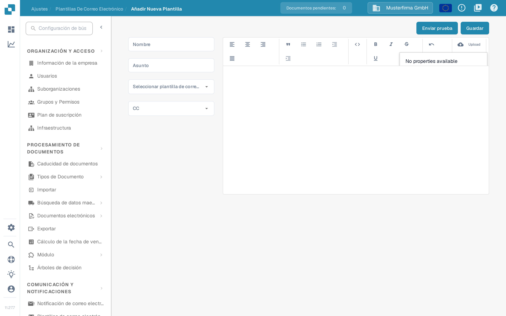

# Edición de plantillas de correo electrónico

<figure><figcaption><p>Lista de plantillas de correo electrónico para proveedores</p></figcaption></figure>

La página **Plantillas de correo electrónico**, en **Ajustes → Configuración del proveedor → Plantillas de correo electrónico**, permite a los administradores diseñar los correos que DocBits envía automáticamente a los proveedores. Cada plantilla se asigna a uno de los cuatro tipos de correo fijos, de modo que siempre sale el mensaje correcto cuando se invita a un proveedor, cuando completa su registro o cuando su cuenta se aprueba o se rechaza en el portal de proveedores.

> Bajo **Comunicación y notificaciones** existe otra entrada con el mismo nombre, **Plantillas de correo electrónico**. Esa página contiene las [notificaciones de eventos de documentos internos](../global-settings/email-notification/README.md) y no los correos dirigidos a proveedores. Para los correos de proveedores, abra siempre la entrada de **Configuración del proveedor**.

El acceso requiere una cuenta de administrador. Consulte [Permisos del Proveedor](supplier-permissions.md) para conocer los roles que reciben los propios proveedores.

El icono de interrogación de la barra superior abre la página de ayuda correspondiente a la pantalla actual; consulte [Iconos de ayuda](../../../end-user-and-partner-section/end-user-section/technical-support-in-docbits/help-icons.md) para saber cómo funciona.

## Lista de plantillas

La lista muestra una fila por plantilla con estas columnas:

| Columna | Descripción |
|---------|-------------|
| **Nombre** | El nombre interno de la plantilla. |
| **Tipo** | El tipo de correo para el que se usa la plantilla, por ejemplo «Correo electrónico de invitación para proveedores». |
| **Asunto** | La línea de asunto que ven los destinatarios. |
| **Última Modificación Por** | El usuario que editó la plantilla por última vez. |
| **Fecha De Última Modificación** | Cuándo se cambió la plantilla por última vez. |

Puede ordenar la lista por cualquier columna. Las columnas **Nombre**, **Tipo** y **Asunto** ofrecen además un filtro en el menú de la columna; los filtros activos aparecen como etiquetas que puede quitar encima de la tabla. También puede arrastrar los encabezados de las columnas para ponerlas en el orden que prefiera, y DocBits recuerda ese orden en su próxima visita.

**Acciones de fila**: cada fila tiene la acción **Editar** (el icono de lápiz de la última columna), que abre la plantilla en el editor, y la acción **Borrar** (el icono de papelera), que elimina la plantilla después de un diálogo de confirmación. Si hace clic en cualquier punto de una fila, la plantilla también se abre para editarla.

**Nuevo**: el botón **Nuevo**, encima de la tabla, crea una plantilla.

## Crear o editar una plantilla

<figure><figcaption><p>Creación de una nueva plantilla de correo para proveedores</p></figcaption></figure>

Haga clic en **Nuevo** (o en **Editar** en una plantilla existente) para abrir el editor de plantillas:

1. **Nombre** — introduzca un nombre interno para la plantilla. Este nombre aparece en la lista, no en el correo.
2. **Asunto** — introduzca la línea de asunto del correo. Puede usar marcadores como `{{supplier_name}}`.
3. **Seleccionar plantilla de correo electrónico** — elija el tipo de correo. Hay exactamente cuatro tipos:
   * **Correo electrónico de invitación para proveedores** — se envía cuando invita a un proveedor al portal de proveedores.
   * **Correo electrónico de finalización del registro del proveedor** — se envía cuando un proveedor completa su registro.
   * **Correo electrónico de aprobación del proveedor** — se envía cuando se aprueba la cuenta del proveedor.
   * **Correo electrónico de rechazo del proveedor** — se envía cuando se rechaza la cuenta del proveedor.

   El tipo de una plantilla existente no se puede cambiar después; el campo es de solo lectura mientras edita. En ese caso, cree una plantilla nueva.
4. **CC** — seleccione opcionalmente quién más recibe una copia: **Usuario asignado** (el usuario responsable del proveedor) y/o **Referrer** (la persona que invitó al proveedor; esta etiqueta sigue en inglés en esta versión). Déjelo vacío para enviar solo al proveedor.
5. Diseñe el cuerpo del correo en el editor de texto enriquecido de la derecha. Puede dar formato al texto, insertar listas y citas y alinear el contenido. El botón **Upload** de la barra de herramientas inserta una imagen subida directamente en el correo o adjunta otros archivos como enlace. El icono de código cambia a la vista del código HTML, donde puede editar y dar formato directamente al HTML subyacente.
6. **Marcadores**: el menú de propiedades de la barra de herramientas inserta los marcadores disponibles para el tipo de correo seleccionado, por ejemplo `{{magic_link}}` y `{{supplier_name}}`.
7. Haga clic en **Guardar** para almacenar la plantilla.

> En esta versión, algunos textos del editor siguen en inglés: la lista desplegable de tipos muestra los cuatro nombres en inglés, la opción **Referrer** de **CC** no está traducida y la barra de herramientas usa **Upload**. La captura muestra la interfaz sin modificar; los nombres de tipo traducidos son los que aparecen en la columna **Tipo** de la lista.

### El marcador `{{magic_link}}`

El marcador `{{magic_link}}` se sustituye por una URL de inicio de sesión única cuando se envía el correo. Lleva al destinatario a una acción del portal de proveedores, por ejemplo a completar su registro. Para convertirlo en un botón en el que se pueda hacer clic, dele formato de enlace en la vista del código HTML:

```html
<a href="{{magic_link}}" target="_blank" style="
    background-color: #B7184B;
    border-radius: 25px;
    font-family: 'Montserrat', Arial, sans-serif;
    font-size: 14px;
    font-weight: bold;
    padding: 12px 25px;
    color: #FFFFFF;
    text-decoration: none;
    display: inline-block;
    cursor: pointer;">
    Completar el registro
</a>
```

Ajuste el texto entre las etiquetas `<a>` y `</a>` para indicar al destinatario qué debe hacer, por ejemplo «Completar el registro» o «Acceder a su cuenta».

## Enviar un correo de prueba

Antes de empezar a usar una plantilla, compruebe cómo se ve:

1. Haga clic en **Enviar prueba** en la esquina superior derecha del editor.
2. Introduzca en **Correo electrónico del receptor** la dirección a la que debe llegar el correo de prueba.
3. Rellene los valores de ejemplo que se muestran para los marcadores (por ejemplo, un nombre de proveedor y un enlace de ejemplo).
4. Haga clic en **Enviar**. DocBits envía el correo con los valores de ejemplo para que pueda comprobar el diseño, la sustitución de los marcadores y el magic link.

El correo de prueba no se envía a ningún proveedor y no modifica ningún dato.

## Páginas relacionadas

* [Notificación por correo electrónico](../global-settings/email-notification/README.md) — notificaciones de eventos de documentos internos
* [Ajustes generales de proveedores](supplier-general-settings.md)
* [Permisos del Proveedor](supplier-permissions.md)
* [Portal de proveedores](../../setup/supplier-portal/README.md) — activar el portal e invitar a proveedores
