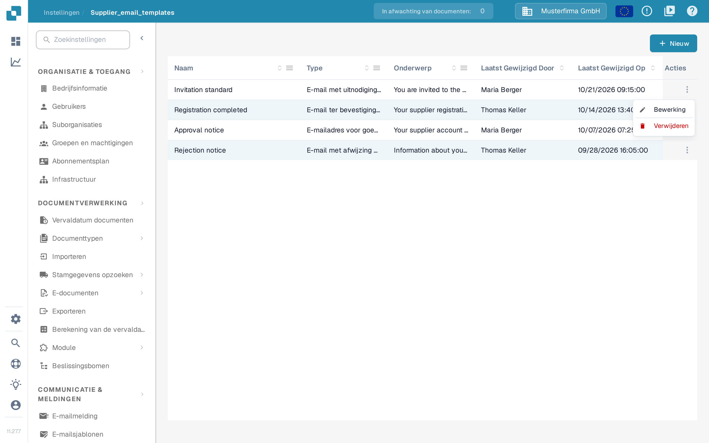
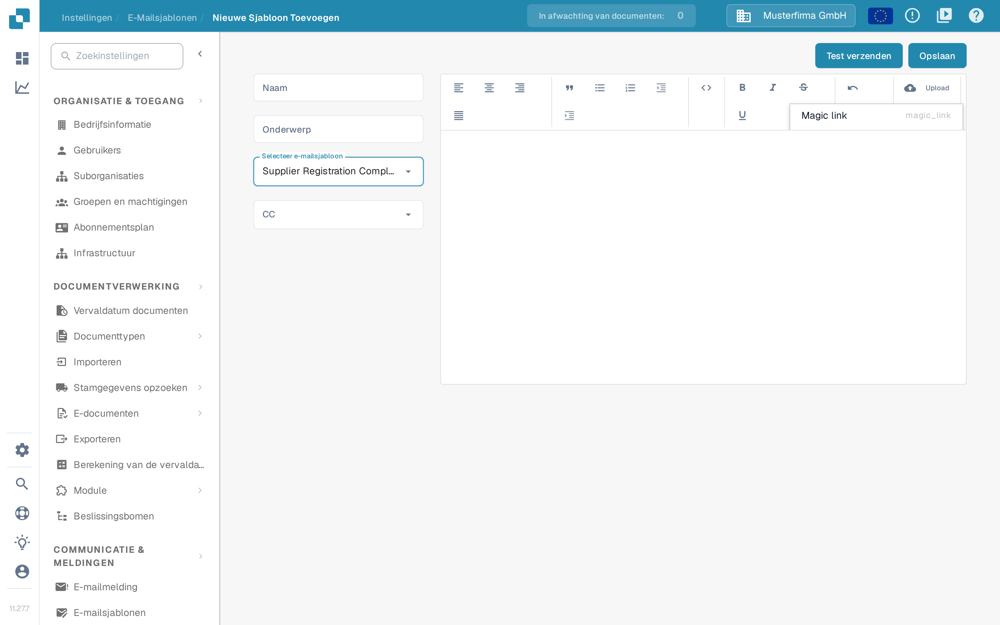

# E-mailsjablonen bewerken

<figure><figcaption><p>Lijst met e-mailsjablonen voor leveranciers</p></figcaption></figure>

De pagina **E-mailsjablonen** in de leveranciersinstellingen (**Instellingen → E-Mailsjablonen**) laat beheerders de e-mails ontwerpen die DocBits automatisch naar leveranciers verstuurt. Elk sjabloon hoort bij één van de vier vaste e-mailtypen, zodat altijd het juiste bericht uitgaat wanneer een leverancier wordt uitgenodigd, zijn registratie afrondt, of in het leveranciersportaal wordt goedgekeurd of afgewezen.

> Onder **Communicatie & meldingen** staat nog een item met dezelfde naam, **E-mailsjablonen**. Die pagina bevat de [e-mailmeldingen](../global-settings/email-notification/README.md) over interne documentgebeurtenissen, niet de e-mails voor leveranciers. Gebruik voor leverancierssjablonen altijd de pagina in de leveranciersinstellingen.

Toegang vereist een beheerdersaccount. Zie [Leveranciersmachtigingen](supplier-permissions.md) voor de rollen die leveranciers zelf krijgen.

## Lijst met sjablonen

De lijst toont één rij per sjabloon met deze kolommen:

| Kolom | Beschrijving |
|-------|--------------|
| **Naam** | De interne naam van het sjabloon. |
| **Type** | Het e-mailtype waarvoor het sjabloon wordt gebruikt, bijvoorbeeld E-mail met uitnodiging voor leveranciers. |
| **Onderwerp** | De onderwerpregel die ontvangers zien. |
| **Laatst Gewijzigd Door** | De gebruiker die het sjabloon het laatst heeft bewerkt. |
| **Laatst Gewijzigd Op** | Wanneer het sjabloon voor het laatst is gewijzigd. |

U kunt de lijst op elke kolom sorteren. De kolommen **Naam**, **Type** en **Onderwerp** bieden via hun kolommenu bovendien een filter; actieve filters verschijnen als verwijderbare labels boven de tabel. U kunt kolomkoppen in de gewenste volgorde slepen en die volgorde wordt bij uw volgende bezoek onthouden.

**Rijacties**: elke rij heeft in de laatste kolom een menu met drie puntjes, met de actie **Bewerking**, die het sjabloon in de editor opent, en de actie **Verwijderen**, die het sjabloon na een bevestigingsvenster verwijdert. Een klik ergens in een rij opent het sjabloon ook om het te bewerken.

<figure><figcaption><p>Rijmenu met de acties Bewerking en Verwijderen</p></figcaption></figure>

**Nieuw**: met de knop **Nieuw** boven de tabel maakt u een sjabloon aan.

## Een sjabloon maken of bewerken

<figure><figcaption><p>Een nieuw e-mailsjabloon voor leveranciers maken</p></figcaption></figure>

Klik op **Nieuw** (of op **Bewerking** bij een bestaand sjabloon) om de sjablooneditor te openen:

1. **Naam** — voer een interne naam voor het sjabloon in. Deze naam verschijnt in de lijst en niet in de e-mail.
2. **Onderwerp** — voer de onderwerpregel van de e-mail in. U kunt plaatsaanduidingen zoals `{{supplier_name}}` gebruiken.
3. **Selecteer e-mailsjabloon** — kies het e-mailtype. Er zijn precies vier typen:
   * **Supplier Invitation Email** — wordt verstuurd wanneer u een leverancier voor het leveranciersportaal uitnodigt.
   * **Supplier Registration Completion Email** — wordt verstuurd wanneer een leverancier zijn registratie afrondt.
   * **Supplier Approval Email** — wordt verstuurd wanneer het account van de leverancier wordt goedgekeurd.
   * **Supplier Rejection Email** — wordt verstuurd wanneer het account van de leverancier wordt afgewezen.

   Het type van een bestaand sjabloon kan later niet meer worden gewijzigd; het veld is tijdens het bewerken alleen-lezen. Maak in dat geval een nieuw sjabloon aan.
4. **CC** — selecteer eventueel wie ook een kopie ontvangt: **Toegewezen gebruiker** (de gebruiker die verantwoordelijk is voor de leverancier) en/of **Referrer** (de gebruiker die de leverancier heeft uitgenodigd). Laat het veld leeg om alleen naar de leverancier te versturen.
5. Ontwerp de inhoud van de e-mail in de rich-text editor aan de rechterkant. U kunt tekst opmaken, lijsten en citaten invoegen en de inhoud uitlijnen. Met de knop **Upload** in de werkbalk voegt u een geüpload bestand als afbeelding direct in de e-mail in of als link bij de e-mail. Het pictogram met de hoekhaken schakelt naar de HTML-bronweergave, waarin u de onderliggende HTML rechtstreeks kunt bewerken en opmaken.
6. **Plaatsaanduidingen**: het eigenschappenmenu in de werkbalk voegt de beschikbare plaatsaanduidingen voor het gekozen e-mailtype in, bijvoorbeeld **Magic link** (`{{magic_link}}`) en **Supplier name** (`{{supplier_name}}`).
7. Klik op **Opslaan** om het sjabloon te bewaren.

> In deze versie blijven enkele labels in de editor Engels: de keuzelijst met typen toont de vier namen in het Engels, de CC-optie **Referrer** is niet vertaald, de werkbalk gebruikt **Upload**, de plaatsaanduidingen heten **Magic link** en **Supplier name**, en het kruimelpad van de lijst toont de niet-vertaalde naam **Supplier_email_templates**. De opname toont de interface zonder aanpassingen; de vertaalde typenamen zijn de namen die in de kolom **Type** van de lijst verschijnen.

### De plaatsaanduiding `{{magic_link}}`

De plaatsaanduiding `{{magic_link}}` wordt bij het versturen van de e-mail vervangen door een unieke aanmeldings-URL. Die brengt de ontvanger naar een actie in het leveranciersportaal, bijvoorbeeld het afronden van zijn registratie. Om er een klikbare knop van te maken, maakt u er in de HTML-bronweergave een link van:

```html
<a href="{{magic_link}}" target="_blank" style="
    background-color: #B7184B;
    border-radius: 25px;
    font-family: 'Montserrat', Arial, sans-serif;
    font-size: 14px;
    font-weight: bold;
    padding: 12px 25px;
    color: #FFFFFF;
    text-decoration: none;
    display: inline-block;
    cursor: pointer;">
    Registratie voltooien
</a>
```

Pas de tekst tussen de tags `<a>` en `</a>` aan zodat de ontvanger ziet wat hij moet doen, bijvoorbeeld "Registratie voltooien" of "Uw account openen".

## Een test-e-mail versturen

Controleer voordat u een sjabloon in gebruik neemt hoe het eruitziet:

1. Klik op **Test verzenden** rechtsboven in de editor.
2. Voer bij **E-mail van de ontvanger** het adres in waarnaar de test-e-mail moet gaan.
3. Vul voor elke plaatsaanduiding van het gekozen type een voorbeeldwaarde in; DocBits toont daarvoor aparte velden, bijvoorbeeld **Magic link** en **Supplier name**. Met het kopieerpictogram in het veld kopieert u de plaatsaanduiding zelf (`{{magic_link}}`), zodat u die rechtstreeks in het sjabloon kunt plakken.
4. Klik op **Versturen**. DocBits verstuurt de e-mail met de voorbeeldwaarden, zodat u de opmaak, de vervanging van de plaatsaanduidingen en de magic link kunt controleren. Met **Annuleren** sluit u het venster zonder iets te versturen.

De test-e-mail gaat naar geen enkele leverancier en wijzigt geen gegevens.

## Gerelateerde pagina's

* [E-mailmelding](../global-settings/email-notification/README.md) — meldingen over interne documentgebeurtenissen
* [Leverancier Algemene Instellingen](supplier-general-settings.md)
* [Leveranciersmachtigingen](supplier-permissions.md)
* [Leveranciersportaal](../../setup/supplier-portal/README.md) — het portaal activeren en leveranciers uitnodigen
