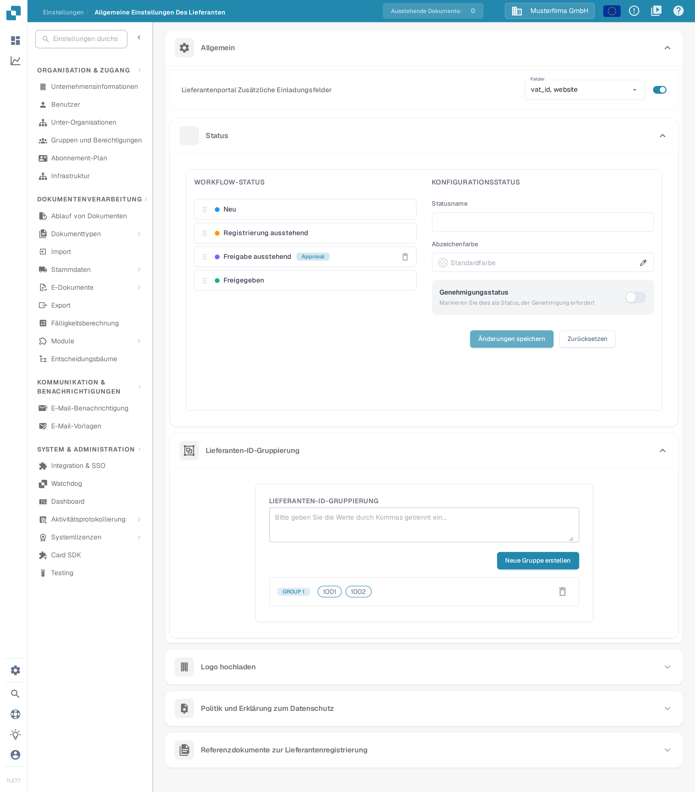

# Allgemeine Lieferanteneinstellungen

<figure><figcaption>
Seite Allgemeine Einstellungen Des Lieferanten. Von oben nach unten: Allgemein (Zusätzliche Einladungsfelder, Status, Lieferanten-ID-Gruppierung), Logo hochladen, Politik und Erklärung zum Datenschutz und Referenzdokumente zur Lieferantenregistrierung.
</figcaption></figure>

### Übersicht

Die Seite **Allgemeine Einstellungen Des Lieferanten** legt fest, wie das Lieferantenportal für Ihre Lieferanten aussieht und sich verhält. Sie enthält sechs Bereiche:

* **Allgemein** – drei Module, die den Ablauf der Lieferantenregistrierung bestimmen:
  * **Lieferantenportal Zusätzliche Einladungsfelder**: zusätzliche Felder im Registrierungsformular für Lieferanten.
  * **Status**: die Workflow-Status, die ein Lieferant durchlaufen kann, und wer jeweils genehmigen darf.
  * **Lieferanten-ID-Gruppierung**: mehrere Lieferanten-IDs zu einem Lieferanten zusammenfassen.
* **Logo hochladen** – das Firmenlogo im Lieferantenportal und in Einladungs-E-Mails.
* **Politik und Erklärung zum Datenschutz** – die rechtlichen Dokumente, die Lieferanten akzeptieren müssen.
* **Referenzdokumente zur Lieferantenregistrierung** – Referenzdokumente, die Lieferanten bei der Registrierung einsehen können.

Die Bereiche wirken erst, wenn das Modul **Lieferantenportal** aktiviert ist; wie Sie es aktivieren, lesen Sie unter [Lieferantenportal](../../setup/supplier-portal/README.md).

### Lieferantenportal Zusätzliche Einladungsfelder

Standardmäßig registrieren sich Lieferanten mit den Standardfeldern des Lieferantenlayouts. Dieser Bereich lässt Sie bei der Registrierung zusätzlich Felder aus Ihren Lieferantenstammdaten abfragen (zum Beispiel **USt-IdNr.**, **Webseite**, **IBAN** oder **Ansprechpartner**).

1. Schalten Sie den Schalter **Lieferantenportal Zusätzliche Einladungsfelder** ein.
2. Wählen Sie im Drop-down **Felder** ein oder mehrere Felder aus. Die Liste enthält die Felder, die für den Stammdatentyp Lieferant definiert sind; ist sie leer, wurden die Lieferantenstammdaten in Ihrer Organisation noch nicht eingerichtet.
3. Die Auswahl wird automatisch gespeichert. Eingeladene Lieferanten sehen die ausgewählten Felder anschließend im Registrierungsformular.

### Status

Der Bereich **Status** legt den Ablauf fest, den eine Lieferantenregistrierung durchläuft. Die linke Spalte **Workflow-Status** listet alle Status in ihrer Reihenfolge; rechts konfigurieren Sie den ausgewählten Status unter **Konfigurationsstatus**. Wie sich Aktivierung, Einladung, Registrierung und Freigabe unterscheiden, lesen Sie unter [Lieferantenportal – Zugang und Status einordnen](../../setup/supplier-portal/README.md#zugang-und-status-richtig-einordnen).

* **Status umsortieren**: Ziehen Sie einen Status am Griff links. Die neue Reihenfolge wird automatisch gespeichert.
* **Status auswählen**: Klicken Sie in der Liste auf einen Status, um ihn in den rechten Bereich zu laden. Vordefinierte Status sind gesperrt: Name und Freigabeeinstellungen lassen sich nicht ändern, und sie können nicht gelöscht werden.
* **Statusname**: Tippen Sie einen Namen ein, um einen neuen eigenen Status anzulegen (wenn keiner ausgewählt ist) oder den ausgewählten eigenen Status umzubenennen.
* **Genehmigungsstatus**: Schalten Sie **Markieren Sie dies als Status, der Genehmigung erfordert** ein, wenn ein Lieferant diesen Status nur nach einer ausdrücklichen Genehmigung verlassen darf. Der Status trägt dann in der Liste das Abzeichen *Approval*.
* **Wer kann die Genehmigung erteilen?**: Sobald ein Status eine Genehmigung erfordert, legen Sie fest, wer sie erteilen darf – **Administrator**, **Empfehlungsgeber** (die Person, die den Lieferanten empfohlen hat), **Zugewiesener Benutzer** und beliebig viele **Benutzergruppen**.
* **Änderungen speichern** übernimmt den ausgewählten Status; **Zurücksetzen** leert das Formular.
* **Eigenen Status löschen**: Klicken Sie auf das Papierkorb-Symbol daneben und bestätigen Sie. Vordefinierte Status lassen sich nicht löschen.

### Lieferanten-ID-Gruppierung

Nutzen Sie die **Lieferanten-ID-Gruppierung**, wenn derselbe Lieferant in Ihrem System unter mehreren Lieferanten-IDs geführt wird (zum Beispiel nach einer Fusion oder über mehrere Werke hinweg). Alle IDs einer Gruppe werden im Lieferantenportal als ein Lieferant behandelt.

1. Geben Sie im Eingabefeld die Lieferanten-IDs durch Kommas getrennt ein (zum Beispiel `1001, 1002`).
2. Klicken Sie auf **Neue Gruppe erstellen**. Eine Gruppe braucht mindestens zwei IDs; andernfalls erscheint ein Hinweis und es wird keine Gruppe angelegt.
3. Jede Gruppe erscheint als Zeile mit ID-Chips, beschriftet mit **GROUP 1**, **GROUP 2** und so weiter. Anlegen und Löschen wirken sofort.
4. **Gruppe bearbeiten**: Klicken Sie auf die Zeile, passen Sie die kommagetrennte Liste an und klicken Sie auf **Speichern** (oder **Abbrechen**, um zu verwerfen).
5. **Gruppe löschen**: Klicken Sie auf das Papierkorb-Symbol am Ende der Zeile.

### Logo hochladen

#### Zweck

Mit der Funktion **Logo hochladen** können Administratoren das Lieferantenportal anpassen, indem sie das Logo ihres Unternehmens hochladen. Das stärkt die Markenwahrnehmung und sorgt für ein einheitliches visuelles Erscheinungsbild für Benutzer, die auf das Portal zugreifen.

#### Schritte zum Hochladen eines Logos

1. **Allgemeine Lieferanteneinstellungen öffnen**:
   * Navigieren Sie im Hauptmenü zum Bereich **Allgemeine Einstellungen Des Lieferanten**.
2. **Bereich „Logo hochladen“ suchen**:
   * Scrollen Sie auf der Einstellungsseite nach unten zum Bereich **Logo hochladen**.
3. **Neues Logo hochladen**:
   * Klicken Sie auf den Bereich **Logo hochladen**, um den Dialog zur Dateiauswahl zu öffnen.
   * Wählen Sie die Bilddatei aus, die Sie hochladen möchten. Unterstützt werden in der Regel die Formate `.png`, `.jpg` oder `.jpeg`.
   * Das hochgeladene Logo wird im Vorschaubereich angezeigt.
4. **Hochgeladenes Logo speichern**:
   * Klicken Sie nach dem Hochladen des Logos auf die Schaltfläche **Speichern**, um die Änderungen zu übernehmen.
   * Das neue Logo wird nun im gesamten Lieferantenportal angezeigt.

#### Bewährte Vorgehensweisen

* **Logo-Abmessungen**: Stellen Sie sicher, dass die Abmessungen des Logos sowohl für die Desktop- als auch für die mobile Ansicht optimiert sind. Das System bietet möglicherweise Richtlinien oder eine automatische Größenanpassung.
* **Dateigröße**: Verwenden Sie eine komprimierte Bilddatei, um die Ladezeiten zu verkürzen und die Benutzerfreundlichkeit zu verbessern.
* **Markenkonsistenz**: Verwenden Sie auf allen Plattformen dasselbe Logo, um eine einheitliche Markenidentität zu wahren.

### Politik und Erklärung zum Datenschutz

#### Zweck

Im Bereich **Politik und Erklärung zum Datenschutz** können Administratoren die rechtlichen Dokumente hochladen oder festlegen, die die Nutzung des Lieferantenportals regeln. Diese Dokumente sind für die Einhaltung gesetzlicher und regulatorischer Anforderungen unverzichtbar und enthalten die Nutzungsbedingungen, Datenschutzrichtlinien und weitere wesentliche Informationen für Benutzer.

#### Schritte zum Hochladen der Richtlinien- und Datenschutzerklärung

1. **Allgemeine Lieferanteneinstellungen öffnen**:
   * Navigieren Sie im Hauptmenü zum Bereich **Allgemeine Einstellungen Des Lieferanten**.
2. **Bereich „Politik und Erklärung zum Datenschutz“ suchen**:
   * Scrollen Sie nach unten zum Bereich **Politik und Erklärung zum Datenschutz**.
3. **Dokumente hochladen oder aktualisieren**:
   * Klicken Sie auf die Schaltfläche **Dokument hochladen**, um die relevanten Dateien auszuwählen. Solange kein Dokument hinterlegt ist, zeigt der Bereich den Hinweis **Sie müssen ein Dokument mit einer Grundsatzerklärung hochladen.**
   * Wählen Sie die Dokumentdatei aus Ihrem lokalen Speicher aus. Unterstützt werden in der Regel die Formate `.pdf`, `.docx` oder `.txt`.
   * Hochgeladene Dokumente werden in diesem Bereich zur Überprüfung aufgelistet.
4. **Änderungen speichern**:
   * Klicken Sie nach dem Hochladen oder Aktualisieren der Dokumente auf die Schaltfläche **Speichern**, damit die neuen Richtlinien übernommen werden.

#### Bewährte Vorgehensweisen

* **Regelmäßige Aktualisierung**: Prüfen und aktualisieren Sie die Richtlinien- und Datenschutzerklärung regelmäßig, damit sie den aktuellen gesetzlichen Anforderungen und Unternehmensrichtlinien entspricht.
* **Klarheit und Zugänglichkeit**: Stellen Sie sicher, dass die hochgeladenen Dokumente klar, präzise und für alle Benutzer zugänglich sind. Erwägen Sie Übersetzungen, wenn Ihr Lieferantenstamm international ist.
* **Rechtliche Prüfung**: Lassen Sie alle Dokumente vor dem Hochladen von einer Rechtsberatung prüfen, um die Einhaltung der einschlägigen Gesetze und Vorschriften sicherzustellen.

### Referenzdokumente zur Lieferantenregistrierung

Dieser Bereich enthält Dokumente, die Lieferanten bei der Registrierung unterstützen – zum Beispiel ein Formular zur Umsatzsteuer-Registrierung oder eine Vorlage der Gewerbeanmeldung. Hochgeladene Dokumente stehen in einer Tabelle mit den Spalten **Name** und **Datei Typ**.

* **Upload**: Klicken Sie auf **Upload** und wählen Sie die Datei. Sie erscheint in der Tabelle, sobald der Upload abgeschlossen ist.
* **Vorschau**: Klicken Sie auf das Augen-Symbol neben einem Dokumentnamen, um das Dokument in einem Vorschaufenster zu öffnen.
* **Link kopieren**: Wählen Sie in der Spalte **Aktionen** die Aktion **Kopieren**, um einen Link auf das Dokument in die Zwischenablage zu kopieren, zum Beispiel um ihn in eigene Anleitungen aufzunehmen.
* **Löschen**: Wählen Sie in der Spalte **Aktionen** die Aktion **Löschen** und bestätigen Sie die Rückfrage.
