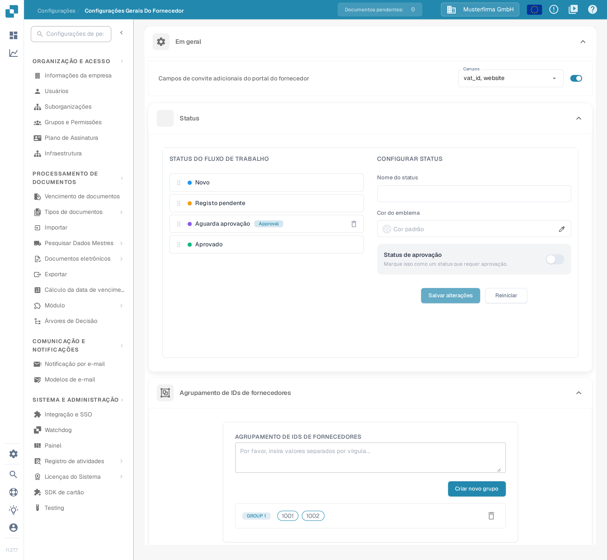
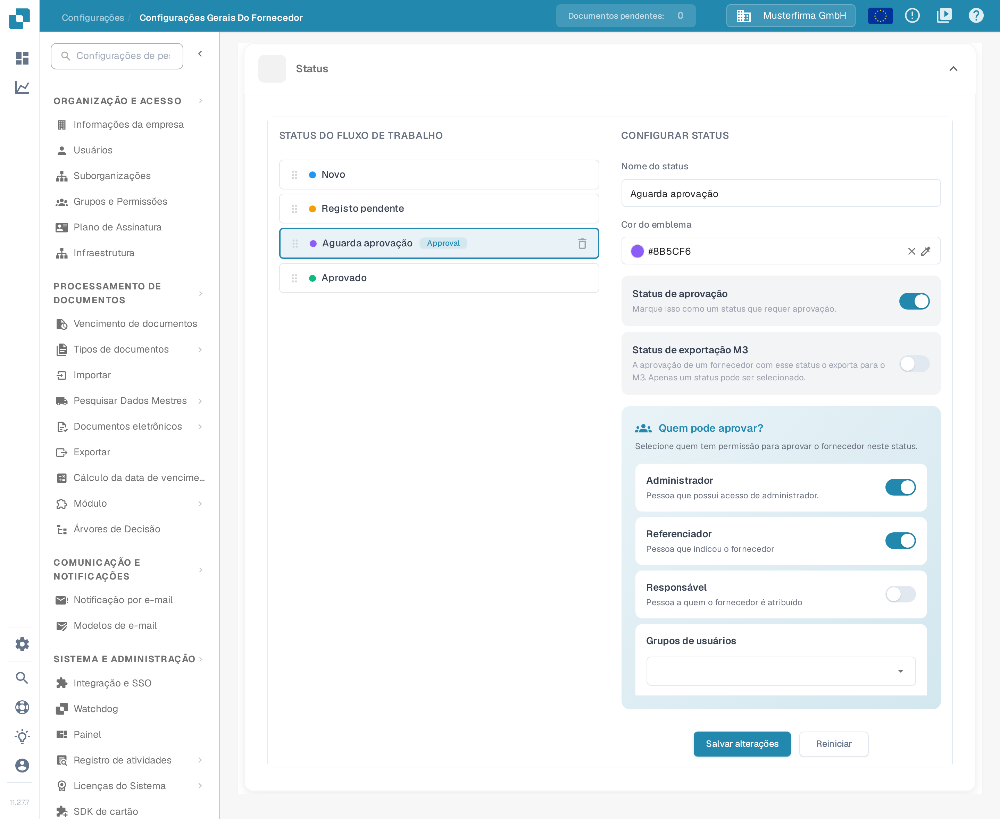
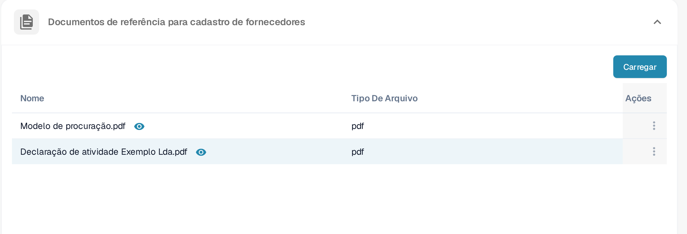

# Configurações Gerais do Fornecedor

<figure><figcaption>
Página <strong>Configurações Gerais do Fornecedor</strong>. Na moldura, de cima para baixo: a secção <strong>Em geral</strong> com o campo <strong>Campos de convite adicionais do portal do fornecedor</strong>, seguida de <strong>Status</strong> e <strong>Agrupamento de IDs de fornecedores</strong>. As secções <strong>Carregar logotipo</strong>, <strong>Declaração de Política e Privacidade</strong> e <strong>Documentos de referência para cadastro de fornecedores</strong> ficam mais abaixo, na mesma página.
</figcaption></figure>

### Visão Geral

A página **Configurações Gerais do Fornecedor** (Configurações → Configurações Gerais do Fornecedor) define o aspeto e o comportamento do portal do fornecedor. Contém seis secções:

* **Em geral** — três módulos que moldam o processo de registo do fornecedor:
  * **Campos de convite adicionais do portal do fornecedor**: acrescenta campos adicionais ao formulário de registo do fornecedor.
  * **Status**: define os status do fluxo de trabalho pelos quais um fornecedor passa e quem pode aprovar cada um.
  * **Agrupamento de IDs de fornecedores**: agrupa vários IDs de fornecedor para que sejam tratados como um único fornecedor.
* **Carregar logotipo** — o logotipo da empresa apresentado no portal do fornecedor e nos e-mails de convite.
* **Declaração de Política e Privacidade** — o documento legal em PDF que os fornecedores têm de aceitar.
* **Documentos de referência para cadastro de fornecedores** — documentos de apoio que os fornecedores podem consultar durante o registo.

Estas secções só têm efeito quando o módulo **Portal do Fornecedor** está ativado; a forma de o ativar está descrita na página [Portal do Fornecedor](../../setup/supplier-portal/README.md).

### Campos de convite adicionais do portal do fornecedor

Por predefinição, os fornecedores registam-se com os campos padrão do layout de fornecedor. Esta secção permite pedir também campos dos dados de base do fornecedor (por exemplo, o ID de IVA ou o sítio web) durante o registo.

1. Ative o interruptor **Campos de convite adicionais do portal do fornecedor**.
2. Na lista **Campos** que aparece, selecione um ou vários campos. A lista mostra os nomes técnicos dos campos (por exemplo `vat_id`, `website`); vêm da configuração dos dados de base do fornecedor, pelo que, se a lista estiver vazia, esse tipo de dados de base ainda não foi configurado na organização.
3. A seleção é guardada automaticamente. Os fornecedores convidados passam a ver os campos selecionados no formulário de registo.

### Status

A secção **Status** define o fluxo de trabalho pelo qual passa o registo de um fornecedor. O painel esquerdo (**STATUS DO FLUXO DE TRABALHO**) lista todos os status pela ordem definida; o painel direito (**CONFIGURAR STATUS**) configura o status selecionado. Para saber em que diferem os estados de ativação, convite, registo e aprovação, consulte [Portal do Fornecedor — compreender acesso e estados](../../setup/supplier-portal/README.md#compreender-acesso-e-estados).

<figure><figcaption>
Secção <strong>Status</strong>: à esquerda, a lista <strong>STATUS DO FLUXO DE TRABALHO</strong> com o emblema <em>Approval</em>; à direita, o painel <strong>CONFIGURAR STATUS</strong> do status selecionado, com a cor do emblema, o status de aprovação, a exportação M3 e as funções autorizadas a aprovar.
</figcaption></figure>

* **Reordenar status**: arraste um status pela alça à esquerda. A nova ordem é guardada automaticamente.
* **Selecionar um status**: clique num status da lista para o carregar no painel **CONFIGURAR STATUS**. Os status incorporados estão bloqueados: não é possível alterar o nome nem as definições de aprovação e não podem ser eliminados.
* **Nome do status**: escreva um nome para criar um novo status personalizado (quando não há nenhum selecionado) ou para renomear o status personalizado selecionado.
* **Cor do emblema**: a cor do ponto antes do status na lista. Introduza o valor da cor no campo (o valor predefinido aparece como **Cor padrão**), escolha uma cor com o conta-gotas ou remova-a com × para voltar à cor predefinida.
* **Status de aprovação**: ative **Marque isso como um status que requer aprovação.** se o fornecedor só puder sair deste status após uma aprovação explícita. O status passa então a apresentar o emblema *Approval* na lista.
* **Status de exportação M3**: este interruptor aparece nos status que requerem aprovação e indica que a aprovação de um fornecedor nesse status o exporta para o M3. Só é possível selecionar um status.
* **Quem pode aprovar?**: quando o status requer aprovação, escolha as funções que o podem aprovar — **Administrador** (pessoa com acesso de administrador), **Referenciador** (pessoa que indicou o fornecedor), **Responsável** (pessoa a quem o fornecedor está atribuído) e qualquer número de **Grupos de usuários**. Nos status incorporados esta escolha não pode ser alterada.
* **Salvar alterações** guarda o status selecionado; **Reiniciar** limpa o formulário.
* **Eliminar um status personalizado**: clique no ícone do caixote de lixo junto ao status e confirme. Os status incorporados não podem ser eliminados.

### Agrupamento de IDs de fornecedores

Use **Agrupamento de IDs de fornecedores** quando o mesmo fornecedor aparece no sistema com vários IDs (por exemplo, após uma fusão ou em fábricas diferentes). Todos os IDs de um grupo são tratados como um único fornecedor no portal do fornecedor.

1. No campo de texto, introduza os IDs de fornecedor separados por vírgulas (por exemplo `1001, 1002`).
2. Clique em **Criar novo grupo**. Cada grupo precisa de pelo menos dois IDs; caso contrário, aparece a mensagem «Forneça pelo menos dois IDs para criar um grupo.» e o grupo não é criado.
3. Cada grupo aparece como uma linha de etiquetas de ID, precedida pela etiqueta do grupo (**GROUP 1**, **GROUP 2**, etc.). As alterações são guardadas automaticamente.
4. **Editar um grupo**: clique na linha do grupo, corrija a lista separada por vírgulas e clique em **Salvar** (ou **Cancelar** para descartar a alteração).
5. **Eliminar um grupo**: clique no ícone do caixote de lixo no fim da linha.

### Carregar logotipo

#### Propósito

A função **Carregar logotipo** permite aos administradores personalizar o portal do fornecedor carregando o logotipo da empresa. O logotipo é guardado em duas versões: para a vista em computador e para a vista em dispositivo móvel.

#### Passos para carregar o logotipo

1. **Abra a secção**: em **Configurações Gerais do Fornecedor**, desloque-se até à secção **Carregar logotipo**.
2. **Escolha a área correta**: a secção tem duas áreas de carregamento lado a lado, identificáveis pelos ícones à direita do campo — o ícone de portátil corresponde ao **logotipo para computador**, o ícone de smartphone ao **logotipo para dispositivo móvel**. Se já existir um logotipo guardado, a área mostra o nome do ficheiro.
3. **Carregue a imagem**: clique na área para abrir a janela de seleção de ficheiros e escolha uma imagem em formato `.png`, `.jpg`, `.jpeg` ou `.webp`. A pré-visualização aparece imediatamente abaixo da área.
4. **Repita para a segunda área**, se precisar de uma versão diferente para computador e dispositivo móvel: as duas áreas são carregadas em separado.
5. **Guarde**: clique em **Salvar** no canto inferior direito da secção. Até esse momento, as imagens ficam apenas na pré-visualização e não são aplicadas no portal do fornecedor.

<figure><figcaption>
Secção <strong>Carregar logotipo</strong>: à esquerda, a área do <strong>logotipo para computador</strong> (ícone de portátil); à direita, a área do <strong>logotipo para dispositivo móvel</strong> (ícone de smartphone). O botão <strong>Salvar</strong>, no canto inferior direito, aplica as duas versões.
</figcaption></figure>

#### Melhores Práticas

* **Dimensões do logotipo**: prepare duas imagens — uma horizontal para computador e outra mais compacta para dispositivo móvel — para que o logotipo fique legível em ambas as vistas.
* **Tamanho do ficheiro**: use um ficheiro de imagem comprimido para reduzir o tempo de carregamento e melhorar a experiência dos utilizadores.
* **Consistência da marca**: use o mesmo logotipo em todas as plataformas para manter uma identidade de marca consistente.

### Declaração de Política e Privacidade

#### Propósito

A secção **Declaração de Política e Privacidade** contém o documento legal que os fornecedores têm de aceitar no portal do fornecedor. A secção suporta um único documento em PDF.

#### Passos para carregar a declaração de política e privacidade

1. **Abra a secção**: em **Configurações Gerais do Fornecedor**, desloque-se até à secção **Declaração de Política e Privacidade**. Enquanto não tiver sido carregado nenhum documento, a secção apresenta a mensagem **Você precisa enviar o documento de declaração de política.**
2. **Carregue o documento**: clique em **Carregar documento** e escolha um ficheiro PDF. Só são aceites ficheiros `.pdf`; outros formatos não podem ser selecionados na janela de seleção de ficheiros.
3. **Aguarde o envio**: não é necessário fazer mais nada. O documento é guardado imediatamente após a seleção do ficheiro; esta secção não tem botão **Salvar**.
4. **Verifique o resultado**: quando o envio terminar, a secção apresenta o ficheiro PDF carregado numa pré-visualização com deslocamento. Para atualizar o documento, carregue-o novamente com o mesmo botão.

#### Melhores Práticas

* **Atualizações regulares**: reveja e atualize regularmente a declaração de política e privacidade para que cumpra os requisitos legais e as regras da empresa mais recentes.
* **Clareza e acessibilidade**: certifique-se de que o documento carregado é claro, conciso e acessível a todos os utilizadores.
* **Revisão jurídica**: antes de carregar o documento, peça a revisão por um departamento jurídico, para garantir o cumprimento das leis e regulamentos aplicáveis.

### Documentos de referência para cadastro de fornecedores

Esta secção contém documentos que ajudam os fornecedores durante o registo — por exemplo, um formulário de registo de IVA ou um modelo de licença de atividade. Os documentos carregados são apresentados numa tabela com as colunas **Nome**, **Tipo De Arquivo** e **Ações**.

<figure><figcaption>
Secção <strong>Documentos de referência para cadastro de fornecedores</strong> com o botão <strong>Carregar</strong> e a tabela dos documentos carregados.
</figcaption></figure>

* **Carregar**: clique em **Carregar** e escolha o ficheiro. O documento aparece na tabela quando o envio termina.
* **Abrir o documento**: clique no ícone do olho junto ao nome do documento (sugestão **Visualizar arquivo**); o documento abre numa janela de pré-visualização.
* **Cópia**: abra o menu de três pontos na coluna **Ações** e escolha **Cópia**. É copiada para a área de transferência uma ligação para o documento, que pode colar nas suas próprias instruções.
* **Excluir**: abra o mesmo menu e escolha **Excluir**; o documento é apagado depois de confirmar na caixa de diálogo.
