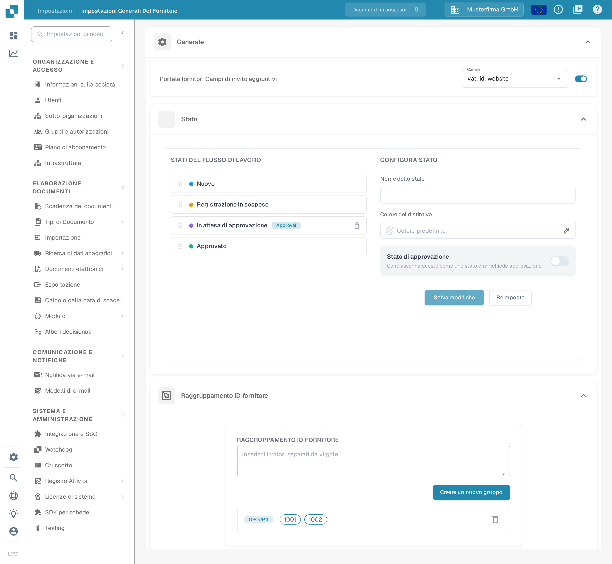
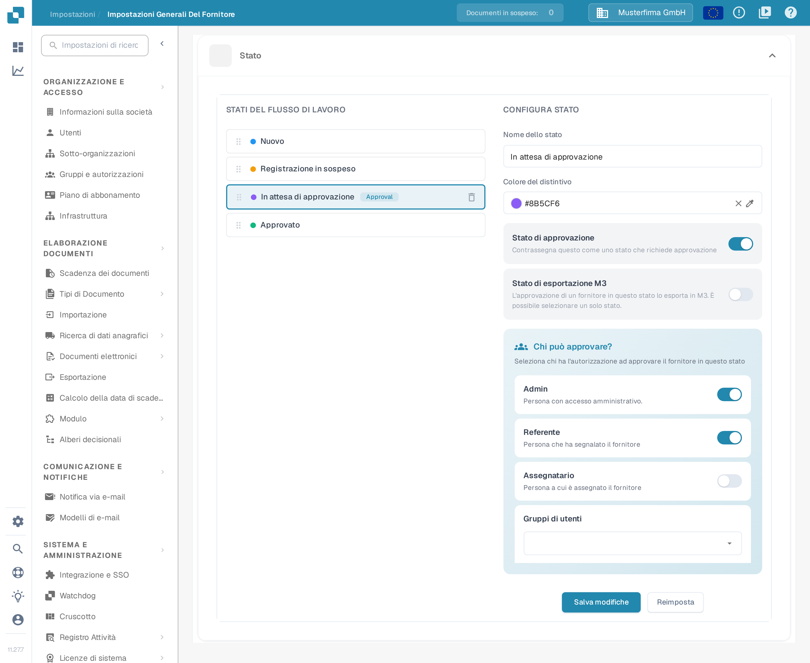
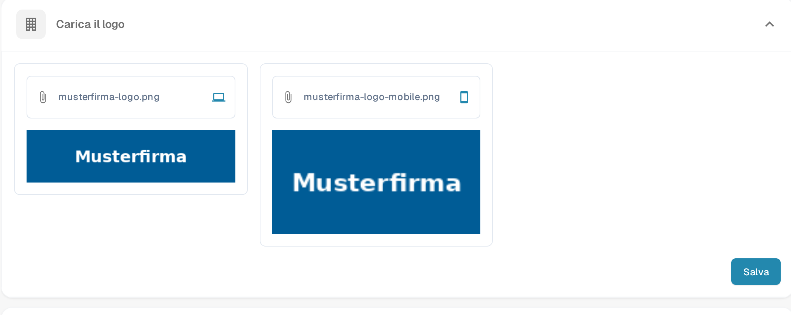
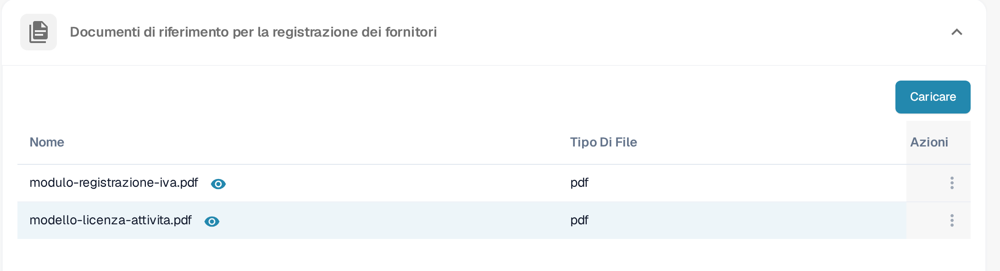

# Impostazioni Generali del Fornitore

<figure><figcaption>
Pagina <strong>Impostazioni Generali Del Fornitore</strong>. Nel riquadro, dall'alto verso il basso: la sezione <strong>Generale</strong> con <strong>Portale fornitori Campi di invito aggiuntivi</strong>, poi <strong>Stato</strong> e <strong>Raggruppamento ID fornitore</strong>. Le sezioni <strong>Carica il logo</strong>, <strong>Politica e dichiarazione sulla privacy</strong> e <strong>Documenti di riferimento per la registrazione dei fornitori</strong> si trovano più in basso nella stessa pagina.
</figcaption></figure>

### Panoramica

La pagina **Impostazioni Generali Del Fornitore** (Impostazioni → Impostazioni Generali Del Fornitore) definisce l'aspetto e il comportamento del portale fornitori. Contiene sei sezioni:

* **Generale** — tre moduli che determinano il flusso di registrazione dei fornitori:
  * **Portale fornitori Campi di invito aggiuntivi**: aggiunge campi supplementari al modulo di registrazione dei fornitori.
  * **Stato**: definisce gli stati del flusso di lavoro che un fornitore può attraversare e chi può approvare ciascuno di essi.
  * **Raggruppamento ID fornitore**: raggruppa più ID fornitore in modo che vengano trattati come un unico fornitore.
* **Carica il logo** — il logo aziendale mostrato nel portale fornitori e nelle e-mail di invito.
* **Politica e dichiarazione sulla privacy** — il documento legale in PDF che i fornitori devono accettare.
* **Documenti di riferimento per la registrazione dei fornitori** — documenti di riferimento che i fornitori possono consultare durante la registrazione.

Queste sezioni hanno effetto solo quando il modulo **Portale fornitori** è attivo; vedere [Portale fornitori](../../setup/supplier-portal/README.md) per l'attivazione.

### Portale fornitori: campi di invito aggiuntivi

Per impostazione predefinita i fornitori si registrano con i campi standard del layout fornitore. Questa sezione consente di richiedere inoltre campi dei dati anagrafici del fornitore (per esempio **VAT ID**, **Website**, **IBAN** o **Contact Person**) durante la registrazione.

1. Attivare l'interruttore **Portale fornitori Campi di invito aggiuntivi**.
2. Nel menu a discesa **Campi** che compare, selezionare uno o più campi. L'elenco contiene i campi definiti per il tipo di dati anagrafici del fornitore; se è vuoto, i campi anagrafici del fornitore non sono ancora stati configurati nell'organizzazione.
3. La selezione viene salvata automaticamente. I fornitori invitati vedono ora i campi selezionati nel modulo di registrazione.

### Stato

La sezione **Stato** definisce il flusso di lavoro attraversato dalla registrazione di un fornitore. Il pannello sinistro (**STATI DEL FLUSSO DI LAVORO**) elenca tutti gli stati in ordine; il pannello destro (**CONFIGURA STATO**) configura lo stato selezionato. Per la differenza tra stati di attivazione, invito, registrazione e approvazione, vedere [Portale fornitori — Comprendere accesso e stati](../../setup/supplier-portal/README.md#comprendere-accesso-e-stati).

<figure><figcaption>
Sezione <strong>Stato</strong>: a sinistra l'elenco <strong>STATI DEL FLUSSO DI LAVORO</strong> con il distintivo <em>Approval</em>, a destra il pannello <strong>CONFIGURA STATO</strong> dello stato selezionato con colore del distintivo, stato di approvazione, esportazione M3 e ruoli che possono approvare.
</figcaption></figure>

* **Riordinare gli stati**: trascinare uno stato dalla maniglia alla sua sinistra. Il nuovo ordine viene salvato automaticamente.
* **Selezionare uno stato**: fare clic su uno stato dell'elenco per caricarlo nel pannello **CONFIGURA STATO**. Gli stati predefiniti sono bloccati: il nome e le impostazioni di approvazione non sono modificabili e non possono essere eliminati.
* **Nome dello stato**: digitare un nome per creare uno stato personalizzato (quando non è selezionato alcuno stato) oppure per rinominare lo stato personalizzato selezionato.
* **Colore del distintivo**: colore del punto che precede lo stato nell'elenco. Il campo mostra solo il valore attuale e non accetta testo digitato: fare clic sul campo o sull'icona a forma di contagocce per aprire il selettore dei colori, quindi scegliere la tonalità nello spettro o digitare il valore esadecimale (per esempio `#00A3E0`) nella casella in alto del selettore. Se non è impostato alcun colore, il campo mostra il testo **Colore predefinito**; la **×** rimuove il colore e riporta il punto al colore standard.
* **Stato di approvazione**: attivare **Contrassegna questo come uno stato che richiede approvazione** se un fornitore può lasciare questo stato solo dopo un'approvazione esplicita. Lo stato mostra quindi il distintivo *Approval* nell'elenco.
* **Stato di esportazione M3**: questo interruttore compare per gli stati che richiedono approvazione e indica che l'approvazione di un fornitore in questo stato lo esporta in M3. È possibile selezionare un solo stato.
* **Chi può approvare?**: non appena uno stato richiede approvazione, scegliere quali ruoli possono approvarlo — **Admin** (la persona con accesso amministrativo), il **Referente** (la persona che ha segnalato il fornitore), l'**Assegnatario** (la persona a cui è assegnato il fornitore) e un numero qualsiasi di **Gruppi di utenti**. Negli stati predefiniti questa selezione non è modificabile.
* **Salva modifiche** salva lo stato selezionato; **Reimposta** svuota il modulo.
* **Eliminare uno stato personalizzato**: fare clic sull'icona del cestino accanto allo stato e confermare. Gli stati predefiniti non possono essere eliminati.

### Raggruppamento ID fornitore

Usare **Raggruppamento ID fornitore** quando lo stesso fornitore compare nel sistema con più ID fornitore (per esempio dopo una fusione o in stabilimenti diversi). Tutti gli ID di un gruppo vengono trattati come un unico fornitore nel portale fornitori.

1. Nel campo di testo inserire gli ID fornitore separati da virgole (per esempio `1001, 1002`).
2. Fare clic su **Creare un nuovo gruppo**. Ogni gruppo richiede almeno due ID; altrimenti viene mostrato un avviso e non viene creato alcun gruppo.
3. Ogni gruppo appare come riga di etichette ID, preceduta dall'etichetta del gruppo (**GROUP 1**, **GROUP 2** e così via). Le modifiche vengono salvate automaticamente.
4. **Modificare un gruppo**: fare clic sulla riga del gruppo, correggere l'elenco separato da virgole e poi fare clic su **Salva** (oppure su **Annulla** per scartare la modifica).
5. **Eliminare un gruppo**: fare clic sull'icona del cestino alla fine della riga.

### Carica il logo

#### Scopo

La funzione **Carica il logo** consente agli amministratori di personalizzare il portale fornitori caricando il logo della propria azienda. Il logo viene memorizzato in due versioni: una per la visualizzazione su desktop e una per la visualizzazione su mobile.

#### Passaggi per caricare un logo

1. **Aprire la sezione**: in **Impostazioni Generali Del Fornitore**, scorrere fino a **Carica il logo**.
2. **Scegliere l'area giusta**: la sezione contiene due aree di caricamento affiancate, riconoscibili dalle icone a destra del campo — l'icona del portatile per il **logo desktop** e l'icona dello smartphone per il **logo mobile**. In ciascuna area è indicato il nome del file attualmente memorizzato.
3. **Caricare un'immagine**: fare clic sull'area per aprire la finestra di selezione del file e scegliere un'immagine in formato `.png`, `.jpg`, `.jpeg` o `.webp`. L'anteprima compare subito sotto l'area.
4. **Ripetere per l'altra area** se serve una versione diversa per desktop e mobile: le due aree si caricano separatamente.
5. **Salvare**: fare clic su **Salva** in basso a destra nella sezione. Fino a quel momento le immagini restano solo nell'anteprima e non vengono applicate al portale fornitori.

<figure><figcaption>
Sezione <strong>Carica il logo</strong>: a sinistra l'area per il <strong>logo desktop</strong> (icona del portatile), a destra l'area per il <strong>logo mobile</strong> (icona dello smartphone). Sotto ogni area è mostrata l'anteprima dell'immagine memorizzata; il pulsante <strong>Salva</strong> in basso a destra applica entrambe le versioni.
</figcaption></figure>

#### Migliori pratiche

* **Dimensioni del logo**: preparare due immagini, una orizzontale per il desktop e una più compatta per il mobile, così il logo resta leggibile su entrambe le visualizzazioni.
* **Dimensione del file**: utilizzare un file immagine compresso per ridurre i tempi di caricamento e migliorare l'esperienza dell'utente.
* **Coerenza del marchio**: utilizzare lo stesso logo su tutte le piattaforme per mantenere un'identità di marchio coerente.

### Politica e dichiarazione sulla privacy

#### Scopo

La sezione **Politica e dichiarazione sulla privacy** contiene il documento legale che i fornitori devono accettare nel portale fornitori. La sezione gestisce un unico documento in formato PDF.

#### Passaggi per caricare la politica e la dichiarazione sulla privacy

1. **Aprire la sezione**: in **Impostazioni Generali Del Fornitore**, scorrere fino a **Politica e dichiarazione sulla privacy**. Finché non è stato caricato alcun documento, la sezione mostra l'avviso **È necessario caricare il documento di dichiarazione della politica.**
2. **Caricare il documento**: fare clic su **Carica documento** e scegliere un file PDF. Sono accettati solo file `.pdf`: gli altri formati non compaiono nella finestra di selezione.
3. **Attendere il caricamento**: non serve altro. Il documento viene memorizzato appena scelto il file; in questa sezione non c'è un pulsante **Salva**.
4. **Controllare il risultato**: al termine, la sezione mostra il PDF caricato in un'anteprima scorrevole. Per aggiornare il documento, ripetere il caricamento con lo stesso pulsante.

#### Migliori pratiche

* **Aggiornamenti regolari**: rivedere e aggiornare regolarmente la Politica e la dichiarazione sulla privacy per garantire che siano conformi ai più recenti requisiti legali e alle politiche aziendali.
* **Chiarezza e accessibilità**: assicurarsi che il documento caricato sia chiaro, conciso e accessibile a tutti gli utenti.
* **Revisione legale**: far rivedere il documento da un legale prima di caricarlo per garantire la conformità alle leggi e ai regolamenti pertinenti.

### Documenti di riferimento per la registrazione dei fornitori

Questa sezione contiene i documenti che assistono i fornitori durante la registrazione, per esempio un modulo di registrazione IVA o un modello di licenza di attività. I documenti caricati sono elencati in una tabella con le colonne **Nome**, **Tipo Di File** e **Azioni**.

<figure><figcaption>
Sezione <strong>Documenti di riferimento per la registrazione dei fornitori</strong> con il pulsante <strong>Caricare</strong> e la tabella dei documenti caricati.
</figcaption></figure>

* **Caricare**: fare clic su **Caricare** e scegliere il file. Il documento compare nella tabella al termine del caricamento.
* **Aprire un documento**: fare clic sull'icona dell'occhio accanto al nome del documento (suggerimento **File di anteprima**); il documento si apre in una finestra di anteprima.
* **Copia**: aprire il menu con i tre punti nella colonna **Azioni** e scegliere **Copia**. Viene copiato negli appunti un link al documento, che si può incollare nelle proprie istruzioni.
* **Cancellare**: aprire lo stesso menu e scegliere **Cancellare**; il documento viene eliminato dopo la conferma dell'avviso.
