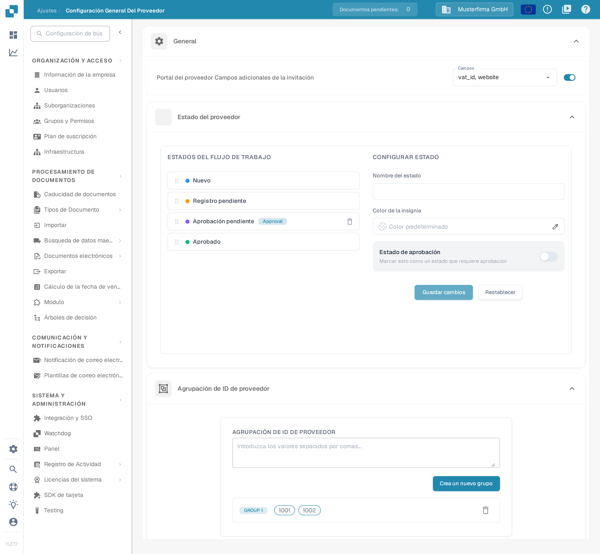

# Ajustes generales de proveedores

<figure><figcaption>
Página <strong>Configuración General Del Proveedor</strong>. De arriba abajo: <strong>General</strong> (campos adicionales de la invitación, estado del proveedor y agrupación de ID de proveedor), <strong>Subir logotipo</strong>, <strong>Política de privacidad</strong> y <strong>Documentos de referencia para el registro de proveedores</strong>.
</figcaption></figure>

### Descripción general

La página **Configuración General Del Proveedor** (Ajustes → Configuración General Del Proveedor) define el aspecto y el comportamiento del portal de proveedores. Consta de seis apartados:

* **General** — tres módulos que determinan el flujo de alta de proveedores:
  * **Portal del proveedor Campos adicionales de la invitación**: añade campos adicionales al formulario de registro de proveedores.
  * **Estado del proveedor**: define los estados del flujo de trabajo por los que puede pasar un proveedor y quién puede aprobar cada uno.
  * **Agrupación de ID de proveedor**: agrupa varios ID de proveedor para tratarlos como un único proveedor.
* **Subir logotipo** — el logotipo de la empresa que se muestra en el portal de proveedores y en los correos de invitación.
* **Política de privacidad** — los documentos legales que los proveedores deben aceptar.
* **Documentos de referencia para el registro de proveedores** — documentos de referencia que los proveedores pueden consultar durante el registro.

Estos apartados solo tienen efecto cuando el módulo **Portal de proveedores** está activado; consulte [Portal de proveedores](../../setup/supplier-portal/README.md) para saber cómo activarlo.

### Portal del proveedor: campos adicionales de la invitación

Por defecto, los proveedores se registran con los campos estándar del layout de proveedor. Este apartado permite solicitar además campos de sus datos maestros de proveedor (por ejemplo **VAT ID**, **Website**, **IBAN** o **Contact Person**) durante el registro.

1. Active el interruptor **Portal del proveedor Campos adicionales de la invitación**.
2. En la lista desplegable **Campos** que aparece, seleccione uno o varios campos. La lista contiene los campos definidos para el tipo de datos maestros de proveedor; si está vacía, todavía no se han configurado los campos de datos maestros de proveedor en su organización.
3. La selección se guarda automáticamente. Los proveedores invitados ven ahora los campos seleccionados en el formulario de registro.

### Estado del proveedor

El apartado **Estado del proveedor** define el flujo de trabajo por el que pasa el registro de un proveedor. El panel izquierdo (**ESTADOS DEL FLUJO DE TRABAJO**) enumera todos los estados en orden; el panel derecho (**CONFIGURAR ESTADO**) configura el estado que seleccione. Para saber en qué se diferencian los estados de activación, invitación, registro y aprobación, consulte [Portal de proveedores — Entender el acceso y los estados](../../setup/supplier-portal/README.md#entender-el-acceso-y-los-estados).

* **Reordenar los estados**: arrastre un estado por el asa de su izquierda. El nuevo orden se guarda automáticamente.
* **Seleccionar un estado**: haga clic en un estado de la lista para cargarlo en el panel **CONFIGURAR ESTADO**. Los estados predefinidos están bloqueados: no se pueden cambiar su nombre ni sus opciones de aprobación, y no se pueden eliminar.
* **Nombre del estado**: escriba un nombre para crear un estado personalizado (cuando no haya ninguno seleccionado) o para renombrar el estado personalizado seleccionado.
* **Color de la insignia**: color del punto que precede al estado en la lista. Escriba un valor de color en el campo (el valor predeterminado se muestra como **Color predeterminado**), elíjalo con el cuentagotas o bórrelo con el aspa para volver al color estándar.
* **Estado de aprobación**: active **Marcar esto como un estado que requiere aprobación** si un proveedor solo puede abandonar este estado tras una aprobación explícita. El estado muestra entonces la insignia *Approval* en la lista.
* **¿Quién puede aprobar?**: en cuanto un estado requiere aprobación, elija qué roles pueden aprobarlo — **ADMINISTRACIÓN** (la persona con acceso de administrador), el **Referente** (la persona que invitó al proveedor), el **Asignado a** (la persona a la que se asigna el proveedor) y cualquier número de **Grupos de usuarios**. Los estados predefinidos no permiten cambiar esta selección.
* **Exportación a M3**: active **Estado de exportación de M3** si aprobar en este estado debe exportar al proveedor a M3. Solo un estado puede estar marcado para la exportación.
* **Guardar cambios** guarda el estado seleccionado; **Restablecer** vacía el formulario.
* **Eliminar un estado personalizado**: haga clic en el icono de papelera situado junto a él y confirme. Los estados predefinidos no se pueden eliminar.

### Agrupación de ID de proveedor

Utilice **Agrupación de ID de proveedor** cuando el mismo proveedor aparezca en su sistema con varios ID de proveedor (por ejemplo, tras una fusión o en distintas plantas). Todos los ID de un grupo se tratan como un único proveedor en el portal de proveedores.

1. En el campo de texto, introduzca los ID de proveedor separados por comas (por ejemplo `1001, 1002`).
2. Haga clic en **Crea un nuevo grupo**. Cada grupo necesita al menos dos ID; de lo contrario se muestra un aviso y no se crea ningún grupo.
3. Cada grupo aparece en una fila con los ID como etiquetas, encabezada por la etiqueta del grupo (**GROUP 1**, **GROUP 2**, etc.). Los cambios se guardan automáticamente.
4. Para corregir los ID de un grupo, elimínelo y cree el grupo de nuevo con la lista correcta.
5. **Eliminar un grupo**: haga clic en el icono de papelera al final de la fila.

### Subir logotipo

#### Finalidad

La función **Subir logotipo** permite a los administradores personalizar el portal de proveedores subiendo el logotipo de su empresa. Esto refuerza el reconocimiento de la marca y proporciona una experiencia visual coherente a los usuarios que acceden al portal.

#### Pasos para subir un logotipo

1. **Abra la configuración general del proveedor**:
   * Vaya a la sección **Configuración General Del Proveedor** desde el menú principal.
2. **Localice la sección Subir logotipo**:
   * Desplácese hacia abajo hasta la sección **Subir logotipo** dentro de la página de ajustes.
3. **Suba un nuevo logotipo**:
   * Haga clic en el área **Subir logotipo** para abrir el cuadro de diálogo de selección de archivos.
   * Seleccione el archivo de imagen que desea subir. Los formatos admitidos suelen incluir `.png`, `.jpg` o `.jpeg`.
   * El logotipo subido se mostrará en el área de vista previa.
4. **Guarde el logotipo subido**:
   * Una vez subido el logotipo, haga clic en el botón **Guardar** para aplicar los cambios.
   * El nuevo logotipo se mostrará en todo el portal de proveedores.

#### Buenas prácticas

* **Dimensiones del logotipo**: asegúrese de que las dimensiones del logotipo estén optimizadas tanto para escritorio como para móvil. Es posible que el sistema ofrezca pautas o un redimensionamiento automático.
* **Tamaño del archivo**: utilice un archivo de imagen comprimido para reducir los tiempos de carga y mejorar la experiencia de usuario.
* **Coherencia de marca**: utilice el mismo logotipo en todas las plataformas para mantener una identidad de marca coherente.

### Política de privacidad

#### Finalidad

La sección **Política de privacidad** permite a los administradores subir o definir los documentos legales que rigen el uso del portal de proveedores. Estos documentos son esenciales para cumplir los requisitos legales y normativos, ya que describen las condiciones de uso, las políticas de protección de datos y otra información fundamental para los usuarios.

#### Pasos para subir la política de privacidad

1. **Abra la configuración general del proveedor**:
   * Vaya a la sección **Configuración General Del Proveedor** desde el menú principal.
2. **Localice la sección Política de privacidad**:
   * Desplácese hacia abajo hasta la sección **Política de privacidad**.
3. **Suba o actualice los documentos**:
   * Haga clic en el botón **Cargar documento** para seleccionar los archivos correspondientes. Mientras no haya ningún documento, la sección muestra el aviso **Debe cargar el documento de declaración de política.**
   * Elija el archivo del documento en su almacenamiento local. Los formatos admitidos suelen incluir `.pdf`, `.docx` o `.txt`.
   * Los documentos subidos se mostrarán en esta sección para su revisión.
4. **Guarde los cambios**:
   * Después de subir o actualizar los documentos, haga clic en el botón **Guardar** para que se apliquen las nuevas políticas.

#### Buenas prácticas

* **Actualizaciones periódicas**: revise y actualice con regularidad la política de privacidad para garantizar que cumpla los últimos requisitos legales y las políticas de la empresa.
* **Claridad y accesibilidad**: asegúrese de que los documentos subidos sean claros, concisos y accesibles para todos los usuarios. Considere ofrecer traducciones si su base de proveedores es internacional.
* **Revisión legal**: haga que un asesor jurídico revise todos los documentos antes de subirlos para garantizar el cumplimiento de las leyes y normativas pertinentes.

### Documentos de referencia para el registro de proveedores

Este apartado contiene los documentos que ayudan a los proveedores durante el registro, por ejemplo un formulario de registro de IVA o una plantilla de licencia de actividad. Los documentos subidos se muestran en una tabla con las columnas **Nombre** y **Tipo De Archivo**.

* **Subir**: haga clic en **Subir** y elija el archivo. Aparece en la tabla cuando ha finalizado la carga.
* **Abrir un documento**: haga clic en el icono del ojo junto al nombre del documento; se abre en la ventana **Documento**.
* **Copiar**: abra el menú de tres puntos de la columna **Acciones** y elija **Copiar**. Se copia al portapapeles un enlace al documento, que puede pegar en sus propias instrucciones.
* **Borrar**: abra el mismo menú y elija **Borrar**; el documento se elimina después de confirmar el aviso.
