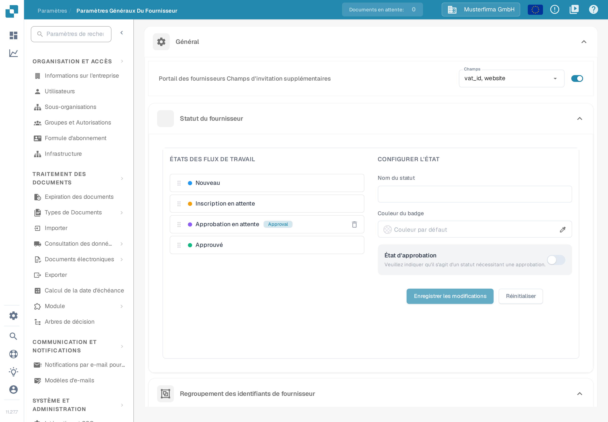
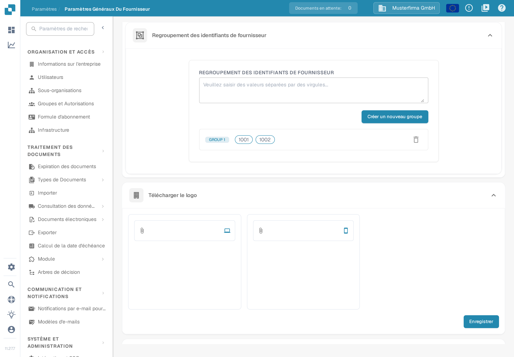
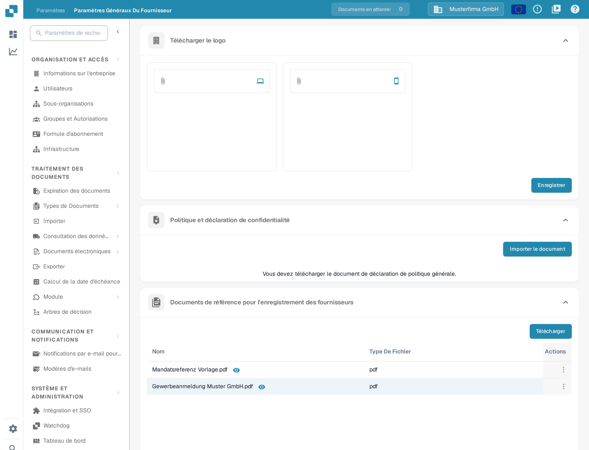

# Paramètres généraux des fournisseurs

<figure><figcaption>
Page Paramètres généraux des fournisseurs : la section Général réunit les champs d'invitation supplémentaires, le statut du fournisseur et le regroupement des identifiants de fournisseur.
</figcaption></figure>

### Aperçu

La page **Paramètres généraux du fournisseur** définit l'apparence et le comportement du portail fournisseurs pour vos fournisseurs. Elle comporte six sections :

* **Général** — trois modules qui structurent le processus d'enregistrement des fournisseurs :
  * **Portail des fournisseurs Champs d'invitation supplémentaires** : ajoute des champs supplémentaires au formulaire d'enregistrement des fournisseurs.
  * **Statut du fournisseur** : définit les statuts de workflow par lesquels passe un fournisseur et qui peut approuver chacun d'eux.
  * **Regroupement des identifiants de fournisseur** : regroupe plusieurs identifiants de fournisseur pour qu'ils soient traités comme un seul fournisseur.
* **Télécharger le logo** — le logo de l'entreprise affiché dans le portail fournisseurs et dans les e-mails d'invitation.
* **Politique et déclaration de confidentialité** — les documents juridiques que les fournisseurs doivent accepter.
* **Documents de référence pour l'enregistrement des fournisseurs** — les documents de référence que les fournisseurs peuvent consulter pendant l'enregistrement.

La page est réservée aux personnes disposant d'un accès administrateur. Pour savoir comment les fournisseurs accèdent ensuite au portail, voir [Portail fournisseurs](../../setup/supplier-portal/README.md).

### Champs d'invitation supplémentaires du portail fournisseurs

Par défaut, les fournisseurs s'enregistrent avec les champs standards de la fiche fournisseur. Cette section permet d'exiger en plus certains champs de vos données de base fournisseur (par exemple le numéro de TVA, le site web, l'IBAN ou la personne de contact) lors de l'enregistrement.

1. Activez l'interrupteur **Portail des fournisseurs Champs d'invitation supplémentaires**.
2. Dans la liste **Champs** qui apparaît, sélectionnez un ou plusieurs champs. La liste contient les champs définis pour le type de données de base fournisseur ; si elle est vide, les champs de données de base fournisseur n'ont pas encore été configurés dans votre organisation.
3. La sélection est enregistrée automatiquement. Les fournisseurs invités voient désormais les champs sélectionnés dans le formulaire d'enregistrement.

### Statut du fournisseur

La section **Statut du fournisseur** définit le workflow par lequel passe un enregistrement fournisseur. Le panneau de gauche liste tous les statuts dans l'ordre ; le panneau **CONFIGURER L'ÉTAT** de droite configure le statut sélectionné. Pour savoir en quoi les états d'activation, d'invitation, d'enregistrement et d'approbation diffèrent, voir [Portail fournisseurs — Comprendre les accès et les statuts](../../setup/supplier-portal/README.md#comprendre-les-acces-et-les-statuts).

* **Réordonner les statuts** : faites glisser un statut par sa poignée à gauche. Le nouvel ordre est enregistré automatiquement.
* **Sélectionner un statut** : cliquez sur un statut dans la liste pour le charger dans le panneau **CONFIGURER L'ÉTAT**. Les statuts prédéfinis sont verrouillés : leur nom et leurs paramètres d'approbation ne peuvent pas être modifiés, et ils ne peuvent pas être supprimés.
* **Nom du statut** : saisissez un nom pour créer un statut personnalisé (lorsqu'aucun statut n'est sélectionné) ou pour renommer le statut personnalisé sélectionné.
* **Couleur du badge** : choisissez la couleur du badge du statut. Sans choix explicite, le statut utilise la couleur par défaut.
* **État d'approbation** : activez l'interrupteur si un fournisseur ne peut quitter ce statut qu'après une approbation explicite (texte d'aide de l'application : « Veuillez indiquer qu'il s'agit d'un statut nécessitant une approbation. »). Le statut porte alors le badge *Approval* dans la liste.
* **Qui peut approuver ?** : dès qu'un statut exige une approbation, choisissez les rôles autorisés à approuver — **Administrateur** (personne disposant d'un accès administrateur), **Référent** (la personne qui a orienté le fournisseur), **Cessionnaire** (la personne à qui le fournisseur est affecté) et autant de **Groupes d'utilisateurs** que nécessaire.
* **État d'exportation M3** : activez cette option si l'approbation d'un fournisseur portant ce statut doit l'exporter vers M3 (texte d'aide de l'application : « L'approbation d'un fournisseur ayant ce statut l'exporte vers M3. Un seul statut peut être sélectionné. »).
* **Enregistrer les modifications** enregistre le statut sélectionné ; **Réinitialiser** vide le formulaire.
* **Supprimer un statut personnalisé** : cliquez sur l'icône de corbeille à côté du statut et confirmez. Les statuts prédéfinis ne peuvent pas être supprimés.

### Regroupement des identifiants de fournisseur

<figure><figcaption>
Regroupement des identifiants de fournisseur : un groupe avec ses identifiants, puis la section Télécharger le logo avec la zone pour la version bureau et celle pour la version mobile.
</figcaption></figure>

Utilisez le **Regroupement des identifiants de fournisseur** lorsque le même fournisseur apparaît sous plusieurs identifiants dans votre système — par exemple après une fusion ou pour plusieurs sites. Tous les identifiants d'un groupe sont traités comme un seul fournisseur dans le portail fournisseurs.

1. Dans le champ de saisie, indiquez les identifiants de fournisseur séparés par des virgules (par exemple `1001, 1002`).
2. Cliquez sur **Créer un nouveau groupe**. Un groupe doit contenir au moins deux identifiants ; sinon un avertissement s'affiche et aucun groupe n'est créé.
3. Chaque groupe apparaît sous la forme d'une ligne d'étiquettes **GROUP 1**, **GROUP 2**, etc. La création et la suppression d'un groupe sont enregistrées immédiatement.
4. **Modifier un groupe** : cliquez sur la ligne du groupe, adaptez la liste séparée par des virgules, puis cliquez sur **Enregistrer** — ou sur **Annuler** pour abandonner la modification.
5. **Supprimer un groupe** : cliquez sur l'icône de corbeille en fin de ligne.

### Télécharger le logo

#### Objectif

La section **Télécharger le logo** permet de personnaliser le portail fournisseurs avec le logo de votre entreprise. Le logo s'affiche dans le portail et dans les e-mails d'invitation envoyés aux fournisseurs.

#### Étapes pour téléverser un logo

1. **Accéder aux paramètres généraux du fournisseur** :
   * Ouvrez la section **Paramètres généraux du fournisseur** depuis le menu principal.
2. **Repérer la section Télécharger le logo** :
   * Faites défiler la page des paramètres jusqu'à la section **Télécharger le logo**.
3. **Téléverser un nouveau logo** :
   * La section contient deux zones de téléversement : celle de gauche, marquée d'une icône d'ordinateur portable, reçoit le logo de la version bureau ; celle de droite, marquée d'une icône de smartphone, le logo de la version mobile.
   * Cliquez sur une zone pour ouvrir la sélection de fichiers, puis choisissez l'image. Les formats acceptés sont `.png`, `.jpg`, `.jpeg` et `.webp`.
   * Le logo téléversé s'affiche dans la zone correspondante.
4. **Enregistrer le logo téléversé** :
   * Cliquez sur **Enregistrer** pour appliquer les modifications.
   * Le nouveau logo s'affiche ensuite dans tout le portail fournisseurs.

#### Bonnes pratiques

* **Dimensions du logo** : choisissez une image de largeur modérée, afin qu'elle reste lisible sur l'affichage bureau comme sur l'affichage mobile.
* **Taille du fichier** : utilisez un fichier image compressé pour réduire les temps de chargement et améliorer l'expérience utilisateur.
* **Cohérence de la marque** : utilisez le même logo sur toutes les plateformes afin de préserver une identité de marque cohérente.

### Politique et déclaration de confidentialité

#### Objectif

La section **Politique et déclaration de confidentialité** contient les documents juridiques que les fournisseurs doivent consulter et accepter lors de l'enregistrement. Elle garantit que vos fournisseurs sont informés de vos conditions et de vos règles de protection des données.

#### Étapes pour téléverser la politique et la déclaration de confidentialité

1. **Accéder aux paramètres généraux du fournisseur** :
   * Ouvrez la section **Paramètres généraux du fournisseur** depuis le menu principal.
2. **Repérer la section Politique et déclaration de confidentialité** :
   * Faites défiler la page des paramètres jusqu'à la section **Politique et déclaration de confidentialité**.
3. **Téléverser ou mettre à jour le document** :
   * Cliquez sur **Importer le document**, puis choisissez le fichier. Seul le format PDF (`.pdf`) est accepté.
   * Le téléversement démarre immédiatement : cette section ne comporte pas de bouton d'enregistrement séparé. Une fois le téléversement terminé, le document remplace la version précédente et s'affiche dans la section.
   * Tant qu'aucun document n'est téléversé, la section affiche le message « Vous devez télécharger le document de déclaration de politique générale. ».

#### Bonnes pratiques

* **Mises à jour régulières** : révisez et mettez à jour régulièrement la politique et la déclaration de confidentialité afin qu'elles respectent les exigences légales et les règles internes en vigueur.
* **Clarté et accessibilité** : veillez à ce que les documents téléversés soient clairs, concis et accessibles à tous les utilisateurs. Si votre base de fournisseurs est internationale, envisagez de fournir des traductions.
* **Validation juridique** : faites relire tous les documents par votre service juridique avant de les téléverser, afin de garantir leur conformité aux lois et règlements applicables.

### Documents de référence pour l'enregistrement des fournisseurs

<figure><figcaption>
Politique et déclaration de confidentialité et documents de référence pour l'enregistrement des fournisseurs : les documents téléversés apparaissent dans le tableau avec leurs actions.
</figcaption></figure>

Cette section contient les documents qui accompagnent les fournisseurs pendant l'enregistrement — par exemple un formulaire d'immatriculation à la TVA ou un modèle de registre du commerce. Les documents téléversés apparaissent dans un tableau dont les colonnes sont **Nom**, **Type De Fichier** et **Actions**.

* **Téléverser** : cliquez sur **Télécharger**, puis choisissez le fichier. Il apparaît dans le tableau une fois le téléversement terminé.
* **Aperçu** : cliquez sur l'icône d'œil à côté du nom du document pour l'ouvrir dans une fenêtre d'aperçu.
* **Copier le lien** : utilisez l'action **Copier** dans la colonne **Actions** pour copier un lien vers le document dans le presse-papiers, par exemple pour l'ajouter à vos propres instructions.
* **Supprimer** : utilisez l'action **Supprimer** dans la colonne **Actions** et confirmez la demande.
