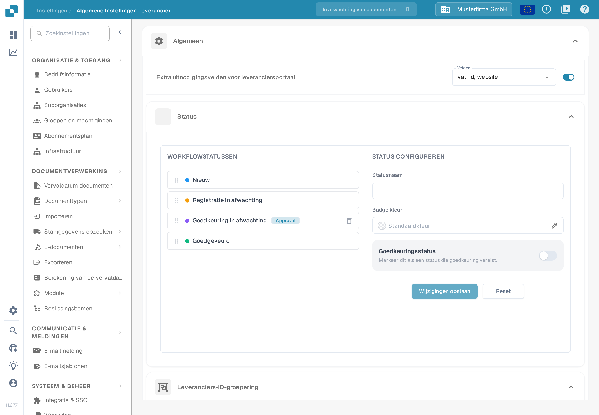
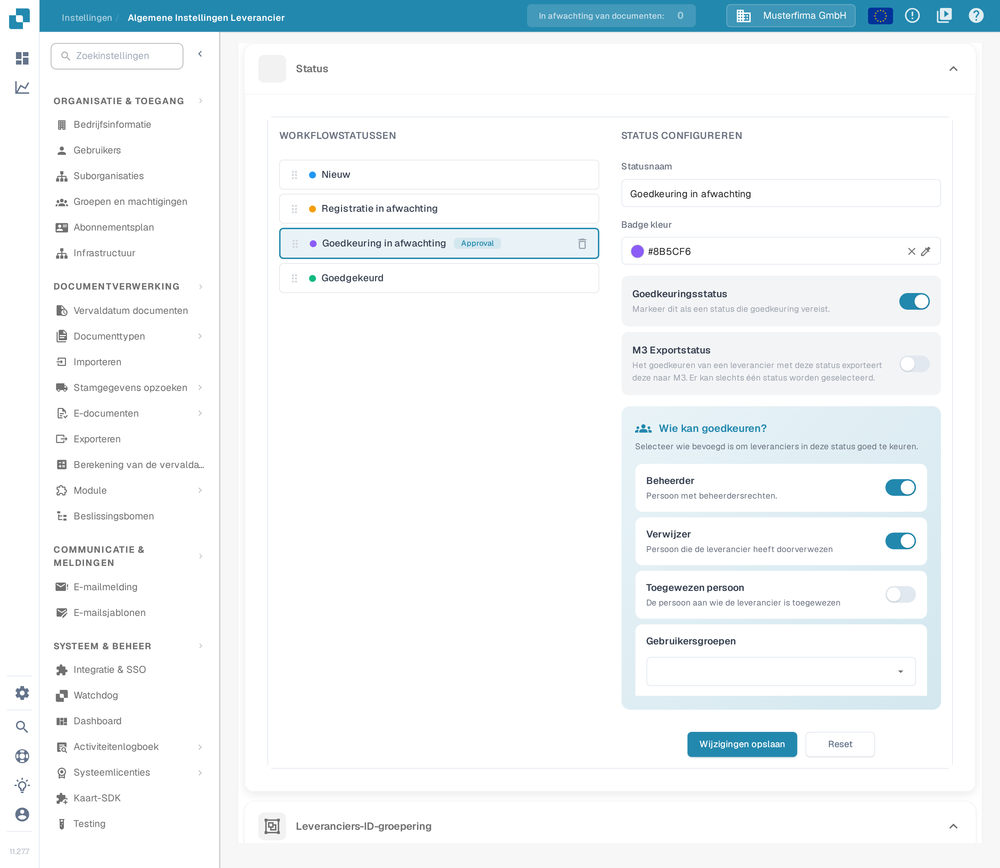
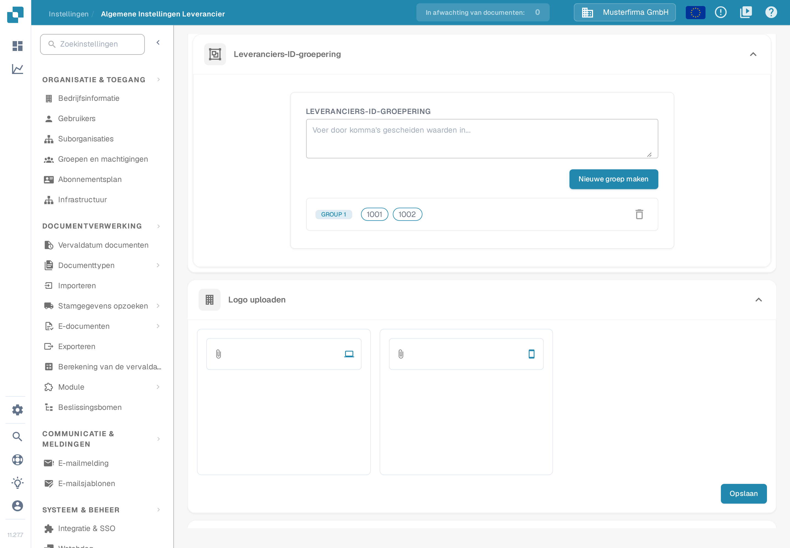
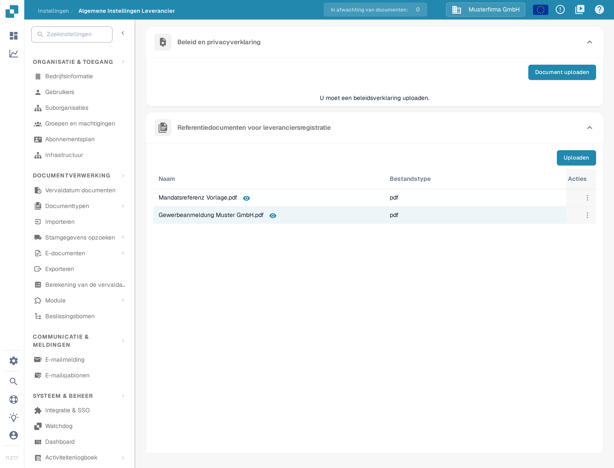

# Algemene leveranciersinstellingen

<figure><figcaption>
De pagina <strong>Algemene Instellingen Leverancier</strong> in de Nederlandse interface. Bovenaan staat de schakelaar <strong>Extra uitnodigingsvelden voor leveranciersportaal</strong> met de veldenkeuze; daaronder begint de sectie <strong>Status</strong> met de lijst <strong>WORKFLOWSTATUSSEN</strong> en het paneel <strong>STATUS CONFIGUREREN</strong>.
</figcaption></figure>

### Overzicht

De pagina **Algemene Instellingen Leverancier** bepaalt hoe het leveranciersportaal eruitziet en hoe het zich gedraagt voor uw leveranciers. U opent de pagina via **Instellingen** en vervolgens **Algemene Instellingen Leverancier**. De pagina bestaat uit zes onderdelen:

* **Algemeen** — drie instellingen die het aanmelden van leveranciers bepalen:
  * **Extra uitnodigingsvelden voor leveranciersportaal**: vraag bij de registratie extra velden uit uw leveranciersstamgegevens op.
  * **Status**: leg de workflowstatussen vast die een leverancier kan doorlopen en wie elke status mag goedkeuren.
  * **Leveranciers-ID-groepering**: voeg meerdere leveranciers-ID's samen, zodat ze als één leverancier gelden.
* **Logo uploaden** — het bedrijfslogo dat in het leveranciersportaal en in uitnodigingsmails verschijnt.
* **Beleid en privacyverklaring** — de juridische documenten die leveranciers moeten accepteren.
* **Referentiedocumenten voor leveranciersregistratie** — documenten die leveranciers tijdens de registratie kunnen bekijken.

Deze onderdelen hebben pas effect als de module **Leveranciersportaal** is geactiveerd. Zie [Leveranciersportaal](../../setup/supplier-portal/README.md) voor het activeren van de module en voor de betekenis van de statussen.

### Extra uitnodigingsvelden voor leveranciersportaal

Standaard registreren leveranciers zich met de vaste velden van de leverancierslayout. Met deze schakelaar vraagt u daarnaast velden uit uw leveranciersstamgegevens op, bijvoorbeeld **VAT ID**, **Website**, **IBAN** of **Contactpersoon**.

1. Zet de schakelaar **Extra uitnodigingsvelden voor leveranciersportaal** aan. De veldenkeuze **Velden** verschijnt.
2. Open **Velden** en selecteer één of meer velden. De lijst bevat de velden die voor het stamgegevenstype leverancier zijn ingericht. Is de lijst leeg, dan zijn de stamgegevensvelden van de leverancier in uw organisatie nog niet ingericht.
3. U hoeft niets te bevestigen: de keuze wordt direct opgeslagen. Uitgenodigde leveranciers zien de gekozen velden daarna in het registratieformulier.

### Status

De sectie **Status** legt de workflow vast die een leveranciersregistratie doorloopt. Het linkerpaneel **WORKFLOWSTATUSSEN** toont alle statussen in volgorde; in het rechterpaneel **STATUS CONFIGUREREN** stelt u de status in die u selecteert. Hoe activering, uitnodiging, registratie en goedkeuring van elkaar verschillen, leest u in [Leveranciersportaal — Toegang en status begrijpen](../../setup/supplier-portal/README.md#toegang-en-status-begrijpen).

<figure><figcaption>
De sectie <strong>Status</strong> met de status <strong>Goedkeuring in afwachting</strong> geselecteerd. Rechts staan <strong>Statusnaam</strong>, <strong>Badge kleur</strong>, de schakelaars <strong>Goedkeuringsstatus</strong> en <strong>M3 Exportstatus</strong>, het blok <strong>Wie kan goedkeuren?</strong> en de knoppen <strong>Wijzigingen opslaan</strong> en <strong>Reset</strong>.
</figcaption></figure>

* **Volgorde wijzigen**: sleep een status aan de greep links van de naam. De nieuwe volgorde wordt direct opgeslagen.
* **Status selecteren**: klik op een status in de lijst om die in het paneel **STATUS CONFIGUREREN** te laden. De ingebouwde statussen **Nieuw**, **Registratie in afwachting** en **Goedgekeurd** zijn vergrendeld: hun naam staat vast, ze hebben geen goedkeuringsinstellingen en u kunt ze niet verwijderen.
* **Statusnaam**: typ een naam om een nieuwe eigen status te maken (als er geen status is geselecteerd) of om de geselecteerde eigen status een andere naam te geven.
* **Badge kleur**: voer een hexkleur in, bijvoorbeeld `#8B5CF6`, of kies een kleur met het potloodpictogram. Zonder eigen kleur toont het veld **Standaardkleur**.
* **Goedkeuringsstatus**: zet deze schakelaar aan als een leverancier de status pas mag verlaten na een uitdrukkelijke goedkeuring. De toelichting in de toepassing luidt: *Markeer dit als een status die goedkeuring vereist.* De status krijgt in de lijst het label **Approval**.
* **M3 Exportstatus**: zet deze schakelaar aan als het goedkeuren van een leverancier met deze status de leverancier naar M3 moet exporteren. De toelichting luidt: *Het goedkeuren van een leverancier met deze status exporteert deze naar M3. Er kan slechts één status worden geselecteerd.*
* **Wie kan goedkeuren?**: zodra een status goedkeuring vereist, bepaalt u hier wie mag goedkeuren — **Beheerder** (persoon met beheerdersrechten), **Verwijzer** (de persoon die de leverancier heeft doorverwezen), **Toegewezen persoon** (de persoon aan wie de leverancier is toegewezen) en een of meer **Gebruikersgroepen**.
* **Wijzigingen opslaan** bewaart de geselecteerde status; **Reset** leegt het formulier.
* **Eigen status verwijderen**: klik op het prullenbakpictogram rechts in de rij en bevestig in het venster. Dat venster toont nog de Engelse knoppen **Cancel** en **Delete**. Ingebouwde statussen hebben geen prullenbakpictogram.

### Leveranciers-ID-groepering

Gebruik **Leveranciers-ID-groepering** wanneer dezelfde leverancier onder meerdere leveranciers-ID's in uw systeem voorkomt, bijvoorbeeld na een fusie of over meerdere vestigingen. Alle ID's in één groep gelden in het leveranciersportaal als één leverancier.

<figure><figcaption>
<strong>Leveranciers-ID-groepering</strong> met het invulveld, de knop <strong>Nieuwe groep maken</strong> en de bestaande groep <strong>GROUP 1</strong> met de ID's <strong>1001</strong> en <strong>1002</strong>. Daaronder de sectie <strong>Logo uploaden</strong> met een uploadveld voor desktop en voor mobiel en de knop <strong>Opslaan</strong>.
</figcaption></figure>

1. Voer in het invulveld de leveranciers-ID's in, gescheiden door komma's, bijvoorbeeld `1001, 1002`. De plaatsaanduiding in het veld luidt *Voer door komma's gescheiden waarden in...*
2. Klik op **Nieuwe groep maken**. Een groep bevat minstens twee ID's.
3. Elke groep verschijnt als rij met de ID's als labels. De groep zelf krijgt het label **GROUP 1**, **GROUP 2**, enzovoort; dat label is in de Nederlandse interface niet vertaald. Wijzigingen in de lijst worden direct opgeslagen.
4. **Groep wijzigen**: klik op de rij, pas de kommagescheiden lijst aan en klik op **Opslaan**. Met **Annuleren** sluit u de rij zonder de wijziging toe te passen.
5. **Groep verwijderen**: klik op het prullenbakpictogram aan het einde van de rij.

### Logo uploaden

#### Doel

Met **Logo uploaden** past u het leveranciersportaal aan met het logo van uw bedrijf. Dat versterkt de merkherkenning en geeft gebruikers van het portaal een herkenbare uitstraling.

#### Stappen om een logo te uploaden

1. **Open de instellingen**: ga naar **Instellingen** en vervolgens **Algemene Instellingen Leverancier**.
2. **Zoek de sectie Logo uploaden**: scroll naar de sectie **Logo uploaden** op de pagina.
3. **Upload een nieuw logo**: klik in het uploadveld met het paperclippictogram. Er zijn twee velden, één voor desktop (laptoppictogram) en één voor mobiel (smartphonepictogram). Kies het afbeeldingsbestand. De geaccepteerde bestandstypen zijn `.png`, `.jpg`, `.jpeg` en `.webp`.
4. **Logo opslaan**: klik op **Opslaan** om de wijziging toe te passen. Het nieuwe logo verschijnt daarna in het leveranciersportaal.

#### Aanbevolen werkwijze

* **Afmetingen**: kies een logo dat zowel op desktop als op mobiel scherp blijft.
* **Bestandsgrootte**: gebruik een gecomprimeerd bestand, zodat het portaal snel laadt.
* **Merkconsistentie**: gebruik hetzelfde logo op alle plaatsen waar uw leveranciers het portaal zien.

### Beleid en privacyverklaring

#### Doel

In de sectie **Beleid en privacyverklaring** legt u de juridische documenten vast die het gebruik van het leveranciersportaal regelen, zoals gebruiksvoorwaarden en het privacybeleid. Deze documenten zijn nodig om aan wettelijke en interne eisen te voldoen.

#### Stappen om het beleid te uploaden

1. **Open de instellingen**: ga naar **Instellingen** en vervolgens **Algemene Instellingen Leverancier**.
2. **Zoek de sectie Beleid en privacyverklaring**: scroll naar de sectie **Beleid en privacyverklaring**.
3. **Upload het document**: klik op **Document uploaden** en kies het bestand. De knop accepteert alleen PDF-bestanden. Zolang er geen document is geüpload, toont de sectie de melding *U moet een beleidsverklaring uploaden.*
4. **Geen aparte opslagknop**: deze sectie heeft, anders dan de sectie **Logo uploaden**, geen knop **Opslaan**. Het geüploade document geldt direct.

<figure><figcaption>
De sectie <strong>Beleid en privacyverklaring</strong> met de knop <strong>Document uploaden</strong> en de melding <strong>U moet een beleidsverklaring uploaden.</strong> Daaronder de sectie <strong>Referentiedocumenten voor leveranciersregistratie</strong> met de knop <strong>Uploaden</strong> en de tabel met de kolommen <strong>Naam</strong>, <strong>Bestandstype</strong> en <strong>Acties</strong>.
</figcaption></figure>

#### Aanbevolen werkwijze

* **Regelmatig bijwerken**: controleer het beleid en de privacyverklaring op gezette tijden en werk ze bij wanneer wetgeving of bedrijfsafspraken veranderen.
* **Duidelijkheid**: zorg dat de documenten begrijpelijk zijn voor alle leveranciers. Overweeg een vertaling als uw leveranciersbestand internationaal is.
* **Juridische beoordeling**: laat de documenten door een jurist beoordelen voordat u ze uploadt.

### Referentiedocumenten voor leveranciersregistratie

Deze sectie bevat documenten die leveranciers tijdens de registratie ondersteunen, bijvoorbeeld een formulier voor btw-registratie of een model voor een handelslicentie. Geüploade documenten staan in een tabel met de kolommen **Naam**, **Bestandstype** en **Acties**; de tabel staat onderaan de afbeelding hierboven.

* **Uploaden**: klik op **Uploaden** en kies het bestand. Het document verschijnt in de tabel zodra de upload klaar is.
* **Bekijken**: klik op het oogpictogram achter de bestandsnaam om het document in een voorbeeldvenster te openen.
* **Kopiëren**: open het menupictogram in de kolom **Acties** (knopinfo **Acties**) en kies **Kopiëren**. Daarmee staat een link naar het document op het klembord, bijvoorbeeld om die in uw eigen instructies op te nemen.
* **Verwijderen**: open hetzelfde menu en kies **Verwijderen**. Het document verdwijnt nadat u de bevestiging hebt geaccepteerd.
