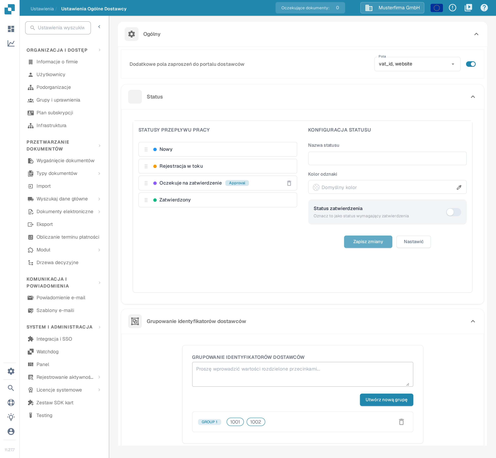
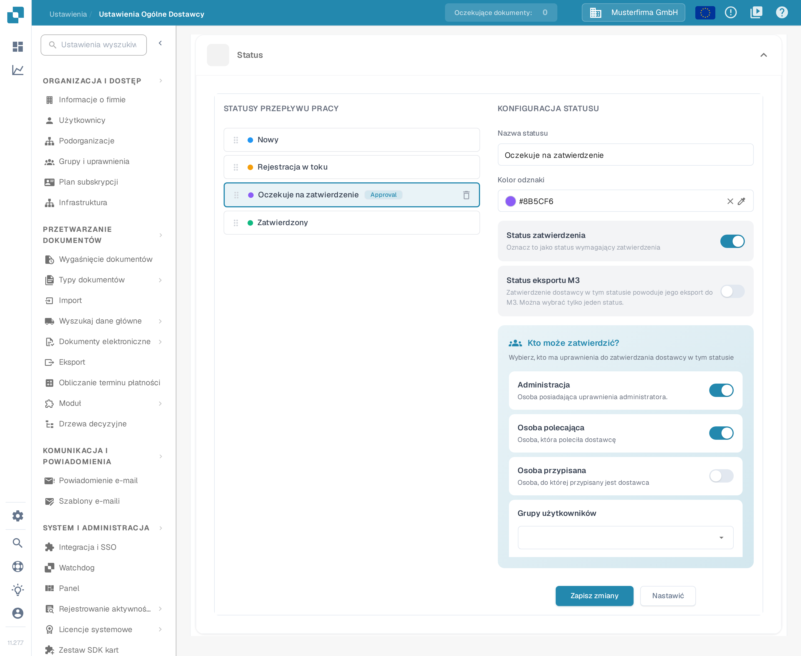
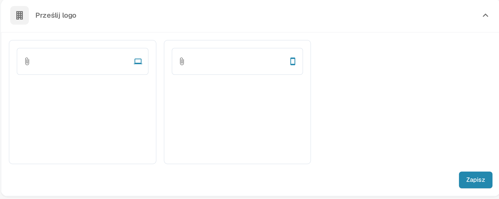
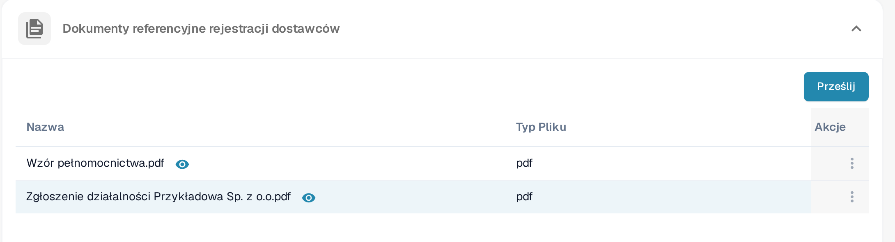

# Ustawienia ogólne dostawcy

<figure><figcaption>
Strona <strong>Ustawienia Ogólne Dostawcy</strong>. W ramce, od góry: sekcja <strong>Ogólny</strong> z polem <strong>Dodatkowe pola zaproszeń do portalu dostawców</strong>, następnie <strong>Status</strong> i <strong>Grupowanie identyfikatorów dostawców</strong>. Sekcje <strong>Prześlij logo</strong>, <strong>Polityka i oświadczenie o ochronie prywatności</strong> oraz <strong>Dokumenty referencyjne rejestracji dostawców</strong> znajdują się niżej na tej samej stronie.
</figcaption></figure>

### Przegląd

Strona **Ustawienia Ogólne Dostawcy** (Ustawienia → Ustawienia Ogólne Dostawcy) określa wygląd i działanie portalu dostawców. Zawiera sześć sekcji:

* **Ogólny** — trzy moduły kształtujące przebieg rejestracji dostawców:
  * **Dodatkowe pola zaproszeń do portalu dostawców**: dodaje dodatkowe pola do formularza rejestracji dostawcy.
  * **Status**: definiuje statusy przepływu pracy, przez które przechodzi dostawca, oraz wskazuje, kto może zatwierdzić każdy z nich.
  * **Grupowanie identyfikatorów dostawców**: grupuje kilka identyfikatorów dostawców, aby były traktowane jak jeden dostawca.
* **Prześlij logo** — logo firmy wyświetlane w portalu dostawców i w wiadomościach z zaproszeniem.
* **Polityka i oświadczenie o ochronie prywatności** — dokument prawny w formacie PDF, który dostawcy muszą zaakceptować.
* **Dokumenty referencyjne rejestracji dostawców** — dokumenty pomocnicze, z którymi dostawcy mogą zapoznać się podczas rejestracji.

Sekcje te działają tylko wtedy, gdy moduł **Portal dostawców** jest włączony; sposób włączenia opisuje strona [Portal dostawców](../../setup/supplier-portal/README.md).

### Dodatkowe pola zaproszeń do portalu dostawców

Domyślnie dostawcy rejestrują się z polami standardowymi układu dostawcy. Ta sekcja pozwala dodatkowo żądać wybranych pól z danych podstawowych dostawcy (na przykład numeru NIP lub adresu strony internetowej) podczas rejestracji.

1. Włącz przełącznik **Dodatkowe pola zaproszeń do portalu dostawców**.
2. Na liście **Pola**, która się pojawi, wybierz jedno lub kilka pól. Na liście widoczne są techniczne nazwy pól (na przykład `vat_id`, `website`); pochodzą one z konfiguracji danych podstawowych dostawcy, więc jeśli lista jest pusta, ten typ danych podstawowych nie został jeszcze skonfigurowany w organizacji.
3. Wybór jest zapisywany automatycznie. Zaproszeni dostawcy widzą teraz wybrane pola w formularzu rejestracji.

### Status

Sekcja **Status** określa przepływ pracy, przez który przechodzi rejestracja dostawcy. Lewy panel (**STATUSY PRZEPŁYWU PRACY**) zawiera wszystkie statusy w kolejności; prawy panel (**KONFIGURACJA STATUSU**) konfiguruje wybrany status. Czym różnią się statusy aktywacji, zaproszenia, rejestracji i zatwierdzenia, opisuje strona [Portal dostawców — dostęp i status](../../setup/supplier-portal/README.md#dostep-i-status-to-rozne-rzeczy).

<figure><figcaption>
Sekcja <strong>Status</strong>: po lewej lista <strong>STATUSY PRZEPŁYWU PRACY</strong> z odznaką <em>Approval</em>, po prawej panel <strong>KONFIGURACJA STATUSU</strong> wybranego statusu z kolorem odznaki, statusem zatwierdzenia, eksportem M3 i rolami uprawnionymi do zatwierdzania.
</figcaption></figure>

* **Zmiana kolejności statusów**: przeciągnij status za uchwyt po jego lewej stronie. Nowa kolejność jest zapisywana automatycznie.
* **Wybór statusu**: kliknij status na liście, aby wczytać go do panelu **KONFIGURACJA STATUSU**. Statusy wbudowane są zablokowane: nie można zmienić ich nazwy ani ustawień zatwierdzania i nie można ich usunąć.
* **Nazwa statusu**: wpisz nazwę, aby utworzyć nowy status własny (gdy żaden status nie jest wybrany) lub zmienić nazwę wybranego statusu własnego.
* **Kolor odznaki**: kolor kropki przed statusem na liście. Wpisz wartość koloru w polu (wartość domyślna jest wyświetlana jako **Domyślny kolor**), wybierz kolor próbnikiem lub usuń go znakiem ×, aby wrócić do koloru standardowego.
* **Status zatwierdzenia**: włącz **Oznacz to jako status wymagający zatwierdzenia**, jeśli dostawca może opuścić ten status tylko po wyraźnym zatwierdzeniu. Status otrzymuje wtedy na liście odznakę *Approval*.
* **Status eksportu M3**: ten przełącznik pojawia się przy statusach wymagających zatwierdzenia i oznacza, że zatwierdzenie dostawcy w tym statusie powoduje jego eksport do M3. Można wybrać tylko jeden status.
* **Kto może zatwierdzić?**: gdy status wymaga zatwierdzenia, wybierz role, które mogą go zatwierdzić — **Administracja** (osoba posiadająca uprawnienia administratora), **Osoba polecająca** (osoba, która poleciła dostawcę), **Osoba przypisana** (osoba, do której przypisany jest dostawca) oraz dowolna liczba **Grup użytkowników**. W statusach wbudowanych tego wyboru nie można zmienić.
* **Zapisz zmiany** zapisuje wybrany status; **Nastawić** czyści formularz.
* **Usuwanie statusu własnego**: kliknij ikonę kosza przy statusie i potwierdź. Statusów wbudowanych nie można usunąć.

### Grupowanie identyfikatorów dostawców

Używaj **Grupowanie identyfikatorów dostawców**, gdy ten sam dostawca występuje w systemie pod kilkoma identyfikatorami (na przykład po połączeniu firm lub w różnych zakładach). Wszystkie identyfikatory w jednej grupie są traktowane w portalu dostawców jako jeden dostawca.

1. W polu tekstowym wpisz identyfikatory dostawców rozdzielone przecinkami (na przykład `1001, 1002`).
2. Kliknij **Utwórz nową grupę**. Grupa wymaga co najmniej dwóch identyfikatorów; w przeciwnym razie pojawia się komunikat „Aby utworzyć grupę, podaj co najmniej dwa identyfikatory.” i grupa nie zostaje utworzona.
3. Każda grupa jest wyświetlana jako wiersz etykiet identyfikatorów, poprzedzony etykietą grupy (**GROUP 1**, **GROUP 2** itd.). Zmiany są zapisywane automatycznie.
4. **Edycja grupy**: kliknij wiersz grupy, popraw listę rozdzieloną przecinkami, a następnie kliknij **Zapisz** (lub **Anulować**, aby odrzucić zmianę).
5. **Usuwanie grupy**: kliknij ikonę kosza na końcu wiersza.

### Prześlij logo

#### Cel

Funkcja **Prześlij logo** pozwala administratorom dostosować portal dostawców, przesyłając logo swojej firmy. Logo jest przechowywane w dwóch wersjach: dla widoku na komputerze i dla widoku na urządzeniu mobilnym.

#### Kroki do przesłania logo

1. **Otwórz sekcję**: w **Ustawienia Ogólne Dostawcy** przewiń do sekcji **Prześlij logo**.
2. **Wybierz właściwy obszar**: sekcja zawiera dwa obszary przesyłania obok siebie, rozpoznawalne po ikonach po prawej stronie pola — ikona laptopa oznacza **logo na komputer**, ikona smartfona **logo na urządzenie mobilne**. Jeśli logo jest już zapisane, w obszarze widnieje nazwa pliku.
3. **Prześlij obraz**: kliknij obszar, aby otworzyć okno wyboru pliku, i wybierz obraz w formacie `.png`, `.jpg`, `.jpeg` lub `.webp`. Podgląd pojawia się bezpośrednio pod obszarem.
4. **Powtórz dla drugiego obszaru**, jeśli potrzebna jest inna wersja dla komputera i urządzenia mobilnego: oba obszary są przesyłane osobno.
5. **Zapisz**: kliknij **Zapisz** w prawym dolnym rogu sekcji. Do tego momentu obrazy pozostają tylko w podglądzie i nie są stosowane w portalu dostawców.

<figure><figcaption>
Sekcja <strong>Prześlij logo</strong>: po lewej obszar <strong>logo na komputer</strong> (ikona laptopa), po prawej obszar <strong>logo na urządzenie mobilne</strong> (ikona smartfona); przycisk <strong>Zapisz</strong> w prawym dolnym rogu stosuje obie wersje.
</figcaption></figure>

#### Najlepsze praktyki

* **Wymiary logo**: przygotuj dwa obrazy — poziomy dla komputera i bardziej zwarty dla urządzenia mobilnego, aby logo pozostało czytelne w obu widokach.
* **Rozmiar pliku**: używaj skompresowanego pliku obrazu, aby skrócić czas ładowania i poprawić komfort pracy użytkowników.
* **Spójność marki**: używaj tego samego logo na wszystkich platformach, aby zachować spójną tożsamość marki.

### Polityka i oświadczenie o ochronie prywatności

#### Cel

Sekcja **Polityka i oświadczenie o ochronie prywatności** zawiera dokument prawny, który dostawcy muszą zaakceptować w portalu dostawców. Sekcja obsługuje jeden dokument w formacie PDF.

#### Kroki do przesłania polityki i oświadczenia o ochronie prywatności

1. **Otwórz sekcję**: w **Ustawienia Ogólne Dostawcy** przewiń do sekcji **Polityka i oświadczenie o ochronie prywatności**. Dopóki nie przesłano żadnego dokumentu, sekcja wyświetla komunikat **Musisz przesłać dokument oświadczenia o polityce.**
2. **Prześlij dokument**: kliknij **Prześlij dokument** i wybierz plik PDF. Akceptowane są tylko pliki `.pdf`; innych formatów nie można wybrać w oknie wyboru pliku.
3. **Poczekaj na przesłanie**: nie trzeba nic więcej robić. Dokument jest zapisywany zaraz po wybraniu pliku; w tej sekcji nie ma przycisku **Zapisz**.
4. **Sprawdź wynik**: po zakończeniu sekcja wyświetla przesłany plik PDF w przewijanym podglądzie. Aby zaktualizować dokument, prześlij go ponownie tym samym przyciskiem.

#### Najlepsze praktyki

* **Regularne aktualizacje**: regularnie przeglądaj i aktualizuj politykę i oświadczenie o ochronie prywatności, aby były zgodne z najnowszymi wymaganiami prawnymi i zasadami firmy.
* **Jasność i dostępność**: upewnij się, że przesłany dokument jest jasny, zwięzły i dostępny dla wszystkich użytkowników.
* **Przegląd prawny**: przed przesłaniem zleć przegląd dokumentu doradcy prawnemu, aby zapewnić zgodność z obowiązującymi przepisami.

### Dokumenty referencyjne rejestracji dostawców

Ta sekcja zawiera dokumenty, które pomagają dostawcom podczas rejestracji — na przykład formularz rejestracji VAT lub wzór zezwolenia na działalność. Przesłane dokumenty są wyświetlane w tabeli z kolumnami **Nazwa**, **Typ Pliku** i **Akcje**.

<figure><figcaption>
Sekcja <strong>Dokumenty referencyjne rejestracji dostawców</strong> z przyciskiem <strong>Prześlij</strong> i tabelą przesłanych dokumentów.
</figcaption></figure>

* **Prześlij**: kliknij **Prześlij** i wybierz plik. Dokument pojawia się w tabeli po zakończeniu przesyłania.
* **Otwórz dokument**: kliknij ikonę oka obok nazwy dokumentu (podpowiedź **Podgląd pliku**); dokument otworzy się w oknie podglądu.
* **Kopia**: otwórz menu z trzema kropkami w kolumnie **Akcje** i wybierz **Kopia**. Do schowka zostanie skopiowany link do dokumentu, który można wkleić we własnych instrukcjach.
* **Usuwać**: otwórz to samo menu i wybierz **Usuwać**; dokument zostanie usunięty po potwierdzeniu w oknie dialogowym.
