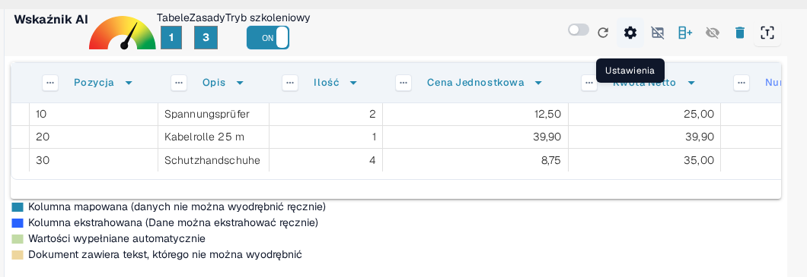
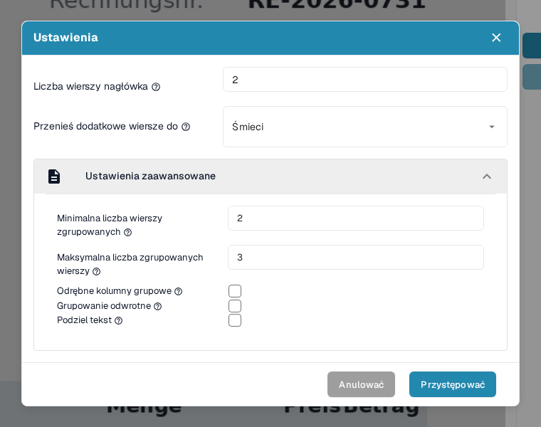
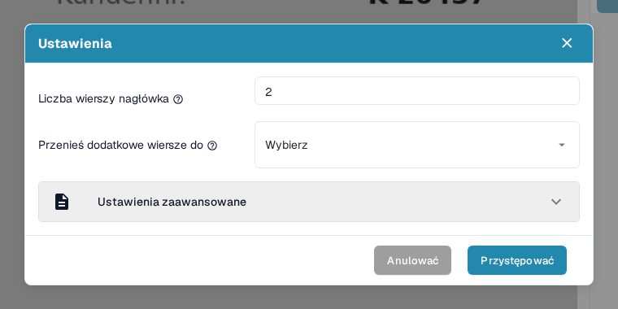
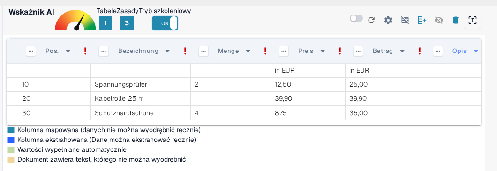
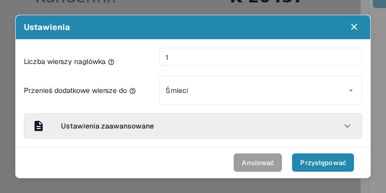
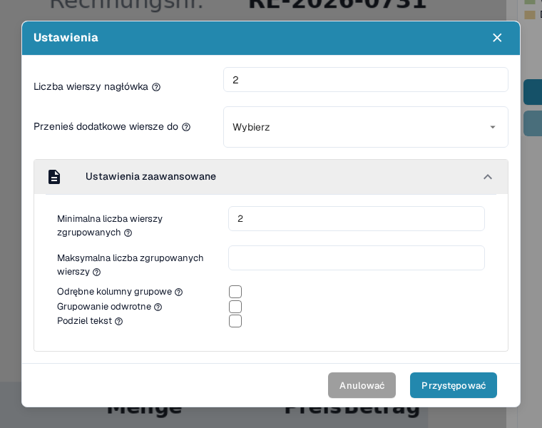
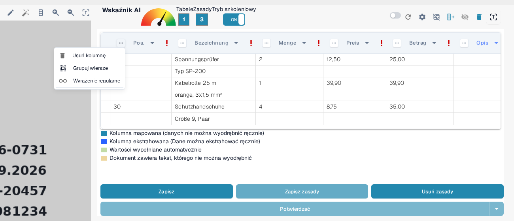
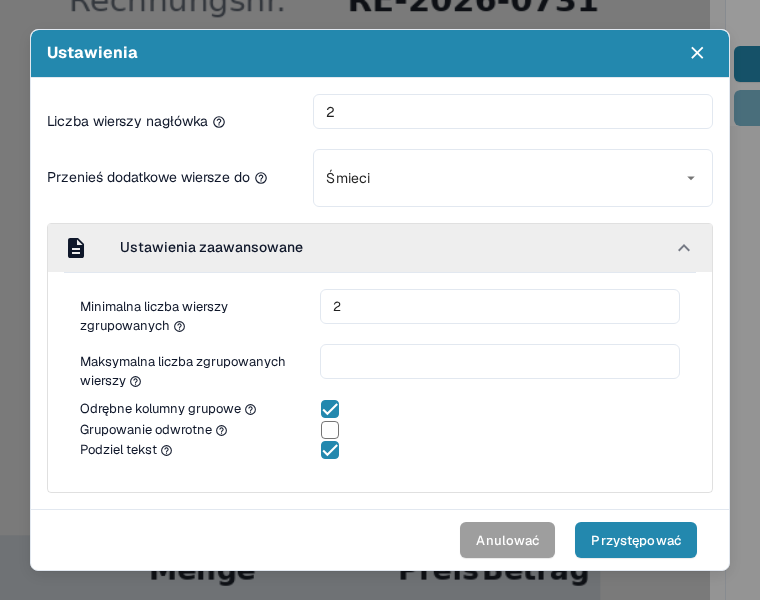
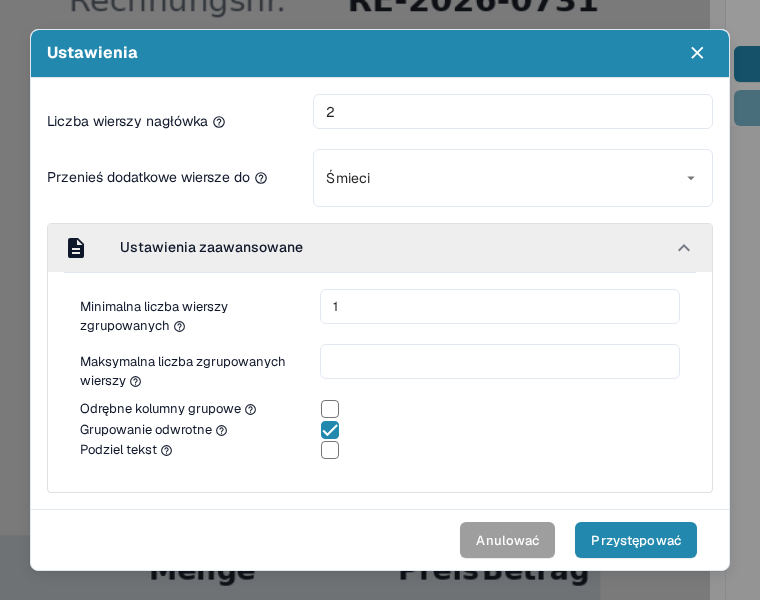
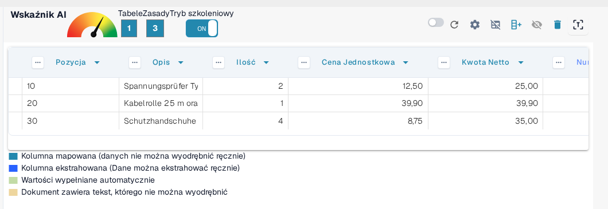

# Ustawienia zaawansowane

W niektórych dokumentach struktury tabel mogą być złożone — mogą obejmować wiele wierszy, zawierać zgrupowane informacje lub niepotrzebne dodatkowe wiersze. _Ustawienia zaawansowane_ w trybie szkoleniowym pozwalają dopasować ekstrakcję tabeli do takich przypadków, poprawiając dokładność i spójność.

Aby otworzyć te ustawienia, włącz **Tryb szkoleniowy** i kliknij ikonę zębatki **Ustawienia** na górnym pasku akcji:

<figure><figcaption>
Ikona zębatki Ustawienia na pasku akcji trybu szkoleniowego otwiera Ustawienia zaawansowane.
</figcaption></figure>

Okno dialogowe Ustawienia zawiera wszystkie opcje opisane na tej stronie. Rozwiń sekcję **Ustawienia zaawansowane**, aby przejść do opcji grupowania — pozostają one zwinięte do momentu otwarcia:

<figure><figcaption>
Sekcja Ustawienia zaawansowane ze wszystkimi opcjami grupowania.
</figcaption></figure>

Każda opcja jest opisana w osobnym punkcie poniżej, wraz z efektem, jaki daje w wyodrębnionej tabeli.

### Liczba wierszy nagłówka

**Użyj tego ustawienia, aby określić, z ilu wierszy składa się nagłówek tabeli.**

Niektóre tabele mają nagłówki zajmujące wiele wierszy. W tym przykładzie nagłówek tabeli obejmuje dwa wiersze:

<figure><figcaption>
Nagłówek tabeli zajmujący dwa wiersze.
</figcaption></figure>

Ustaw **Liczbę wierszy nagłówka** odpowiednio do tego:

<figure><figcaption>
Liczba wierszy nagłówka ustawiona na 2 w oknie Ustawienia.
</figcaption></figure>

#### Dlaczego jest to ważne?

Jeśli tego nie ustawisz, DocBits może potraktować drugi wiersz jako dane, a nie jako część nagłówka, co prowadzi do błędów ekstrakcji:

**Przed:**

<figure><figcaption>
Przed: drugi wiersz nagłówka jest traktowany jako dane.
</figcaption></figure>

Po:

<figure><figcaption>
Po: nagłówek i wiersze danych są prawidłowo rozdzielone.
</figcaption></figure>

### Przenoszenie dodatkowych wierszy do kosza

**Użyj tej opcji, aby odrzucić niechciane wpisy zajmujące wiele wierszy, np. opisy przechodzące na kolejne wiersze.**

W tym przykładzie opis przechodzi na kilka wierszy, ale istotny jest tylko pierwszy z nich:

<figure><figcaption>
Opis przechodzi na kilka wierszy, z których istotny jest tylko pierwszy.
</figcaption></figure>

Ustaw **Przenieś dodatkowe wiersze do** na **Śmieci**, aby usunąć nadmiarowe wiersze:

<figure><figcaption>
Opcja Przenieś dodatkowe wiersze do ustawiona na Śmieci.
</figcaption></figure>

**Wynik po mapowaniu:**

<figure><figcaption>
Wynik po mapowaniu: nadmiarowe wiersze zniknęły i pozostały tylko istotne wiersze.
</figcaption></figure>

### Minimalna liczba wierszy zgrupowanych

**Użyj tej opcji, gdy wiersze mają zostać zgrupowane pod jednym wierszem głównym (np. pozycje z kilkoma wierszami podrzędnymi).**

Tutaj istotne są tylko trzy z sześciu wierszy. Zmapowane są dwie kolumny kluczowe (np. Pozycja, Opis), a pozostałe są traktowane jako pola niestandardowe.

Zacznij od ustawienia **Liczby wierszy nagłówka** i **Minimalnej liczby wierszy zgrupowanych** — najmniejszej liczby wierszy, która musi należeć do grupy, zanim DocBits je połączy:

<figure><figcaption>
Liczba wierszy nagłówka i minimalna liczba wierszy zgrupowanych ustawione w oknie Ustawienia.
</figcaption></figure>

Ustaw także **Przenieś dodatkowe wiersze do** na **Śmieci**, aby usunąć nieistotne dane:

<figure><figcaption>
Dodatkowo opcja Przenieś dodatkowe wiersze do ustawiona na Śmieci.
</figcaption></figure>

Następnie zdefiniuj kolumnę klucza grupowania, np. _Pozycja_, otwierając menu tej kolumny i wybierając **Grupuj wiersze**:

<figure><figcaption>
Wybierz Grupuj wiersze w menu kolumny klucza grupowania (Pozycja).
</figcaption></figure>

Samo grupowanie oraz pozostałe narzędzia kolumn, które z nim współpracują (ręczne zaznaczanie wierszy, mapowanie kolumn i wyrażenia regularne), opisano krok po kroku w [Strukturyzacja i Poprawa Ekstrakcji Tabel w DocBits](improving-table-extraction-with-regex.md).

**Wynik:**

<figure><figcaption>
Wynik: sześć wierszy fizycznych jest zgrupowanych w trzy pozycje.
</figcaption></figure>

#### Maksymalna liczba zgrupowanych wierszy

**Użyj tej opcji, aby ograniczyć liczbę wierszy w jednej grupie.** Jej podpowiedź brzmi: _Ile wierszy maksymalnie może mieć Twoja zgrupowana kolumna?_ To odpowiednik Minimalnej liczby wierszy zgrupowanych: grupa, która wymagałaby więcej wierszy niż ta liczba, nie zostanie połączona.

Pozostaw pole puste, jeśli grupy mogą mieć dowolną wielkość. Ustaw je, gdy dokument zawiera pozycje z wieloma wierszami podrzędnymi, a chcesz, aby DocBits pozostawił nietypowo duże bloki bez grupowania, żebyś mógł je sprawdzić samodzielnie.

Ustawiasz je w tym samym obszarze okna co Minimalną liczbę wierszy zgrupowanych, bezpośrednio pod nią:

<figure><figcaption>
Maksymalna liczba zgrupowanych wierszy (tu 3) znajduje się bezpośrednio pod minimalną liczbą wierszy zgrupowanych.
</figcaption></figure>

#### Odrębne kolumny grupowe

**Użyj tej opcji, aby zachować w kolumnie klucza grupowania tylko unikalne wartości.**

Podpowiedź tej opcji w aplikacji brzmi: _Czy chcesz, aby w pogrupowanej kolumnie znalazły się tylko unikalne wartości?_ Włącz ją, gdy kilka grup miałoby tę samą wartość w kolumnie klucza grupowania, a chcesz, aby DocBits zachował tę wartość tylko raz — powtarzające się grupy pokażą wtedy pusty klucz zamiast zduplikowanej wartości.

To pole wyboru znajduje się w tej samej sekcji co Minimalna liczba wierszy zgrupowanych:

<figure><figcaption>
Odrębne kolumny grupowe to pole wyboru pod maksymalną liczbą zgrupowanych wierszy.
</figcaption></figure>

#### Grupowanie odwrotne

**Użyj tej opcji, gdy wiersz grupowania znajduje się&#x20;**_**po**_**&#x20;wierszach, które ma zgrupować.**

Podpowiedź tej opcji brzmi: _Czy chcesz połączyć wszystkie wiersze powyżej zgrupowanego atrybutu?_ Włącz ją, gdy wiersz zawierający klucz grupowania (np. pozycję lub kwotę) znajduje się _pod_ wierszami kontynuacji, aby DocBits połączył wiersze powyżej klucza w grupę, a nie wiersze poniżej:

<figure><figcaption>
Wiersz grupowania pojawia się po wierszach, które ma zgrupować.
</figcaption></figure>

Włącz **Grupowanie odwrotne**, grupuj według kolumny głównej (np. Kwota netto) i w razie potrzeby ustaw **Przenieś dodatkowe wiersze do** na **Śmieci**:

<figure><figcaption>
Grupowanie odwrotne włączone razem z opcją Przenieś dodatkowe wiersze do.
</figcaption></figure>

**Wynik końcowy:**

<figure><figcaption>
Wynik końcowy z grupowaniem odwrotnym.
</figcaption></figure>

#### Podziel tekst

**Użyj tej opcji, aby podzielić tekst komórki dokładnie w miejscu separatora kolumny.**

Podpowiedź tej opcji brzmi: _Czy chcesz podzielić tekst dokładnie w miejscu separatora kolumny?_ Włącz ją, gdy jedna wyodrębniona komórka zawiera tekst dwóch kolumn, których separator tabeli nie rozdzielił. DocBits ponownie wyodrębni wtedy tabelę i przetnie każdą wartość w zdefiniowanym miejscu separatora, zamiast zapisywać obie wartości w jednej komórce.

Ponieważ podział uruchamia ekstrakcję ponownie, DocBits prosi o potwierdzenie: okno potwierdzenia pojawia się od razu po zaznaczeniu pola, a podział jest stosowany dopiero po kliknięciu **Przystępować**.

Pole wyboru jest ostatnią opcją w sekcji Ustawienia zaawansowane:

<figure><figcaption>
Podziel tekst to ostatnie pole wyboru w sekcji.
</figcaption></figure>

<figure><figcaption>
Zaznaczenie opcji Podziel tekst otwiera to potwierdzenie; podział stosuje dopiero przycisk Przystępować.
</figcaption></figure>

### Podsumowanie

Używaj _Ustawień zaawansowanych_, aby nauczyć DocBits dokładnej obsługi bardziej złożonych lub niespójnych struktur tabel. Te ustawienia poprawiają precyzję ekstrakcji, uwzględniając:

* nagłówki zajmujące wiele wierszy
* opisy zajmujące wiele wierszy
* zgrupowane pozycje
* odwróconą kolejność zgrupowanych danych
* tekst, który trzeba podzielić w miejscu separatora kolumny

Włączenie tych opcji podczas szkolenia sprawia, że DocBits zapamiętuje właściwy układ dla przyszłych dokumentów od tego samego dostawcy. Gdy ekstrakcja wygląda poprawnie, zapisz konfigurację akcją **Zapis zasady** opisaną w [Zapisywanie i Usuwanie Reguł](save-and-delete-rules.md).
