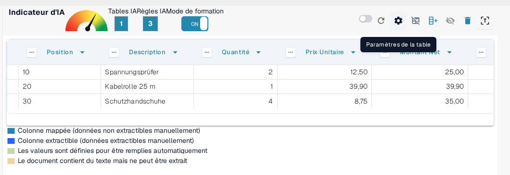
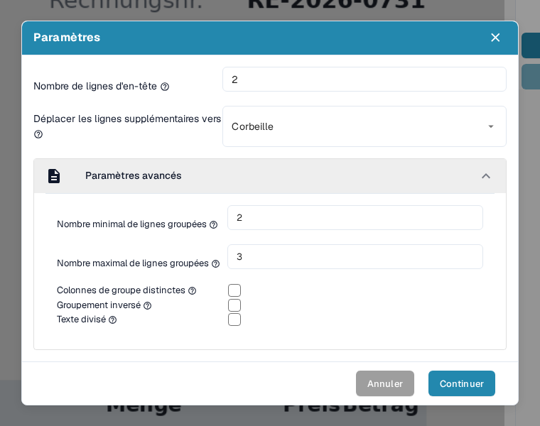
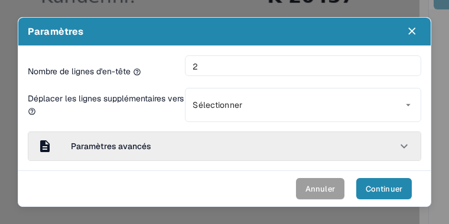
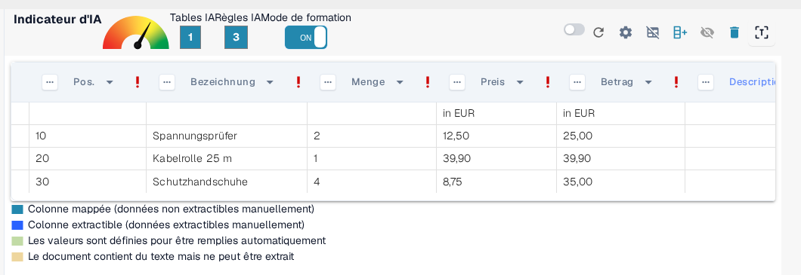
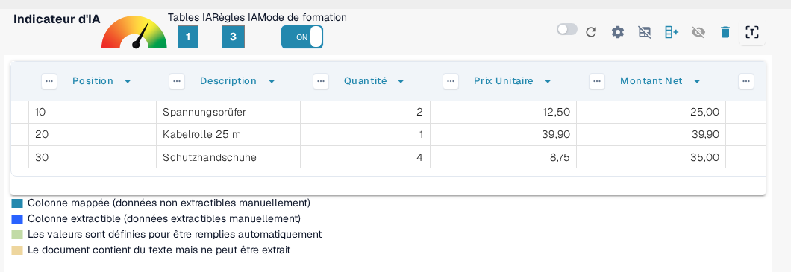
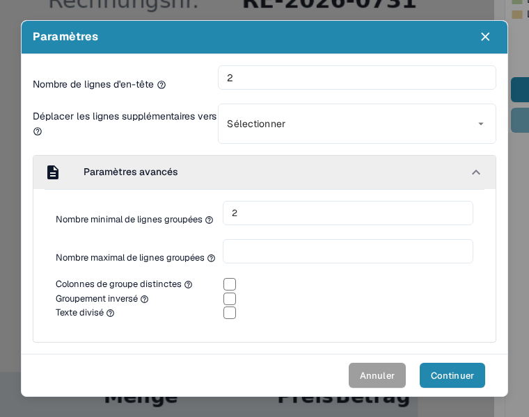
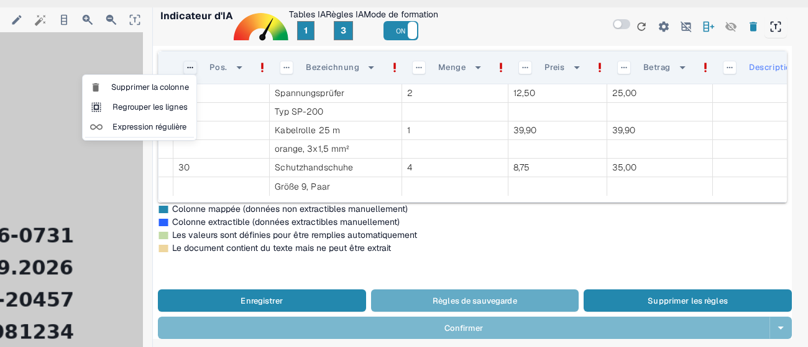
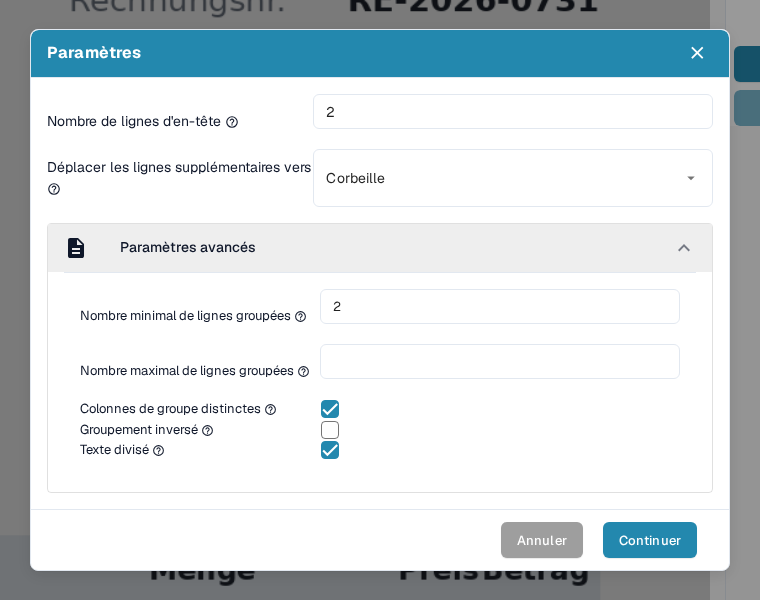
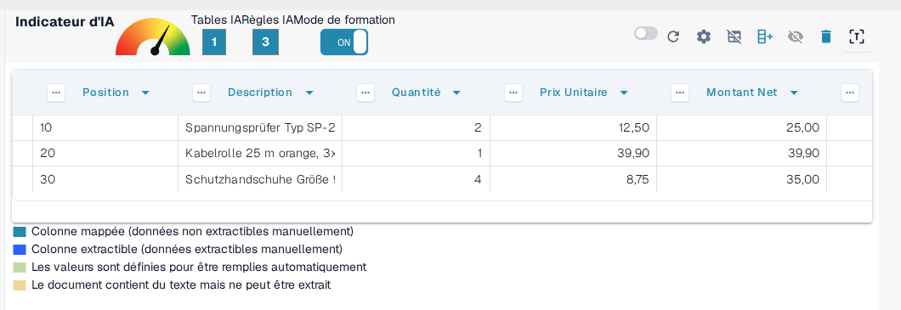
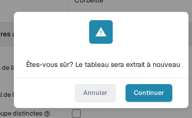

# Paramètres avancés

Dans certains documents, les structures de table peuvent être complexes : elles s'étendent sur plusieurs lignes, contiennent des informations regroupées ou incluent des lignes supplémentaires inutiles. Les _Paramètres avancés_ du mode de formation vous permettent d'affiner l'extraction de table pour ces cas et d'améliorer ainsi la précision et la cohérence.

Pour accéder à ces paramètres, activez le **Mode de formation** et cliquez sur l'icône d'engrenage **Paramètres de la table** dans la barre d'actions supérieure :

<figure><figcaption>
L'icône d'engrenage de la barre d'actions du mode de formation ouvre les paramètres avancés.
</figcaption></figure>

La fenêtre **Paramètres** contient toutes les options décrites sur cette page. Dépliez la section **Paramètres avancés** pour atteindre les options de regroupement, qui restent repliées jusqu'à ce que vous les ouvriez :

<figure><figcaption>
La section Paramètres avancés avec toutes les options de regroupement.
</figcaption></figure>

Chaque option est décrite dans sa propre section ci-dessous, avec l'effet qu'elle produit sur la table extraite.

### Nombre de lignes d'en-tête

**Utilisez ce paramètre pour définir le nombre de lignes qui composent l'en-tête de la table.**

Certaines tables ont un en-tête sur plusieurs lignes. Par exemple, l'en-tête de cette table s'étend sur deux lignes :

<figure><figcaption>
Un en-tête de table qui s'étend sur deux lignes.
</figcaption></figure>

Définissez le **Nombre de lignes d'en-tête** en conséquence :

<figure><figcaption>
Nombre de lignes d'en-tête réglé sur 2 dans la fenêtre Paramètres.
</figcaption></figure>

#### Pourquoi est-ce important ?

Si vous ne définissez pas ce paramètre, DocBits peut traiter la deuxième ligne comme une donnée au lieu de la considérer comme faisant partie de l'en-tête, ce qui provoque des erreurs d'extraction :

**Avant :**

<figure><figcaption>
Avant : la deuxième ligne d'en-tête est traitée comme une donnée.
</figcaption></figure>

Après :

<figure><figcaption>
Après : lignes d'en-tête et lignes de données sont correctement séparées.
</figcaption></figure>

### Déplacer les lignes supplémentaires vers la corbeille

**Utilisez cette option pour écarter les entrées sur plusieurs lignes non désirées, par exemple les descriptions qui débordent.**

Dans cet exemple, la description déborde sur plusieurs lignes alors que seule la première est pertinente :

<figure><figcaption>
La description déborde sur plusieurs lignes dont seule la première est pertinente.
</figcaption></figure>

Réglez **Déplacer les lignes supplémentaires vers** sur **Corbeille** pour supprimer le débordement :

<figure><figcaption>
Déplacer les lignes supplémentaires vers réglé sur Corbeille.
</figcaption></figure>

**Résultat après le mappage :**

<figure><figcaption>
Résultat après le mappage : les lignes de débordement ont disparu et seules les lignes pertinentes restent.
</figcaption></figure>

### Nombre minimal de lignes groupées

**Utilisez cette option lorsque des lignes doivent être regroupées sous une ligne principale (par exemple des positions avec plusieurs sous-lignes).**

Ici, seules trois des six lignes sont pertinentes. Deux colonnes clés sont mappées (par exemple Position et Description), les autres sont traitées comme des champs personnalisés.

Commencez par définir le **Nombre de lignes d'en-tête** et le **Nombre minimal de lignes groupées**, c'est-à-dire le plus petit nombre de lignes qui doivent appartenir à un groupe pour que DocBits les fusionne :

<figure><figcaption>
Nombre de lignes d'en-tête et Nombre minimal de lignes groupées réglés dans la fenêtre Paramètres.
</figcaption></figure>

Réglez également **Déplacer les lignes supplémentaires vers** sur **Corbeille** pour nettoyer les données non pertinentes :

<figure><figcaption>
Déplacer les lignes supplémentaires vers réglé sur Corbeille en complément.
</figcaption></figure>

Définissez ensuite la colonne clé du regroupement, par exemple _Position_, en ouvrant le menu de cette colonne et en choisissant **Group rows** :

<figure><figcaption>
Choisissez Group rows dans le menu de la colonne clé du regroupement (Position).
</figcaption></figure>

Le regroupement lui-même, ainsi que les autres outils de colonne qui l'accompagnent (sélection manuelle de lignes, mappage des colonnes et expression régulière), sont décrits pas à pas dans [Structuration et amélioration de l'extraction de table dans DocBits](improving-table-extraction-with-regex.md).

**Résultat :**

<figure><figcaption>
Résultat : les six lignes physiques sont regroupées en trois positions.
</figcaption></figure>

#### Nombre maximal de lignes groupées

**Utilisez cette option pour limiter le nombre de lignes qu'un groupe peut contenir.** Son infobulle, à côté du libellé, porte sur le nombre maximal de lignes de la colonne regroupée. C'est le pendant du Nombre minimal de lignes groupées : un groupe qui aurait besoin de plus de lignes que ce nombre n'est pas fusionné.

Laissez le champ vide lorsque les groupes peuvent avoir n'importe quelle taille. Renseignez-le lorsqu'un document contient des positions avec de nombreuses sous-lignes et que vous voulez que DocBits laisse les blocs anormalement grands non regroupés, afin de pouvoir les contrôler vous-même.

Vous le définissez dans la même zone de la fenêtre que le Nombre minimal de lignes groupées, juste en dessous :

<figure><figcaption>
Nombre maximal de lignes groupées (ici 3) se trouve directement sous Nombre minimal de lignes groupées.
</figcaption></figure>

#### Colonnes de groupe distinctes

**Utilisez cette option pour ne conserver que des valeurs uniques dans la colonne clé du regroupement.**

L'infobulle de l'option demande si vous voulez uniquement des valeurs uniques pour votre colonne regroupée. Activez-la lorsque plusieurs groupes porteraient la même valeur dans la colonne clé et que vous voulez que DocBits ne conserve cette valeur qu'une seule fois : les groupes répétés affichent alors une clé vide au lieu de la valeur en double.

Il s'agit d'une case à cocher dans la même section que le Nombre minimal de lignes groupées :

<figure><figcaption>
Colonnes de groupe distinctes est la case à cocher située sous Nombre maximal de lignes groupées.
</figcaption></figure>

#### Groupement inversé

**Utilisez cette option lorsque la ligne de regroupement se trouve&#x20;**_**après**_**&#x20;les lignes qu'elle doit regrouper.**

L'infobulle de l'option demande si vous voulez combiner toutes les lignes situées au-dessus de l'attribut regroupé. Activez-la lorsque la ligne qui porte la clé de regroupement (par exemple la position ou le montant) se trouve _sous_ ses lignes de continuation : DocBits fusionne alors les lignes situées au-dessus de la clé dans le groupe, et non celles du dessous :

<figure><figcaption>
La ligne de regroupement apparaît après les lignes qu'elle doit regrouper.
</figcaption></figure>

Activez **Groupement inversé**, regroupez par une colonne principale (par exemple Montant Net) et réglez **Déplacer les lignes supplémentaires vers** sur **Corbeille** si nécessaire :

<figure><figcaption>
Groupement inversé activé en complément de Déplacer les lignes supplémentaires vers la corbeille.
</figcaption></figure>

**Résultat final :**

<figure><figcaption>
Résultat final avec le groupement inversé.
</figcaption></figure>

#### Texte divisé

**Utilisez cette option pour diviser le texte d'une cellule exactement au séparateur de colonne.**

L'infobulle de l'option demande si vous voulez diviser le texte exactement au séparateur de colonne. Activez-la lorsqu'une cellule extraite contient le texte de deux colonnes que le séparateur de la table n'a pas séparées. DocBits extrait alors à nouveau la table et coupe chaque valeur à la position du séparateur que vous avez définie, au lieu de stocker les deux valeurs dans une seule cellule.

Comme la division relance l'extraction, DocBits vous demande de confirmer avant de l'exécuter : la confirmation apparaît dès que vous cochez la case, et la division n'est appliquée qu'après avoir cliqué sur **Continuer**.

La case à cocher est la dernière option de la section Paramètres avancés :

<figure><figcaption>
Texte divisé est la dernière case à cocher de la section.
</figcaption></figure>

<figure><figcaption>
Cocher Texte divisé ouvre cette confirmation ; seul Continuer applique la division.
</figcaption></figure>

### Résumé

Utilisez les _Paramètres avancés_ pour apprendre à DocBits à traiter correctement des structures de table plus complexes ou irrégulières. Ces paramètres améliorent la précision de l'extraction en tenant compte des éléments suivants :

* En-têtes sur plusieurs lignes
* Descriptions sur plusieurs lignes
* Positions regroupées
* Ordre inverse des données regroupées
* Texte à diviser au niveau d'un séparateur de colonne

Activer ces options pendant la formation garantit que DocBits mémorise la bonne disposition pour les futurs documents du même fournisseur. Une fois l'extraction correcte, enregistrez la configuration avec l'action **Règles de sauvegarde** décrite dans [Enregistrer et Supprimer les Règles](save-and-delete-rules.md).
