# Impostazioni avanzate

In alcuni documenti le strutture delle tabelle sono complesse: l'intestazione occupa più righe, le informazioni sono raggruppate oppure sono presenti righe extra non necessarie. Le _Impostazioni avanzate_ in modalità di allenamento ti consentono di ottimizzare l'estrazione delle tabelle in questi casi, migliorando precisione e coerenza.

Per aprire queste impostazioni, attiva la **Modalità di allenamento** e clicca sull'icona a ingranaggio **Impostazioni** nella barra delle azioni in alto:

<figure>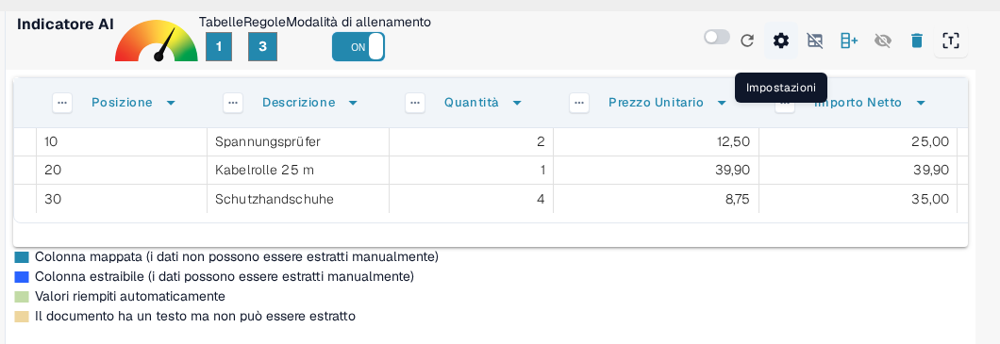<figcaption>
L'icona a ingranaggio nella barra della modalità di allenamento apre le impostazioni avanzate.
</figcaption></figure>

La finestra **Impostazioni** contiene tutte le opzioni descritte in questa pagina. Espandi la sezione **Impostazioni avanzate** per raggiungere le opzioni di raggruppamento, che restano compresse finché non le apri:

<figure><figcaption>
La sezione Impostazioni avanzate con tutte le opzioni di raggruppamento.
</figcaption></figure>

Ogni opzione è descritta nella propria sezione, insieme all'effetto che produce sulla tabella estratta.

## Conteggio delle righe dell'intestazione

**Usa questa impostazione per definire da quante righe è composta l'intestazione della tabella.** Il tooltip dell'opzione chiede: _Di quante righe è composta l'intestazione della tabella?_

Alcune tabelle hanno intestazioni su più righe. Ad esempio, l'intestazione di questa tabella occupa due righe:

<figure><figcaption>
Un'intestazione di tabella che occupa due righe.
</figcaption></figure>

Imposta il **Conteggio delle righe dell'intestazione** in base al numero di righe dell'intestazione:

<figure>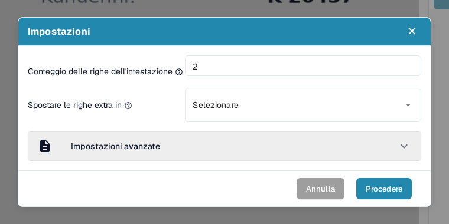<figcaption>
Conteggio delle righe dell'intestazione impostato su 2 nella finestra Impostazioni.
</figcaption></figure>

### Perché è importante?

Se non imposti questo valore, DocBits può considerare la seconda riga come dati anziché come parte dell'intestazione, causando errori di estrazione:

**Prima:**

<figure>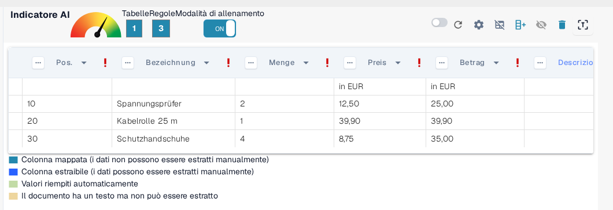<figcaption>
Prima: la seconda riga dell'intestazione viene trattata come dati.
</figcaption></figure>

Dopo:

<figure>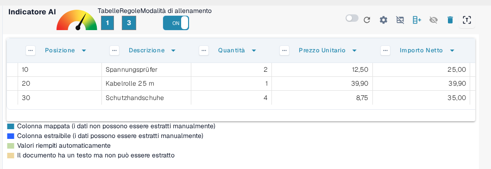<figcaption>
Dopo: intestazione e righe di dati sono separate correttamente.
</figcaption></figure>

## Spostare le righe extra in

**Usa questa opzione per eliminare le voci su più righe non desiderate, come le descrizioni che occupano più righe.** Il tooltip dell'opzione chiede: _In quale colonna si desidera spostare i dati non raggruppati?_

In questo esempio la descrizione si estende su più righe, ma solo la prima è rilevante:

<figure><figcaption>
La descrizione si estende su più righe, delle quali solo la prima è rilevante.
</figcaption></figure>

Imposta **Spostare le righe extra in** su **Rifiuti** per rimuovere il testo in eccesso:

<figure><figcaption>
Spostare le righe extra in impostato su Rifiuti.
</figcaption></figure>

**Risultato dopo la mappatura:**

<figure>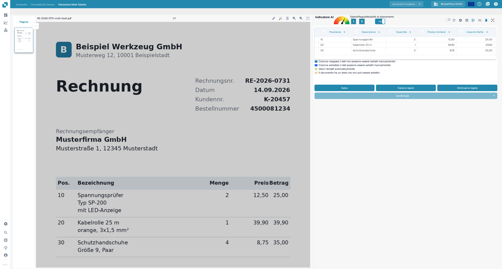<figcaption>
Risultato dopo la mappatura: le righe in eccesso non ci sono più e restano solo le righe rilevanti.
</figcaption></figure>

## Righe minime raggruppate

**Usa questa opzione quando le righe devono essere raggruppate sotto una riga principale (ad esempio articoli con più sottorighe).** Il tooltip dell'opzione chiede: _Quante righe ha la colonna minima raggruppata?_

Qui solo tre righe su sei sono rilevanti. Due colonne chiave sono mappate (ad esempio Posizione e Descrizione), mentre le altre sono trattate come campi personalizzati.

Inizia impostando il **Conteggio delle righe dell'intestazione** e le **Righe minime raggruppate**, cioè il numero minimo di righe che devono appartenere a un gruppo prima che DocBits le unisca:

<figure>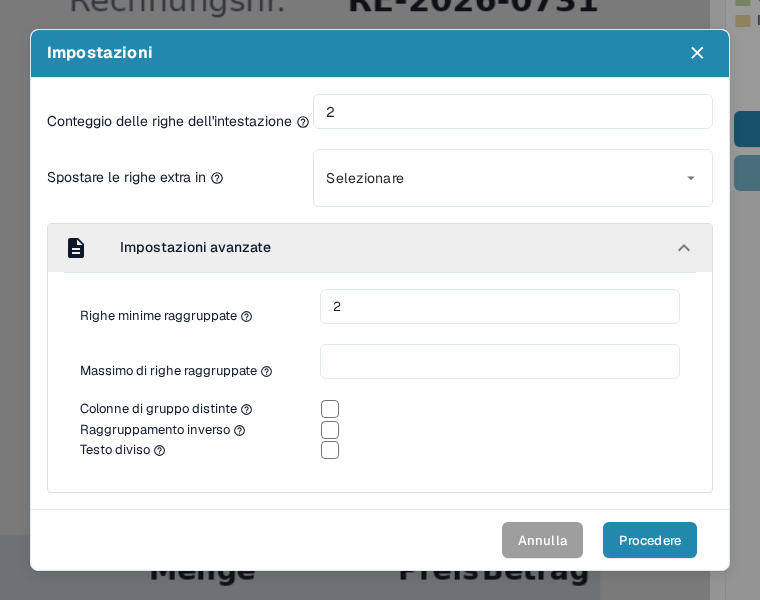<figcaption>
Conteggio delle righe dell'intestazione e Righe minime raggruppate impostati nella finestra Impostazioni.
</figcaption></figure>

Imposta anche **Spostare le righe extra in** su **Rifiuti** per eliminare i dati non rilevanti:

<figure><figcaption>
In aggiunta, Spostare le righe extra in impostato su Rifiuti.
</figcaption></figure>

Poi definisci la colonna chiave di raggruppamento, ad esempio _Posizione_, aprendo il menu di quella colonna e scegliendo la voce **File di gruppo** (l'opzione che raggruppa le righe):

<figure>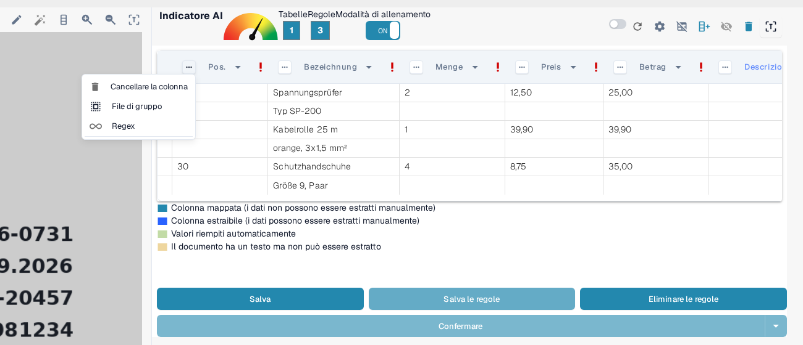<figcaption>
Scegli File di gruppo nel menu della colonna chiave di raggruppamento (Posizione).
</figcaption></figure>

Il raggruppamento stesso e gli altri strumenti delle colonne che funzionano insieme a esso (selezione manuale delle righe, mappatura delle colonne ed espressioni regolari) sono descritti passo dopo passo in [Strutturazione e Miglioramento dell'Estrazione delle Tabelle in DocBits](improving-table-extraction-with-regex.md).

**Risultato:**

<figure><figcaption>
Risultato: le sei righe fisiche sono raggruppate in tre articoli.
</figcaption></figure>

### Massimo di righe raggruppate

**Usa questa opzione per limitare quante righe può contenere un gruppo.** Il suo tooltip chiede: _Quante righe ha la colonna massima raggruppata?_ È la controparte di Righe minime raggruppate: un gruppo che richiederebbe più righe di questo numero non viene unito.

Lascia il campo vuoto quando i gruppi possono avere qualsiasi dimensione. Impostalo quando un documento contiene articoli con molte sottorighe e vuoi che DocBits lasci i blocchi insolitamente grandi non raggruppati, così puoi controllarli tu stesso.

Il campo si trova nella stessa area della finestra di Righe minime raggruppate, subito sotto:

<figure><figcaption>
Massimo di righe raggruppate (qui 3) si trova subito sotto Righe minime raggruppate.
</figcaption></figure>

### Colonne di gruppo distinte

**Usa questa opzione per mantenere solo valori unici nella colonna chiave di raggruppamento.** Il tooltip dell'opzione chiede: _Si vogliono solo valori unici per la colonna raggruppata?_

Attivala quando più gruppi porterebbero lo stesso valore nella colonna chiave e vuoi che DocBits mantenga quel valore una sola volta, così i gruppi ripetuti mostrano la chiave vuota invece del valore duplicato.

È una casella di controllo nella stessa sezione di Righe minime raggruppate:

<figure><figcaption>
Colonne di gruppo distinte è la casella di controllo sotto Massimo di righe raggruppate.
</figcaption></figure>

### Raggruppamento inverso

**Usa questa opzione quando la riga di raggruppamento compare** _**dopo**_ **le righe che dovrebbe raggruppare.** Il tooltip dell'opzione chiede: _Si desidera combinare tutte le righe sopra l'attributo raggruppato?_

Attivala quando la riga che contiene la chiave di raggruppamento (ad esempio la posizione o l'importo) sta _sotto_ le sue righe di continuazione: DocBits unisce così al gruppo le righe sopra la chiave, invece di quelle sotto:

<figure>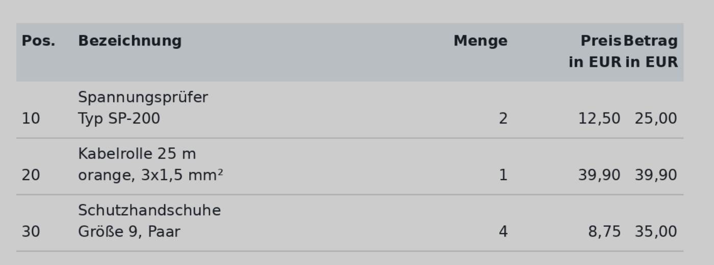<figcaption>
La riga di raggruppamento compare dopo le righe che dovrebbe raggruppare.
</figcaption></figure>

Attiva **Raggruppamento inverso**, raggruppa per una colonna principale (ad esempio Importo Netto) e imposta **Spostare le righe extra in** su **Rifiuti** se necessario:

<figure>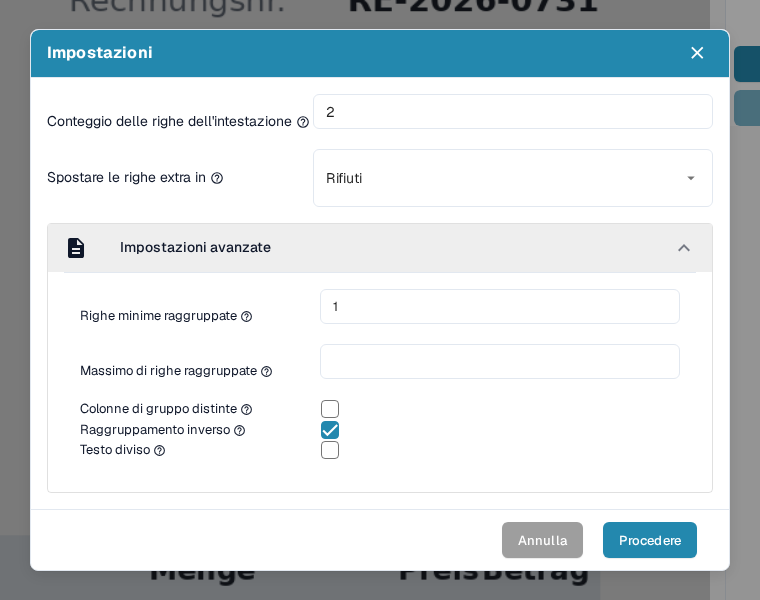<figcaption>
Raggruppamento inverso attivo insieme a Spostare le righe extra in Rifiuti.
</figcaption></figure>

**Risultato finale:**

<figure>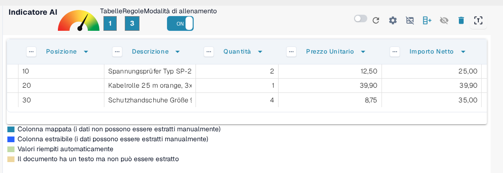<figcaption>
Risultato finale con il raggruppamento inverso.
</figcaption></figure>

### Testo diviso

**Usa questa opzione per dividere il testo di una cella esattamente in corrispondenza del separatore di colonna.** Il tooltip dell'opzione chiede: _Si vuole dividere il testo esattamente in corrispondenza del separatore di colonna?_

Attivala quando una cella estratta contiene il testo di due colonne che il separatore della tabella non ha separato. DocBits estrae di nuovo la tabella e taglia ogni valore nella posizione del separatore che hai definito, invece di memorizzare entrambi i valori in una sola cella.

Poiché la divisione ripete l'estrazione, DocBits ti chiede conferma prima di eseguirla: la richiesta compare appena selezioni la casella di controllo e la divisione viene applicata solo dopo aver cliccato **Procedere**.

La casella è l'ultima opzione della sezione Impostazioni avanzate:

<figure><figcaption>
Testo diviso è l'ultima casella di controllo della sezione.
</figcaption></figure>

<figure>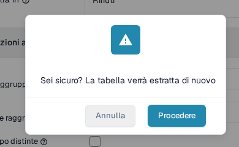<figcaption>
Selezionando Testo diviso compare questa conferma; solo Procedere applica la divisione.
</figcaption></figure>

## Riepilogo

Usa le _Impostazioni avanzate_ per insegnare a DocBits come gestire con precisione strutture di tabelle più complesse o irregolari. Queste impostazioni migliorano la precisione dell'estrazione tenendo conto di:

* Intestazioni su più righe
* Descrizioni su più righe
* Articoli raggruppati
* Ordine inverso dei dati raggruppati
* Testo da dividere in corrispondenza del separatore di colonna

Attivare queste opzioni durante l'allenamento garantisce che DocBits ricordi il layout corretto per i documenti futuri dello stesso fornitore. Quando l'estrazione è corretta, salva la configurazione con l'azione **Salva le regole**, descritta in [Salvare ed Eliminare Regole](save-and-delete-rules.md).
