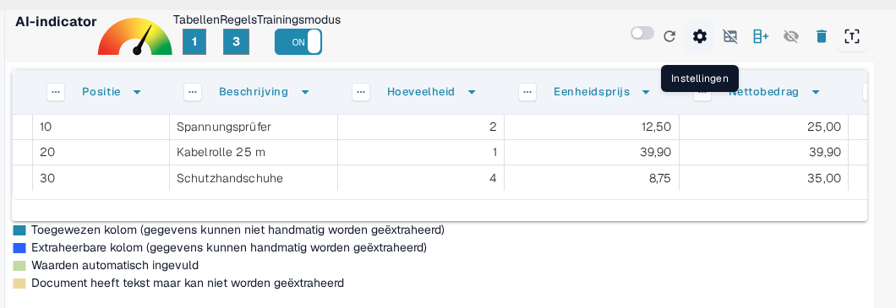
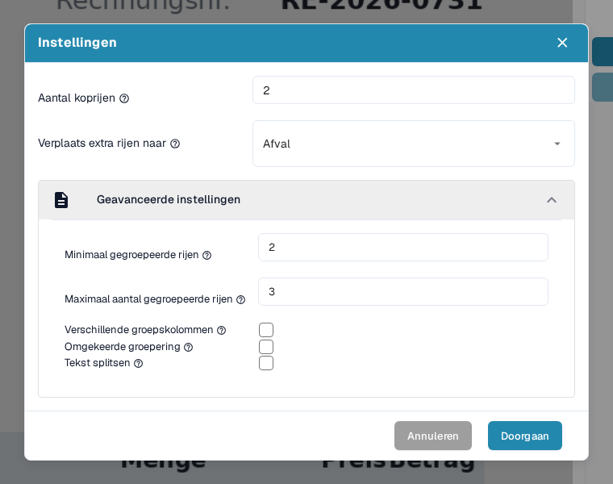
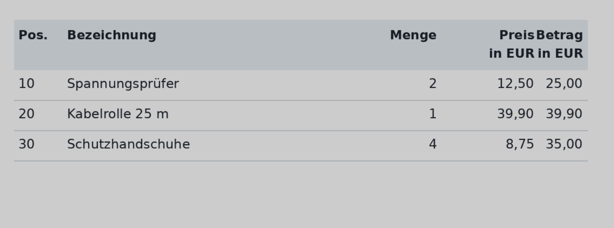
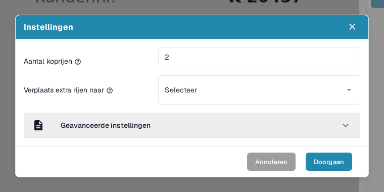
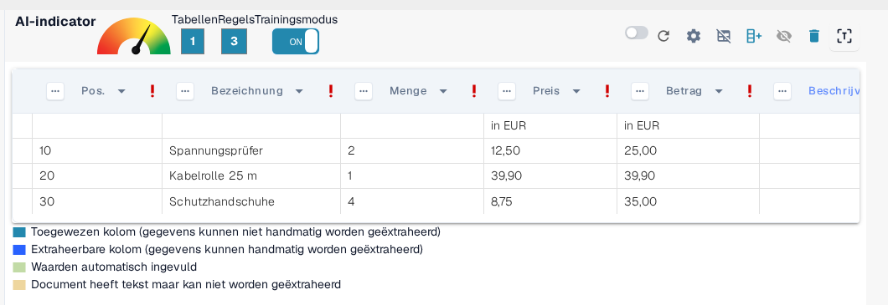
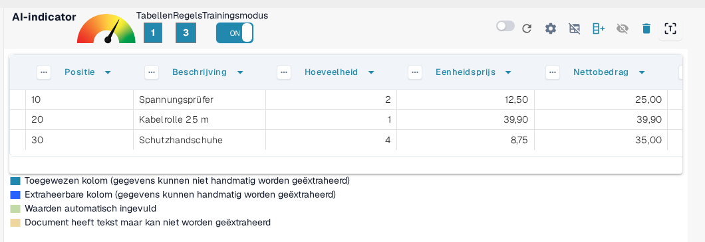
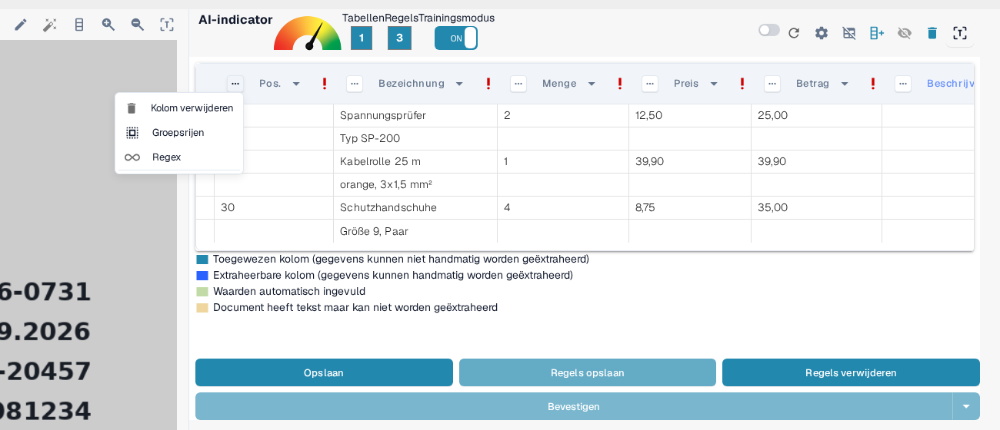
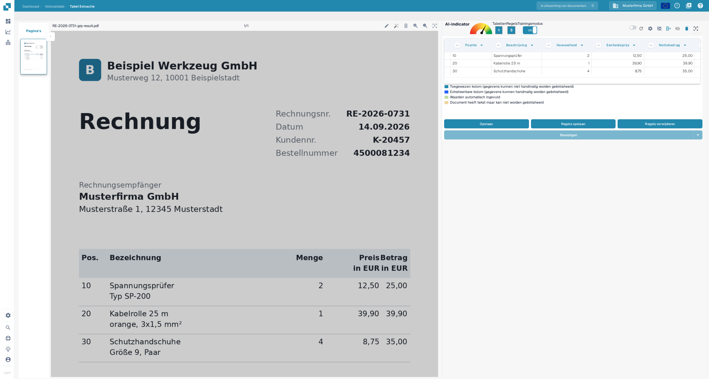
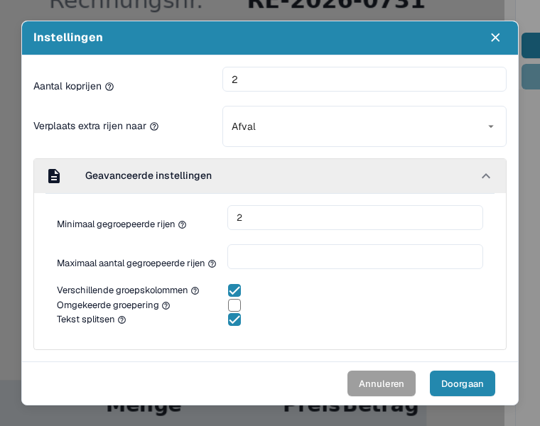
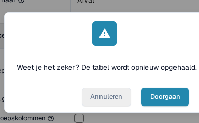

# Geavanceerde instellingen

In sommige documenten zijn tabelstructuren complex: ze lopen over meerdere regels, bevatten gegroepeerde informatie of hebben overbodige extra rijen. Met de _Geavanceerde instellingen_ in de trainingsmodus stelt u de tabelextractie voor zulke gevallen nauwkeuriger af, wat de nauwkeurigheid en de consistentie ten goede komt.

Om deze instellingen te openen, activeert u de **Trainingsmodus** en klikt u op het tandwiel **Instellingen** in de bovenste actiebalk:

<figure><figcaption>
Het tandwiel Instellingen in de actiebalk van de trainingsmodus opent de Geavanceerde instellingen.
</figcaption></figure>

In het venster **Instellingen** staan alle opties die op deze pagina worden beschreven. Klap de sectie **Geavanceerde instellingen** open om bij de groeperingsopties te komen; die blijven ingeklapt tot u ze opent:

<figure><figcaption>
De sectie Geavanceerde instellingen met alle groeperingsopties.
</figcaption></figure>

Elke optie wordt hieronder in een eigen sectie beschreven, samen met het effect ervan op de geëxtraheerde tabel.

### Aantal koprijen

**Gebruik deze instelling om te bepalen uit hoeveel regels de tabelkop bestaat.**

Sommige tabellen hebben een kop over meerdere regels. In dit voorbeeld loopt de kop van de tabel over twee regels:

<figure><figcaption>
Een tabelkop die over twee regels loopt.
</figcaption></figure>

Stel **Aantal koprijen** daarop in:

<figure><figcaption>
Aantal koprijen op 2 in het venster Instellingen.
</figcaption></figure>

#### Waarom is dit belangrijk?

Als u dit niet instelt, kan DocBits de tweede regel als gegevens behandelen in plaats van als deel van de kop, wat tot extractiefouten leidt:

**Voor:**

<figure><figcaption>
Voor: de tweede kopregel wordt als gegevens behandeld.
</figcaption></figure>

Na:

<figure><figcaption>
Na: kop- en gegevensrijen zijn correct gescheiden.
</figcaption></figure>

### Verplaats extra rijen naar Afval

**Gebruik dit om ongewenste regels met doorlopende tekst weg te gooien, zoals omschrijvingen die over meerdere regels lopen.**

In dit voorbeeld loopt de omschrijving door over meerdere regels, terwijl alleen de eerste regel relevant is:

<figure><figcaption>
De omschrijving loopt door over meerdere regels, waarvan alleen de eerste relevant is.
</figcaption></figure>

Zet **Verplaats extra rijen naar** op **Afval** om de overtollige regels te verwijderen:

<figure><figcaption>
Verplaats extra rijen naar ingesteld op Afval.
</figcaption></figure>

**Resultaat na toewijzen:**

<figure><figcaption>
Resultaat na toewijzen: de doorlopende regels zijn weg en alleen de relevante rijen blijven over.
</figcaption></figure>

### Minimaal gegroepeerde rijen

**Gebruik dit wanneer rijen onder één hoofdrij gegroepeerd moeten worden (bijv. artikelregels met meerdere subregels).**

Hier zijn slechts drie van de zes rijen relevant. Twee sleutelkolommen zijn toegewezen (bijv. Positie, Beschrijving), terwijl de andere als aangepaste velden worden behandeld.

Begin met **Aantal koprijen** en **Minimaal gegroepeerde rijen** — het kleinste aantal rijen dat bij een groep moet horen voordat DocBits ze samenvoegt:

<figure><figcaption>
Aantal koprijen en Minimaal gegroepeerde rijen ingesteld in het venster Instellingen.
</figcaption></figure>

Zet daarnaast **Verplaats extra rijen naar** op **Afval** om irrelevante gegevens op te ruimen:

<figure><figcaption>
Ook Verplaats extra rijen naar is ingesteld op Afval.
</figcaption></figure>

Definieer vervolgens de groeperingssleutelkolom, bijv. _Positie_, door het kolommenu van die kolom te openen en **Groepsrijen** te kiezen:

<figure><figcaption>
Kies Groepsrijen in het kolommenu van de groeperingssleutelkolom (Positie).
</figcaption></figure>

Groeperen zelf en de andere kolomhulpmiddelen die ermee samenwerken (handmatige rijselectie, kolomtoewijzing en regex) worden stap voor stap behandeld in [Tabellen structureren en de tabelextractie in DocBits verbeteren](improving-table-extraction-with-regex.md).

**Resultaat:**

<figure><figcaption>
Resultaat: de zes fysieke regels zijn gegroepeerd tot drie artikelregels.
</figcaption></figure>

#### Maximaal aantal gegroepeerde rijen

**Gebruik dit om te beperken hoeveel rijen één groep mag bevatten.** De tooltip ervan vraagt: _Hoeveel rijen heeft uw gegroepeerde kolom maximaal?_ Het is de tegenhanger van Minimaal gegroepeerde rijen: een groep die meer rijen nodig zou hebben dan dit aantal, wordt niet samengevoegd.

Laat het leeg wanneer groepen willekeurig groot mogen zijn. Stel het in wanneer een document artikelen met veel subregels bevat en u wilt dat DocBits uitzonderlijk grote blokken niet groepeert, zodat u ze zelf kunt controleren.

U stelt het in hetzelfde deel van het venster in als Minimaal gegroepeerde rijen, direct daaronder:

<figure><figcaption>
Maximaal aantal gegroepeerde rijen (hier 3) staat direct onder Minimaal gegroepeerde rijen.
</figcaption></figure>

#### Verschillende groepskolommen

**Gebruik dit om alleen unieke waarden in de groeperingssleutelkolom te behouden.**

De tooltip van de optie vraagt: _Wilt u alleen unieke waarden voor uw gegroepeerde kolom?_ Schakel de optie in wanneer meerdere groepen dezelfde waarde in de groeperingssleutelkolom zouden krijgen en u wilt dat DocBits die waarde maar één keer behoudt, zodat de herhaalde groepen een lege sleutel tonen in plaats van de dubbele waarde.

Het is een selectievakje in dezelfde sectie als Minimaal gegroepeerde rijen:

<figure><figcaption>
Verschillende groepskolommen is het selectievakje onder Maximaal aantal gegroepeerde rijen.
</figcaption></figure>

#### Omgekeerde groepering

**Gebruik dit wanneer de groeperingsrij pas _na_ de rijen staat die erbij gegroepeerd moeten worden.**

De tooltip van de optie vraagt: _Wilt u alle rijen boven het gegroepeerde kenmerk combineren?_ Schakel de optie in wanneer de rij met de groeperingssleutel (bijvoorbeeld de positie of het bedrag) _onder_ de bijbehorende vervolgregels staat, zodat DocBits de rijen boven de sleutel in de groep samenvoegt in plaats van de rijen eronder:

<figure><figcaption>
De groeperingsrij staat na de rijen die erbij gegroepeerd moeten worden.
</figcaption></figure>

Schakel **Omgekeerde groepering** in, groepeer op een hoofdkolom (bijv. Nettobedrag) en stel indien nodig **Verplaats extra rijen naar** in op **Afval**:

<figure><figcaption>
Omgekeerde groepering ingeschakeld samen met Verplaats extra rijen naar Afval.
</figcaption></figure>

**Eindresultaat:**

<figure><figcaption>
Eindresultaat met omgekeerde groepering.
</figcaption></figure>

#### Tekst splitsen

**Gebruik dit om celtekst precies op het kolomscheidingsteken te splitsen.**

De tooltip van de optie vraagt: _Wilt u de tekst precies op het punt van de kolomscheidingsteken splitsen?_ Schakel de optie in wanneer één geëxtraheerde cel de tekst van twee kolommen bevat die door het tabelscheidingsteken niet zijn gescheiden. DocBits extraheert de tabel dan opnieuw en knipt elke waarde af op de positie van het door u bepaalde scheidingsteken, in plaats van beide waarden in één cel op te slaan.

Omdat het splitsen de extractie opnieuw uitvoert, vraagt DocBits eerst om bevestiging: de bevestiging verschijnt zodra u het selectievakje aanvinkt, en de splitsing wordt pas toegepast nadat u op **Doorgaan** hebt geklikt.

Het selectievakje is de laatste optie in de sectie Geavanceerde instellingen:

<figure><figcaption>
Tekst splitsen is het laatste selectievakje van de sectie.
</figcaption></figure>

<figure><figcaption>
Het aanvinken van Tekst splitsen opent deze bevestiging; alleen Doorgaan past de splitsing toe.
</figcaption></figure>

### Samenvatting

Gebruik de _Geavanceerde instellingen_ om DocBits te leren hoe het complexere of inconsistente tabelstructuren nauwkeurig verwerkt. Deze instellingen verbeteren de extractieprecisie door rekening te houden met:

* koppen over meerdere regels
* omschrijvingen over meerdere rijen
* gegroepeerde artikelregels
* omgekeerde volgorde van gegroepeerde gegevens
* tekst die op een kolomscheidingsteken gesplitst moet worden

Als u deze opties tijdens de training inschakelt, onthoudt DocBits de juiste lay-out voor toekomstige documenten van dezelfde leverancier. Zodra de extractie goed uitziet, slaat u de configuratie op met de actie **Regels opslaan**, die wordt beschreven in [Regels opslaan en verwijderen](save-and-delete-rules.md).
