# Configuración Avanzada

En algunos documentos, las estructuras de tabla pueden ser complejas: abarcan varias líneas, contienen información agrupada o incluyen filas adicionales innecesarias. Los _Ajustes avanzados_ en el modo de formación te permiten ajustar la extracción de tablas para estos casos y mejorar la precisión y la coherencia.

Para acceder a estos ajustes, activa el **Modo Formación** y haz clic en el icono de engranaje **Ajustes** de la barra de acciones superior:

<figure>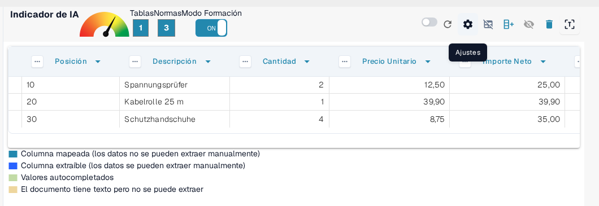<figcaption>
El engranaje Ajustes de la barra de acciones del modo formación abre la configuración avanzada.
</figcaption></figure>

El diálogo **Ajustes** contiene todas las opciones descritas en esta página. Despliega la sección **Ajustes avanzados** para llegar a las opciones de agrupación, que permanecen contraídas hasta que las abras:

<figure>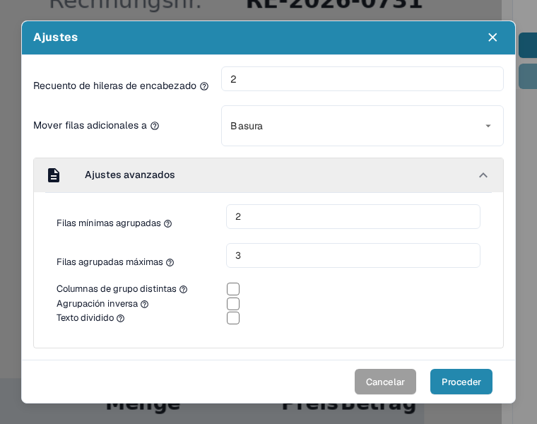<figcaption>
La sección Ajustes avanzados con todas las opciones de agrupación.
</figcaption></figure>

Cada opción se describe en su propia sección a continuación, junto con el efecto que tiene sobre la tabla extraída.

### Recuento de hileras de encabezado

**Utiliza este ajuste para definir cuántas líneas componen el encabezado de la tabla.**

Algunas tablas tienen encabezados de varias líneas. Por ejemplo, el encabezado de esta tabla abarca dos líneas:

<figure><figcaption>
Un encabezado de tabla que abarca dos líneas.
</figcaption></figure>

Ajusta el **Recuento de hileras de encabezado** para que coincida:

<figure><figcaption>
Recuento de hileras de encabezado configurado en 2 en el diálogo Ajustes.
</figcaption></figure>

#### ¿Por qué es importante?

Si no lo configuras, DocBits puede tratar la segunda línea como datos en lugar de como parte del encabezado, lo que provoca errores de extracción:

**Antes:**

<figure>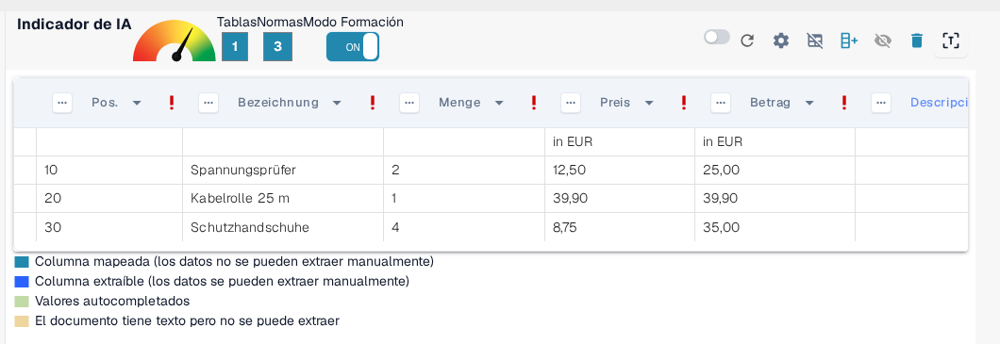<figcaption>
Antes: la segunda línea del encabezado se trata como datos.
</figcaption></figure>

Después:

<figure>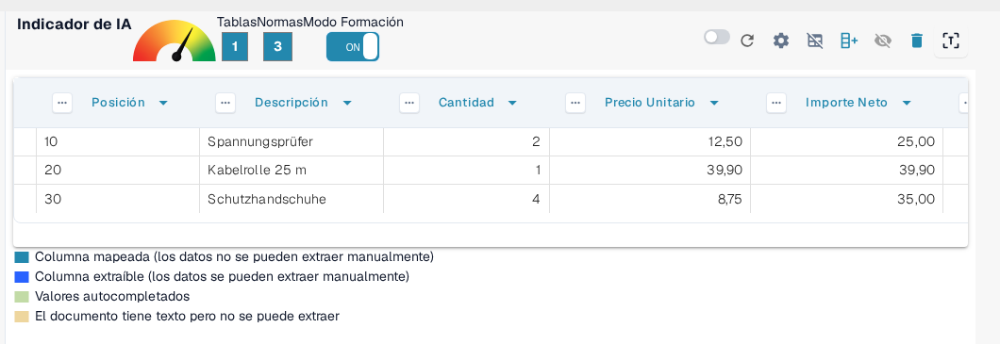<figcaption>
Después: las filas del encabezado y de los datos están separadas correctamente.
</figcaption></figure>

### Mover filas adicionales a Basura

**Utiliza esto para descartar entradas de varias líneas no deseadas, como descripciones que desbordan.**

En este ejemplo, la descripción se extiende a varias filas, pero solo la primera línea es relevante:

<figure>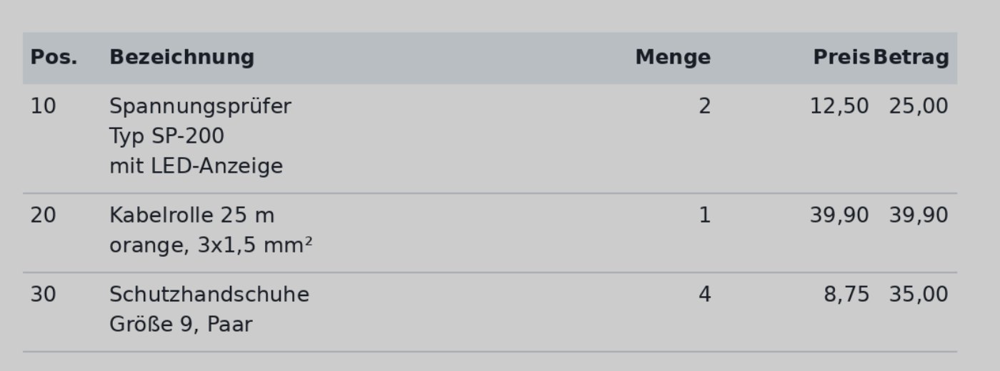<figcaption>
La descripción se extiende a varias líneas, de las que solo la primera es relevante.
</figcaption></figure>

Configura **Mover filas adicionales a** en **Basura** para eliminar el desbordamiento:

<figure><figcaption>
Mover filas adicionales a configurado en Basura.
</figcaption></figure>

**Resultado después del mapeo:**

<figure>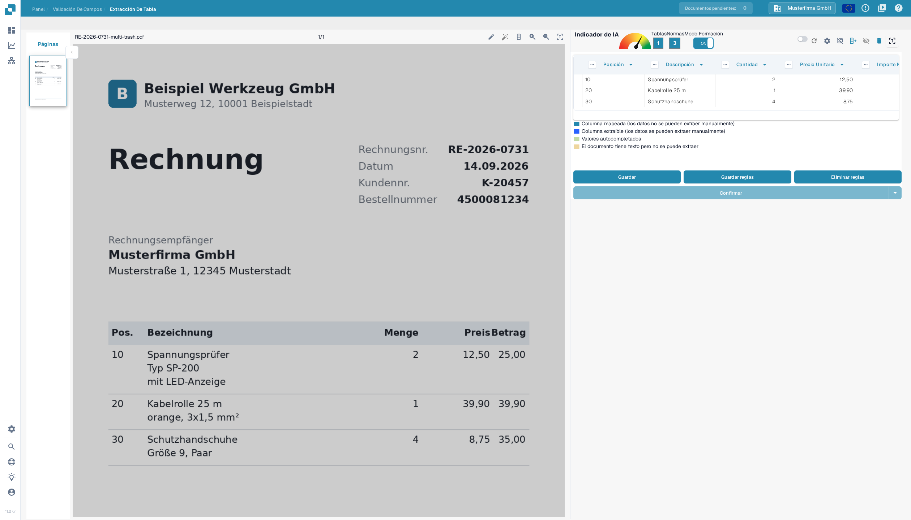<figcaption>
Resultado después del mapeo: las líneas sobrantes han desaparecido y solo quedan las filas relevantes.
</figcaption></figure>

### Filas minimas agrupadas

**Utiliza esto cuando las filas deban agruparse bajo una fila principal (por ejemplo, elementos de línea con varias sublíneas).**

Aquí solo tres de seis filas son relevantes. Se mapean dos columnas clave (por ejemplo, Posición y Descripción), mientras que las demás se tratan como campos personalizados.

Empieza configurando el **Recuento de hileras de encabezado** y las **Filas minimas agrupadas**, es decir, el número mínimo de filas que debe tener un grupo para que DocBits las una:

<figure>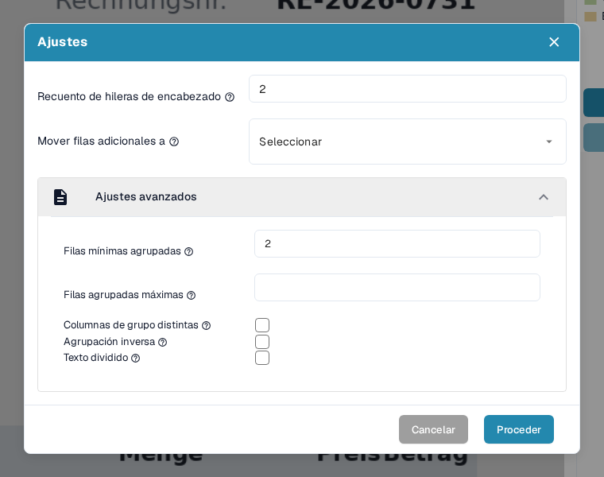<figcaption>
Recuento de hileras de encabezado y Filas minimas agrupadas configurados en el diálogo Ajustes.
</figcaption></figure>

Configura también **Mover filas adicionales a** en **Basura** para limpiar los datos que no son relevantes:

<figure>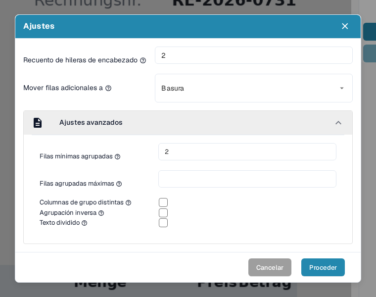<figcaption>
Mover filas adicionales a configurado además en Basura.
</figcaption></figure>

A continuación define la columna clave de agrupación, por ejemplo _Posición_, abriendo el menú de columna de esa columna y eligiendo **Hileras grupales**:

<figure><figcaption>
Elige Hileras grupales en el menú de la columna clave de agrupación (Posición).
</figcaption></figure>

Las otras dos entradas de ese menú actúan sobre la misma columna: con **Eliminar columna** ocultas la columna de la tabla extraída (la asignación de nombre de esa columna se libera y, si era la columna de agrupación, la agrupación se cancela); con **Regular** abres el diálogo **Gestionar reglas** en la pestaña REGULAR, donde defines la expresión regular de la columna, explicada en [Estructuración y Mejora de la Extracción de Tablas en DocBits](improving-table-extraction-with-regex.md).

La agrupación en sí y las demás herramientas de columna que funcionan junto con ella (selección manual de filas y mapeo de columnas) se explican paso a paso en [Estructuración y Mejora de la Extracción de Tablas en DocBits](improving-table-extraction-with-regex.md).

**Resultado:**

<figure>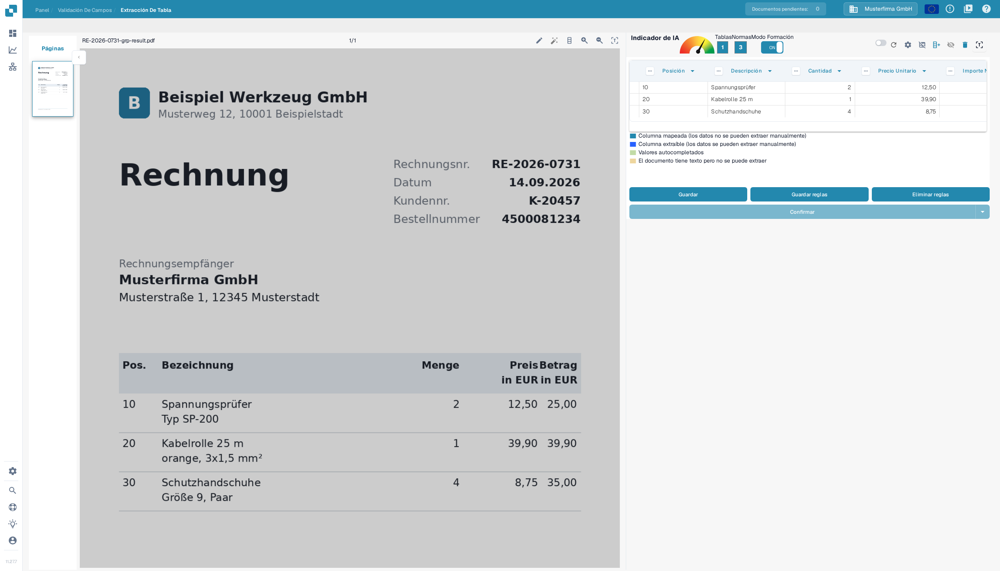<figcaption>
Resultado: las seis filas físicas se agrupan en tres elementos de línea.
</figcaption></figure>

#### Filas agrupadas máximas

**Utiliza esto para limitar cuántas filas puede contener un grupo.** La información sobre herramientas de la opción pregunta: _¿Cuántas filas tiene el máximo de su columna agrupada?_ Es la contrapartida de Filas minimas agrupadas: un grupo que necesitaría más filas que este número no se une.

Déjalo vacío cuando los grupos puedan tener cualquier tamaño. Configúralo cuando un documento contenga artículos con muchas sublíneas y quieras que DocBits deje sin agrupar los bloques inusualmente grandes para que puedas revisarlos tú mismo.

Se configura en la misma área del diálogo que Filas minimas agrupadas, directamente debajo:

<figure><figcaption>
Filas agrupadas máximas (aquí 3) está directamente debajo de Filas minimas agrupadas.
</figcaption></figure>

#### Columnas de grupo distintas

**Utiliza esto para conservar solo valores únicos en la columna clave de agrupación.**

La información sobre herramientas de la propia opción pregunta: _¿Quieres solo valores únicos para tu columna agrupada?_ Actívala cuando varios grupos lleven el mismo valor en la columna clave de agrupación y quieras que DocBits conserve ese valor una sola vez, de modo que los grupos repetidos muestren la clave vacía en lugar del valor duplicado.

Es una casilla de verificación de la misma sección que Filas minimas agrupadas:

<figure><figcaption>
Columnas de grupo distintas es la casilla situada debajo de Filas agrupadas máximas.
</figcaption></figure>

#### Agrupación inversa

**Utiliza esto cuando la fila de agrupación aparezca** _**después**_ **de las filas que debería agrupar.**

La información sobre herramientas de la opción pregunta: _¿Quieres combinar todas las filas sobre el atributo agrupado?_ Actívala cuando la fila que lleva la clave de agrupación (por ejemplo, la posición o el importe) esté _debajo_ de sus líneas de continuación, para que DocBits una en el grupo las filas situadas por encima de la clave en lugar de las que están por debajo:

<figure><figcaption>
La fila de agrupación aparece después de las filas que debería agrupar.
</figcaption></figure>

Activa **Agrupación inversa**, agrupa por una columna principal (por ejemplo, Importe Neto) y configura **Mover filas adicionales a** en **Basura** si es necesario:

<figure>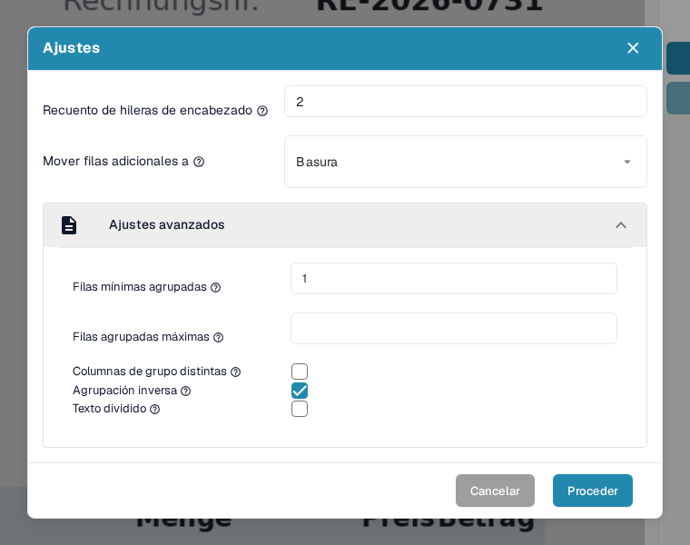<figcaption>
Agrupación inversa activada junto con Mover filas adicionales a Basura.
</figcaption></figure>

**Resultado final:**

<figure>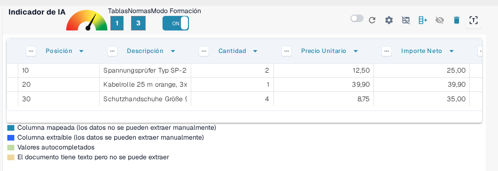<figcaption>
Resultado final con agrupación inversa.
</figcaption></figure>

#### Texto dividido

**Utiliza esto para dividir el texto de una celda exactamente en el separador de columna.**

La información sobre herramientas de la opción pregunta: _¿Quieres dividir el texto exactamente en el separador de columna?_ Actívala cuando una celda extraída contenga el texto de dos columnas que el separador de la tabla no separó. DocBits vuelve a extraer la tabla y corta cada valor en la posición del separador que hayas definido, en lugar de guardar ambos valores en una sola celda.

Como la división vuelve a ejecutar la extracción, DocBits te pide confirmación antes de ejecutarla: la confirmación aparece en cuanto marcas la casilla y la división solo se aplica después de hacer clic en **Proceder**.

La casilla es la última opción de la sección Ajustes avanzados:

<figure><figcaption>
Texto dividido es la última casilla de la sección.
</figcaption></figure>

<figure>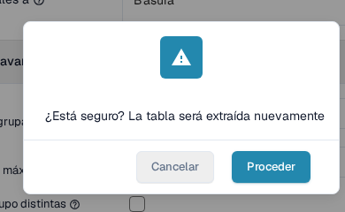<figcaption>
Al marcar Texto dividido aparece esta confirmación; solo Proceder aplica la división.
</figcaption></figure>

### Resumen

Utiliza los _Ajustes avanzados_ para enseñar a DocBits a manejar con precisión estructuras de tabla más complejas o inconsistentes. Estos ajustes mejoran la precisión de la extracción al tener en cuenta:

* Encabezados de varias líneas
* Descripciones de varias filas
* Elementos de línea agrupados
* Orden inverso de datos agrupados
* Texto que debe dividirse en un separador de columna

Activar estas opciones durante la formación garantiza que DocBits recuerde el diseño correcto para futuros documentos del mismo proveedor. Cuando la extracción sea correcta, guarda la configuración con la acción **Guardar reglas** descrita en [Guardar y Eliminar Reglas](save-and-delete-rules.md).
