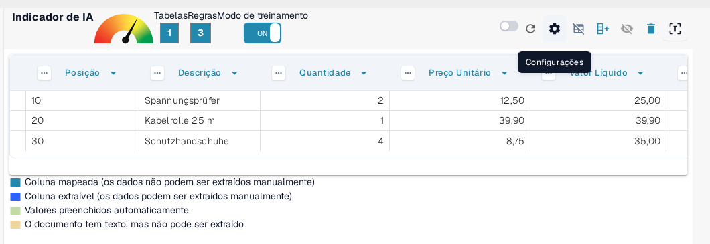
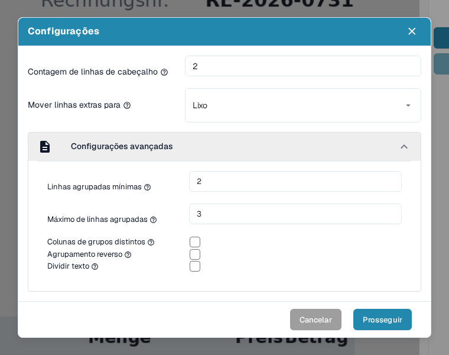
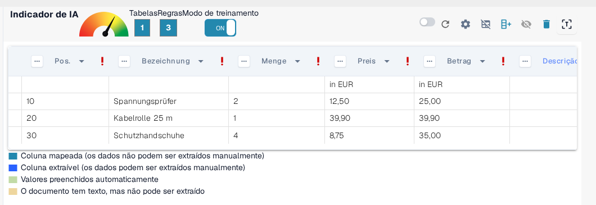
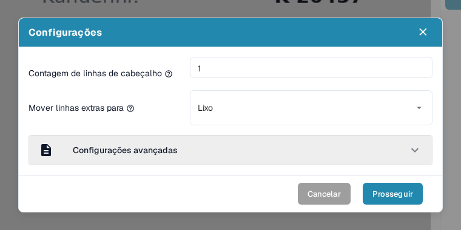
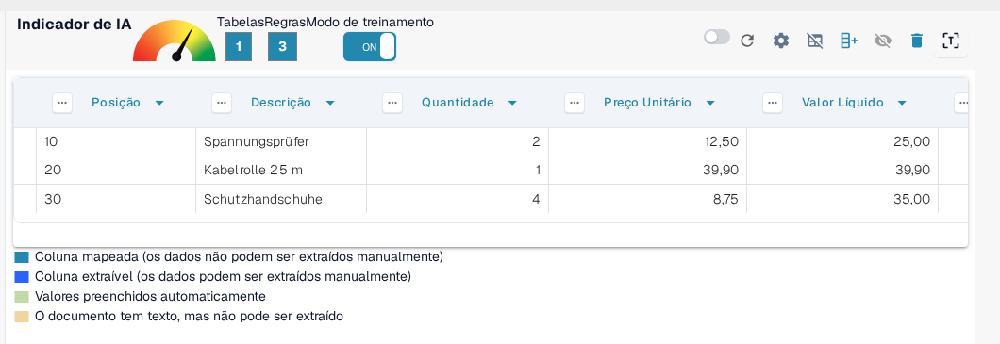
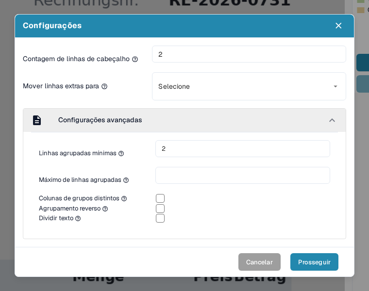
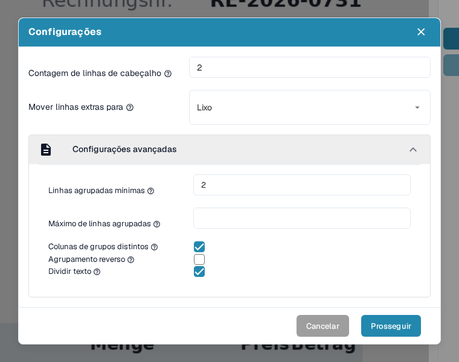
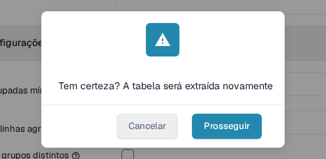

# Configurações Avançadas

Em alguns documentos, as estruturas de tabela podem ser complexas — abrangendo várias linhas, contendo informações agrupadas ou incluindo linhas extras desnecessárias. As _Configurações Avançadas_ no modo de treinamento permitem ajustar a extração de tabelas para esses casos, melhorando a precisão e a consistência.

Para acessar essas configurações, ative o **Modo de treinamento** e clique no ícone de engrenagem **Configurações** na barra de ações superior:

<figure><figcaption>
O ícone de engrenagem Configurações, na barra de ações do modo de treinamento, abre a caixa de diálogo Configurações.
</figcaption></figure>

A caixa de diálogo **Configurações** reúne todas as opções descritas nesta página. Expanda a seção **Configurações avançadas** para acessar as opções de agrupamento, que permanecem recolhidas até você abri-las:

<figure><figcaption>
A seção Configurações avançadas com todas as opções de agrupamento.
</figcaption></figure>

Cada opção é descrita em sua própria seção abaixo, junto com o efeito que tem sobre a tabela extraída.

### Contagem de linhas de cabeçalho

**Use essa configuração para definir quantas linhas compõem o cabeçalho da tabela.**

Algumas tabelas têm cabeçalhos com várias linhas. Por exemplo, o cabeçalho desta tabela ocupa duas linhas:

<figure><figcaption>
Um cabeçalho de tabela que ocupa duas linhas.
</figcaption></figure>

Defina a **Contagem de linhas de cabeçalho** de acordo:

<figure><figcaption>
Contagem de linhas de cabeçalho definida como 2 na caixa de diálogo Configurações.
</figcaption></figure>

#### Por que isso é importante?

Se você não definir isso, o DocBits pode tratar a segunda linha como dados em vez de parte do cabeçalho, o que leva a erros de extração:

**Antes:**

<figure><figcaption>
Antes: a segunda linha do cabeçalho é tratada como dados.
</figcaption></figure>

Depois:

<figure><figcaption>
Depois: linhas de cabeçalho e linhas de dados separadas corretamente.
</figcaption></figure>

### Mover linhas extras para o Lixo

**Use esta opção para descartar entradas de várias linhas que você não quer, como descrições que transbordam.**

No exemplo a seguir, a descrição se estende por várias linhas, mas apenas a primeira é relevante:

<figure><figcaption>
A descrição se estende por várias linhas, das quais apenas a primeira é relevante.
</figcaption></figure>

Defina **Mover linhas extras para** como **Lixo** para remover o excesso:

<figure><figcaption>
Mover linhas extras para definido como Lixo.
</figcaption></figure>

**Resultado após o mapeamento:**

<figure><figcaption>
Resultado após o mapeamento: as linhas excedentes desapareceram e só permanecem as linhas relevantes.
</figcaption></figure>

### Linhas agrupadas mínimas

**Use esta opção quando for necessário agrupar linhas sob uma linha principal (por exemplo, itens de linha com várias sublinhas).**

Aqui, apenas três das seis linhas são relevantes. Duas colunas principais estão mapeadas (por exemplo, Posição e Descrição), enquanto as demais são tratadas como campos personalizados.

Comece definindo a **Contagem de linhas de cabeçalho** e as **Linhas agrupadas mínimas** — o menor número de linhas que precisa pertencer a um grupo para que o DocBits as mescle:

<figure><figcaption>
Contagem de linhas de cabeçalho e Linhas agrupadas mínimas definidas na caixa de diálogo Configurações.
</figcaption></figure>

Defina também **Mover linhas extras para** como **Lixo** para eliminar os dados irrelevantes:

<figure><figcaption>
Mover linhas extras para definido como Lixo, além das demais opções.
</figcaption></figure>

Depois, defina a coluna chave do agrupamento, por exemplo _Posição_, abrindo o menu dessa coluna e escolhendo **Agrupar linhas**:

<figure><figcaption>
Escolha Agrupar linhas no menu da coluna chave do agrupamento (Posição).
</figcaption></figure>

O agrupamento em si e as outras ferramentas de coluna que funcionam em conjunto com ele (seleção manual de linhas, mapeamento de colunas e expressão regular) são explicados passo a passo em [Estruturação e Melhoria da Extração de Tabelas no DocBits](improving-table-extraction-with-regex.md).

**Resultado:**

<figure><figcaption>
Resultado: as seis linhas físicas são agrupadas em três itens de linha.
</figcaption></figure>

#### Máximo de linhas agrupadas

**Use esta opção para limitar quantas linhas um grupo pode conter.** A dica da opção pergunta: _Quantas linhas sua coluna agrupada tem no máximo?_ É a contrapartida das Linhas agrupadas mínimas: um grupo que precisaria de mais linhas do que esse número não é mesclado.

Deixe o campo vazio quando os grupos puderem ter qualquer tamanho. Preencha-o quando um documento tiver itens com muitas sublinhas e você quiser que o DocBits deixe blocos excepcionalmente grandes sem agrupar, para que você possa inspecioná-los manualmente.

Você define esse valor na mesma área da caixa de diálogo das Linhas agrupadas mínimas, logo abaixo delas:

<figure><figcaption>
Máximo de linhas agrupadas (aqui 3) fica logo abaixo de Linhas agrupadas mínimas.
</figcaption></figure>

#### Colunas de grupos distintos

**Use esta opção para manter apenas valores únicos na coluna chave do agrupamento.**

A dica da própria opção no aplicativo pergunta: _Você quer apenas valores únicos para sua coluna agrupada?_ Ative-a quando vários grupos tiverem o mesmo valor na coluna chave do agrupamento e você quiser que o DocBits mantenha esse valor apenas uma vez, de modo que os grupos repetidos mostrem uma chave vazia em vez do valor duplicado.

É uma caixa de seleção na mesma seção das Linhas agrupadas mínimas:

<figure><figcaption>
Colunas de grupos distintos é a caixa de seleção abaixo de Máximo de linhas agrupadas.
</figcaption></figure>

#### Agrupamento reverso

**Use esta opção quando a linha de agrupamento aparecer *depois* das linhas que ela deve agrupar.**

A dica da opção pergunta: _Você deseja combinar todas as linhas acima do atributo agrupado?_ Ative-a quando a linha que contém a chave de agrupamento (por exemplo, a posição ou o valor) estiver _abaixo_ de suas linhas de continuação, para que o DocBits mescle no grupo as linhas acima da chave, em vez das linhas abaixo dela:

<figure><figcaption>
A linha de agrupamento aparece depois das linhas que deve agrupar.
</figcaption></figure>

Ative **Agrupamento reverso**, agrupe por uma coluna principal (por exemplo, Valor Líquido) e defina **Mover linhas extras para** como **Lixo** se necessário:

<figure><figcaption>
Agrupamento reverso ativado junto com Mover linhas extras para Lixo.
</figcaption></figure>

**Resultado final:**

<figure><figcaption>
Resultado final com agrupamento reverso.
</figcaption></figure>

#### Dividir texto

**Use esta opção para dividir o texto da célula exatamente no separador de colunas.**

A dica da opção pergunta: _Você quer dividir o texto exatamente no separador de colunas?_ Ative-a quando uma célula extraída contiver o texto de duas colunas que o separador da tabela não separou. O DocBits então extrai a tabela novamente e corta cada valor na posição do separador que você definiu, em vez de armazenar os dois valores em uma única célula.

Como a divisão executa a extração novamente, o DocBits pede confirmação antes de executá-la: a confirmação aparece assim que você marca a caixa de seleção, e a divisão só é aplicada depois que você clica em **Prosseguir**.

A caixa de seleção é a última opção da seção Configurações avançadas:

<figure><figcaption>
Dividir texto é a última caixa de seleção da seção.
</figcaption></figure>

<figure><figcaption>
Marcar Dividir texto abre esta confirmação; apenas Prosseguir aplica a divisão.
</figcaption></figure>

### Resumo

Use as _Configurações Avançadas_ para ensinar ao DocBits como lidar com precisão com estruturas de tabela mais complexas ou inconsistentes. Essas configurações melhoram a precisão da extração ao considerar:

* Cabeçalhos com várias linhas
* Descrições com várias linhas
* Itens de linha agrupados
* Ordem inversa dos dados agrupados
* Texto que precisa ser dividido em um separador de colunas

Ativar essas opções durante o treinamento garante que o DocBits se lembre do layout correto para documentos futuros do mesmo fornecedor. Quando a extração estiver correta, salve a configuração com a ação **Salvar regras**, descrita em [Salvar e Excluir Regras](save-and-delete-rules.md).
