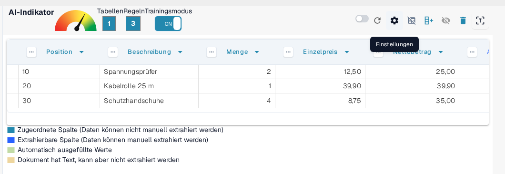
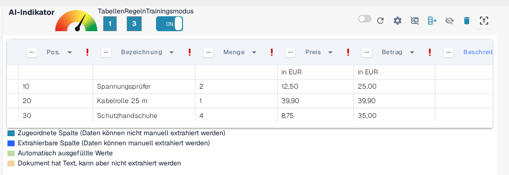
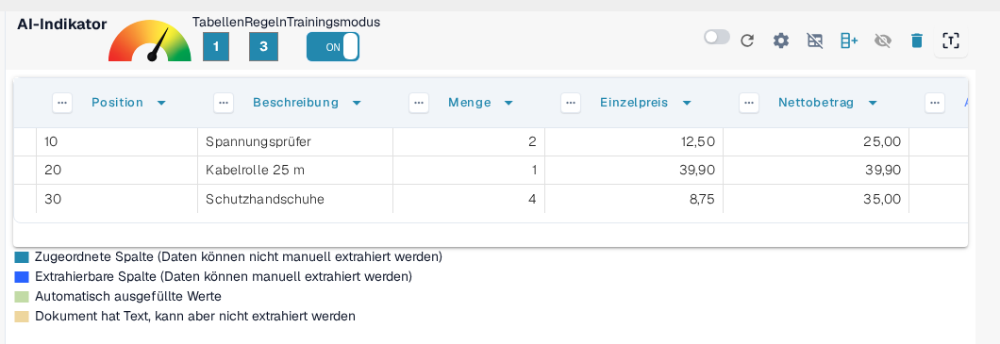
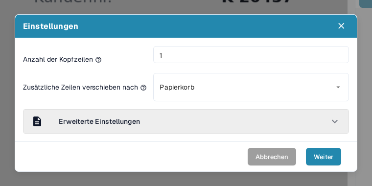
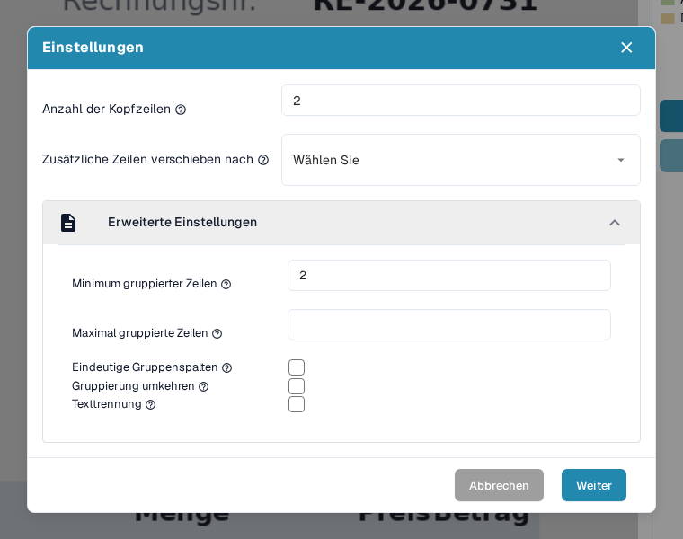
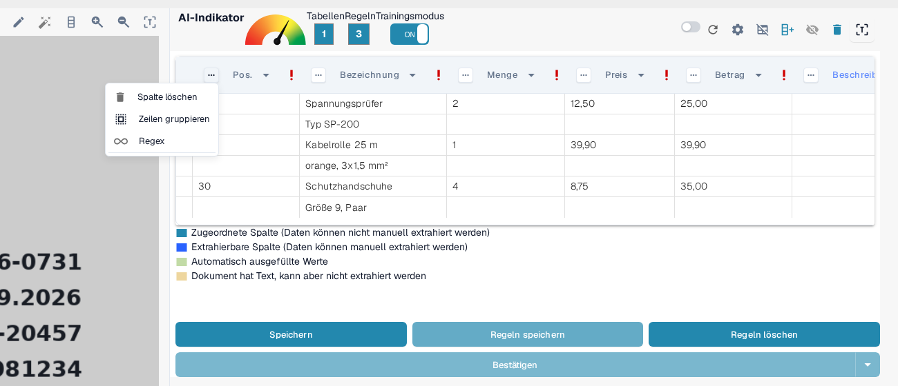
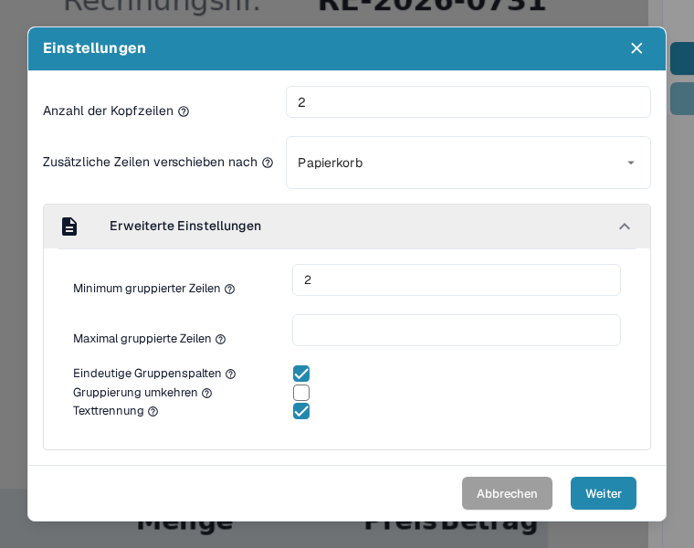
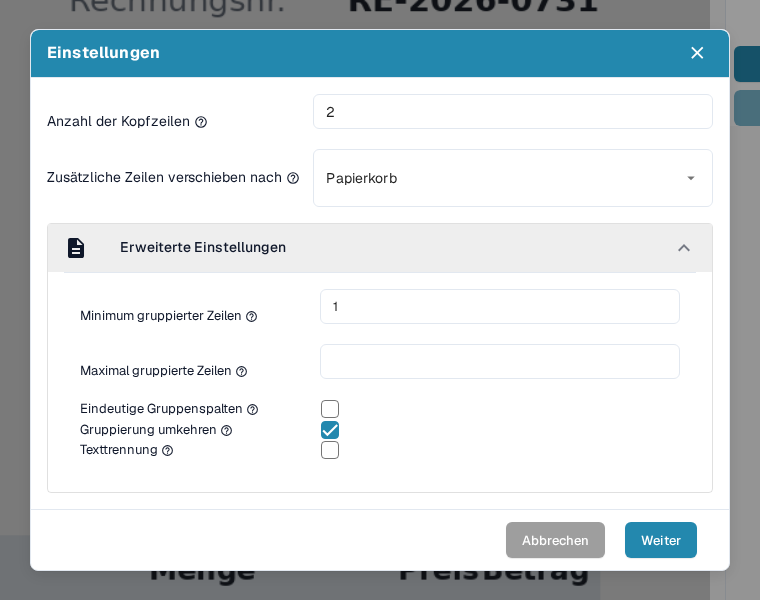
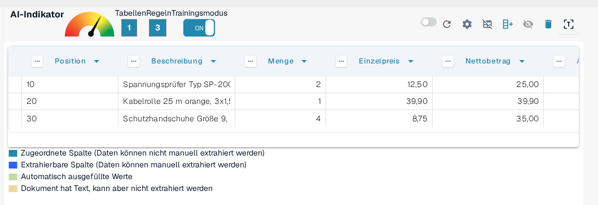
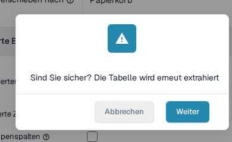

# Erweiterte Einstellungen

In manchen Dokumenten sind Tabellenstrukturen komplex: Sie reichen über mehrere Zeilen, enthalten gruppierte Informationen oder unnötige Zusatzzeilen. Mit den _Erweiterten Einstellungen_ im Trainingsmodus können Sie die Tabellenauswertung für solche Fälle fein abstimmen und damit Genauigkeit und Konsistenz verbessern.

Um diese Einstellungen zu öffnen, aktivieren Sie den **Trainingsmodus** und klicken in der oberen Aktionsleiste auf das Zahnrad **Einstellungen**:

<figure><figcaption>
Das Zahnrad Einstellungen in der Aktionsleiste des Trainingsmodus öffnet die Erweiterten Einstellungen.
</figcaption></figure>

Der Dialog **Einstellungen** enthält alle Optionen dieser Seite. Klappen Sie den Bereich **Erweiterte Einstellungen** auf, um die Gruppierungsoptionen zu erreichen; er bleibt zugeklappt, bis Sie ihn öffnen:

<figure><figcaption>
Der Bereich Erweiterte Einstellungen mit allen Gruppierungsoptionen.
</figcaption></figure>

Jede Option ist unten in einem eigenen Abschnitt beschrieben, zusammen mit ihrer Wirkung auf die ausgewertete Tabelle.

## Anzahl der Kopfzeilen

**Mit dieser Einstellung legen Sie fest, aus wie vielen Zeilen der Tabellenkopf besteht.**

Der Tooltip der Option fragt: _Aus wie vielen Zeilen besteht Ihr Tabellenkopf?_

Manche Tabellen haben mehrzeilige Kopfzeilen. Der Kopf dieser Tabelle erstreckt sich zum Beispiel über zwei Zeilen:

<figure><figcaption>
Eine Kopfzeile, die sich über zwei Zeilen erstreckt.
</figcaption></figure>

Stellen Sie die **Anzahl der Kopfzeilen** passend ein:

<figure><figcaption>
Anzahl der Kopfzeilen ist im Dialog Einstellungen auf 2 gesetzt.
</figcaption></figure>

### Warum ist das wichtig?

Wenn Sie diese Einstellung nicht setzen, behandelt DocBits die zweite Zeile möglicherweise als Daten statt als Teil des Kopfes. Das führt zu Auswertungsfehlern:

**Vorher:**

<figure><figcaption>
Vorher: Die zweite Kopfzeile wird als Datenzeile behandelt.
</figcaption></figure>

Nachher:

<figure><figcaption>
Nachher: Kopf- und Datenzeilen sind korrekt getrennt.
</figcaption></figure>

## Zusätzliche Zeilen verschieben nach

**Damit verwerfen Sie unerwünschte mehrzeilige Einträge, etwa überlaufende Beschreibungen.**

Der Tooltip der Option fragt: _In welche Spalte möchten Sie Ihre nicht gruppierten Daten verschieben?_ Zur Auswahl steht der **Papierkorb**.

In diesem Beispiel läuft die Beschreibung über mehrere Zeilen, aber nur die erste Zeile ist relevant:

<figure><figcaption>
Die Beschreibung läuft über mehrere Zeilen, von denen nur die erste relevant ist.
</figcaption></figure>

Setzen Sie **Zusätzliche Zeilen verschieben nach** auf **Papierkorb**, um den Überlauf zu entfernen:

<figure><figcaption>
Zusätzliche Zeilen verschieben nach ist auf Papierkorb gesetzt.
</figcaption></figure>

**Ergebnis nach der Zuordnung:**

<figure><figcaption>
Ergebnis: Die Überlaufzeilen sind entfernt, nur die relevanten Zeilen bleiben.
</figcaption></figure>

## Minimum gruppierter Zeilen

**Nutzen Sie diese Einstellung, wenn Zeilen unter einer Hauptzeile gruppiert werden sollen (z. B. Positionen mit mehreren Unterzeilen).**

Der Tooltip der Option fragt: _Wie viele Zeilen hat Ihre gruppierte Spalte mindestens?_

Hier sind nur drei von sechs Zeilen relevant. Zwei Schlüsselspalten sind zugeordnet (z. B. Position, Beschreibung), weitere Spalten werden als benutzerdefinierte Felder behandelt.

Legen Sie zuerst die **Anzahl der Kopfzeilen** und die **Minimum gruppierter Zeilen** fest, also die kleinste Zeilenzahl, die zu einer Gruppe gehören muss, bevor DocBits sie zusammenfasst:

<figure><figcaption>
Anzahl der Kopfzeilen und Minimum gruppierter Zeilen sind im Dialog Einstellungen gesetzt.
</figcaption></figure>

Stellen Sie zusätzlich **Zusätzliche Zeilen verschieben nach** auf **Papierkorb**, um irrelevante Daten zu bereinigen:

<figure><figcaption>
Zusätzlich ist Zusätzliche Zeilen verschieben nach auf Papierkorb gesetzt.
</figcaption></figure>

Legen Sie dann die Gruppierungsschlüsselspalte fest, zum Beispiel _Position_. Öffnen Sie dazu das Spaltenmenü dieser Spalte und wählen Sie **Zeilen gruppieren**:

<figure><figcaption>
Wählen Sie im Spaltenmenü der Gruppierungsschlüsselspalte (Pos.) den Eintrag Zeilen gruppieren.
</figcaption></figure>

Die Gruppierung selbst und die weiteren Spaltenwerkzeuge, die damit zusammenspielen (manuelle Zeilenauswahl, Spaltenzuordnung und Regex), sind Schritt für Schritt beschrieben unter [Strukturierung und Verbesserung der Tabellenauswertung in DocBits](improving-table-extraction-with-regex.md).

**Ergebnis:**

<figure><figcaption>
Ergebnis: Die physischen Zeilen sind zu drei Positionen gruppiert.
</figcaption></figure>

### Maximal gruppierte Zeilen

**Damit begrenzen Sie, wie viele Zeilen eine Gruppe enthalten darf.** Der Tooltip der Option fragt: _Wie viele Zeilen hat Ihre gruppierte Spalte maximal?_ Sie ist das Gegenstück zu Minimum gruppierter Zeilen: Eine Gruppe, die mehr Zeilen bräuchte als hier erlaubt, wird nicht zusammengefasst.

Lassen Sie das Feld leer, wenn Gruppen beliebig groß sein dürfen. Füllen Sie es aus, wenn ein Dokument Positionen mit vielen Unterzeilen enthält und Sie DocBits ungewöhnlich große Blöcke ungruppiert lassen möchten, damit Sie sie selbst prüfen können.

Sie setzen den Wert im selben Dialogbereich wie Minimum gruppierter Zeilen, direkt darunter:

<figure><figcaption>
Maximal gruppierte Zeilen (hier 3) steht direkt unter Minimum gruppierter Zeilen.
</figcaption></figure>

### Eindeutige Gruppenspalten

**Damit behalten Sie in der Gruppierungsschlüsselspalte nur eindeutige Werte.**

Der Tooltip der Option fragt: _Möchten Sie nur eindeutige Werte für Ihre gruppierte Spalte?_ Aktivieren Sie die Option, wenn mehrere Gruppen denselben Wert in der Gruppierungsschlüsselspalte tragen und DocBits diesen Wert nur einmal behalten soll; die wiederholten Gruppen zeigen dann einen leeren Schlüssel statt des doppelten Wertes.

Es ist ein Kontrollkästchen im selben Bereich wie Minimum gruppierter Zeilen:

<figure><figcaption>
Eindeutige Gruppenspalten ist das Kontrollkästchen unter Maximal gruppierte Zeilen.
</figcaption></figure>

### Gruppierung umkehren

**Nutzen Sie diese Option, wenn die Gruppierungszeile _nach_ den Zeilen steht, die sie gruppieren soll.**

Der Tooltip der Option fragt: _Möchten Sie alle Zeilen oberhalb des gruppierten Attributs kombinieren?_ Aktivieren Sie die Option, wenn die Zeile mit dem Gruppierungsschlüssel (zum Beispiel die Position oder der Betrag) _unter_ ihren Fortsetzungszeilen steht; DocBits fasst dann die Zeilen oberhalb des Schlüssels zur Gruppe zusammen statt der Zeilen darunter:

<figure><figcaption>
Die Gruppierungszeile steht nach den Zeilen, die sie gruppieren soll.
</figcaption></figure>

Aktivieren Sie **Gruppierung umkehren**, gruppieren Sie nach einer Hauptspalte (z. B. Nettobetrag) und setzen Sie bei Bedarf **Zusätzliche Zeilen verschieben nach** auf **Papierkorb**:

<figure><figcaption>
Gruppierung umkehren ist zusammen mit Zusätzliche Zeilen verschieben nach aktiviert.
</figcaption></figure>

**Endergebnis:**

<figure><figcaption>
Endergebnis mit umgekehrter Gruppierung.
</figcaption></figure>

### Texttrennung

**Damit teilen Sie Zellentext genau an der Spaltentrennlinie.**

Der Tooltip der Option fragt: _Möchten Sie den Text genau an der Spaltentrennlinie aufteilen?_ Aktivieren Sie die Option, wenn eine ausgewertete Zelle den Text zweier Spalten enthält, die die Tabellentrennlinie nicht getrennt hat. DocBits wertet die Tabelle dann erneut aus und schneidet jeden Wert an der von Ihnen definierten Trennlinienposition ab, statt beide Werte in einer Zelle zu speichern.

Da die Aufteilung die Auswertung erneut ausführt, fragt DocBits vorher nach: Die Bestätigung erscheint, sobald Sie das Kontrollkästchen anhaken, und die Aufteilung wird erst nach einem Klick auf **Weiter** ausgeführt. Mit **Abbrechen** schließen Sie die Bestätigung, ohne die Tabelle erneut auszuwerten.

Das Kontrollkästchen ist die letzte Option im Bereich Erweiterte Einstellungen:

<figure><figcaption>
Texttrennung ist das letzte Kontrollkästchen des Bereichs.
</figcaption></figure>

<figure><figcaption>
Das Anhaken von Texttrennung öffnet diese Bestätigung; erst Weiter führt die Aufteilung aus.
</figcaption></figure>

## Zusammenfassung

Mit den _Erweiterten Einstellungen_ bringen Sie DocBits bei, komplexere oder uneinheitliche Tabellenstrukturen zuverlässig zu behandeln. Diese Einstellungen verbessern die Auswertungsgenauigkeit, weil sie berücksichtigen:

* Mehrzeilige Kopfzeilen
* Mehrzeilige Beschreibungen
* Gruppierte Positionen
* Umgekehrte Reihenfolge gruppierter Daten
* Text, der an einer Spaltentrennlinie geteilt werden muss

Wenn Sie diese Optionen während des Trainings aktivieren, merkt sich DocBits die richtige Struktur für künftige Dokumente desselben Lieferanten. Sobald die Auswertung passt, speichern Sie die Konfiguration mit **Regeln speichern**, wie beschrieben unter [Regeln speichern und löschen](save-and-delete-rules.md).
