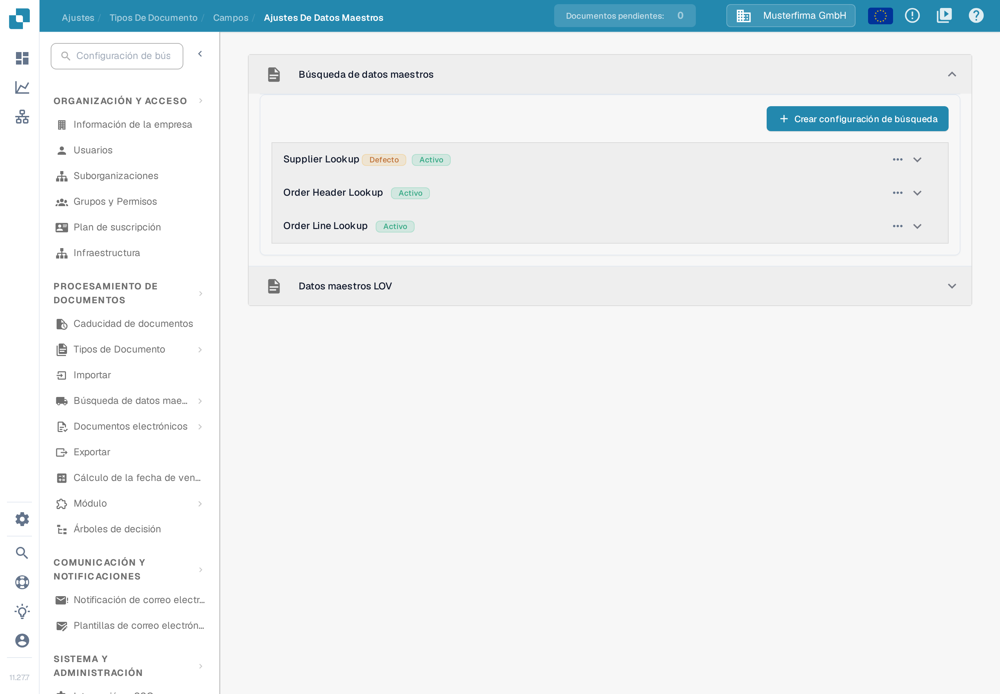
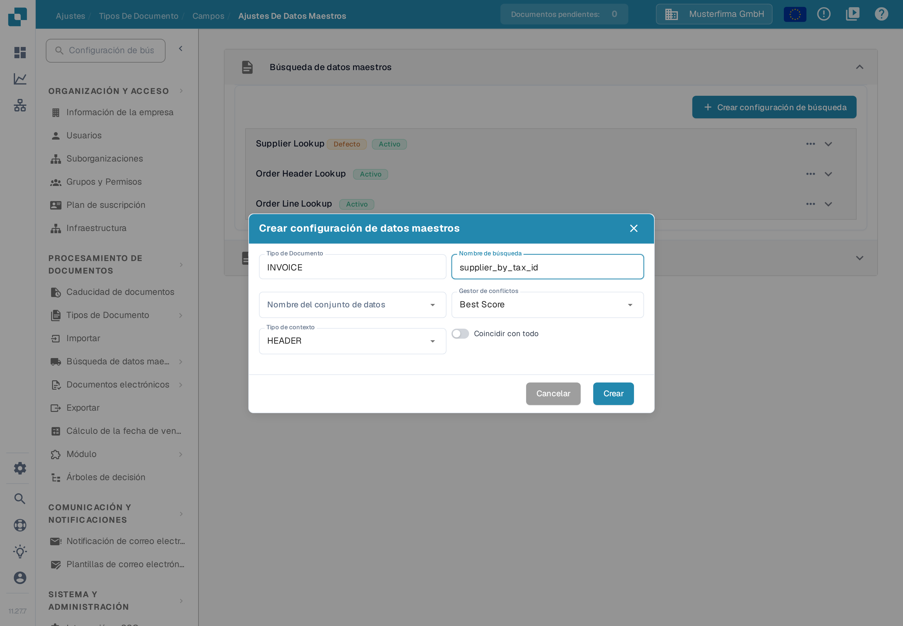
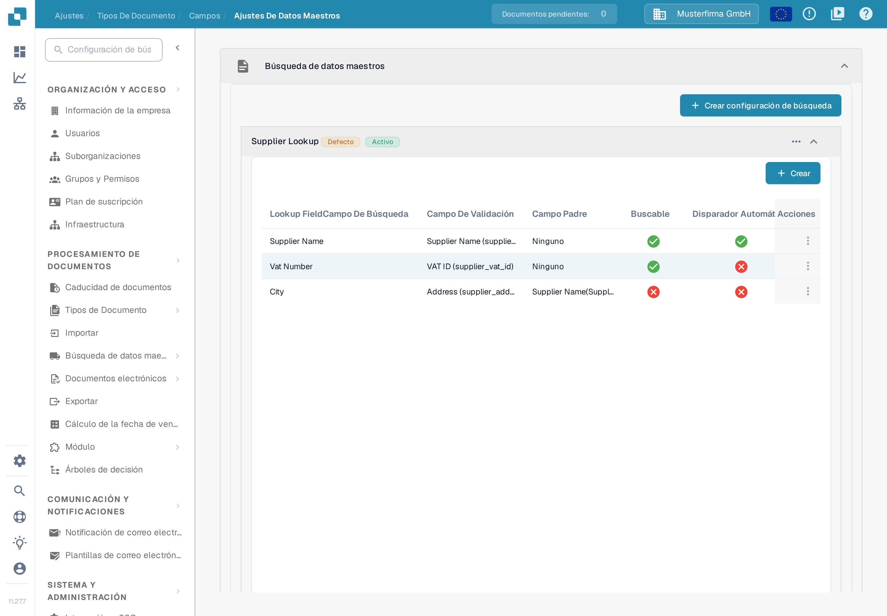
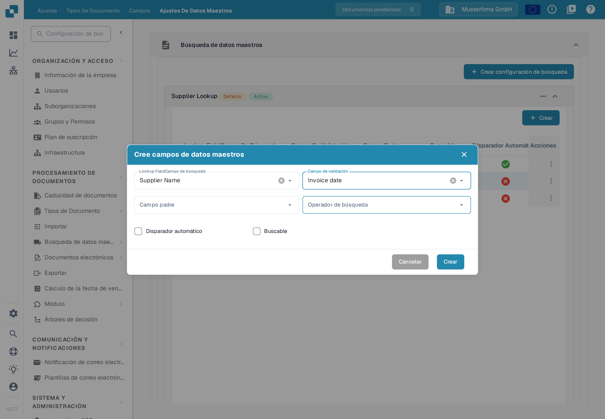

# Configuración de Datos Difusos con Datos Maestros

Use una búsqueda de datos maestros para reconocer un proveedor a partir de los valores de una factura. La búsqueda consulta un conjunto de datos importado y puede rellenar los campos de proveedor del documento. Configure cada tipo de documento por separado. El ejemplo muestra la configuración del tipo de documento de factura en una organización de prueba con datos ficticios.

## Abrir los ajustes de búsqueda

1. Abra **Ajustes** y, en **Procesamiento de documentos**, seleccione **Tipos de Documento**.
2. Seleccione el tipo de documento de la factura y abra **Campos** → **Ajustes De Datos Maestros**.
3. Expanda **Búsqueda de datos maestros**. La organización de prueba muestra las configuraciones **Supplier Lookup**, **Order Header Lookup** y **Order Line Lookup**, y debajo la sección **Datos maestros LOV**. Su organización puede tener otras configuraciones y otros nombres.

<figure><figcaption>
Seleccione una configuración de búsqueda para ver sus campos o elija Crear configuración de búsqueda para crear una nueva. Los nombres de las configuraciones son datos de ejemplo.
</figcaption></figure>

La etiqueta **Activo** indica que una configuración está habilitada y **Defecto** marca la configuración predeterminada. El menú de tres puntos muestra las acciones disponibles; en una configuración predeterminada, por ejemplo, **Desactivar**, **Duplicar** y **Vista**. Las configuraciones predeterminadas se pueden consultar, pero no editar ni eliminar. No desactive una búsqueda sin comprobar antes qué campos del documento dependen de ella.


Los datos maestros de proveedor correspondientes deben estar importados para que una búsqueda pueda encontrarlos. Consulte [Importación de datos maestros](../../../infor-integration-and-configuration/importing-customer-master-data/README.md) y [Ajustes de datos maestros](../../settings/global-settings/document-types/fields/master-data-settings.md) para la configuración general.


## Crear una configuración de búsqueda

Seleccione **Crear configuración de búsqueda**. Introduzca un **Nombre de búsqueda**, elija un **Nombre del conjunto de datos** y ajuste **Tipo de contexto** en **HEADER** para campos de cabecera o **LINE** para una tabla; para **LINE**, elija además la tabla correspondiente como detalle de contexto. Ajuste **Gestor de conflictos** para decidir qué ocurre cuando coinciden varios registros. **Coincidir con todo** exige que todos los campos de búsqueda usados coincidan con el mismo registro; si está desactivado, puede bastar un campo coincidente.

<figure><figcaption>
El diálogo se abrió para la documentación y no se creó ninguna configuración. El nombre supplier_by_tax_id es un dato de ejemplo introducido para la captura.
</figcaption></figure>

Las opciones del gestor de conflictos son **Best Score**, **Return None** y **Return First**. Use **Return None** cuando una persona deba decidir entre proveedores ambiguos; revise los ejemplos siguientes antes de elegir **Best Score** o **Coincidir con todo**.

## Elegir campos para el reconocimiento de proveedores

Expanda **Supplier Lookup** para ver sus asignaciones. La tabla muestra el **Campo de búsqueda** del conjunto de datos, su **Campo de validación** en el documento, el **Campo padre** opcional y si **Buscable** o **Disparador automático** están activados. En el ejemplo, **Supplier Name** es buscable y disparador automático, **Vat Number** es buscable y **City** no participa en la búsqueda; estos indicadores pueden ser distintos en otra organización.

<figure><figcaption>
Compruebe qué campos participan en el reconocimiento de proveedores antes de cambiar la regla de coincidencia. Los nombres y los valores de la tabla son datos de ejemplo.
</figcaption></figure>

Para añadir una asignación, seleccione **Crear** dentro del grupo expandido. En el diálogo **Cree campos de datos maestros**, elija **Campo de búsqueda**, **Campo de validación**, un **Campo padre** opcional y **Operador de búsqueda**. El **Campo padre** indica de qué otro valor depende el campo; en el ejemplo, **City** depende de **Supplier Name**. El operador determina cómo se compara el texto: **exacto** compara el texto completo, **comienza con**, **termina con** y **Contiene** comparan solo una parte, y **Smart** o **Smart Exact** buscan una coincidencia aproximada; use una comparación parcial solo cuando deba coincidir parte del texto. **Disparador automático** inicia una búsqueda cuando ese campo del documento recibe un valor. **Buscable** incluye el campo en la búsqueda y permite la búsqueda manual durante la validación. Seleccione **Crear** solo después de comprobar la asignación.

<figure><figcaption>
El formulario se revisó sin guardar un campo nuevo. Supplier Name e Invoice date son selecciones de ejemplo tomadas de las listas.
</figcaption></figure>

Los ejemplos siguientes explican cómo interactúan estos indicadores, **Coincidir con todo** y el gestor de conflictos. En esta comprobación no se generó ningún resultado real de reconocimiento de proveedores.

### **Cómo DocBits elige un proveedor**

Cuando llega un documento, DocBits busca el proveedor en sus datos maestros. Tres ajustes deciden el resultado. Esta sección los explica paso a paso, con ejemplos.

#### **Paso 1 — Qué campos se usan para la búsqueda**

DocBits usa un campo para la búsqueda solo cuando se cumplen ambos puntos:

* el campo está marcado como **Buscable** o **Disparador automático** en la configuración de búsqueda, y
* el campo tiene un valor en el documento.

No importa cómo llegó el valor al campo. Un campo entrenado, un campo rellenado por la IA y un valor escrito por una persona se tratan igual.


**Buscable hace dos cosas.** Muestra el icono azul de búsqueda en la pantalla de validación y además añade el campo a la búsqueda automática de proveedores. Un campo que solo deba buscarse a mano debe quedar sin marcar.


#### **Paso 2 — Una búsqueda, no una búsqueda por campo**

DocBits **no** busca cada campo por separado. Construye **una** búsqueda sobre todos los campos usados. **Coincidir con todo** decide cómo se combinan:

* **Coincidir con todo desactivado** (predeterminado) → «encuentra todos los proveedores que coincidan con el NIF **O** con el nombre del proveedor». Esto da una lista **más larga**.
* **Coincidir con todo activado** → «encuentra todos los proveedores que coincidan con el NIF **Y** con el nombre del proveedor». Esto da una lista **más corta**.

Tenga en cuenta que los operadores **Smart**, **Smart Exact** y **Contiene** buscan una parte del texto. El nombre «Meier» también encuentra «Meier Bau GmbH» y «Meier & Sons Ltd». Por eso un nombre de proveedor suele encontrar varios proveedores.

#### **Paso 3 — Qué ocurre cuando la lista tiene más de un proveedor**

El **Gestor de conflictos** decide:

* **Best Score** → toma el proveedor que coincide con más campos. Nunca deja el proveedor vacío.
* **Return None** → deja el proveedor vacío para que una persona lo elija.
* **Return First** → toma el primer proveedor de la lista.

#### **Ejemplos**

En todos los ejemplos el documento lleva un NIF y un nombre de proveedor, y ambos campos son **Buscables**.

<table><thead><tr><th width="150">El NIF encuentra</th><th width="150">El nombre encuentra</th><th width="150">Coincidir con todo desactivado + Return None</th><th width="150">Coincidir con todo activado + Return None</th><th width="150">Coincidir con todo desactivado + Best Score</th></tr></thead><tbody>
<tr><td>solo A</td><td>A y B</td><td>vacío</td><td><strong>A</strong></td><td><strong>A</strong></td></tr>
<tr><td>A y B</td><td>solo B</td><td>vacío</td><td><strong>B</strong></td><td><strong>B</strong></td></tr>
<tr><td>A, B y C</td><td>C, D y E</td><td>vacío</td><td><strong>C</strong></td><td><strong>C</strong></td></tr>
<tr><td>A, B y C</td><td>B, C y D</td><td>vacío</td><td>vacío</td><td>B o C, no fiable</td></tr>
<tr><td>solo A</td><td>nada</td><td><strong>A</strong></td><td>vacío</td><td><strong>A</strong></td></tr>
</tbody></table>

Cómo leer la tabla:

* **Las filas 1 a 3** son el caso normal. Un campo es único y el otro no. Con **Coincidir con todo desactivado** la lista contiene varios proveedores y **Return None** deja el campo vacío. **Coincidir con todo activado** conserva solo el proveedor que coincide con ambos campos y lo encuentra.
* **La fila 4** no tiene ningún proveedor único. Dejar el campo vacío es correcto. **Best Score** elige uno de todos modos, y puede ser el proveedor equivocado.
* **La fila 5** es el riesgo de **Coincidir con todo activado**. Vea la advertencia siguiente.


**Coincidir con todo puede perder un proveedor.** Con **Coincidir con todo activado** cada campo usado debe coincidir. Si un campo lleva un valor que no existe en sus datos maestros —una errata, un nombre de empresa antiguo, un valor leído de la página—, la búsqueda completa no devuelve nada y no se encuentra ningún proveedor, aunque el NIF por sí solo habría encontrado el correcto.


#### **Un proveedor se reconocía antes y ya no se reconoce**

Casi siempre hay un campo más que ahora entrega un valor. Compruebe en este orden:

1. Abra el documento. ¿Qué campo del grupo de búsqueda lleva ahora un valor que antes estaba vacío?
2. Abra la configuración de búsqueda. ¿Ese campo está marcado como **Buscable** o **Disparador automático**? Si es así, ahora participa en la búsqueda y alarga la lista de resultados.
3. Elija una de las tres salidas:
   * **El campo no debe participar en la búsqueda** → desmarque **Buscable** y **Disparador automático** en ese campo. El campo conserva su valor en el documento y se sigue mostrando a la persona. Es el cambio más pequeño.
   * **El campo debe participar** → active **Coincidir con todo**, pero lea antes la advertencia anterior.
   * **Quiere un proveedor en todos los casos** → ajuste el **Gestor de conflictos** en **Best Score**. Acepte que puede elegir el proveedor equivocado en lugar de dejar el campo vacío.

### **Paso final: añadir los campos al diseño**

Después de configurar los campos de Datos Difusos, **asegúrese de añadirlos al diseño con el Editor de diseños**. Si los campos no se añaden al diseño, no estarán disponibles para su uso.

[Editor de diseños](layout-builder.md)
