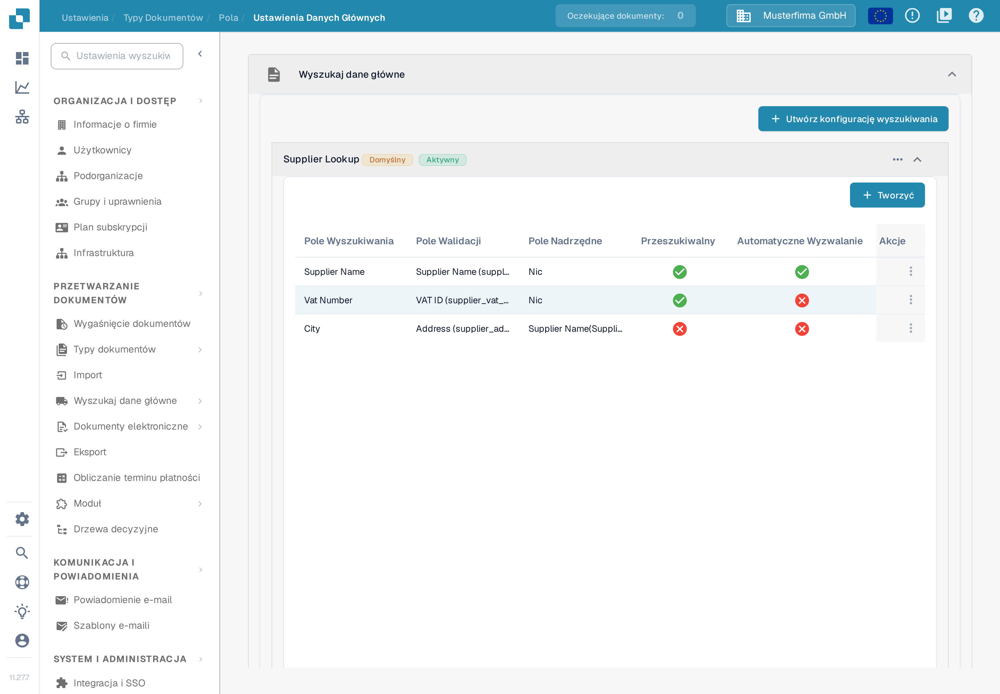
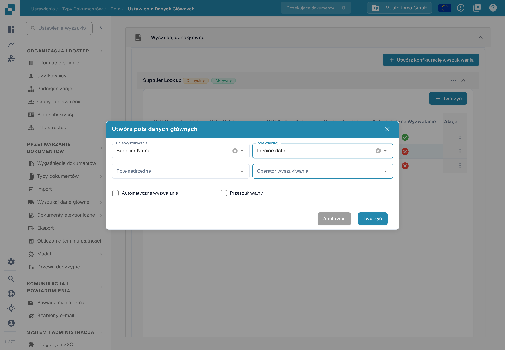

# Konfiguracja danych rozmytych z danymi głównymi

Wyszukiwanie w danych głównych pozwala rozpoznać dostawcę na podstawie wartości z faktury. Wyszukiwanie przeszukuje zaimportowany zestaw danych i może wypełnić pola dostawcy w dokumencie. Każdy rodzaj dokumentu konfiguruje się osobno. Przykład używa dokumentu **INVOICE** w organizacji przykładowej **Musterfirma GmbH**; wszystkie nazwy i wartości na zrzutach ekranu są wymyślone i służą tylko jako przykład.

## Otwieranie ustawień wyszukiwania

1. Otwórz **Ustawienia → Przetwarzanie dokumentów → Typy dokumentów**.
2. Wybierz **INVOICE → Pola → Ustawienia Danych Głównych**.
3. Rozwiń **Wyszukaj dane główne**. W organizacji przykładowej widać konfiguracje **Supplier Lookup**, **Order Header Lookup** i **Order Line Lookup**, a pod nimi osobną kartę **Dane główne LOV**. W Twojej organizacji konfiguracje mogą mieć inne nazwy i może ich być więcej.

<figure><figcaption>
Rozwiń konfigurację, aby zobaczyć jej pola, albo wybierz Utwórz konfigurację wyszukiwania, aby dodać nową.
</figcaption></figure>

Etykieta **Aktywny** oznacza, że konfiguracja jest włączona, a etykieta **Domyślny** — że to konfiguracja domyślna. Menu z trzema kropkami zawiera pozycje **Dezaktywować**, **Duplikat** i **Podgląd**. Konfiguracji domyślnej nie można usunąć ani zmienić, natomiast własna konfiguracja ma więcej możliwości. Nie dezaktywuj wyszukiwania, dopóki nie sprawdzisz, które pola dokumentu od niego zależą.


Odpowiednie dane główne dostawców muszą być zaimportowane, zanim wyszukiwanie je znajdzie. Zobacz [Importowanie danych głównych](../../../infor-integration-and-configuration/importing-customer-master-data/README.md) i [Ustawienia danych głównych](../../settings/global-settings/document-types/fields/master-data-settings.md), aby poznać szerszą konfigurację.


## Tworzenie konfiguracji wyszukiwania

Wybierz **Utwórz konfigurację wyszukiwania**. Wpisz **Wyszukaj nazwę**, wybierz **Wyszukaj nazwę zestawu danych** i ustaw **Typ kontekstu** na **HEADER** dla pól dokumentu albo **LINE** dla tabeli. Przy **LINE** wybierz dodatkowo odpowiednią tabelę w polu **Szczegóły kontekstu**. Pole **Osoba rozwiązująca konflikty** decyduje, co się stanie, gdy pasuje kilka rekordów. **Dopasuj wszystko** wymaga, aby każde użyte pole wyszukiwania pasowało do tego samego rekordu; bez tego wystarczy jedno pasujące pole.

<figure><figcaption>
Okno otwarto tylko na potrzeby dokumentacji; wpisana nazwa supplier_by_tax_id jest wymyślonym przykładem i nie została zapisana.
</figcaption></figure>

Do wyboru są **Best Score**, **Return None** i **Return First**. Wybierz **Return None**, gdy o niejednoznacznym dostawcy powinien zdecydować człowiek; zanim wybierzesz **Best Score** lub **Dopasuj wszystko**, przeczytaj przykłady poniżej.

## Wybieranie pól do rozpoznawania dostawcy

Rozwiń **Supplier Lookup**, aby zobaczyć przypisania pól. Tabela pokazuje pole zestawu danych (**Pole Wyszukiwania**), jego pole w dokumencie (**Pole Walidacji**), opcjonalne **Pole Nadrzędne** oraz to, czy włączono **Przeszukiwalny** albo **Automatyczne Wyzwalanie**. W organizacji przykładowej pole Supplier Name ma włączone oba znaczniki, pole Vat Number jest tylko przeszukiwalne, a pole City nie ma żadnego z nich; w innej organizacji te znaczniki mogą być inne.

<figure><figcaption>
Sprawdź, które pola mogą brać udział w rozpoznawaniu dostawcy, zanim zmienisz regułę dopasowania.
</figcaption></figure>

Aby dodać przypisanie, wybierz **Tworzyć** w rozwiniętej grupie, a następnie **Pole wyszukiwania**, **Pole walidacji**, opcjonalne **Pole nadrzędne** i **Operator wyszukiwania**. Operator decyduje o sposobie porównywania tekstu: do ścisłego identyfikatora użyj operatora dokładnego, a operatorów dopasowujących fragment tekstu tylko wtedy, gdy częściowe dopasowanie ma sens. **Automatyczne wyzwalanie** uruchamia wyszukiwanie po tym, jak pole dokumentu otrzyma wartość. **Przeszukiwalny** włącza pole do wyszukiwania i udostępnia wyszukiwanie ręczne podczas weryfikacji. W oknie wybierz **Tworzyć** dopiero po sprawdzeniu przypisania.

<figure><figcaption>
Formularz obejrzano bez zapisywania nowego pola.
</figcaption></figure>

Przykłady poniżej wyjaśniają, jak te znaczniki, **Dopasuj wszystko** i osoba rozwiązująca konflikty działają razem. Na potrzeby tej dokumentacji nie utworzono żadnego rzeczywistego wyniku rozpoznania dostawcy.

### Jak DocBits wybiera jednego dostawcę

Gdy dokument trafia do systemu, DocBits szuka dostawcy w Twoich danych głównych. O wyniku decydują trzy ustawienia. Ta sekcja wyjaśnia je krok po kroku, na przykładach.

#### Krok 1 — Które pola są używane do wyszukiwania

DocBits używa pola do wyszukiwania tylko wtedy, gdy spełnione są oba warunki:

* pole ma zaznaczony znacznik **Przeszukiwalny** albo **Automatyczne wyzwalanie** w konfiguracji wyszukiwania, oraz
* pole ma wartość w dokumencie.

Nie ma znaczenia, skąd wartość się wzięła. Pole wytrenowane, pole wypełnione przez AI i wartość wpisana przez użytkownika są traktowane tak samo.


**Przeszukiwalny robi dwie rzeczy.** Pokazuje niebieską ikonę wyszukiwania na ekranie weryfikacji oraz dodaje pole do automatycznego wyszukiwania dostawcy. Pole, które ma służyć tylko do ręcznego wyszukiwania, powinno pozostać niezaznaczone.


#### Krok 2 — Jedno wyszukiwanie, a nie jedno na pole

DocBits **nie** przeszukuje każdego pola osobno. Buduje **jedno** wyszukiwanie obejmujące wszystkie użyte pola. **Dopasuj wszystko** decyduje, jak są łączone:

* **Dopasuj wszystko wyłączone** (domyślnie) → „znajdź każdego dostawcę, który pasuje do numeru podatkowego **LUB** nazwy dostawcy”. Wynikiem jest **dłuższa** lista.
* **Dopasuj wszystko włączone** → „znajdź każdego dostawcę, który pasuje do numeru podatkowego **I** nazwy dostawcy”. Wynikiem jest **krótsza** lista.

Pamiętaj, że operatory wyszukiwania dopasowujące fragment tekstu szukają tylko jego części. Nazwa „Meier” znajdzie także „Meier Bau GmbH” i „Meier & Sons Ltd”. Dlatego nazwa dostawcy często znajduje kilku dostawców.

#### Krok 3 — Co się dzieje, gdy lista ma więcej niż jednego dostawcę

O tym decyduje **Osoba rozwiązująca konflikty**:

* **Best Score** → wybiera dostawcę, który pasuje do największej liczby pól. Nigdy nie zostawia pola dostawcy pustego.
* **Return None** → zostawia pole dostawcy puste, aby użytkownik wybrał dostawcę sam.
* **Return First** → wybiera pierwszego dostawcę z listy.

#### Przykłady

We wszystkich przykładach dokument zawiera numer podatkowy i nazwę dostawcy, a w obu polach zaznaczono **Przeszukiwalny**.

<table><thead><tr><th width="150">Numer podatkowy znajduje</th><th width="150">Nazwa znajduje</th><th width="150">Dopasuj wszystko wył. + Return None</th><th width="150">Dopasuj wszystko wł. + Return None</th><th width="150">Dopasuj wszystko wył. + Best Score</th></tr></thead><tbody>
<tr><td>tylko A</td><td>A i B</td><td>puste</td><td><strong>A</strong></td><td><strong>A</strong></td></tr>
<tr><td>A i B</td><td>tylko B</td><td>puste</td><td><strong>B</strong></td><td><strong>B</strong></td></tr>
<tr><td>A, B i C</td><td>C, D i E</td><td>puste</td><td><strong>C</strong></td><td><strong>C</strong></td></tr>
<tr><td>A, B i C</td><td>B, C i D</td><td>puste</td><td>puste</td><td>B lub C, niewiarygodne</td></tr>
<tr><td>tylko A</td><td>nic</td><td><strong>A</strong></td><td>puste</td><td><strong>A</strong></td></tr>
</tbody></table>

Jak czytać tabelę:

* **Wiersze od 1 do 3** to normalny przypadek. Jedno pole jest jednoznaczne, drugie nie. Przy wyłączonym **Dopasuj wszystko** lista zawiera kilku dostawców, a **Return None** zostawia pole puste. Włączone **Dopasuj wszystko** zostawia tylko dostawcę pasującego do obu pól i znajduje go.
* **Wiersz 4** nie ma żadnego jednoznacznego dostawcy. Puste pole jest tu prawidłowym wynikiem. **Best Score** i tak wybierze jednego z nich, a może to być niewłaściwy dostawca.
* **Wiersz 5** to ryzyko włączonego **Dopasuj wszystko**. Zobacz ostrzeżenie poniżej.


**Dopasuj wszystko może zgubić dostawcę.** Przy włączonym **Dopasuj wszystko** każde użyte pole musi pasować. Jeśli jedno pole ma wartość, której nie ma w Twoich danych głównych — literówkę, starą nazwę firmy, wartość odczytaną ze strony — całe wyszukiwanie nie zwraca niczego i dostawca nie zostaje znaleziony, choć sam numer podatkowy wystarczyłby do znalezienia właściwego dostawcy.


#### Dostawca był rozpoznawany wcześniej, a teraz nie jest

Prawie zawsze zaczęło wartość dostarczać jeszcze jedno pole. Sprawdź w tej kolejności:

1. Otwórz dokument. Które pole grupy wyszukiwania ma teraz wartość, która wcześniej była pusta?
2. Otwórz konfigurację wyszukiwania. Czy to pole ma zaznaczony znacznik **Przeszukiwalny** albo **Automatyczne wyzwalanie**? Jeśli tak, bierze teraz udział w wyszukiwaniu i wydłuża listę wyników.
3. Wybierz jedno z trzech rozwiązań:
   * **Pole nie powinno brać udziału w wyszukiwaniu** → odznacz **Przeszukiwalny** i **Automatyczne wyzwalanie** dla tego pola. Pole zachowuje wartość w dokumencie i nadal jest widoczne dla użytkownika. To najmniejsza zmiana.
   * **Pole powinno brać udział** → włącz **Dopasuj wszystko**, ale najpierw przeczytaj ostrzeżenie powyżej.
   * **Chcesz mieć dostawcę w każdym przypadku** → ustaw pole **Osoba rozwiązująca konflikty** na **Best Score**. Zaakceptuj to, że może wybrać niewłaściwego dostawcę zamiast zostawić pole puste.

### Ostatni krok: dodawanie pól do układu

Po skonfigurowaniu pól danych rozmytych **dodaj je do układu w Layout Builderze**. Jeśli pola nie zostaną dodane do układu, nie będą dostępne do użycia.

[Layout Builder](layout-builder.md)
