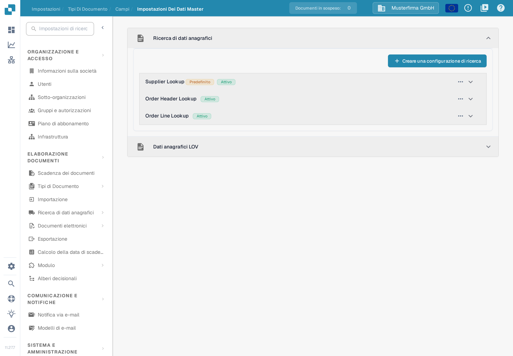
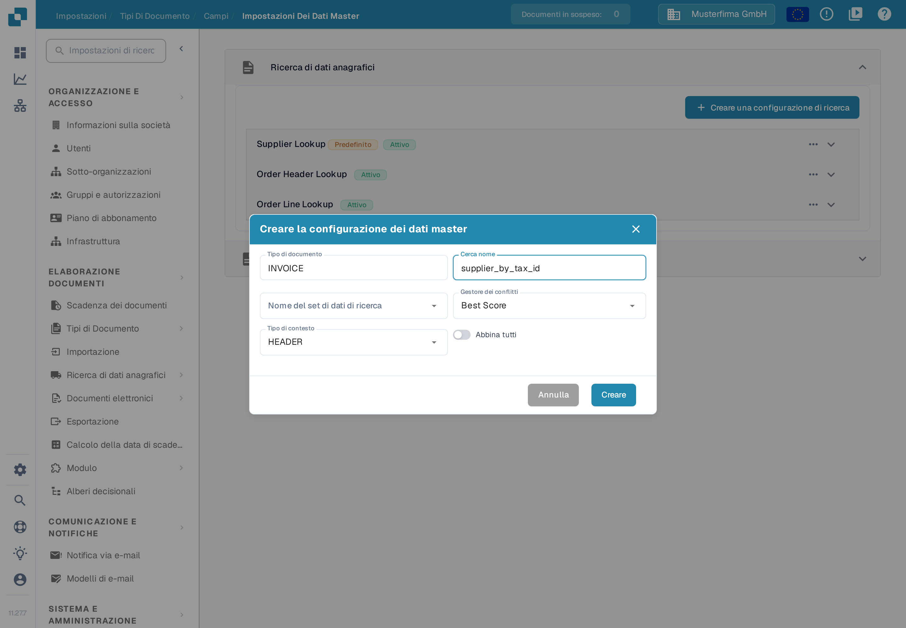

# Configurazione dei dati fuzzy con i dati master

Usa una ricerca sui dati master per riconoscere un fornitore dai valori presenti in una fattura. La ricerca cerca in un set di dati importato e può compilare i campi fornitore del documento. Configura ogni tipo di documento separatamente. L'esempio qui usa **INVOICE** nell'organizzazione di esempio **Musterfirma GmbH**.

## Aprire le impostazioni di ricerca

1. Apri **Impostazioni → Elaborazione documenti → Tipi di Documento**.
2. Seleziona **INVOICE → Campi → Impostazioni dei dati master**.
3. Espandi **Ricerca di dati anagrafici**. Nell'esempio l'organizzazione mostra le configurazioni **Supplier Lookup**, **Order Header Lookup** e **Order Line Lookup**, più la sezione separata **Dati anagrafici LOV**. I nomi sono dati di esempio; la tua organizzazione può avere altre configurazioni.

<figure><figcaption>
Seleziona una configurazione di ricerca per vedere i suoi campi oppure scegli Creare una configurazione di ricerca per crearne una nuova.
</figcaption></figure>

Il tag **Attivo** indica che una configurazione è abilitata. Il menu a tre punti mostra le azioni disponibili per quella configurazione; nell'esempio di un gruppo predefinito sono **Disattivare**, **Duplicato** e **Vista**. Le configurazioni predefinite possono essere visualizzate ma non modificate né eliminate; una configurazione personalizzata offre più azioni. Non disattivare una ricerca prima di aver verificato quali campi del documento dipendono da essa.


I dati master del fornitore devono essere importati prima che una ricerca possa trovarli. Vedi [Importare i dati master](../../../infor-integration-and-configuration/importing-customer-master-data/README.md) e [Impostazioni dei dati master](../../settings/global-settings/document-types/fields/master-data-settings.md) per la configurazione generale.


## Creare una configurazione di ricerca

Seleziona **Creare una configurazione di ricerca**. Inserisci un nome in **Cerca nome**, scegli un **Nome del set di dati di ricerca** e imposta **Tipo di contesto** su **HEADER** per i campi del documento o su **LINE** per una tabella. Per **LINE** scegli anche la tabella pertinente in **Dettaglio del contesto**. Imposta **Gestore dei conflitti** per decidere cosa succede quando più record corrispondono. **Abbina tutti** richiede che ogni campo di ricerca usato corrisponda allo stesso record; se è disattivato, può bastare un solo campo corrispondente.

<figure><figcaption>
La finestra è stata aperta solo a scopo di documentazione: il nome supplier_by_tax_id è un esempio inventato e nessuna configurazione è stata creata.
</figcaption></figure>

Le scelte per i conflitti sono **Best Score**, **Return None** e **Return First**. Usa **Return None** quando una persona deve decidere tra fornitori ambigui; leggi gli esempi più sotto prima di scegliere **Best Score** o **Abbina tutti**.

## Scegliere i campi per il riconoscimento del fornitore

Espandi **Supplier Lookup** per vedere le sue mappature. La tabella mostra il **Campo di ricerca** del set di dati, il suo **Campo di convalida** sul documento, il **Campo genitore** facoltativo e se **Ricercabile** o **Trigger automatico** sono attivi. Nell'esempio **Supplier Name** è sia ricercabile sia trigger automatico, **Vat Number** è solo ricercabile e **City** non ha alcun flag; in un'altra organizzazione i flag possono essere diversi. I nomi delle righe sono dati di esempio.

<figure><figcaption>
Controlla quali campi possono partecipare al riconoscimento del fornitore prima di cambiare la regola di corrispondenza.
</figcaption></figure>

Per aggiungere una mappatura, seleziona **Creare** all'interno del gruppo espanso, poi scegli **Campo di ricerca**, **Campo di convalida**, l'eventuale **Campo genitore** e l'**Operatore di ricerca**. L'operatore determina come viene confrontato il testo: usa **Esatto** per un identificativo rigoroso e valuta **Smart** o **Contiene** solo quando deve corrispondere una parte del testo. **Trigger automatico** avvia una ricerca dopo che quel campo del documento riceve un valore. **Ricercabile** include il campo nella ricerca e rende disponibile la ricerca manuale durante la convalida. Seleziona **Creare** solo dopo aver controllato la mappatura.

<figure><figcaption>
Il modulo mostra selezioni di esempio (Supplier Name e Invoice date) ed è stato solo ispezionato: nessun campo è stato salvato.
</figcaption></figure>

Il testo che segue spiega come interagiscono questi flag, Abbina tutti e il gestore dei conflitti. Per questa verifica della documentazione non è stato generato alcun risultato reale di riconoscimento del fornitore.

### Come DocBits sceglie un fornitore

Quando arriva un documento, DocBits cerca il fornitore nei dati master. Tre impostazioni determinano il risultato. Questa sezione le spiega passo per passo, con esempi.

#### Passo 1 — Quali campi vengono usati per la ricerca

DocBits usa un campo per la ricerca solo quando entrambi i punti sono veri:

* il campo è contrassegnato come **Ricercabile** o **Trigger automatico** nella configurazione di ricerca, e
* il campo ha un valore sul documento.

Non importa come il valore sia arrivato nel campo. Un campo addestrato, un campo compilato dall'IA e un valore digitato da un utente vengono trattati allo stesso modo.


**Ricercabile fa due cose.** Mostra l'icona blu di ricerca nella schermata di convalida **e** aggiunge il campo alla ricerca automatica del fornitore. Un campo che deve essere cercato solo a mano resta non contrassegnato.


#### Passo 2 — Una ricerca, non una ricerca per campo

DocBits **non** cerca ogni campo separatamente. Costruisce **una** ricerca su tutti i campi usati. **Abbina tutti** decide come vengono combinati:

* **Abbina tutti disattivato** (predefinito) → "trova ogni fornitore che corrisponde alla partita IVA **o** al nome del fornitore". Questo dà un elenco **più lungo**.
* **Abbina tutti attivato** → "trova ogni fornitore che corrisponde alla partita IVA **e** al nome del fornitore". Questo dà un elenco **più corto**.

Tieni presente che gli operatori **Smart** e **Contiene** cercano una parte del testo. Il nome "Meier" trova anche "Meier Bau GmbH" e "Meier & Sons Ltd". Un nome di fornitore trova quindi spesso più fornitori.

#### Passo 3 — Cosa succede quando l'elenco contiene più fornitori

Il **Gestore dei conflitti** decide:

* **Best Score** → prende il fornitore che corrisponde al maggior numero di campi. Non lascia mai il fornitore vuoto.
* **Return None** → lascia il fornitore vuoto, così un utente lo sceglie.
* **Return First** → prende il primo fornitore dell'elenco.

#### Esempi

In tutti gli esempi il documento ha una partita IVA e un nome di fornitore, ed entrambi i campi sono **Ricercabili**.

<table><thead><tr><th width="150">La partita IVA trova</th><th width="150">Il nome trova</th><th width="150">Abbina tutti disattivato + Return None</th><th width="150">Abbina tutti attivato + Return None</th><th width="150">Abbina tutti disattivato + Best Score</th></tr></thead><tbody>
<tr><td>solo A</td><td>A e B</td><td>vuoto</td><td><strong>A</strong></td><td><strong>A</strong></td></tr>
<tr><td>A e B</td><td>solo B</td><td>vuoto</td><td><strong>B</strong></td><td><strong>B</strong></td></tr>
<tr><td>A, B e C</td><td>C, D e E</td><td>vuoto</td><td><strong>C</strong></td><td><strong>C</strong></td></tr>
<tr><td>A, B e C</td><td>B, C e D</td><td>vuoto</td><td>vuoto</td><td>B o C, non affidabile</td></tr>
<tr><td>solo A</td><td>niente</td><td><strong>A</strong></td><td>vuoto</td><td><strong>A</strong></td></tr>
</tbody></table>

Come leggere la tabella:

* **Le righe da 1 a 3** sono il caso normale. Un campo è univoco, l'altro no. Con **Abbina tutti disattivato** l'elenco contiene più fornitori e **Return None** lascia il campo vuoto. **Abbina tutti attivato** conserva solo il fornitore che corrisponde a entrambi i campi e lo trova.
* **La riga 4** non ha alcun fornitore univoco. Lasciare il campo vuoto è corretto. **Best Score** ne sceglie comunque uno, che può essere quello sbagliato.
* **La riga 5** è il rischio di **Abbina tutti attivato**. Vedi l'avviso qui sotto.


**Abbina tutti può perdere un fornitore.** Con **Abbina tutti attivato** ogni campo usato deve corrispondere. Se un campo contiene un valore che non esiste nei tuoi dati master — un errore di battitura, un vecchio nome dell'azienda, un valore letto dalla pagina — l'intera ricerca non restituisce nulla e non viene trovato alcun fornitore, anche se la sola partita IVA avrebbe trovato quello giusto.


#### Un fornitore veniva riconosciuto prima e ora non viene più riconosciuto

Quasi sempre un campo in più ha iniziato a fornire un valore. Controlla in questo ordine:

1. Apri il documento. Quale campo del gruppo di ricerca contiene ora un valore che prima era vuoto?
2. Apri la configurazione di ricerca. Quel campo è contrassegnato come **Ricercabile** o **Trigger automatico**? Se sì, ora partecipa alla ricerca e allunga l'elenco dei risultati.
3. Scegli una delle tre soluzioni:
   * **Il campo non deve partecipare alla ricerca** → togli **Ricercabile** e **Trigger automatico** da quel campo. Il campo mantiene il suo valore sul documento e resta visibile all'utente. È la modifica più piccola.
   * **Il campo deve partecipare** → attiva **Abbina tutti**, ma leggi prima l'avviso qui sopra.
   * **Vuoi un fornitore in ogni caso** → imposta il **Gestore dei conflitti** su **Best Score**. Accetta che possa scegliere il fornitore sbagliato invece di lasciare il campo vuoto.

### Passo finale: aggiungere i campi al layout

Dopo aver configurato i campi fuzzy, **assicurati di aggiungere i campi al layout usando il Layout Builder**. Se i campi non vengono aggiunti al layout, non saranno disponibili per l'uso.

[Layout Builder](layout-builder.md)
