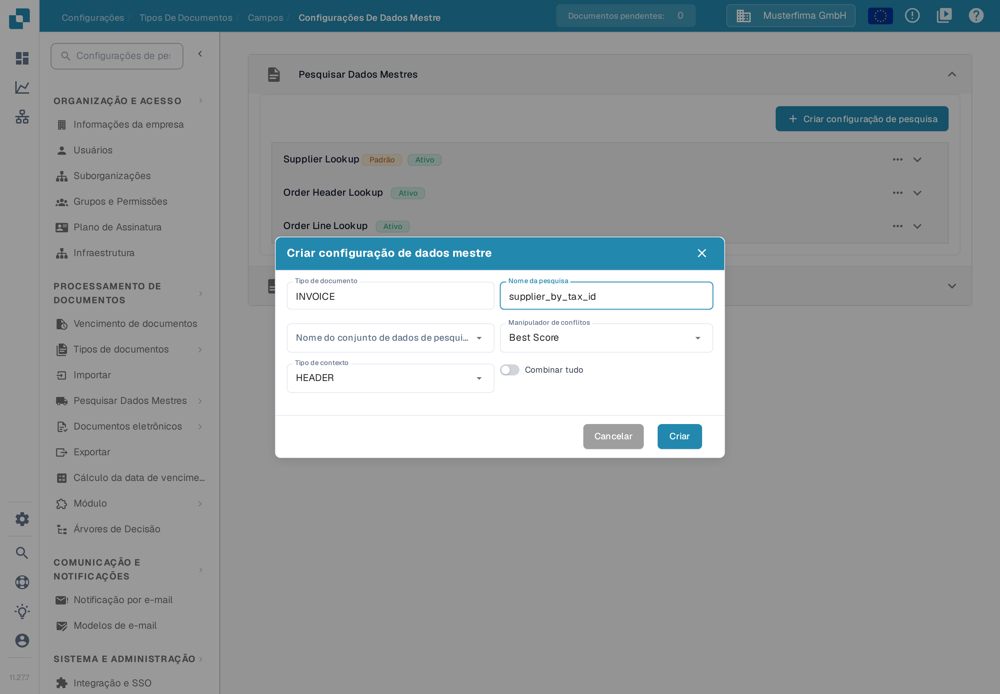
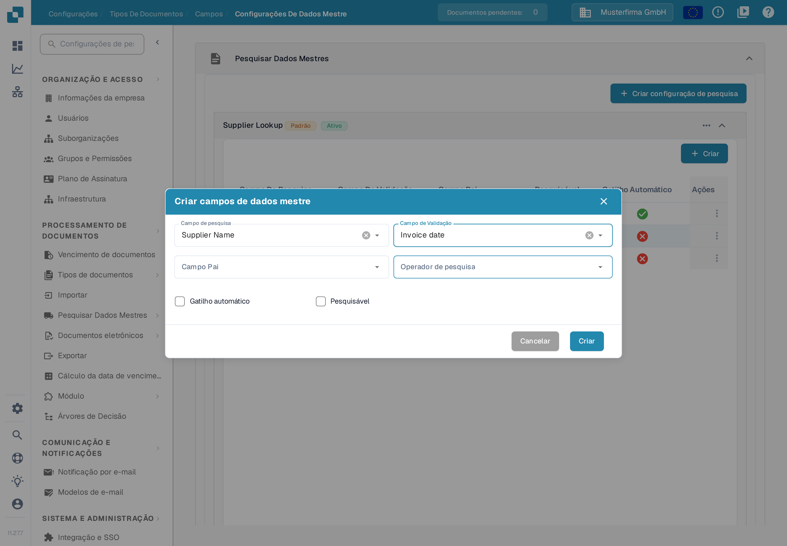

# Configuração de Dados Fuzzy com Dados Mestres

Utilize uma pesquisa nos dados mestres para reconhecer um fornecedor a partir dos valores de uma fatura. A pesquisa procura num conjunto de dados importado e pode preencher os campos de fornecedor do documento. Configure cada tipo de documento em separado. O exemplo aqui utiliza **INVOICE** na organização de exemplo **Musterfirma GmbH**.

## Abrir as configurações de pesquisa

1. Abra **Configurações → Tipos De Documentos**.
2. Escolha o tipo de documento **INVOICE** e abra **Campos → Configurações De Dados Mestre**.
3. Expanda **Pesquisar Dados Mestres**. Na organização de exemplo aparecem **Supplier Lookup**, **Order Header Lookup** e **Order Line Lookup**, além do cartão separado **Dados Mestres LOV**. A sua organização pode ter outras configurações; os nomes são dados de exemplo.

<figure><figcaption>
Escolha uma configuração de pesquisa para ver os respetivos campos ou escolha Criar configuração de pesquisa para criar uma nova.
</figcaption></figure>

O rótulo **Ativo** indica que uma configuração está ativada. O menu de três pontos mostra as ações disponíveis para a configuração; no exemplo de um grupo padrão são **Desativar**, **Duplicado** e **Visualizar**. As configurações padrão podem ser vistas, mas não editadas nem eliminadas; uma configuração própria oferece mais ações. Não desative uma pesquisa sem antes verificar de que campos do documento ela depende.


Os dados mestres de fornecedor relevantes têm de estar importados antes de uma pesquisa os poder encontrar. Ver [Importar dados mestre](../../../infor-integration-and-configuration/importing-customer-master-data/README.md) e [Configurações de dados mestre](../../settings/global-settings/document-types/fields/master-data-settings.md) para a configuração mais ampla.


## Criar uma configuração de pesquisa

Escolha **Criar configuração de pesquisa**. Introduza um **Nome da pesquisa**, escolha um **Nome do conjunto de dados de pesquisa** e defina o **Tipo de contexto** como **HEADER** para campos do documento ou **LINE** para uma tabela. Com **LINE**, escolha também a tabela correspondente em **Detalhe do contexto**. O **Manipulador de conflitos** decide o que acontece quando vários registos correspondem. **Combinar tudo** exige que todos os campos de pesquisa utilizados correspondam ao mesmo registo; desligado, um único campo correspondente pode ser suficiente.

<figure><figcaption>
A janela foi aberta apenas para a documentação: o nome supplier_by_tax_id é um exemplo inventado e nenhuma configuração foi criada.
</figcaption></figure>

As opções de conflito são **Best Score**, **Return None** e **Return First**. Utilize **Return None** quando for uma pessoa a decidir entre fornecedores ambíguos; leia os exemplos abaixo antes de escolher **Best Score** ou **Combinar tudo**.

## Escolher campos para o reconhecimento de fornecedores

Expanda **Supplier Lookup** para ver as suas atribuições. A tabela mostra o **Campo De Pesquisa** do conjunto de dados, o **Campo De Validação** correspondente no documento, o **Campo Pai** opcional e se **Pesquisável** ou **Gatilho Automático** está ativado. No exemplo, **Supplier Name** tem ambos os indicadores, **Vat Number** é apenas pesquisável e **City** não tem nenhum; noutra organização os indicadores podem ser diferentes. Os nomes das linhas são dados de exemplo.

<figure><figcaption>
Verifique que campos podem participar no reconhecimento de fornecedores antes de alterar a regra de correspondência.
</figcaption></figure>

Para acrescentar uma atribuição, escolha **Criar** dentro do grupo expandido e depois **Campo de pesquisa**, **Campo de Validação**, o **Campo Pai** opcional e o **Operador de pesquisa**. O operador determina como o texto é comparado: utilize **Exato** para um identificador estrito e considere **Inteligente** ou **Contém** apenas quando uma parte do texto deve corresponder. **Gatilho automático** inicia uma pesquisa depois de esse campo do documento receber um valor. **Pesquisável** inclui o campo na pesquisa e torna disponível a pesquisa manual durante a validação. Escolha **Criar** apenas depois de verificar a atribuição.

<figure><figcaption>
O formulário mostra seleções de exemplo (Supplier Name e Invoice date) e foi apenas inspecionado: não foi guardado nenhum campo.
</figcaption></figure>

Os exemplos abaixo explicam como estes indicadores, Combinar tudo e o manipulador de conflitos interagem. Para esta verificação da documentação não foi gerado nenhum resultado real de reconhecimento de fornecedores.

### **Como o DocBits escolhe um fornecedor**

Quando um documento chega, o DocBits procura o fornecedor nos seus dados mestres. Três definições determinam o resultado. Esta secção explica-as passo a passo, com exemplos.

#### **Passo 1 — Que campos são utilizados na pesquisa**

O DocBits só utiliza um campo na pesquisa quando ambos os pontos se verificam:

* o campo está marcado como **Pesquisável** ou **Gatilho Automático** na configuração de pesquisa, e
* o campo tem um valor no documento.

A forma como o valor chegou ao campo não importa. Um campo treinado, um campo preenchido pela IA e um valor escrito por um utilizador são tratados da mesma forma.


**Pesquisável faz duas coisas.** Mostra o ícone azul de pesquisa no ecrã de validação **e** acrescenta o campo à pesquisa automática de fornecedores. Um campo que só deve ser pesquisado manualmente fica desmarcado.


#### **Passo 2 — Uma pesquisa, não uma pesquisa por campo**

O DocBits **não** pesquisa cada campo em separado. Constrói **uma** pesquisa sobre todos os campos utilizados. **Combinar tudo** determina como são combinados:

* **Combinar tudo desligado** (predefinição) → "encontrar todos os fornecedores que correspondem ao NIF **ou** ao nome do fornecedor". Isto dá uma lista **mais longa**.
* **Combinar tudo ligado** → "encontrar todos os fornecedores que correspondem ao NIF **e** ao nome do fornecedor". Isto dá uma lista **mais curta**.

Tenha em conta que os operadores **Inteligente** e **Contém** procuram uma parte do texto. O nome "Meier" também encontra "Meier Bau GmbH" e "Meier & Sons Ltd". Por isso um nome de fornecedor encontra muitas vezes vários fornecedores.

#### **Passo 3 — O que acontece quando a lista tem mais de um fornecedor**

O **Manipulador de conflitos** decide:

* **Best Score** → escolhe o fornecedor que corresponde ao maior número de campos. Nunca deixa o fornecedor vazio.
* **Return None** → deixa o fornecedor vazio, para que um utilizador o escolha.
* **Return First** → escolhe o primeiro fornecedor da lista.

#### **Exemplos**

Em todos os exemplos o documento tem um NIF e um nome de fornecedor, e ambos os campos são pesquisáveis.

<table><thead><tr><th width="150">O NIF encontra</th><th width="150">O nome encontra</th><th width="150">Combinar tudo desligado + Return None</th><th width="150">Combinar tudo ligado + Return None</th><th width="150">Combinar tudo desligado + Best Score</th></tr></thead><tbody>
<tr><td>só A</td><td>A e B</td><td>vazio</td><td><strong>A</strong></td><td><strong>A</strong></td></tr>
<tr><td>A e B</td><td>só B</td><td>vazio</td><td><strong>B</strong></td><td><strong>B</strong></td></tr>
<tr><td>A, B e C</td><td>C, D e E</td><td>vazio</td><td><strong>C</strong></td><td><strong>C</strong></td></tr>
<tr><td>A, B e C</td><td>B, C e D</td><td>vazio</td><td>vazio</td><td>B ou C, não fiável</td></tr>
<tr><td>só A</td><td>nada</td><td><strong>A</strong></td><td>vazio</td><td><strong>A</strong></td></tr>
</tbody></table>

Como ler a tabela:

* **As linhas 1 a 3** são o caso normal. Um campo é único, o outro não. Com **Combinar tudo desligado** a lista contém vários fornecedores e **Return None** deixa o campo vazio. **Combinar tudo ligado** mantém apenas o fornecedor que corresponde aos dois campos e encontra-o.
* **A linha 4** não tem nenhum fornecedor único. Deixar o campo vazio está correto. **Best Score** escolhe um deles à mesma, e pode ser o fornecedor errado.
* **A linha 5** é o risco de **Combinar tudo ligado**. Ver o aviso abaixo.


**Combinar tudo pode perder um fornecedor.** Com **Combinar tudo ligado** todos os campos utilizados têm de corresponder. Se um campo tiver um valor que não existe nos seus dados mestres — um erro de escrita, um nome de empresa antigo, um valor lido da página — a pesquisa completa não devolve nada e não é encontrado nenhum fornecedor, mesmo que o NIF sozinho tivesse encontrado o fornecedor correto.


#### **Um fornecedor era reconhecido antes e já não é**

Quase sempre há mais um campo que passou a ter um valor. Verifique por esta ordem:

1. Abra o documento. Que campo do grupo de pesquisa tem agora um valor que antes estava vazio?
2. Abra a configuração de pesquisa. Esse campo está marcado como **Pesquisável** ou **Gatilho Automático**? Se sim, passou a participar na pesquisa e torna a lista de resultados mais longa.
3. Escolha uma das três saídas:
   * **O campo não deve participar na pesquisa** → desmarque **Pesquisável** e **Gatilho Automático** nesse campo. O campo mantém o seu valor no documento e continua a ser mostrado ao utilizador. É a alteração mais pequena.
   * **O campo deve participar** → ligue **Combinar tudo**, mas leia primeiro o aviso acima.
   * **Pretende um fornecedor em todos os casos** → coloque o **Manipulador de conflitos** em **Best Score**. Aceite que pode ser escolhido o fornecedor errado em vez de deixar o campo vazio.

### **Último passo: acrescentar campos ao layout**

Depois de configurar campos de dados fuzzy, **certifique-se de que os acrescenta ao layout com o Construtor de Layouts**. Se os campos não forem acrescentados ao layout, não ficam disponíveis para utilização.

[Construtor de Layouts](layout-builder.md)
