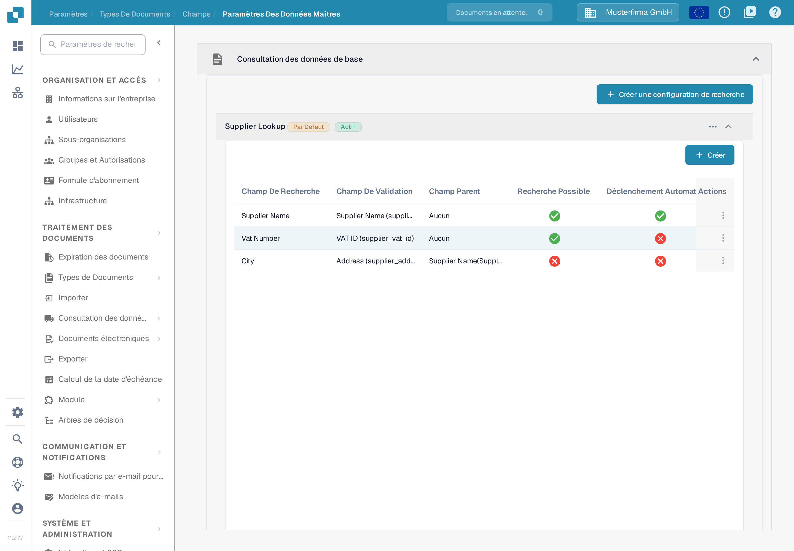

# Configuration des données floues avec les données maîtres

Une recherche dans les données maîtres permet de reconnaître un fournisseur à partir des valeurs d'une facture. La recherche parcourt un jeu de données importé et peut remplir les champs fournisseur du document. Configurez chaque type de document séparément. L'exemple utilise **Invoice** dans l'organisation d'exemple **Musterfirma GmbH** ; toutes les valeurs affichées sont des données inventées.

## Ouvrir les paramètres de recherche

1. Ouvrez **Paramètres → Traitement des documents → Types de Documents**.
2. Sélectionnez **Invoice → Champs → Paramètres des données maîtres**.
3. Dépliez **Consultation des données de base**. L'organisation d'exemple affiche les groupes **Supplier Lookup**, **Order Header Lookup** et **Order Line Lookup** ainsi que la section **Données de base LOV**. Votre organisation peut contenir d'autres configurations.

<figure><figcaption>
Sélectionnez un groupe de recherche pour vérifier ses champs, ou choisissez Créer une configuration de recherche pour en créer une nouvelle.
</figcaption></figure>

Le libellé **Actif** indique qu'une configuration est activée. Le menu à trois points permet de vérifier les actions disponibles ; pour une configuration par défaut, ce sont **Désactiver**, **Duplicata** et **Vue**. Une configuration par défaut peut être consultée, mais pas modifiée ni supprimée ; une configuration personnalisée propose davantage d'actions. Ne désactivez pas une recherche avant d'avoir vérifié quels champs du document en dépendent.


Les données maîtres du fournisseur doivent être importées avant que la recherche puisse les trouver. Voir [Importation des données de référence](../../../infor-integration-and-configuration/importing-customer-master-data/README.md) et [Paramètres des données de référence](../../settings/global-settings/document-types/fields/master-data-settings.md) pour la mise en place complète.


## Créer une configuration de recherche

Sélectionnez **Créer une configuration de recherche**. Saisissez un **Nom de recherche**, choisissez un **Nom du jeu de données de recherche** et réglez le **Type de contexte** sur **HEADER** pour les champs du document ou sur **LINE** pour un tableau. Pour **LINE**, choisissez également la table correspondante. Le **Gestionnaire de conflits** décide de ce qui se passe lorsque plusieurs enregistrements correspondent. **Tout faire correspondre** exige que chaque champ de recherche utilisé corresponde au même enregistrement ; désactivé, un seul champ correspondant peut suffire.

<figure><figcaption>
La fenêtre a été ouverte pour la documentation et remplie avec le nom d'exemple inventé supplier_by_tax_id ; aucune configuration n'a été créée.
</figcaption></figure>

Les choix du **Gestionnaire de conflits** sont **Best Score**, **Return None** et **Return First**. Utilisez **Return None** lorsqu'une personne doit décider entre des fournisseurs ambigus ; lisez les exemples ci-dessous avant de choisir **Best Score** ou **Tout faire correspondre**.

## Choisir les champs pour la reconnaissance des fournisseurs

Dépliez **Supplier Lookup** pour voir ses affectations. Le tableau affiche le **Champ de recherche** du jeu de données, son **Champ de validation** sur le document, le **Champ parent** facultatif, ainsi que l'état de **Recherche possible** et de **Déclenchement automatique**. Dans l'organisation d'exemple, Supplier Name est recherchable et sert aussi de déclencheur automatique ; Vat Number est seulement recherchable. Ces marques peuvent différer dans une autre organisation.

<figure><figcaption>
Vérifiez quels champs peuvent participer à la reconnaissance du fournisseur avant de modifier la règle de correspondance.
</figcaption></figure>

Pour ajouter une affectation, sélectionnez **Créer** dans le groupe déplié, puis choisissez le **Champ de recherche**, le **Champ de validation**, le **Champ parent** facultatif et l'**Opérateur de recherche**. L'opérateur détermine la comparaison du texte ; utilisez **exact** pour un identifiant strict et n'envisagez **Smart** ou **Contient** que lorsqu'une partie du texte doit correspondre. Le **Déclenchement automatique** lance une recherche dès que ce champ du document reçoit une valeur. La **Recherche possible** intègre le champ à la recherche et rend la recherche manuelle disponible pendant la validation. Ne sélectionnez **Créer** qu'après avoir vérifié l'affectation.

<figure><figcaption>
Le formulaire a été vérifié sans enregistrer de nouveau champ.
</figcaption></figure>

Les exemples ci-dessous expliquent comment ces marques, **Tout faire correspondre** et le gestionnaire de conflits interagissent. Aucun résultat réel de reconnaissance de fournisseur n'a été généré pour cette vérification de la documentation.

### **Comment DocBits choisit un fournisseur**

Lorsqu'un document arrive, DocBits recherche le fournisseur dans vos données maîtres. Trois réglages déterminent le résultat. Cette section les explique étape par étape, avec des exemples.

#### **Étape 1 — Quels champs servent à la recherche**

DocBits utilise un champ pour la recherche uniquement si les deux points sont vrais :

* le champ est coché **Recherche possible** ou **Déclenchement automatique** dans la configuration de recherche, et
* le champ a une valeur sur le document.

La provenance de la valeur n'a pas d'importance. Un champ entraîné, un champ rempli par l'IA et une valeur saisie par un utilisateur sont traités de la même façon.


**La Recherche possible fait deux choses.** Elle affiche l'icône bleue de recherche dans l'écran de validation **et** elle ajoute le champ à la recherche automatique de fournisseur. Un champ que vous voulez seulement chercher à la main reste décoché.


#### **Étape 2 — Une seule recherche, pas une recherche par champ**

DocBits ne recherche **pas** chaque champ séparément. Il construit **une** recherche sur tous les champs utilisés. **Tout faire correspondre** décide de la combinaison :

* **Tout faire correspondre désactivé** (par défaut) → « trouver tous les fournisseurs qui correspondent au numéro de TVA **OU** au nom du fournisseur ». Cela donne une liste **plus longue**.
* **Tout faire correspondre activé** → « trouver tous les fournisseurs qui correspondent au numéro de TVA **ET** au nom du fournisseur ». Cela donne une liste **plus courte**.

N'oubliez pas que les opérateurs **Smart** et **Contient** cherchent une partie du texte. Le nom « Meier » trouve aussi « Meier Bau GmbH » et « Meier & Sons Ltd ». Un nom de fournisseur trouve donc souvent plusieurs fournisseurs.

#### **Étape 3 — Ce qui se passe quand la liste contient plusieurs fournisseurs**

Le **Gestionnaire de conflits** décide :

* **Best Score** → prend le fournisseur qui correspond au plus grand nombre de champs. Ne laisse jamais le fournisseur vide.
* **Return None** → laisse le fournisseur vide, pour qu'un utilisateur le choisisse.
* **Return First** → prend le premier fournisseur de la liste.

#### **Exemples**

Dans tous les exemples, le document porte un numéro de TVA et un nom de fournisseur, et les deux champs sont **Recherche possible**.

<table><thead><tr><th width="150">Le numéro de TVA trouve</th><th width="150">Le nom trouve</th><th width="150">Tout faire correspondre désactivé + Return None</th><th width="150">Tout faire correspondre activé + Return None</th><th width="150">Tout faire correspondre désactivé + Best Score</th></tr></thead><tbody>
<tr><td>seulement A</td><td>A et B</td><td>vide</td><td><strong>A</strong></td><td><strong>A</strong></td></tr>
<tr><td>A et B</td><td>seulement B</td><td>vide</td><td><strong>B</strong></td><td><strong>B</strong></td></tr>
<tr><td>A, B et C</td><td>C, D et E</td><td>vide</td><td><strong>C</strong></td><td><strong>C</strong></td></tr>
<tr><td>A, B et C</td><td>B, C et D</td><td>vide</td><td>vide</td><td>B ou C, peu fiable</td></tr>
<tr><td>seulement A</td><td>rien</td><td><strong>A</strong></td><td>vide</td><td><strong>A</strong></td></tr>
</tbody></table>

Comment lire le tableau :

* **Les lignes 1 à 3** sont le cas normal. Un champ est unique, l'autre non. Avec **Tout faire correspondre désactivé**, la liste contient plusieurs fournisseurs et **Return None** laisse le champ vide. **Tout faire correspondre activé** ne garde que le fournisseur qui correspond aux deux champs et le trouve.
* **La ligne 4** n'a aucun fournisseur unique. Laisser le champ vide est correct. **Best Score** en choisit quand même un, qui peut être le mauvais.
* **La ligne 5** est le risque de **Tout faire correspondre activé**. Voir l'avertissement ci-dessous.


**Tout faire correspondre peut perdre un fournisseur.** Avec **Tout faire correspondre activé**, chaque champ utilisé doit correspondre. Si un champ porte une valeur qui n'existe pas dans vos données maîtres — une faute de frappe, un ancien nom d'entreprise, une valeur lue sur la page — la recherche entière ne renvoie rien et aucun fournisseur n'est trouvé, alors que le numéro de TVA seul aurait trouvé le bon.


#### **Un fournisseur était reconnu avant et ne l'est plus**

Presque toujours, un champ de plus fournit désormais une valeur. Vérifiez dans cet ordre :

1. Ouvrez le document. Quel champ du groupe de recherche porte maintenant une valeur qui était vide avant ?
2. Ouvrez la configuration de recherche. Ce champ est-il coché **Recherche possible** ou **Déclenchement automatique** ? Si oui, il participe désormais à la recherche et allonge la liste des résultats.
3. Choisissez l'une des trois solutions :
   * **Le champ ne doit pas participer à la recherche** → décochez **Recherche possible** et **Déclenchement automatique** pour ce champ. Le champ garde sa valeur sur le document et reste affiché à l'utilisateur. C'est la plus petite modification.
   * **Le champ doit participer** → activez **Tout faire correspondre**, mais lisez d'abord l'avertissement ci-dessus.
   * **Vous voulez un fournisseur dans tous les cas** → réglez le **Gestionnaire de conflits** sur **Best Score**. Acceptez qu'il puisse choisir le mauvais fournisseur au lieu de laisser le champ vide.

### **Étape finale : ajouter les champs à la mise en page**

Après avoir configuré les champs de données floues, **ajoutez-les à la mise en page avec l'éditeur de mise en page**. Si les champs ne sont pas ajoutés à la mise en page, ils ne seront pas disponibles.

[Éditeur de mise en page](layout-builder.md)
