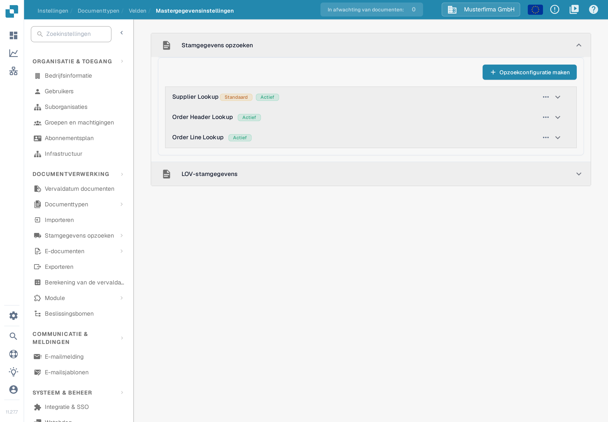
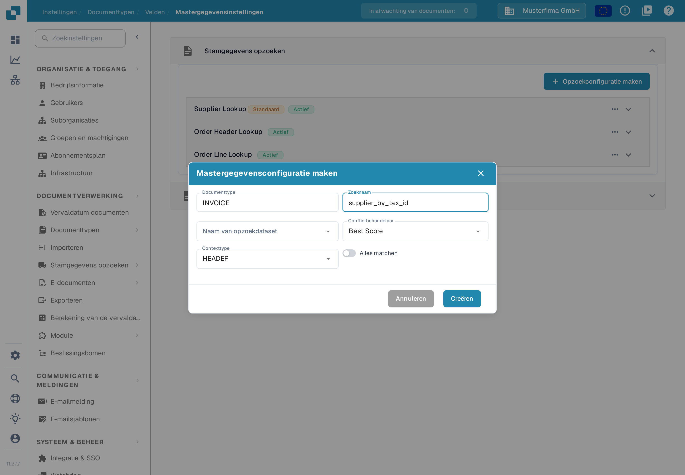
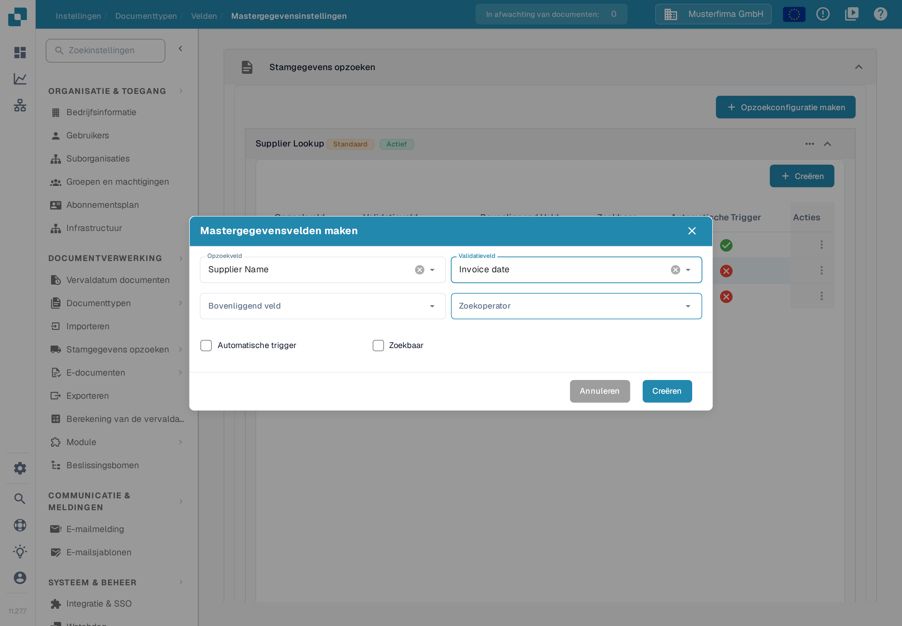

# Fuzzy Data-configuratie met Mastergegevens

Gebruik een opzoeking in de stamgegevens om een leverancier te herkennen aan de waarden op een factuur. De opzoeking doorzoekt een geïmporteerde dataset en kan de leveranciersvelden van het document invullen. Configureer elk documenttype apart. Het voorbeeld hier gebruikt **INVOICE** in de voorbeeldorganisatie **Musterfirma GmbH**.

## De opzoekinstellingen openen

1. Open **Instellingen → Documentverwerking → Documenttypen**.
2. Kies **INVOICE → Velden → Mastergegevensinstellingen**.
3. Klap **Stamgegevens opzoeken** uit. In de voorbeeldorganisatie ziet u **Supplier Lookup**, **Order Header Lookup** en **Order Line Lookup**, plus de aparte kaart **LOV-stamgegevens**. Uw organisatie kan andere configuraties hebben; de namen zijn voorbeeldgegevens.

<figure><figcaption>
Kies een opzoekconfiguratie om de velden ervan te bekijken, of kies Opzoekconfiguratie maken voor een nieuwe.
</figcaption></figure>

Het label **Actief** geeft aan dat een configuratie is ingeschakeld. Het menu met de drie puntjes toont de acties voor die configuratie; in het voorbeeld van een standaardgroep zijn dat **Deactiveren**, **Duplicaat** en **Weergave**. Standaardconfiguraties kunt u bekijken, maar niet bewerken of verwijderen; een eigen configuratie biedt meer acties. Deactiveer een opzoeking pas nadat u hebt gecontroleerd welke documentvelden ervan afhangen.


De relevante leveranciersstamgegevens moeten zijn geïmporteerd voordat een opzoeking ze kan vinden. Zie [Stamgegevens importeren](../../../infor-integration-and-configuration/importing-customer-master-data/README.md) en [Mastergegevensinstellingen](../../settings/global-settings/document-types/fields/master-data-settings.md) voor de bredere configuratie.


## Een opzoekconfiguratie maken

Kies **Opzoekconfiguratie maken**. Voer een **Zoeknaam** in, kies een **Naam van opzoekdataset** en zet **Contexttype** op **HEADER** voor documentvelden of op **LINE** voor een tabel. Kies bij **LINE** ook de betreffende tabel als **Contextdetails**. Met de **Conflictbehandelaar** bepaalt u wat er gebeurt wanneer meerdere records overeenkomen. **Alles matchen** vereist dat elk gebruikt zoekveld op hetzelfde record past; staat het uit, dan kan één passend veld al genoeg zijn.

<figure><figcaption>
Het venster is alleen voor de documentatie geopend: de naam supplier_by_tax_id is een verzonnen voorbeeld en er is geen configuratie aangemaakt.
</figcaption></figure>

De keuzes voor conflicten zijn **Best Score**, **Return None** en **Return First**. Gebruik **Return None** wanneer een persoon moet beslissen tussen twijfelachtige leveranciers; lees de uitgewerkte voorbeelden hieronder voordat u **Best Score** of **Alles matchen** kiest.

## Velden kiezen voor leveranciersherkenning

Klap **Supplier Lookup** uit om de toewijzingen te zien. De tabel toont het **Opzoekveld** van de dataset, het bijbehorende **Validatieveld** op het document, het eventuele **Bovenliggend Veld** en of **Zoekbaar** of **Automatische Trigger** is ingeschakeld. In het voorbeeld heeft **Supplier Name** beide vinkjes, **Vat Number** is alleen zoekbaar en **City** heeft geen van beide; in een andere organisatie kunnen de vinkjes anders staan. De rijnamen zijn voorbeeldgegevens.

<figure><figcaption>
Controleer welke velden kunnen meedoen aan de leveranciersherkenning voordat u de matchregel wijzigt.
</figcaption></figure>

Om een toewijzing toe te voegen, kiest u **Creëren** in de uitgeklapte groep en daarna **Opzoekveld**, **Validatieveld**, het eventuele **Bovenliggend veld** en de **Zoekoperator**. De operator bepaalt hoe tekst wordt vergeleken: gebruik **Exact** voor een strikte identificatie en overweeg **Smart** of **Bevat** alleen wanneer een deel van de tekst mag passen. **Automatische trigger** start een opzoeking nadat dat documentveld een waarde heeft gekregen. **Zoekbaar** neemt het veld op in de opzoeking en maakt handmatig zoeken tijdens de validatie mogelijk. Kies **Creëren** pas nadat u de toewijzing hebt gecontroleerd.

<figure><figcaption>
Het formulier toont voorbeeldselecties (Supplier Name en Invoice date) en is alleen bekeken: er is geen veld opgeslagen.
</figcaption></figure>

De uitgewerkte voorbeelden hieronder leggen uit hoe deze vinkjes, Alles matchen en de conflictbehandelaar samenwerken. Voor deze controle van de documentatie is geen echt resultaat van leveranciersherkenning gemaakt.

### **Hoe DocBits één leverancier kiest**

Wanneer een document binnenkomt, zoekt DocBits de leverancier in uw stamgegevens. Drie instellingen bepalen het resultaat. Dit hoofdstuk legt ze stap voor stap uit, met voorbeelden.

#### **Stap 1 — Welke velden voor de opzoeking worden gebruikt**

DocBits gebruikt een veld alleen voor de opzoeking als beide punten kloppen:

* het veld is in de opzoekconfiguratie aangevinkt als **Zoekbaar** of **Automatische Trigger**, en
* het veld heeft een waarde op het document.

Hoe de waarde in het veld is gekomen, maakt niet uit. Een getraind veld, een door AI gevuld veld en een door een gebruiker getypte waarde worden hetzelfde behandeld.


**Zoekbaar doet twee dingen.** Het toont het blauwe zoekpictogram in het validatiescherm **en** het voegt het veld toe aan de automatische leveranciersopzoeking. Een veld waarmee u alleen handmatig wilt zoeken, laat u uitgevinkt.


#### **Stap 2 — Eén opzoeking, niet één per veld**

DocBits zoekt **niet** per veld apart. Het bouwt **één** opzoeking over alle gebruikte velden. **Alles matchen** bepaalt hoe ze worden gecombineerd:

* **Alles matchen uit** (standaard) → "zoek elke leverancier die past bij het btw-nummer **of** bij de leveranciersnaam". Dat geeft een **langere** lijst.
* **Alles matchen aan** → "zoek elke leverancier die past bij het btw-nummer **en** bij de leveranciersnaam". Dat geeft een **kortere** lijst.

Houd er rekening mee dat de operatoren **Smart** en **Bevat** naar een deel van de tekst zoeken. De naam "Meier" vindt ook "Meier Bau GmbH" en "Meier & Sons Ltd". Een leveranciersnaam levert daarom vaak meerdere leveranciers op.

#### **Stap 3 — Wat er gebeurt wanneer de lijst meer dan één leverancier bevat**

De **Conflictbehandelaar** beslist:

* **Best Score** → neemt de leverancier die op de meeste velden past. Laat de leverancier nooit leeg.
* **Return None** → laat de leverancier leeg, zodat een gebruiker hem kiest.
* **Return First** → neemt de eerste leverancier van de lijst.

#### **Voorbeelden**

In alle voorbeelden heeft het document een btw-nummer en een leveranciersnaam, en beide velden zijn **Zoekbaar**.

<table><thead><tr><th width="150">Btw-nummer vindt</th><th width="150">Naam vindt</th><th width="150">Alles matchen uit + Return None</th><th width="150">Alles matchen aan + Return None</th><th width="150">Alles matchen uit + Best Score</th></tr></thead><tbody>
<tr><td>alleen A</td><td>A en B</td><td>leeg</td><td><strong>A</strong></td><td><strong>A</strong></td></tr>
<tr><td>A en B</td><td>alleen B</td><td>leeg</td><td><strong>B</strong></td><td><strong>B</strong></td></tr>
<tr><td>A, B en C</td><td>C, D en E</td><td>leeg</td><td><strong>C</strong></td><td><strong>C</strong></td></tr>
<tr><td>A, B en C</td><td>B, C en D</td><td>leeg</td><td>leeg</td><td>B of C, niet betrouwbaar</td></tr>
<tr><td>alleen A</td><td>niets</td><td><strong>A</strong></td><td>leeg</td><td><strong>A</strong></td></tr>
</tbody></table>

Zo leest u de tabel:

* **Rij 1 tot en met 3** is het normale geval. Het ene veld is uniek, het andere niet. Met **Alles matchen uit** bevat de lijst meerdere leveranciers en laat **Return None** het veld leeg. **Alles matchen aan** houdt alleen de leverancier over die op beide velden past en vindt die.
* **Rij 4** heeft helemaal geen unieke leverancier. Het veld leeg laten is dan juist. **Best Score** kiest er toch één, en dat kan de verkeerde zijn.
* **Rij 5** is het risico van **Alles matchen aan**. Zie de waarschuwing hieronder.


**Alles matchen kan een leverancier verliezen.** Met **Alles matchen aan** moet elk gebruikt veld passen. Bevat één veld een waarde die niet in uw stamgegevens voorkomt — een typefout, een oude bedrijfsnaam, een waarde die van de pagina is gelezen — dan levert de hele opzoeking niets op en wordt er geen leverancier gevonden, ook al had het btw-nummer alleen de juiste leverancier opgeleverd.


#### **Een leverancier werd eerder herkend en nu niet meer**

Bijna altijd levert nu een extra veld een waarde. Controleer in deze volgorde:

1. Open het document. Welk veld van de opzoekgroep heeft nu een waarde die eerst leeg was?
2. Open de opzoekconfiguratie. Is dat veld aangevinkt als **Zoekbaar** of **Automatische Trigger**? Zo ja, dan doet het nu mee aan de opzoeking en wordt de resultatenlijst langer.
3. Kies een van de drie uitwegen:
   * **Het veld mag niet meedoen aan de opzoeking** → vink **Zoekbaar** en **Automatische Trigger** voor dat veld uit. Het veld houdt zijn waarde op het document en blijft zichtbaar voor de gebruiker. Dit is de kleinste wijziging.
   * **Het veld moet meedoen** → zet **Alles matchen** aan, maar lees eerst de waarschuwing hierboven.
   * **U wilt in elk geval een leverancier** → zet de **Conflictbehandelaar** op **Best Score**. Accepteer dat er dan een verkeerde leverancier kan worden gekozen in plaats van een leeg veld.

### **Laatste stap: velden aan de lay-out toevoegen**

Nadat u Fuzzy Data-velden hebt geconfigureerd, **moet u ze met de Lay-outbouwer aan de lay-out toevoegen**. Worden velden niet aan de lay-out toegevoegd, dan zijn ze niet beschikbaar.

[Lay-outeditor](layout-builder.md)
