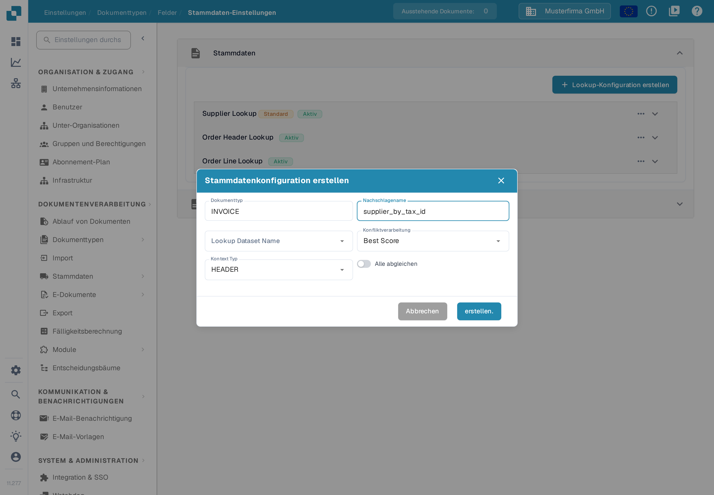
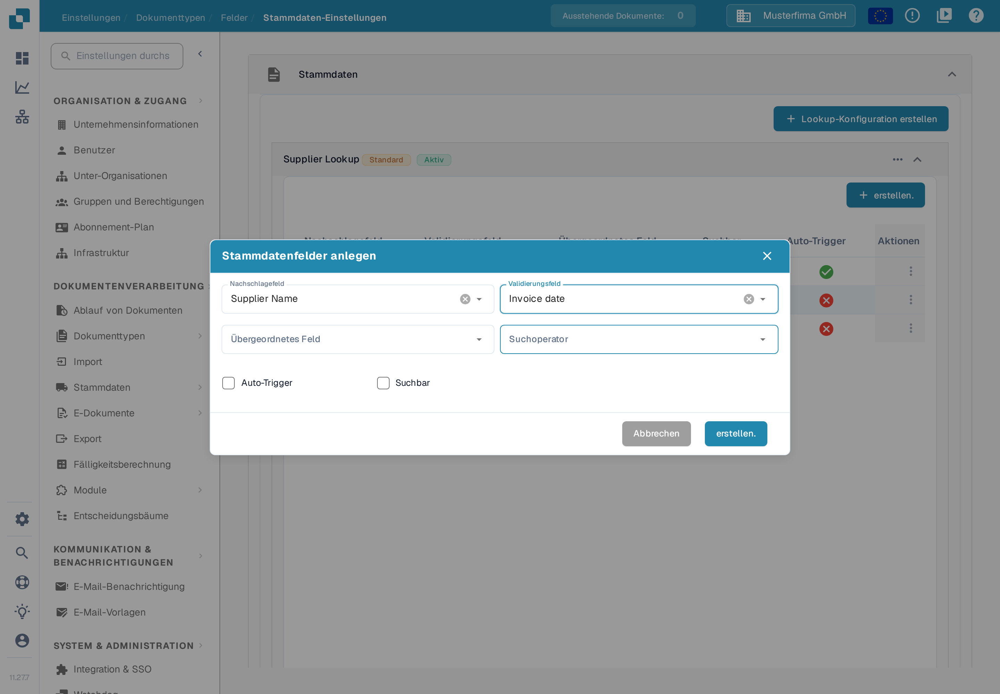

# Fuzzy-Daten mit Stammdaten konfigurieren

Mit einem Stammdaten-Lookup erkennen Sie einen Lieferanten anhand von Werten auf einer Rechnung. Der Lookup durchsucht einen importierten Datensatz und kann die Lieferantenfelder des Dokuments füllen. Konfigurieren Sie jeden Dokumententyp einzeln. Das Beispiel verwendet **Invoice** in der Beispielorganisation **Musterfirma GmbH**; alle gezeigten Werte sind erfundene Beispieldaten.

## Lookup-Einstellungen öffnen

1. Öffnen Sie **Einstellungen → Dokumentenverarbeitung → Dokumenttypen**.
2. Wählen Sie **Invoice → Felder → Stammdaten-Einstellungen**.
3. Klappen Sie **Stammdaten** auf. Die Beispielorganisation zeigt die Gruppen **Supplier Lookup**, **Order Header Lookup** und **Order Line Lookup** sowie den Bereich **LOV-Stammdaten**. Ihre Organisation kann weitere Konfigurationen haben.

<figure><figcaption>
Wählen Sie eine Lookup-Gruppe, um ihre Felder zu prüfen, oder erstellen Sie mit <strong>Lookup-Konfiguration erstellen</strong> eine neue.
</figcaption></figure>

Das Label **Aktiv** zeigt, dass eine Konfiguration eingeschaltet ist. Über das Drei-Punkte-Menü prüfen Sie die verfügbaren Aktionen; bei einer Standardkonfiguration sind das **Deaktivieren**, **Duplizieren** und **Anzeigen**. Standardkonfigurationen lassen sich ansehen, aber nicht bearbeiten oder löschen; eine eigene Konfiguration bietet zusätzliche Aktionen. Deaktivieren Sie einen Lookup erst, nachdem Sie geprüft haben, welche Dokumentfelder davon abhängen.


Die relevanten Lieferanten-Stammdaten müssen importiert sein, bevor ein Lookup sie finden kann. Siehe [Stammdaten importieren](../../../infor-integration-and-configuration/importing-customer-master-data/README.md) und [Stammdaten-Einstellungen](../../settings/global-settings/document-types/fields/master-data-settings.md) für die weitergehende Einrichtung.


## Lookup-Konfiguration erstellen

Wählen Sie **Lookup-Konfiguration erstellen**. Geben Sie einen **Nachschlagename** ein, wählen Sie einen **Lookup Dataset Name** und setzen Sie **Kontext Typ** auf **HEADER** für Dokumentfelder oder auf **LINE** für eine Tabelle. Bei **LINE** wählen Sie zusätzlich unter **Kontext Detail** die passende Tabelle aus. Mit **Konfliktverarbeitung** legen Sie fest, was passiert, wenn mehrere Datensätze passen. **Alle abgleichen** verlangt, dass jedes verwendete Suchfeld auf denselben Datensatz passt; ausgeschaltet genügt ein passendes Feld.

<figure><figcaption>
Der Dialog wurde für die Dokumentation geöffnet und mit dem erfundenen Beispielnamen <strong>supplier_by_tax_id</strong> gefüllt; eine Konfiguration wurde nicht erstellt.
</figcaption></figure>

In der **Konfliktverarbeitung** stehen **Best Score**, **Return None** und **Return First** zur Auswahl. Verwenden Sie **Return None**, wenn eine Person zwischen mehrdeutigen Lieferanten entscheiden soll; lesen Sie die Beispiele unten, bevor Sie **Best Score** oder **Alle abgleichen** wählen.

## Felder für die Lieferantenerkennung wählen

Klappen Sie **Supplier Lookup** auf, um die Zuordnungen zu sehen. Die Tabelle zeigt das **Nachschlagefeld** aus dem Datensatz, das **Validierungsfeld** auf dem Dokument, das optionale Feld **Übergeordnetes Feld** und ob **Suchbar** oder **Auto-Trigger** eingeschaltet ist. In der Beispielorganisation ist Supplier Name suchbar und zusätzlich als Auto-Trigger markiert, Vat Number nur suchbar; in einer anderen Organisation können die Markierungen abweichen.

<figure><figcaption>
Prüfen Sie, welche Felder an der Lieferantenerkennung teilnehmen, bevor Sie die Abgleichsregel ändern.
</figcaption></figure>

Um eine Zuordnung hinzuzufügen, wählen Sie innerhalb der aufgeklappten Gruppe **erstellen.** und dann **Nachschlagefeld**, **Validierungsfeld**, optional **Übergeordnetes Feld** und **Suchoperator**. Der Operator bestimmt, wie Text verglichen wird; verwenden Sie **Genau** für eine eindeutige Kennung und erwägen Sie **Smart** oder **Enthält** nur, wenn ein Textteil passen soll. **Auto-Trigger** startet einen Lookup, sobald dieses Dokumentfeld einen Wert erhält. **Suchbar** nimmt das Feld in die Suche auf und macht den manuellen Lookup während der Validierung verfügbar. Wählen Sie **erstellen.** erst, nachdem Sie die Zuordnung geprüft haben.

<figure><figcaption>
Das Formular wurde geprüft, ohne ein neues Feld zu speichern.
</figcaption></figure>

Die Beispiele unten erklären, wie diese Markierungen, **Alle abgleichen** und die Konfliktverarbeitung zusammenspielen. Für diese Dokumentationsprüfung wurde kein echtes Ergebnis der Lieferantenerkennung erzeugt.

### **Wie DocBits einen Lieferanten auswählt**

Wenn ein Dokument eintrifft, sucht DocBits den Lieferanten in Ihren Stammdaten. Drei Einstellungen bestimmen das Ergebnis. Dieser Abschnitt erklärt sie Schritt für Schritt, mit Beispielen.

#### **Schritt 1 — Welche Felder für die Suche verwendet werden**

DocBits verwendet ein Feld nur dann für die Suche, wenn beide Punkte zutreffen:

* das Feld ist in der Stammdatenkonfiguration als **Suchbar** oder **Auto-Trigger** markiert, und
* das Feld hat auf dem Dokument einen Wert.

Woher der Wert kommt, spielt keine Rolle. Ein trainiertes Feld, ein von der KI gefülltes Feld und ein von Hand eingetippter Wert werden gleich behandelt.


**Suchbar bewirkt zwei Dinge.** Es zeigt das blaue Suchsymbol im Validierungsbildschirm, **und** es nimmt das Feld in die automatische Lieferantensuche auf. Ein Feld, das nur von Hand durchsucht werden soll, bleibt unmarkiert.


#### **Schritt 2 — Eine Suche, nicht eine Suche pro Feld**

DocBits sucht **nicht** je Feld einzeln. Es baut **eine** Suche über alle verwendeten Felder. **Alle abgleichen** bestimmt, wie sie verknüpft werden:

* **Alle abgleichen aus** (Standard) → "finde jeden Lieferanten, der zur Steuernummer **ODER** zum Lieferantennamen passt". Das ergibt eine **längere** Liste.
* **Alle abgleichen ein** → "finde jeden Lieferanten, der zur Steuernummer **UND** zum Lieferantennamen passt". Das ergibt eine **kürzere** Liste.

Beachten Sie außerdem: Die Suchoperatoren **Smart** und **Enthält** suchen nach einem Textteil. Der Name "Meier" findet auch "Meier Bau GmbH" und "Meier & Sons Ltd". Ein Lieferantenname findet deshalb oft mehrere Lieferanten.

#### **Schritt 3 — Was passiert, wenn die Liste mehrere Lieferanten enthält**

Die **Konfliktverarbeitung** entscheidet:

* **Best Score** → nimmt den Lieferanten, der zu den meisten Feldern passt. Lässt den Lieferanten nie leer.
* **Return None** → lässt den Lieferanten leer, damit ein Benutzer ihn auswählt.
* **Return First** → nimmt den ersten Lieferanten der Liste.

#### **Beispiele**

In allen Beispielen hat das Dokument eine Steuernummer und einen Lieferantennamen, und beide Felder sind **Suchbar**.

<table><thead><tr><th width="150">Steuernummer findet</th><th width="150">Name findet</th><th width="150">Alle abgleichen aus + Return None</th><th width="150">Alle abgleichen ein + Return None</th><th width="150">Alle abgleichen aus + Best Score</th></tr></thead><tbody>
<tr><td>nur A</td><td>A und B</td><td>leer</td><td><strong>A</strong></td><td><strong>A</strong></td></tr>
<tr><td>A und B</td><td>nur B</td><td>leer</td><td><strong>B</strong></td><td><strong>B</strong></td></tr>
<tr><td>A, B und C</td><td>C, D und E</td><td>leer</td><td><strong>C</strong></td><td><strong>C</strong></td></tr>
<tr><td>A, B und C</td><td>B, C und D</td><td>leer</td><td>leer</td><td>B oder C, nicht verlässlich</td></tr>
<tr><td>nur A</td><td>nichts</td><td><strong>A</strong></td><td>leer</td><td><strong>A</strong></td></tr>
</tbody></table>

So lesen Sie die Tabelle:

* **Zeile 1 bis 3** sind der Normalfall. Ein Feld ist eindeutig, das andere nicht. Mit **Alle abgleichen aus** enthält die Liste mehrere Lieferanten und **Return None** lässt das Feld leer. **Alle abgleichen ein** behält nur den Lieferanten, der zu beiden Feldern passt, und findet ihn.
* **Zeile 4** hat überhaupt keinen eindeutigen Lieferanten. Das Feld leer zu lassen ist richtig. **Best Score** wählt trotzdem einen aus, und das kann der falsche sein.
* **Zeile 5** ist das Risiko von **Alle abgleichen ein**. Siehe die Warnung unten.


**Alle abgleichen kann einen Lieferanten verlieren.** Mit **Alle abgleichen ein** muss jedes verwendete Feld passen. Trägt ein Feld einen Wert, den es in Ihren Stammdaten nicht gibt — ein Tippfehler, ein alter Firmenname, ein vom Beleg gelesener Wert — liefert die gesamte Suche nichts und es wird kein Lieferant gefunden, obwohl die Steuernummer allein den richtigen gefunden hätte.


#### **Ein Lieferant wurde früher erkannt und wird jetzt nicht mehr erkannt**

Fast immer liefert ein weiteres Feld jetzt einen Wert. Prüfen Sie in dieser Reihenfolge:

1. Öffnen Sie das Dokument. Welches Feld der Stammdatenkonfiguration trägt jetzt einen Wert, der früher leer war?
2. Öffnen Sie die Stammdatenkonfiguration. Ist dieses Feld als **Suchbar** oder **Auto-Trigger** markiert? Wenn ja, nimmt es jetzt an der Suche teil und macht die Trefferliste länger.
3. Wählen Sie einen der drei Wege:
   * **Das Feld soll nicht an der Suche teilnehmen** → entfernen Sie **Suchbar** und **Auto-Trigger** bei diesem Feld. Das Feld behält seinen Wert auf dem Dokument und wird dem Benutzer weiterhin angezeigt. Das ist die kleinste Änderung.
   * **Das Feld soll teilnehmen** → schalten Sie **Alle abgleichen** ein, lesen Sie aber zuerst die Warnung oben.
   * **Sie wollen in jedem Fall einen Lieferanten** → setzen Sie die **Konfliktverarbeitung** auf **Best Score**. Nehmen Sie in Kauf, dass statt eines leeren Feldes auch der falsche Lieferant gewählt werden kann.

### **Letzter Schritt: Felder zum Layout hinzufügen**

Nachdem Sie die Fuzzy-Datenfelder konfiguriert haben, **fügen Sie sie mit dem Layout-Editor zum Layout hinzu**. Felder, die nicht zum Layout hinzugefügt werden, stehen nicht zur Verfügung.

[Layout-Editor](layout-builder.md)
