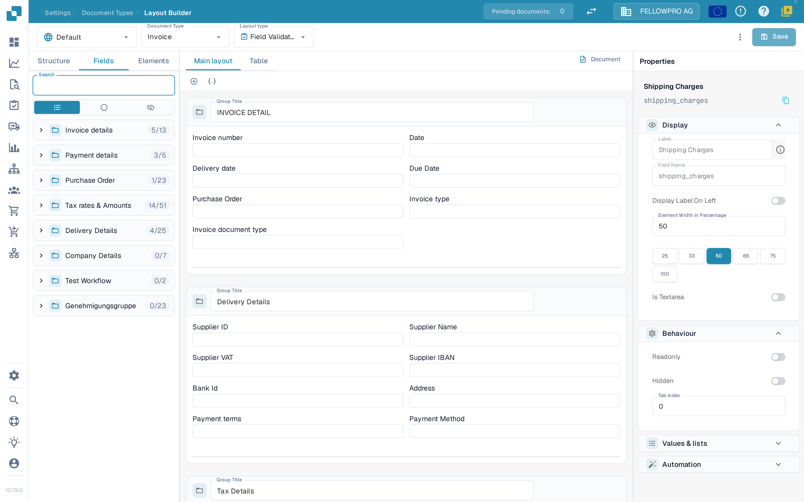
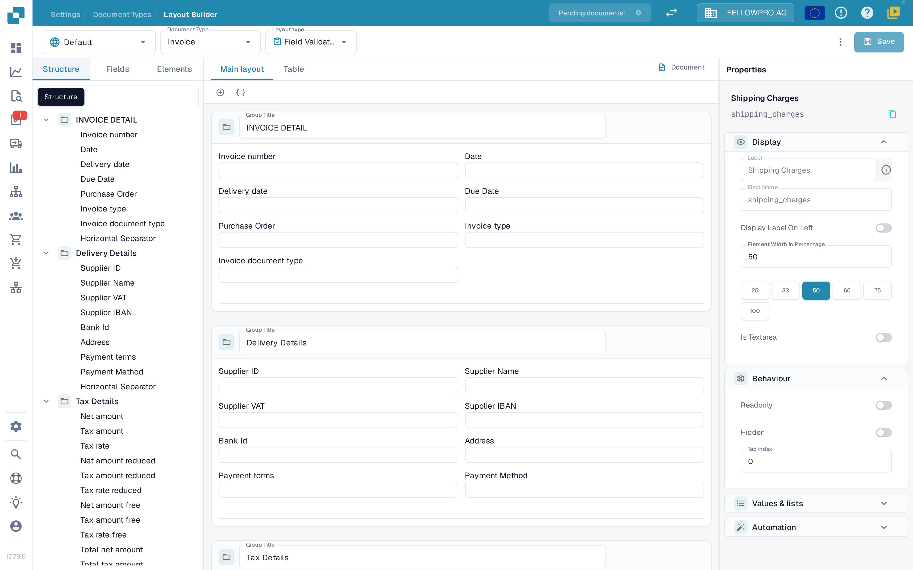

# Editor de diseños

Utilice el Layout Builder para organizar los campos y los controles que las personas ven al validar o aprobar un documento. Un diseño pertenece a un tipo de documento, un origen y un tipo de diseño, así que compruebe esos tres datos en la parte superior de la página antes de guardar.


DocBits Layout Builder Tutorial: Create Custom Document Layouts for Faster, Cleaner Validation


## Abrir el diseño

1. Abra **Settings → Document Types**.
2. Seleccione el tipo de documento que quiera editar y abra **Layout Builder**. Para un subtipo de documento, abra la acción Layout Builder de ese subtipo.
3. Compruebe la cabecera. El selector de la izquierda es el **origin** (por ejemplo **Default**), seguido de **Document Type** (por ejemplo **Invoice**) y **Layout type** (por ejemplo **Field Validation**). Cada selector abre una lista; si elige otra entrada, se carga ese diseño. Si Layout Builder no está disponible, puede que un administrador deba activar el módulo para su organización.

<figure><figcaption>
El Layout Builder: los selectores de la cabecera, las listas de elementos a la izquierda, el lienzo en el centro y el panel Properties a la derecha.
</figcaption></figure>

## Trabajar con la cabecera

* **Document Type** y **Layout type** cambian de diseño. La página vuelve a cargar el diseño que elija.
* Junto a **Save**, DocBits indica si el diseño tiene **unsaved changes**. Después de guardar, indica cuándo se guardó el diseño por última vez.
* **Save** almacena el diseño del tipo de documento, el origen y el tipo de diseño seleccionados.
* El menú **More** (tres puntos) contiene **Auto Generate template**, **Apply Default layout to Origins**, **Use default template**, **Edit JSON**, **Copy JSON** y **Layout settings**. **Auto Generate template** y **Use default template** sustituyen un diseño personalizado, así que compruebe primero el tipo de documento y el diseño seleccionados. **Edit JSON** es para la configuración avanzada y solo debe utilizarse cuando se conoce el formato de la plantilla.
* Si sale de la página con cambios sin guardar, DocBits pregunta si desea guardarlos o descartarlos.

## Buscar elementos: Structure, Fields y Elements

El lado izquierdo tiene tres pestañas:

| Pestaña | Uso |
| --- | --- |
| **Structure** | Ver el diseño como un árbol. Los grupos y sus campos aparecen en el orden en que se muestran en el lienzo, con el número de campos colocados y disponibles. |
| **Fields** | Todos los campos configurados para el tipo de documento, agrupados por grupo de campos y contraídos de forma predeterminada. El filtro alterna entre los campos **All**, **Unused** y **Hidden**, y el nombre técnico del campo se muestra bajo la etiqueta del campo. |
| **Elements** | Controles de presentación e interacción como Text, Label, Check Box, separadores, tablas, botones y subgrupos. |

<figure><figcaption>
La pestaña Structure muestra el diseño construido como un árbol de grupos y campos.
</figcaption></figure>

Seleccione un elemento para añadirlo o arrástrelo al lienzo. El título de un grupo indica a la persona que valida el documento qué corresponde a esa sección. Cree o renombre los campos de documento reutilizables en [Document Types](README.md) primero.

## Trabajar en el lienzo

* **Main layout** muestra el diseño del propio documento. **Table** muestra el diseño de tabla que se utiliza para las líneas.
* **Document** abre o cierra el documento de ejemplo junto al lienzo, para que pueda comparar el diseño con un documento real.
* Los grupos se dibujan como tarjetas; los campos de un grupo pueden organizarse en filas y tener anchos distintos.

## Cambiar las propiedades de un elemento

Seleccione un elemento o un grupo en el lienzo. **Properties** a la derecha está siempre visible y se organiza en secciones:

* **Display** – etiqueta, nombre del campo, posición de la etiqueta y ancho del elemento.
* **Behaviour** – solo lectura, oculto e índice de tabulación.
* **Values & lists** – los valores que se ofrecen para el elemento.
* **Automation** – reglas que rellenan o cambian el elemento.
* **Borders & spacing** – la apariencia del elemento.

Para el ancho, elija uno de los valores preestablecidos (25, 33, 50, 66, 75 o 100 por ciento) en lugar de escribir un valor; compruebe el resultado en el lienzo. Las secciones y opciones que aparecen dependen del elemento seleccionado. Para más detalles, consulte [Configuring Field Properties](../../settings/global-settings/document-types/layout-manager/configuring-field-properties.md).

## Traducir las etiquetas de los botones

Los botones como **Save Rules**, **Auto Accounting**, **PO Match**, **Export**, **Export Without Validation** y **Reject** obtienen su etiqueta de una clave de traducción. El visor muestra la etiqueta en el idioma de la persona que abre el diseño. Si la clave no tiene texto para ese idioma, DocBits muestra la etiqueta guardada en el diseño.

* Un botón independiente tiene un campo **Translation Key** en **Properties**.
* **Invoice Buttons** agrupa varios botones. Defina la clave de un botón hijo concreto o defina una clave por hijo en la lista del panel del grupo.

Los diseños creados antes de este cambio conservan sus etiquetas: DocBits les asigna la clave predeterminada de cada tipo de botón. Los diseños guardados con una clave conservan esa clave, también después de recargar.

## Save and go back to Dashboard

Un botón del tipo **Save and go back to Dashboard** almacena los valores del documento como **Save** y después abre el Dashboard. El tipo es adecuado para diseños en los que un revisor trabaja una cola de documentos uno tras otro.

* Añada un elemento de botón en el lienzo y elija el tipo en sus **Properties**.
* Si el guardado falla, el botón permanece en la pantalla de validación y no abre el Dashboard, de modo que el problema puede corregirse primero.
* La etiqueta se resuelve como la etiqueta de cualquier otro botón; véase *Traducir las etiquetas de los botones* arriba.

## Revisar y guardar

Organice los grupos y los campos, compruebe el diseño en el lienzo y utilice **Save** en la cabecera cuando el resultado sea correcto. Para diseños específicos de un origen, consulte [Origin Layouts](origin-layouts.md).


Las capturas muestran ajustes sintéticos en la organización de pruebas de DocBits con inglés seleccionado en la aplicación. No se guardó ni se sustituyó ningún diseño durante su captura.

