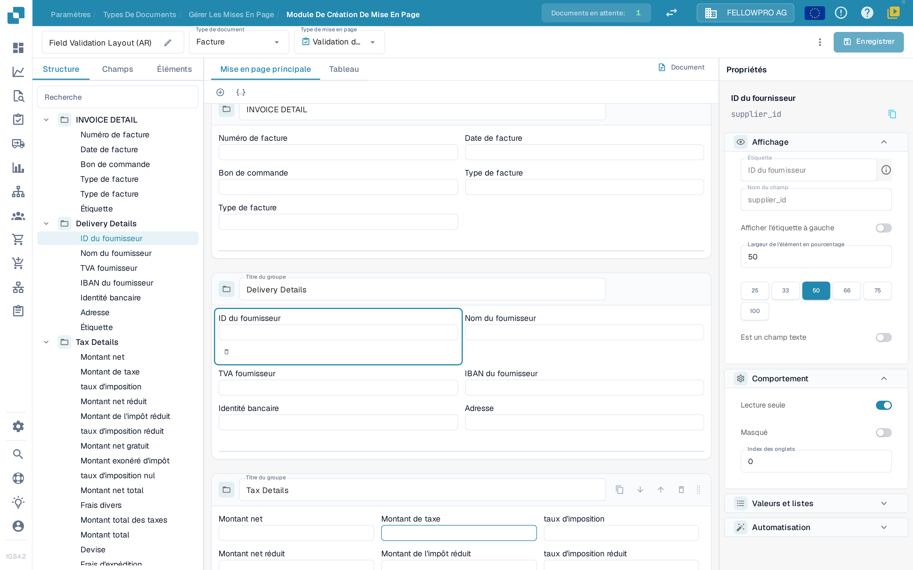
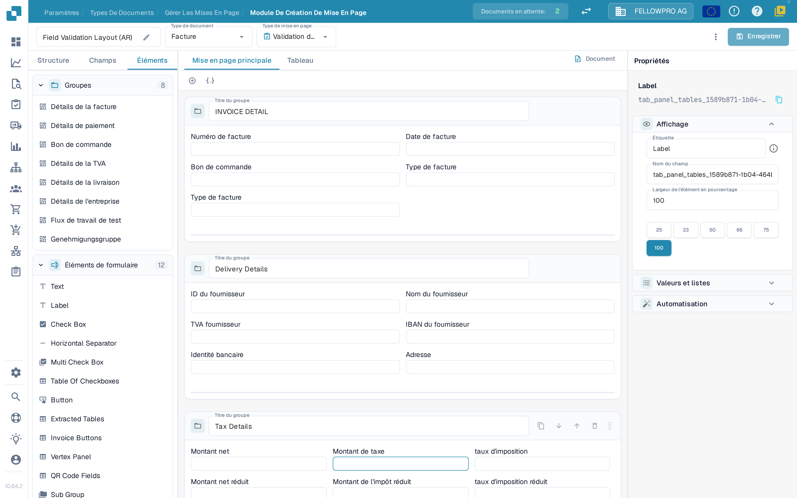

# Éditeur de mise en page

Utilisez l’éditeur de mise en page pour organiser les champs et les contrôles que les personnes voient lorsqu’elles valident ou approuvent un document. Chaque mise en page appartient à un type de document et à un type de mise en page : vérifiez ces deux indications en haut de la page avant d’enregistrer. Les mises en page propres à une origine sont décrites dans [Mises en page par origine](origin-layouts.md).

## Ouvrir la mise en page

1. Ouvrez **Paramètres → Types de documents**.
2. Sous le nom du type de document à modifier, sélectionnez **Plans** pour ouvrir ses mises en page. Pour un sous-type de document, ouvrez l’action correspondante de ce sous-type.
3. Si l’éditeur de mise en page n’est pas disponible, un administrateur doit peut-être activer le module pour votre organisation.

<figure><figcaption>
L’éditeur de mise en page : l’en-tête, les trois onglets à gauche, le canevas au centre et le panneau Propriétés à droite.
</figcaption></figure>

## Travailler avec l’en-tête

* À gauche de l’en-tête, le nom de la mise en page s’affiche ; le crayon à côté permet de la renommer.
* **Type de document** et **Type de mise en page** permettent de passer d’une mise en page à l’autre : la page recharge celle que vous choisissez.
* À côté d’**Enregistrer**, DocBits indique **Modifications non enregistrées** tant que la mise en page n’est pas enregistrée. Après un enregistrement, l’heure du dernier enregistrement s’affiche.
* **Enregistrer** enregistre la mise en page pour le type de document et le type de mise en page sélectionnés.
* Le menu à trois points contient **Générer automatiquement un modèle**, **Modifier JSON**, **Copier JSON** et **Paramètres de mise en page**. **Générer automatiquement un modèle** remplace une mise en page personnalisée : vérifiez donc d’abord quel type de document et quelle mise en page sont ouverts. **Modifier JSON** s’adresse aux utilisateurs avancés et ne doit être utilisé que si vous connaissez le format du modèle.
* Si vous quittez la page alors que des modifications ne sont pas enregistrées, DocBits demande s’il faut les rejeter : **Faut-il rejeter les modifications ?** propose **Annuler** pour rester sur la page et **OK** pour la quitter sans enregistrer.

## Trouver des éléments : Structure, Champs, Éléments

La partie gauche comporte trois onglets :

| Onglet | Utilisation |
| --- | --- |
| **Structure** | Affiche la mise en page sous forme d’arborescence. Les groupes et leurs champs apparaissent dans l’ordre du canevas ; dépliez un groupe avec son chevron pour voir les champs qu’il contient, et le compteur à droite du nom indique combien de ses champs sont placés. La zone de recherche filtre l’arborescence et, lorsque vous sélectionnez une ligne, l’élément correspondant est sélectionné sur le canevas. |
| **Champs** | Réunit tous les champs proposés par le type de document, classés par groupe et repliés par défaut. Trois boutons de filtre sous la recherche limitent la liste à tous les champs, à ceux qui ne sont pas encore placés ou à ceux qui sont masqués. Chaque ligne affiche le libellé du champ ; une coche verte signale les champs déjà placés, qui apparaissent en grisé. |
| **Éléments** | Contrôles de présentation et d’interaction : **Text**, **Label**, **Check Box**, séparateurs, tableaux, boutons et sous-groupes. |

<figure><figcaption>
L’onglet Éléments : les groupes de la mise en page et les éléments de formulaire disponibles.
</figcaption></figure>

Sélectionnez un élément pour l’ajouter, ou faites-le glisser dans le canevas. Le titre d’un groupe indique à la personne qui valide le document ce que contient cette section. Créez ou renommez d’abord les champs réutilisables du document dans [Types de documents](README.md).

## Travailler sur le canevas

* **Mise en page principale** affiche la mise en page du document lui-même ; **Tableau** affiche la disposition en tableau utilisée pour les lignes d’articles.
* **Document** ouvre ou ferme le document d’exemple à côté du canevas, pour comparer la mise en page avec un document réel.
* Les groupes apparaissent sous forme de cartes ; les champs d’un groupe peuvent être disposés en lignes et recevoir des largeurs différentes.

## Modifier les propriétés d’un élément

Sélectionnez un élément ou un groupe sur le canevas. Le panneau **Propriétés** à droite reste toujours visible et se compose de sections : **Affichage** (libellé, nom du champ, position du libellé et largeur de l’élément), **Comportement** (lecture seule, masqué et index des onglets), **Valeurs et listes** (valeurs proposées pour l’élément) et **Automatisation** (règles qui remplissent ou modifient l’élément).

Pour la largeur, choisissez l’une des valeurs proposées (25, 33, 50, 66, 75 ou 100 pour cent) plutôt que de saisir un nombre, puis vérifiez le résultat sur le canevas. Les sections et les options affichées dépendent de l’élément sélectionné. Pour plus de détails, consultez [Configurer les propriétés des champs](../../settings/global-settings/document-types/layout-manager/configuring-field-properties.md).

## Vérifier et enregistrer

Organisez les groupes et les champs, vérifiez le résultat sur le canevas puis utilisez **Enregistrer** dans l’en-tête. Pour les mises en page propres à une origine, consultez [Mises en page par origine](origin-layouts.md).


Les captures montrent des données d’exemple d’une organisation de test, avec l’interface en français. Aucune mise en page n’a été enregistrée ni remplacée. Dans cette version, les noms des éléments de formulaire (**Text**, **Label**, **Check Box**…) s’affichent en anglais dans l’interface française.

