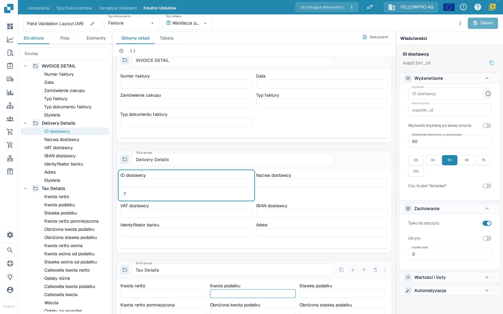
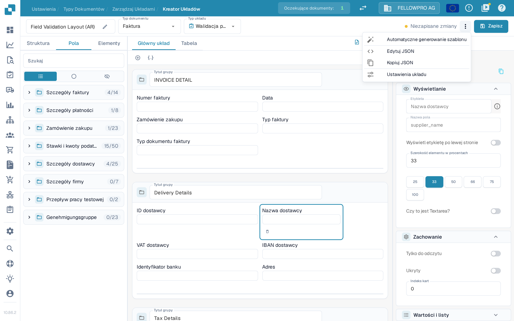
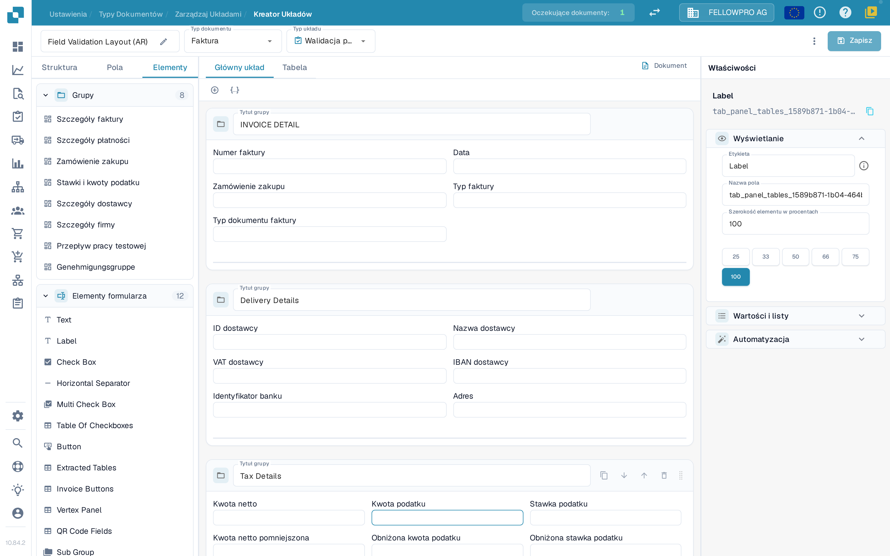

# Edytor układu

Edytor układu służy do rozmieszczania pól i elementów sterujących, które osoby walidujące i zatwierdzające widzą podczas pracy z dokumentem. Każdy układ należy do jednego typu dokumentu, jednego źródła i jednego typu układu, więc przed zapisaniem sprawdź typ dokumentu i typ układu w nagłówku.

## Otwieranie układu

1. Przejdź do **Ustawienia → Typy dokumentów**.
2. Wybierz typ dokumentu, który chcesz edytować, i otwórz jego **Układy**; edytor układu (**Kreator Układów**) otworzy się dla tego typu. Dla podtypu dokumentu otwórz akcję edytora układu tego podtypu.
3. Sprawdź nagłówek. Zobaczysz w nim nazwę układu (zmienisz ją ikoną ołówka), **Typ dokumentu** (na przykład **Faktura**) i **Typ układu** (na przykład **Walidacja pola**). Każdy selektor otwiera listę; wybranie innej pozycji wczytuje odpowiedni układ. Jeśli edytor układu jest niedostępny, administrator może musieć włączyć ten moduł dla Twojej organizacji.

<figure><figcaption>
Edytor układu: selektory w nagłówku, listy elementów po lewej, obszar roboczy pośrodku i panel Właściwości po prawej.
</figcaption></figure>

Nagłówek i karty panelu po lewej stronie opisuje dokładniej strona [Nawigacja w Menedżerze Układów](../../settings/global-settings/document-types/layout-manager/navigating-the-layout-manager.md).

## Praca z nagłówkiem

* **Typ dokumentu** i **Typ układu** przełączają między układami. Po wybraniu innej pozycji strona wczytuje wybrany układ.
* Obok przycisku **Zapisz** DocBits pokazuje, czy układ ma **Niezapisane zmiany**. Po zapisaniu pokazuje godzinę ostatniego zapisu.
* **Zapisz** zapisuje układ dla wybranego typu dokumentu, źródła i typu układu.
* Menu z trzema kropkami obok przycisku **Zapisz** zawiera akcje **Automatyczne generowanie szablonu**, **Edytuj JSON**, **Kopiuj JSON** i **Ustawienia układu**. W nagłówku możesz też wybrać **Zastosuj domyślny układ do Origins** albo **Użyj domyślnego szablonu**. **Automatyczne generowanie szablonu** i **Użyj domyślnego szablonu** zastępują układ niestandardowy, więc najpierw sprawdź wybrany typ dokumentu i układ. **Edytuj JSON** służy do zaawansowanej konfiguracji i warto z niego korzystać tylko wtedy, gdy znasz format szablonu.
* Jeśli opuścisz stronę z niezapisanymi zmianami, DocBits zapyta **Odrzucić zmiany?**. Wybierz **Anuluj**, aby zostać i zapisać, albo **OK**, aby wyjść bez zapisywania.

<figure><figcaption>
Akcje układu w menu z trzema kropkami obok przycisku <strong>Zapisz</strong>.
</figcaption></figure>

## Znajdowanie elementów: Struktura, Pola, Elementy

Panel po lewej stronie ma trzy karty:

| Karta | Do czego służy |
| --- | --- |
| **Struktura** | Pokazuje układ jako drzewo. Grupy i ich pola są wymienione w kolejności, w jakiej występują na obszarze roboczym, wraz z liczbą pól umieszczonych i dostępnych (na przykład **4/14**). |
| **Pola** | Wszystkie pola skonfigurowane dla typu dokumentu, pogrupowane według grup i domyślnie zwinięte. Trzy przyciski filtrów przełączają listę między wszystkimi polami, polami nieużywanymi i polami ukrytymi, a pod etykietą pola widoczna jest techniczna nazwa pola. |
| **Elementy** | Elementy prezentacji i interakcji, takie jak Text, Label, Check Box, separatory, tabele, przyciski i podgrupy. |

<figure><figcaption>
Karta <strong>Elementy</strong> z paletami Grupy i Elementy formularza.
</figcaption></figure>

Nazwy elementów formularza (**Text**, **Label**, **Check Box** i pozostałe) są w polskim interfejsie wyświetlane po angielsku.

Wybierz element, aby go dodać, albo przeciągnij go na obszar roboczy. Tytuł grupy mówi osobie walidującej dokument, co należy do danej sekcji. Pola dokumentu wielokrotnego użytku utwórz lub zmień najpierw w sekcji [Typy dokumentów](README.md).

## Praca na obszarze roboczym

* **Główny układ** pokazuje układ samego dokumentu. **Tabela** pokazuje układ tabeli używany dla pozycji dokumentu.
* **Dokument** otwiera lub zamyka przykładowy dokument obok obszaru roboczego, dzięki czemu możesz porównać układ z rzeczywistym dokumentem.
* Grupy są rysowane jako karty; pola w grupie można rozmieścić w wierszach i nadać im różne szerokości.

## Zmiana właściwości elementu

Wybierz element lub grupę na obszarze roboczym. Panel **Właściwości** po prawej jest zawsze widoczny i podzielony na sekcje:

* **Wyświetlanie** – etykieta, nazwa pola, położenie etykiety i **Szerokość elementu w procentach**.
* **Zachowanie** – tylko do odczytu, ukrycie i indeks kart.
* **Wartości i listy** – wartości oferowane dla elementu.
* **Automatyzacja** – reguły, które wypełniają lub zmieniają element.

Szerokość wybierz z gotowych wartości (25, 33, 50, 66, 75 lub 100 procent) zamiast wpisywać ją ręcznie; sprawdź wynik na obszarze roboczym. To, które sekcje i opcje są widoczne, zależy od wybranego elementu. Więcej informacji znajdziesz w artykule [Konfigurowanie właściwości pól](../../settings/global-settings/document-types/layout-manager/configuring-field-properties.md).

## Sprawdzanie i zapisywanie

Rozmieść grupy i pola, sprawdź układ na obszarze roboczym i użyj przycisku **Zapisz** w nagłówku, gdy wynik jest prawidłowy. Układy dla konkretnego źródła opisuje strona [Układy według źródła](origin-layouts.md).


Zrzuty ekranu przedstawiają przykładowy układ faktury w organizacji testowej DocBits z wybranym językiem polskim. Nazwy pól i dostępne opcje zależą od konfiguracji.

