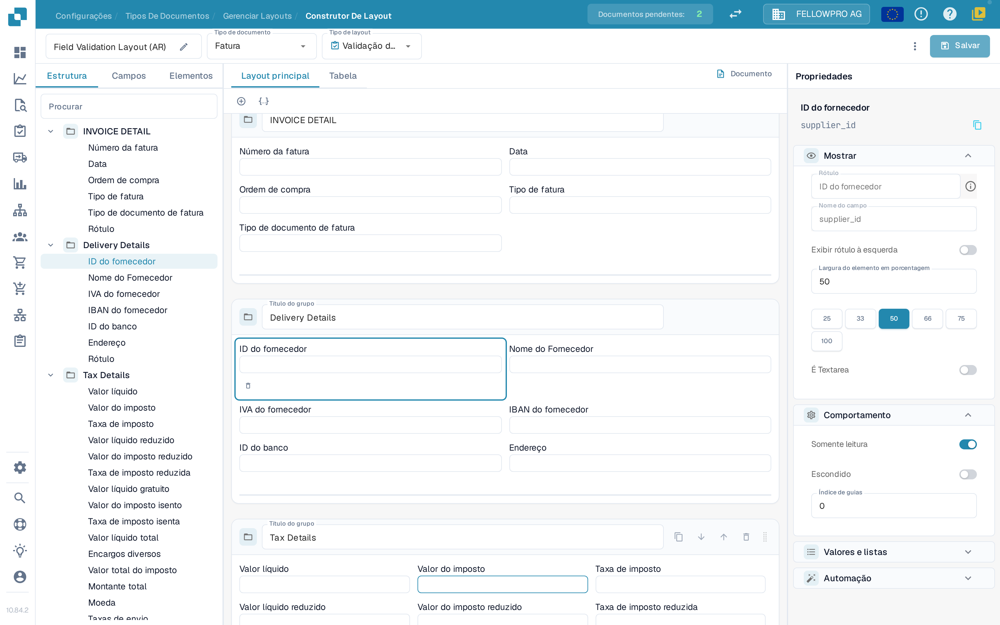
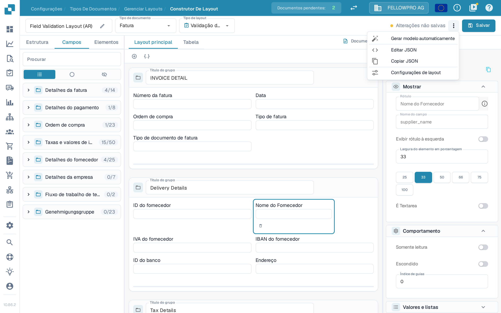
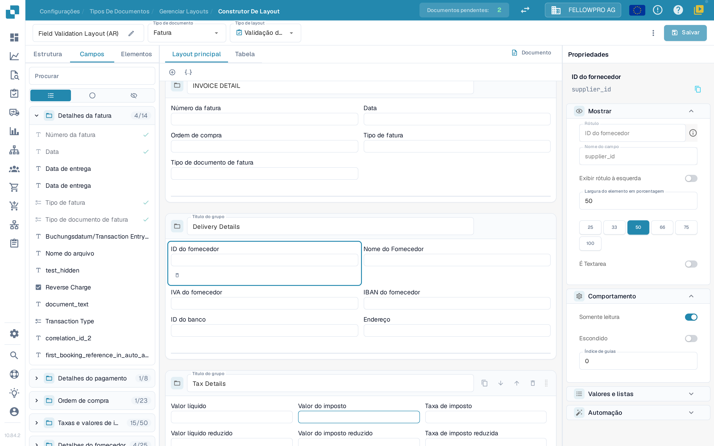

# Construtor de Layout

Use o **Construtor de Layout** para organizar os campos e os controlos que as pessoas veem quando validam ou aprovam um documento. Cada layout pertence a um tipo de documento, uma origem e um tipo de layout, por isso confirme os três na parte superior da página antes de guardar.

## Abrir o layout

1. Abra **Configurações → Tipos de documentos**.
2. Selecione o tipo de documento que quer editar e abra o **Construtor de Layout**. Para um subtipo de documento, abra a ação **Construtor de Layout** desse subtipo.
3. Confirme a barra superior. À esquerda está o nome do layout, que pode mudar com o lápis; ao lado seguem-se o **Tipo de documento** e o **Tipo de layout**. Cada seletor abre uma lista e, ao escolher outra entrada, o DocBits carrega esse layout. Se o Construtor de Layout não estiver disponível, um administrador poderá ter de ativar o módulo para a sua organização.

<figure><figcaption>
A barra superior, as listas de elementos à esquerda, o canvas ao centro e o painel Propriedades à direita.
</figcaption></figure>

## Trabalhar com a barra superior

* **Tipo de documento** e **Tipo de layout** mudam de layout: a página carrega o layout que escolher.
* Junto a **Salvar**, o DocBits indica se o layout tem **Alterações não salvas** e, depois de guardar, mostra quando o layout foi guardado pela última vez.
* **Salvar** guarda o layout para o tipo de documento, a origem e o tipo de layout selecionados.
* O menu de três pontos reúne as restantes ações do layout: **Gerar modelo automaticamente**, **Editar JSON**, **Copiar JSON** e **Configurações de layout**. **Gerar modelo automaticamente** substitui o layout existente, por isso confirme primeiro qual layout está aberto. **Editar JSON** destina-se a configuração avançada e só deve ser usado se conhecer o formato do modelo.
* Se sair da página com alterações não guardadas, o DocBits pergunta se as quer guardar ou descartar.

<figure><figcaption>
O menu de três pontos reúne as restantes ações do layout.
</figcaption></figure>

## Encontrar elementos: Estrutura, Campos, Elementos

O painel à esquerda tem três separadores:

| Separador | Serve para |
| --- | --- |
| **Estrutura** | Ver o layout como uma árvore. Os grupos e os seus campos aparecem na ordem em que estão no canvas, com o número de campos colocados e disponíveis. |
| **Campos** | Todos os campos configurados para o tipo de documento, agrupados por grupo de campos e recolhidos por predefinição. Os três botões de filtro alternam entre todos os campos, apenas os não utilizados e apenas os ocultos, e o nome técnico do campo aparece no painel **Propriedades**. |
| **Elementos** | Controlos de apresentação e interação, como Text, Label, Check Box, separadores horizontais, tabelas, botões e Sub Group. |

<figure><figcaption>
O separador Campos: filtre os campos e veja quais já estão colocados no layout.
</figcaption></figure>

Selecione um item para o adicionar, ou arraste-o para o canvas. O título de um grupo indica à pessoa que valida o documento o que pertence a essa secção. Crie ou renomeie campos de documento reutilizáveis em [Tipos de documentos](README.md) primeiro.

## Trabalhar no canvas

* **Layout principal** mostra o layout do próprio documento. **Tabela** mostra o layout da tabela usado para os artigos.
* **Documento** abre ou fecha o documento de exemplo ao lado do canvas, para comparar o layout com um documento real.
* Os grupos aparecem como cartões; os campos dentro de um grupo podem ser organizados em linhas e receber larguras diferentes.

## Alterar as propriedades de um elemento

Selecione um elemento ou um grupo no canvas. O painel **Propriedades**, à direita, está sempre visível e organiza as definições em secções:

* **Mostrar** – rótulo, nome do campo, posição do rótulo e a **Largura do elemento em porcentagem**.
* **Comportamento** – somente leitura, escondido e índice de guias.
* **Valores e listas** – os valores oferecidos para o elemento.
* **Automação** – regras que preenchem ou alteram o elemento.

Para a largura, escolha um dos valores predefinidos (25, 33, 50, 66, 75 ou 100 por cento) em vez de escrever um valor, e confirme o resultado no canvas. As secções e opções que aparecem dependem do elemento selecionado. Para mais detalhe, veja [Configurar propriedades dos campos](../../settings/global-settings/document-types/layout-manager/configuring-field-properties.md).

## Rever e guardar

Organize os grupos e os campos, confirme o layout no canvas e use **Salvar** na barra superior quando o resultado estiver correto. Para layouts específicos de uma origem, veja [Layouts por origem](origin-layouts.md).


As capturas de ecrã mostram definições sintéticas na organização de teste do DocBits, com a interface em português. Nenhum layout foi guardado ou substituído.

