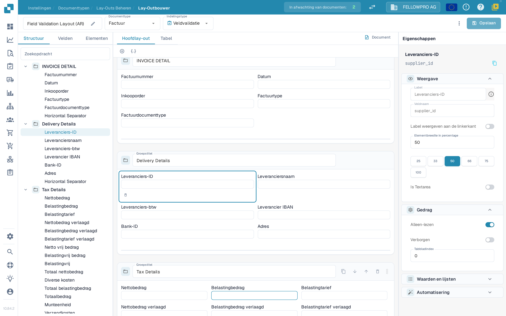
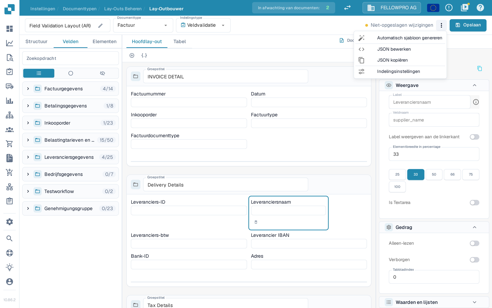
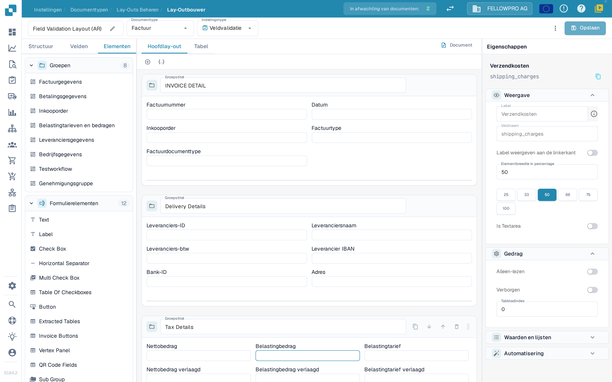

# Lay-outeditor

Gebruik de **Lay-outbouwer** om de velden en besturingselementen te ordenen die gebruikers zien wanneer zij een document valideren of goedkeuren. Een indeling hoort bij één documenttype, één oorsprong en één indelingstype, dus controleer bovenaan de pagina welke indeling open is voordat u wijzigingen opslaat.


DocBits Layout Builder Tutorial: Create Custom Document Layouts for Faster, Cleaner Validation


## De indeling openen

1. Ga naar **Instellingen → Documenttypen**.
2. Selecteer het documenttype dat u wilt bewerken en open **Lay-outbouwer**. Voor een subtype opent u de actie Lay-outbouwer van dat subtype.
3. Controleer de kop van de pagina. Bovenaan staat de naam van de indeling, die u met het potlood wijzigt, gevolgd door het **Documenttype** (bijvoorbeeld **Factuur**) en het **Indelingstype** (bijvoorbeeld **Veldvalidatie**). Elk onderdeel opent een lijst; kiest u een ander item, dan laadt DocBits die indeling. Is de Lay-outbouwer niet beschikbaar, dan moet een beheerder de module voor uw organisatie mogelijk eerst aanzetten.

<figure><figcaption>
De Lay-outbouwer: de kop met de indeling, de tabs links, het canvas in het midden en het paneel Eigenschappen rechts.
</figcaption></figure>

## Werken met de kop

* Met **Documenttype** en **Indelingstype** schakelt u tussen indelingen. DocBits laadt de gekozen indeling opnieuw.
* Naast **Opslaan** toont DocBits of de indeling **niet-opgeslagen wijzigingen** heeft. Na het opslaan ziet u wanneer de indeling voor het laatst is opgeslagen.
* **Opslaan** bewaart de indeling voor het gekozen documenttype en indelingstype.
* Het menu met de drie puntjes naast **Opslaan** bevat **Automatisch sjabloon genereren**, **JSON bewerken**, **JSON kopiëren** en **Indelingsinstellingen**. **Automatisch sjabloon genereren** vervangt een eigen indeling, dus controleer eerst welk documenttype en welke indeling open is. **JSON bewerken** is bedoeld voor gevorderde configuratie en gebruikt u alleen als u het formaat van het sjabloon kent.
* Verlaat u de pagina met niet-opgeslagen wijzigingen, dan vraagt DocBits of u ze wilt opslaan of negeren.

<figure><figcaption>
De overige acties staan in het menu met de drie puntjes naast Opslaan.
</figcaption></figure>

## Elementen vinden: Structuur, Velden, Elementen

Het paneel links heeft drie tabs:

| Tab | Waarvoor u het gebruikt |
| --- | --- |
| **Structuur** | Bekijk de indeling als een boom. Groepen en hun velden staan in de volgorde waarin ze op het canvas verschijnen, met het aantal geplaatste en beschikbare velden. |
| **Velden** | Alle velden die het documenttype aanbiedt, gegroepeerd per veldgroep en standaard ingeklapt. Met de drie pictogrammen onder het zoekveld filtert u op alle velden, op velden die nog niet in de indeling staan of op verborgen velden. De technische veldnaam leest u in het paneel **Eigenschappen** wanneer u een veld selecteert. |
| **Elementen** | Weergave- en interactieblokken zoals Text, Label, Check Box, scheidingslijnen, tabellen, knoppen en subgroepen. |

<figure><figcaption>
De paletten Groepen en Formulierelementen in de tab Elementen.
</figcaption></figure>

Selecteer een item om het toe te voegen, of sleep het naar het canvas. Een groepstitel vertelt de gebruiker die het document valideert wat er in die sectie hoort. Maak of wijzig herbruikbare documentvelden eerst in [Documenttypen](README.md).

## Op het canvas werken

* **Hoofdlay-out** toont de indeling van het document zelf. **Tabel** toont de tabelindeling die voor regels wordt gebruikt.
* **Document** opent of sluit het voorbeelddocument naast het canvas, zodat u de indeling met een echt document kunt vergelijken.
* Groepen worden als kaarten getekend; de velden in een groep kunt u in rijen rangschikken en verschillende breedtes geven.

## De eigenschappen van een element wijzigen

Selecteer een element of een groep op het canvas. **Eigenschappen** rechts is altijd zichtbaar en is ingedeeld in secties:

* **Weergave** – het label, de veldnaam, de positie van het label en de elementbreedte.
* **Gedrag** – alleen-lezen, verborgen en tabbladindex.
* **Waarden en lijsten** – de waarden die het element aanbiedt.
* **Automatisering** – regels die het element vullen of wijzigen.

Voor de breedte kiest u een van de voorinstellingen (25, 33, 50, 66, 75 of 100 procent) in plaats van een waarde te typen; controleer het resultaat op het canvas. Welke secties en opties verschijnen, hangt af van het geselecteerde element. Zie [Veldeigenschappen configureren](../../settings/global-settings/document-types/layout-manager/configuring-field-properties.md) voor meer detail.

## Knoplabels vertalen

Knoppen zoals **Save Rules**, **Auto Accounting**, **PO Match**, **Export**, **Export Without Validation** en **Reject** halen hun label uit een vertaalsleutel. Zo ziet iedere gebruiker het label in zijn eigen taal.

* Voor een losse knop stelt u de vertaalsleutel in het paneel **Eigenschappen** in.
* **Invoice Buttons** bundelt meerdere knoppen. Stel de sleutel voor één knop in, of stel per knop een sleutel in de lijst op het paneel van de groep.

Indelingen van vóór deze wijziging houden hun labels: DocBits vult voor elke knop de standaardsleutel van dat knoptype in, zoals `save_rules` en `export`. Een opgeslagen sleutel blijft behouden, ook nadat u de indeling opnieuw laadt.

## Controleren en opslaan

Rangschik de groepen en velden, controleer de indeling op het canvas en gebruik **Opslaan** in de kop als het resultaat klopt. Zie [Oorsprongindelingen](origin-layouts.md) voor indelingen die bij een specifieke oorsprong horen.


De schermafbeeldingen tonen een voorbeeldindeling in de Nederlandse interface. Veldnamen en beschikbare opties hangen af van uw eigen configuratie.

