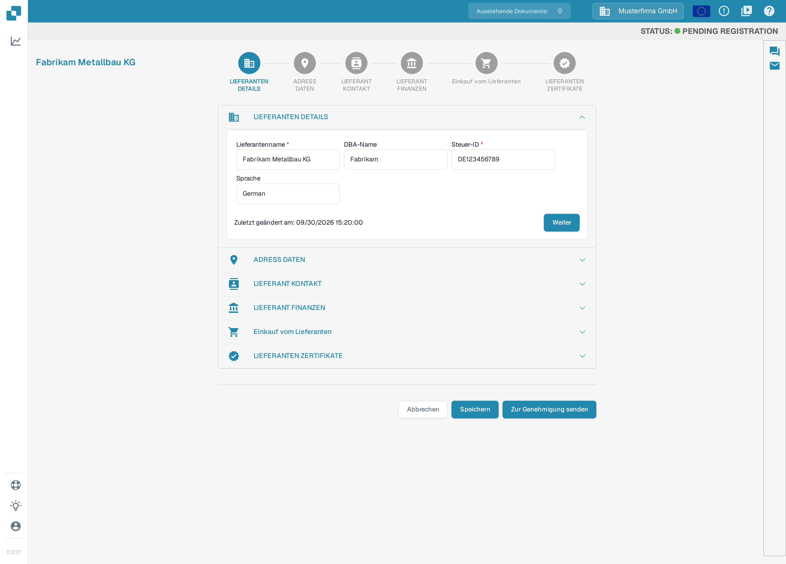
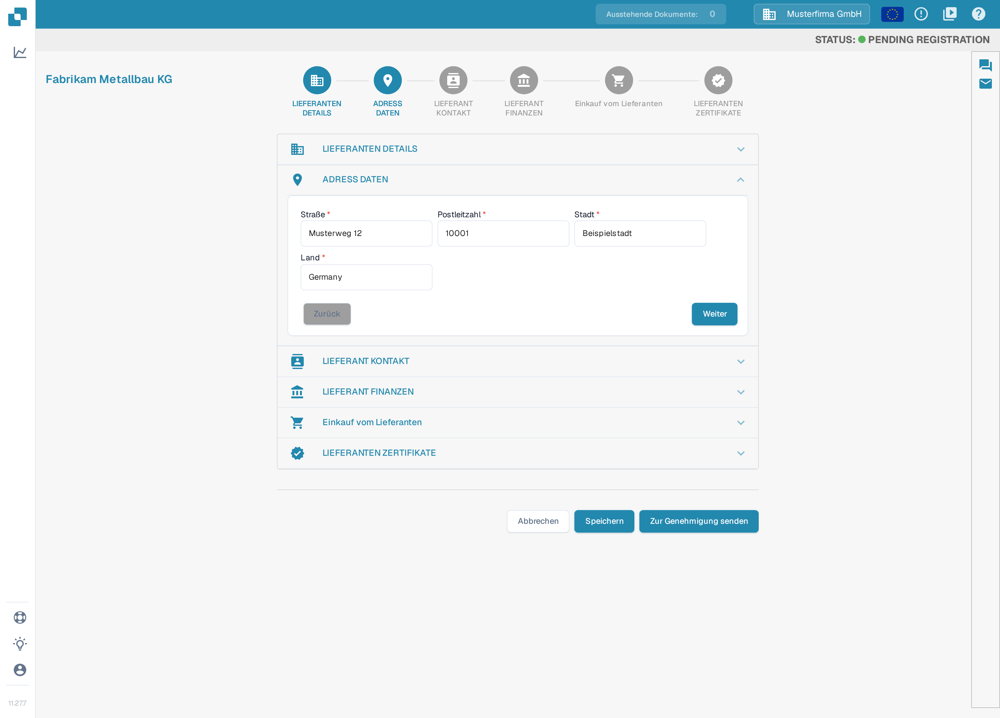
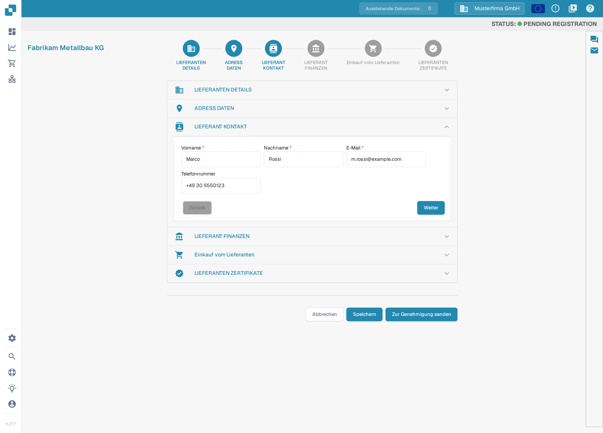
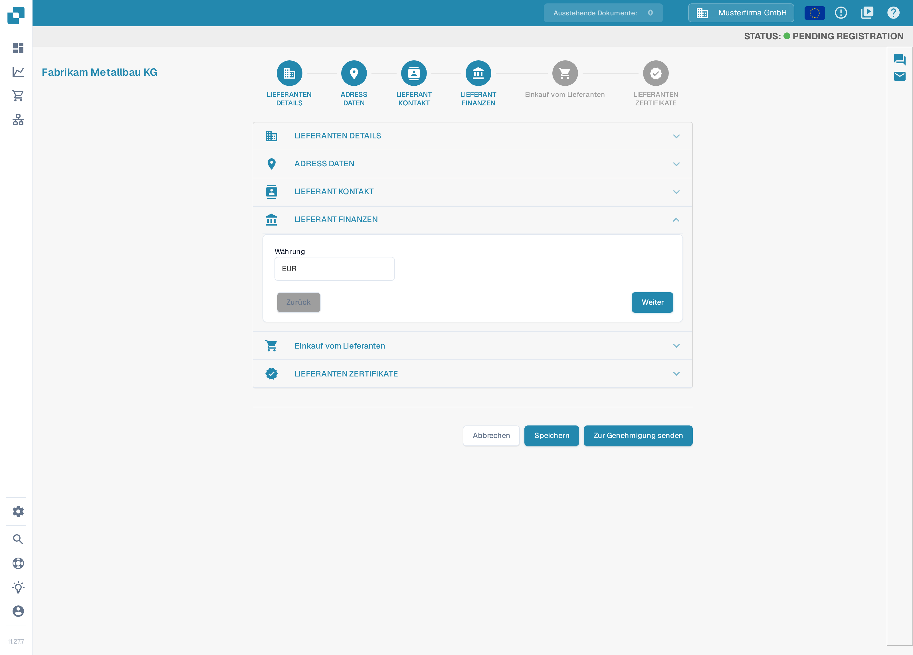
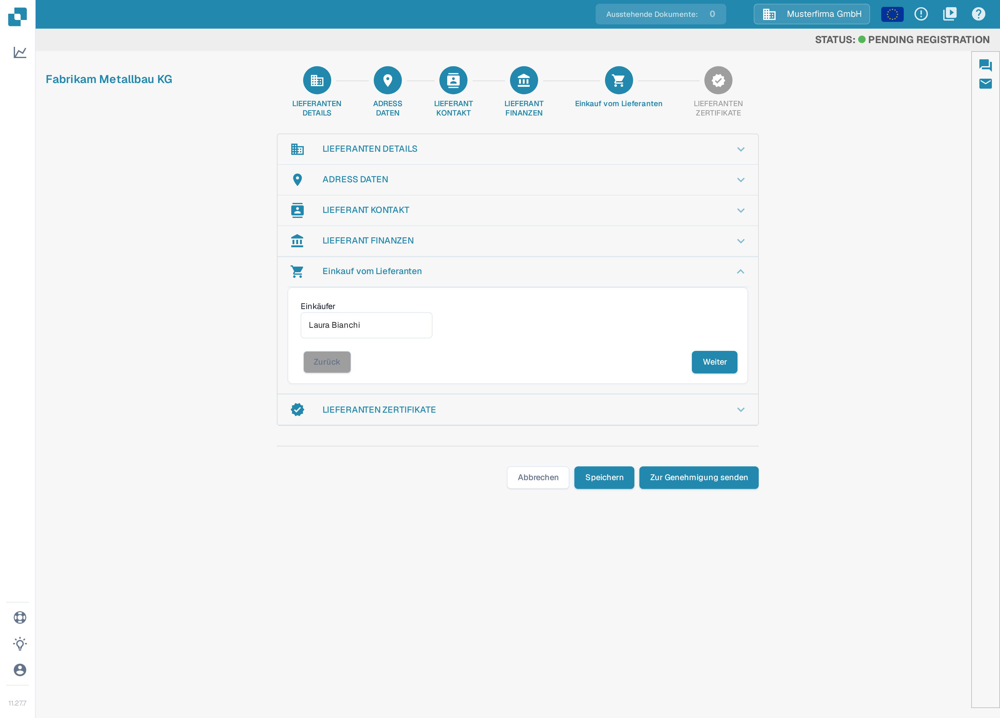
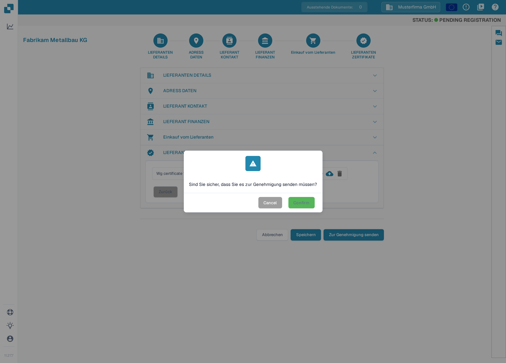

# Registrierung für Lieferanten

Diese Anleitung richtet sich an Lieferanten, die in das DocBits-Portal einer Organisation eingeladen wurden. Verwenden Sie den Link aus Ihrer Einladung. Sie erhalten einen eigenen Lieferantenzugang; die einladende Organisation bestimmt, welche Informationen freigegeben sind und welche Registrierungsschritte erforderlich sind. Wenn das [Lieferantenportal](README.md) aktiviert ist, können Sie Ihre Lieferanten zur Registrierung einladen; die folgenden Schritte beschreiben die Registrierung, die ein Lieferant nach Erhalt einer Einladung durchführt. Ist eine Einladung abgelaufen oder an die falsche Person gegangen, bitten Sie die einladende Organisation um eine neue Einladung.

1.  Sie erhalten eine Einladung mit einem Link per E-Mail, die den Registrierungsvorgang startet. Wie Sie diese Einladungs-E-Mails selbst erstellen und testen, lesen Sie unter [E-Mail-Vorlagen bearbeiten](../../settings/supplier-setting/editing-email-templates.md).

    Der Link öffnet das öffentliche Registrierungsformular. Geben Sie Ihren Vornamen und Nachnamen, Ihre E-Mail-Adresse und ein Passwort ein, wiederholen Sie das Passwort und akzeptieren Sie die Bedingungen und Konditionen. Klicken Sie anschließend auf **Registrieren**.

    <figure><figcaption>
Das Registrierungsformular: Namen, E-Mail-Adresse und Passwort eingeben, „Ich akzeptiere die Bedingungen und Konditionen“ anhaken und <strong>Registrieren</strong> anklicken.
</figcaption></figure>

2.  **Lieferanten Details**

    Prüfen Sie, ob der Lieferantenname korrekt ist. Dieser Name ist für Identitäts- und Rechtszwecke entscheidend und kann nicht geändert werden. Ergänzen Sie alle zutreffenden Angaben einschließlich der Pflichtfelder. Wenn Sie fertig sind, klicken Sie auf **Weiter**, um zu den Adressdaten zu gelangen. Mit **Speichern** sichern Sie Ihren Stand und können die Registrierung später fortsetzen.

    <figure><figcaption>
Schritt 1 von 6, <strong>Lieferanten Details</strong>: Lieferantenname prüfen und die Pflichtfelder (<strong>Lieferantenname</strong>, <strong>Steuer-ID</strong>) ausfüllen, dann <strong>Weiter</strong>. Die Abschnitte sind je Organisation konfigurierbar; Ihr Wizard kann andere Abschnitte oder Felder zeigen. Alle sichtbaren Angaben sind Beispieldaten.
</figcaption></figure>

3.  **Adress Daten**

    Ergänzen Sie alle zutreffenden Angaben einschließlich der Pflichtfelder. Klicken Sie dann auf **Weiter**, um zu den Lieferantenkontakten zu gelangen. Mit **Speichern** sichern Sie Ihren Stand und können die Registrierung später fortsetzen.

    <figure><figcaption>
Schritt 2 von 6, <strong>Adress Daten</strong>: Straße, Postleitzahl, Stadt und Land eingeben, dann <strong>Weiter</strong>. Alle sichtbaren Angaben sind Beispieldaten.
</figcaption></figure>

4.  **Lieferant Kontakt**

    Ergänzen Sie alle zutreffenden Angaben einschließlich der Pflichtfelder. Klicken Sie dann auf **Weiter**, um zu den Finanzdaten zu gelangen. Mit **Speichern** sichern Sie Ihren Stand und können die Registrierung später fortsetzen.

    <figure><figcaption>
Schritt 3 von 6, <strong>Lieferant Kontakt</strong>: Namen und E-Mail-Adresse der Kontaktperson eingeben, dann <strong>Weiter</strong>. Alle sichtbaren Angaben sind Beispieldaten.
</figcaption></figure>

5.  **Lieferant Finanzen**

    Ergänzen Sie alle zutreffenden Angaben. Klicken Sie dann auf **Weiter**, um zu den Einkaufsangaben zu gelangen. Mit **Speichern** sichern Sie Ihren Stand und können die Registrierung später fortsetzen.

    <figure><figcaption>
Schritt 4 von 6, <strong>Lieferant Finanzen</strong>: Ihre Währung auswählen, dann <strong>Weiter</strong>. Alle sichtbaren Angaben sind Beispieldaten.
</figcaption></figure>

6.  **Einkauf vom Lieferanten**

    Ergänzen Sie alle zutreffenden Angaben. Klicken Sie dann auf **Weiter**, um zu den Lieferanten Zertifikaten zu gelangen. Mit **Speichern** sichern Sie Ihren Stand und können die Registrierung später fortsetzen.

    <figure><figcaption>
Schritt 5 von 6, <strong>Einkauf vom Lieferanten</strong>: den für Ihr Konto zuständigen Einkäufer eintragen, dann <strong>Weiter</strong>. Alle sichtbaren Angaben sind Beispieldaten.
</figcaption></figure>

7.  **Lieferanten Zertifikate**

    Laden Sie alle erforderlichen Zertifikate hoch. Welche Zertifikate verlangt werden, legt die einladende Organisation fest; in der Ansicht sind das Zertifikat „Wg certificate“ als Pflichtfeld und „Supplier diversity certificate“ ohne Pflichtkennzeichnung. Wenn Sie die Registrierung später abschließen möchten, sichern Sie Ihren Stand vorher mit **Speichern**. Wenn Sie fertig sind, klicken Sie auf **Zur Genehmigung senden**.

    <figure><figcaption>
Schritt 6 von 6, <strong>Lieferanten Zertifikate</strong>: die erforderlichen Zertifikate über das Hochladen-Symbol neben dem jeweiligen Feld hinzufügen, dann <strong>Zur Genehmigung senden</strong>. Die beiden Zertifikatsbezeichnungen zeigt die Oberfläche derzeit noch englisch an.
</figcaption></figure>

8.  Bestätigen Sie, dass Sie Ihre Registrierung absenden möchten. Ihre Angaben gehen anschließend zur Prüfung an Ihre Kundin oder Ihren Kunden, und Sie erhalten eine E-Mail, die den Abschluss der Registrierung bestätigt.

    <figure><figcaption>
Klicken Sie im Dialog auf <strong>Confirm</strong>, um Ihre Registrierung abzusenden. Die Schaltflächen des Dialogs zeigt die Oberfläche derzeit noch englisch an; <strong>Cancel</strong> bricht den Vorgang ab. Nach der Prüfung durch Ihre Kundin oder Ihren Kunden werden Sie per E-Mail benachrichtigt.
</figcaption></figure>

## Wenn der Zugang nicht funktioniert

Bei einem ungültigen Einladungslink, fehlender Berechtigung oder unklaren Pflichtangaben wenden Sie sich an die einladende Organisation. Ein sichtbarer Lieferantenstammsatz im internen Dashboard ersetzt weder Ihre Registrierung noch die erforderliche Zugangsfreigabe.

[Zur Einrichtung des Lieferantenportals](README.md).

[Video: Portalzugang und Registrierung vorbereiten – mit deutschen Untertiteln](https://docbits-videos.fra1.cdn.digitaloceanspaces.com/settings-assistant/supplier-portal-access-admin/v1/de.html)
