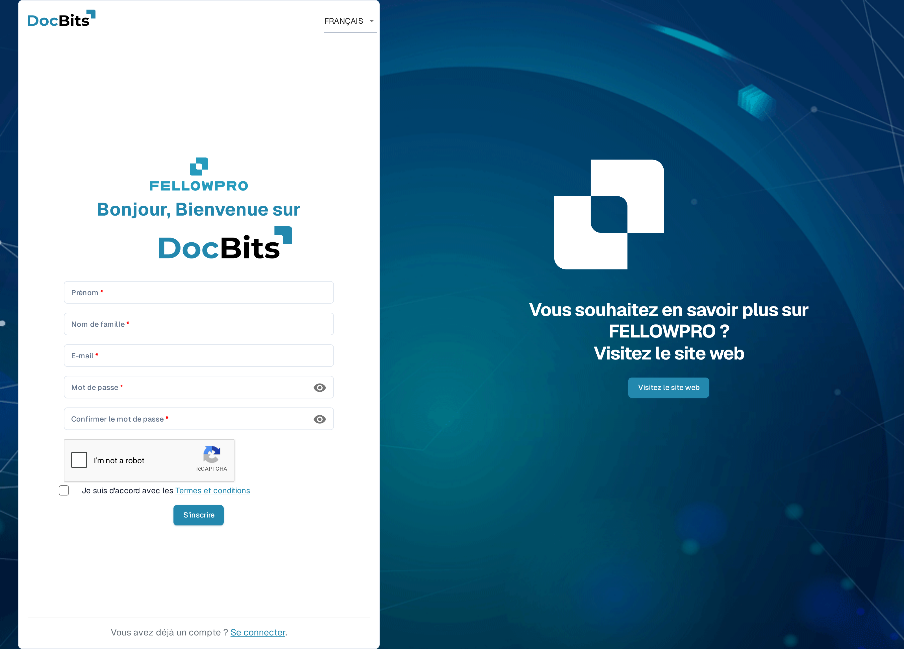
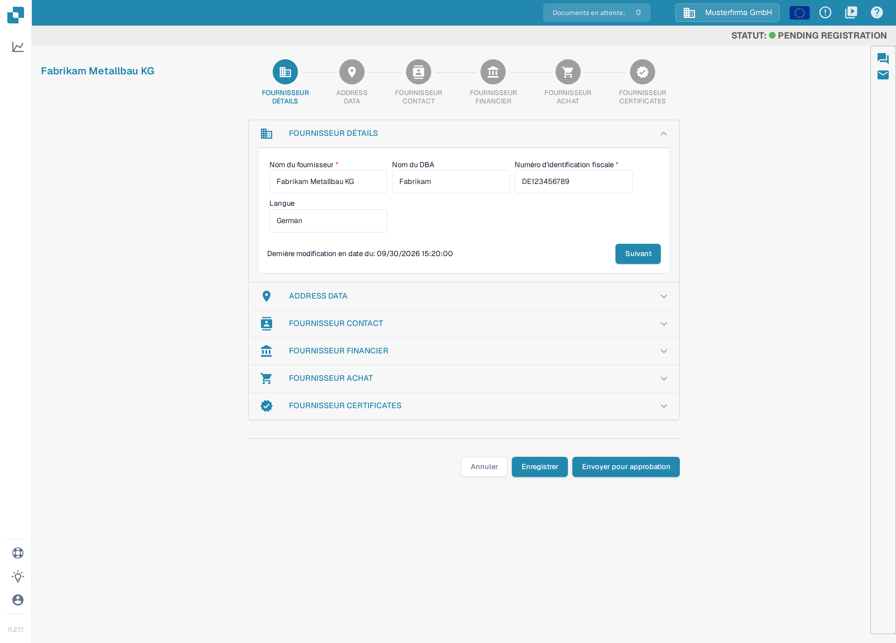
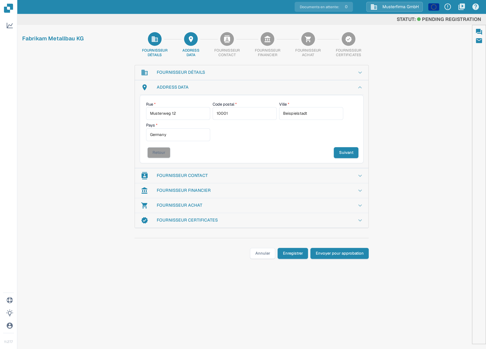
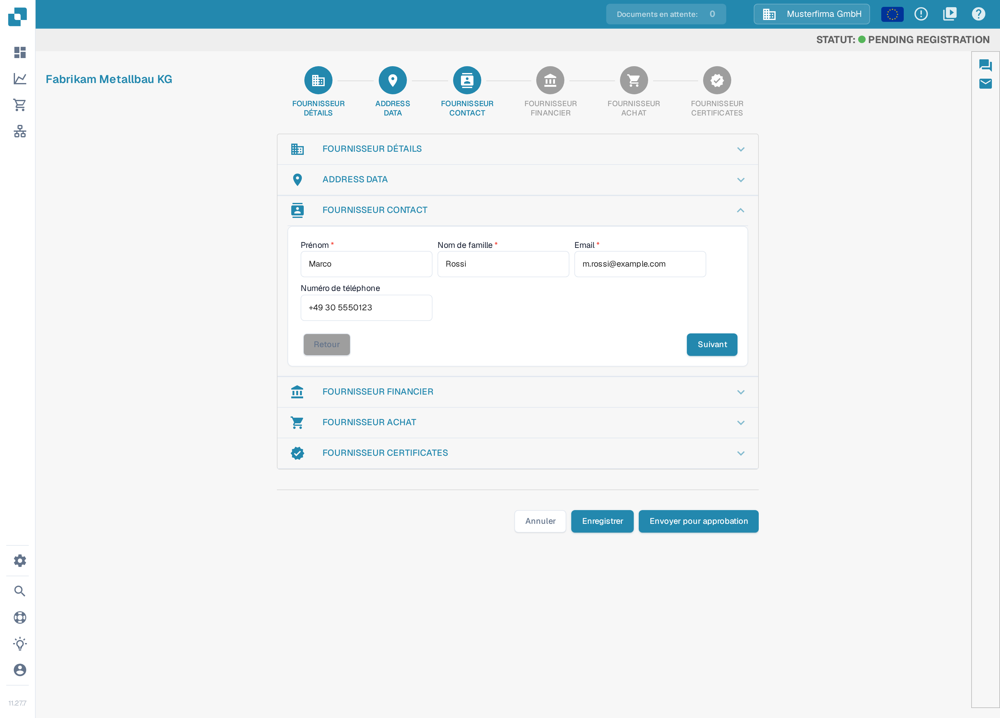
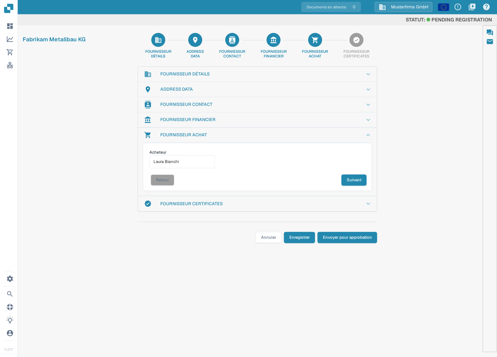
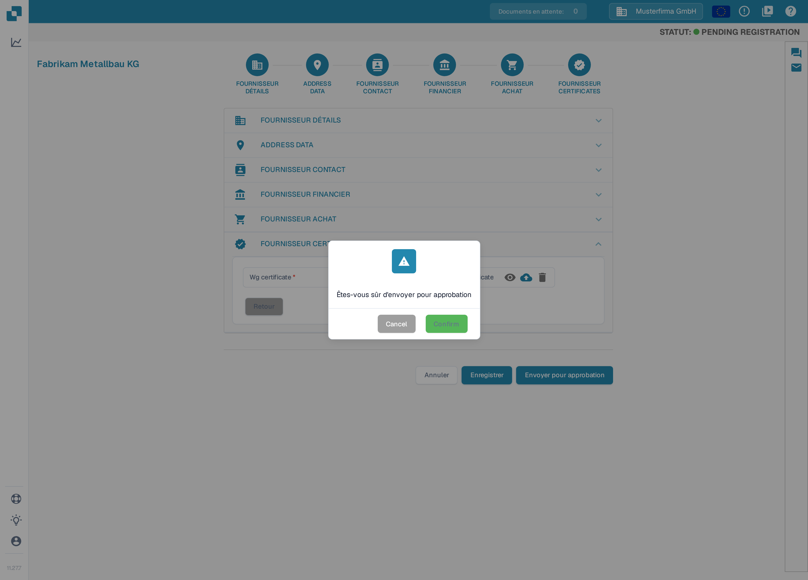

# Inscription des fournisseurs

Ce guide s’adresse aux fournisseurs invités au portail DocBits d’une organisation. Utilisez le lien de votre invitation. Vous disposez de votre propre compte fournisseur ; l’organisation qui vous invite détermine les informations accessibles et les étapes d’inscription requises. Lorsque le [portail fournisseurs](README.md) est activé, vous pouvez inviter vos fournisseurs à s’inscrire ; les étapes ci-dessous décrivent l’inscription qu’un fournisseur effectue après avoir reçu une invitation. Si une invitation a expiré ou a été envoyée à la mauvaise personne, demandez une nouvelle invitation à l’organisation qui vous invite.

1.  Vous recevez une invitation par e-mail contenant un lien vers l’inscription. Comment créer et tester vous-même ces e-mails d’invitation, voir [Modification des modèles d’e-mails](../../settings/supplier-setting/editing-email-templates.md).

    Le lien ouvre le formulaire d’inscription public. Saisissez votre prénom et votre nom de famille, votre adresse e-mail et un mot de passe, confirmez le mot de passe et acceptez les conditions générales. Cliquez ensuite sur **S'inscrire**.

    <figure><figcaption>
Le formulaire d’inscription : saisissez votre nom, votre adresse e-mail et un mot de passe, cochez l’accord sur les conditions générales, puis cliquez sur <strong>S'inscrire</strong>. Le formulaire est vide sur cette capture, à l’exception de la case de vérification anti-robot.
</figcaption></figure>

2.  **FOURNISSEUR DÉTAILS**

    Vérifiez que le nom du fournisseur est correct. Cette information est déterminante pour l’identité et les aspects juridiques et ne peut pas être modifiée. Complétez toutes les informations applicables, y compris les champs obligatoires. Une fois terminé, cliquez sur **Suivant** pour passer à la section suivante. Pour enregistrer votre progression et continuer plus tard, cliquez sur **Enregistrer**.

    <figure><figcaption>
Étape 1 sur 6, <strong>FOURNISSEUR DÉTAILS</strong> : vérifiez le nom du fournisseur et complétez les champs obligatoires (<strong>Nom du fournisseur</strong>, <strong>Numéro d'identification fiscale</strong>), puis cliquez sur <strong>Suivant</strong>. Les sections sont configurables par organisation ; votre wizard peut donc afficher d’autres sections ou d’autres champs. Toutes les valeurs visibles sont des données d’exemple inventées.
</figcaption></figure>

3.  **ADDRESS DATA**

    Complétez toutes les informations applicables, y compris les champs obligatoires. Une fois terminé, cliquez sur **Suivant** pour passer à la section du contact fournisseur. Pour enregistrer votre progression et continuer plus tard, cliquez sur **Enregistrer**.

    <figure><figcaption>
Étape 2 sur 6, <strong>ADDRESS DATA</strong> : saisissez la rue, le code postal, la ville et le pays, puis cliquez sur <strong>Suivant</strong>. Le titre de cette section s’affiche actuellement encore en anglais. Toutes les valeurs visibles sont des données d’exemple inventées.
</figcaption></figure>

4.  **FOURNISSEUR CONTACT**

    Complétez toutes les informations applicables, y compris les champs obligatoires. Une fois terminé, cliquez sur **Suivant** pour passer à la section des données financières. Pour enregistrer votre progression et continuer plus tard, cliquez sur **Enregistrer**.

    <figure><figcaption>
Étape 3 sur 6, <strong>FOURNISSEUR CONTACT</strong> : saisissez le nom et l’adresse e-mail de la personne de contact, puis cliquez sur <strong>Suivant</strong>. Toutes les valeurs visibles sont des données d’exemple inventées.
</figcaption></figure>

5.  **FOURNISSEUR FINANCIER**

    Complétez toutes les informations applicables. Une fois terminé, cliquez sur **Suivant** pour passer à la section des achats. Pour enregistrer votre progression et continuer plus tard, cliquez sur **Enregistrer**.

    <figure><figcaption>
Étape 4 sur 6, <strong>FOURNISSEUR FINANCIER</strong> : sélectionnez votre devise, puis cliquez sur <strong>Suivant</strong>. Toutes les valeurs visibles sont des données d’exemple inventées.
</figcaption></figure>

6.  **FOURNISSEUR ACHAT**

    Complétez toutes les informations applicables. Une fois terminé, cliquez sur **Suivant** pour passer à la section des certificats fournisseur. Pour enregistrer votre progression et continuer plus tard, cliquez sur **Enregistrer**.

    <figure><figcaption>
Étape 5 sur 6, <strong>FOURNISSEUR ACHAT</strong> : indiquez l’acheteur responsable de votre compte, puis cliquez sur <strong>Suivant</strong>. Toutes les valeurs visibles sont des données d’exemple inventées.
</figcaption></figure>

7.  **FOURNISSEUR CERTIFICATES**

    Téléversez tous les certificats requis. Les certificats demandés sont définis par l’organisation qui vous invite ; dans cette vue, le certificat « Wg certificate » est un champ obligatoire et « Supplier diversity certificate » n’est pas marqué comme obligatoire. Si vous souhaitez terminer l’inscription plus tard, enregistrez d’abord votre progression avec **Enregistrer**. Une fois terminé, cliquez sur **Envoyer pour approbation**.

    <figure><figcaption>
Étape 6 sur 6, <strong>FOURNISSEUR CERTIFICATES</strong> : ajoutez les certificats requis avec l’icône de téléversement à côté du champ correspondant, puis cliquez sur <strong>Envoyer pour approbation</strong>. Les deux libellés de certificats s’affichent actuellement encore en anglais.
</figcaption></figure>

8.  Confirmez que vous souhaitez envoyer votre inscription. Vos informations sont ensuite transmises à votre client pour vérification, et vous recevez un e-mail confirmant que vous avez terminé le processus d’inscription.

    <figure><figcaption>
Cliquez sur <strong>Confirm</strong> dans la boîte de dialogue pour envoyer votre inscription. Les boutons de cette boîte de dialogue s’affichent actuellement encore en anglais ; <strong>Cancel</strong> annule l’envoi. Après la vérification par votre client, vous êtes informé par e-mail.
</figcaption></figure>

## Si vous ne pouvez pas accéder au portail

Contactez l’organisation qui vous invite si le lien est invalide, si des autorisations manquent ou si les données obligatoires sont ambiguës. Une fiche fournisseur interne ne remplace ni votre inscription ni l’approbation d’accès nécessaire.

[Configuration du portail fournisseurs](README.md).

[Vidéo : préparer l’accès au portail et l’inscription – avec sous-titres français](https://docbits-videos.fra1.cdn.digitaloceanspaces.com/settings-assistant/supplier-portal-access-admin/v1/fr.html)
