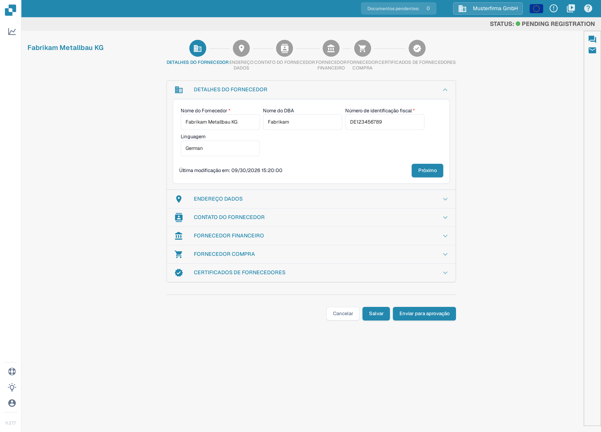
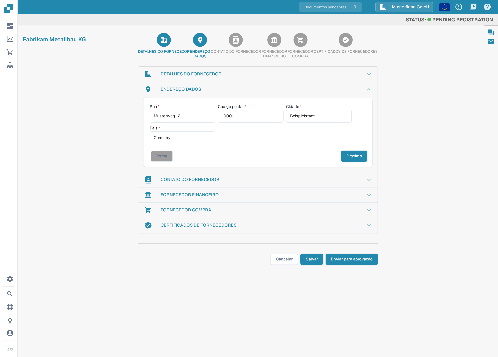
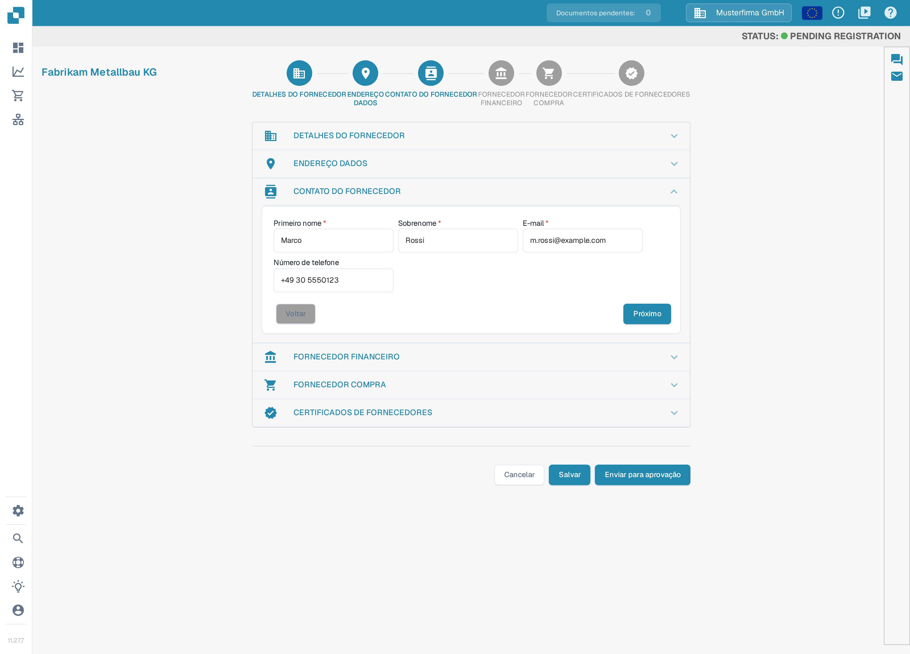
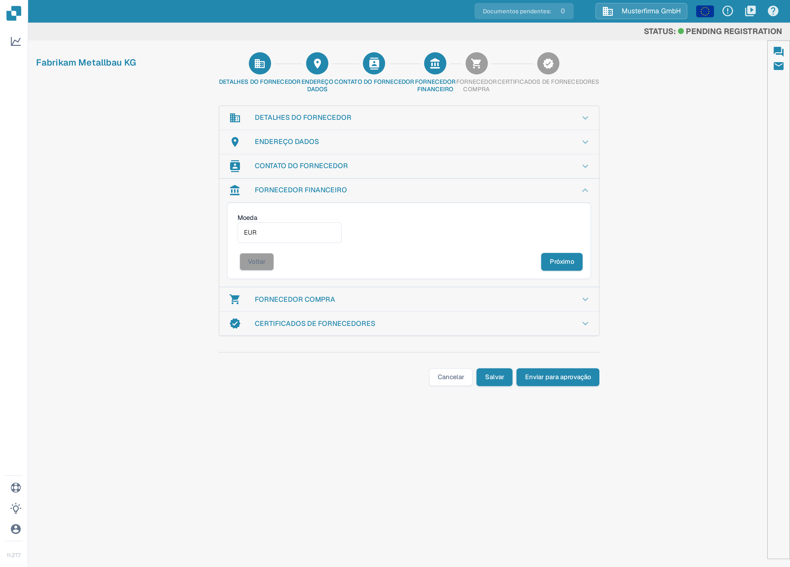
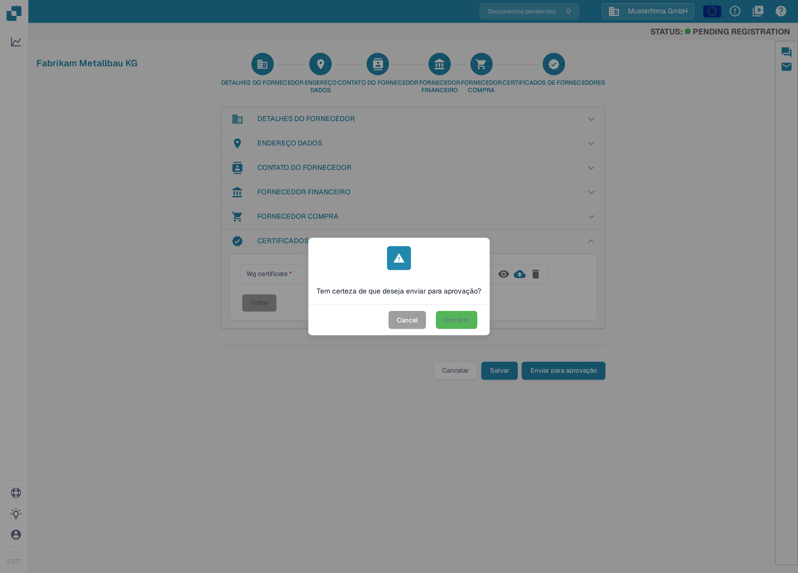

# Registro de fornecedores

Este guia destina-se a fornecedores convidados para o portal DocBits de uma organização. Utilize o link do seu convite. Você tem a sua própria conta de fornecedor; a organização que convida define quais informações estão disponíveis e quais etapas de registro são necessárias. Quando o [Portal do Fornecedor](README.md) está ativado, você pode convidar os seus fornecedores a se registrarem; as etapas abaixo mostram o registro que um fornecedor conclui depois de receber um convite. Se um convite expirou ou foi enviado à pessoa errada, solicite um novo convite à organização que convidou.

1.  Você receberá por e-mail um convite com um link para iniciar o registro. Clique nesse link, informe os dados solicitados e aceite os termos e condições para começar. O texto do botão no e-mail depende do modelo utilizado; você pode criar e testar esses e-mails de convite em [Edição de Modelos de E-mail](../../settings/supplier-setting/editing-email-templates.md).

    O link abre o formulário público de registro. Informe o seu primeiro nome, o sobrenome, o endereço de e-mail e uma senha, confirme a senha e aceite os Termos e Condições. Em seguida, clique em **Registrar**.

    <figure><figcaption>
O formulário de registro: informe nome, endereço de e-mail e uma senha, aceite os Termos e Condições e clique em <strong>Registrar</strong>. Os campos estão vazios; a verificação antirobô abaixo do formulário aparece em inglês nesta versão.
</figcaption></figure>

2.  **DETALHES DO FORNECEDOR**

    Verifique se o nome do fornecedor está correto. Esse dado é essencial para a identidade e para fins legais e não pode ser alterado. Preencha todas as informações aplicáveis, incluindo os campos obrigatórios. Ao terminar, clique em **Próximo** para continuar para a seção de endereço. Para salvar o progresso e continuar mais tarde, clique em **Salvar**.

    <figure><figcaption>
Passo 1 de 6, <strong>DETALHES DO FORNECEDOR</strong>: confira o nome do fornecedor e preencha os campos obrigatórios (<strong>Nome do Fornecedor</strong>, <strong>Número de identificação fiscal</strong>). Os valores mostrados são dados de exemplo inventados para esta captura. As seções são configuráveis por organização, por isso o seu assistente pode apresentar outras seções ou campos.
</figcaption></figure>

3.  **ENDEREÇO DADOS**

    Preencha todas as informações aplicáveis, incluindo os campos obrigatórios. Ao terminar, clique em **Próximo** para continuar para a seção de contato. Para salvar o progresso e continuar mais tarde, clique em **Salvar**.

    <figure><figcaption>
Passo 2 de 6, <strong>ENDEREÇO DADOS</strong>: informe rua, código postal, cidade e país e clique em <strong>Próximo</strong>. Os valores mostrados são dados de exemplo inventados para esta captura.
</figcaption></figure>

4.  **CONTATO DO FORNECEDOR**

    Preencha todas as informações aplicáveis, incluindo os campos obrigatórios. Ao terminar, clique em **Próximo** para continuar para a seção financeira. Para salvar o progresso e continuar mais tarde, clique em **Salvar**.

    <figure><figcaption>
Passo 3 de 6, <strong>CONTATO DO FORNECEDOR</strong>: informe o nome e o endereço de e-mail da pessoa de contato e clique em <strong>Próximo</strong>. Os valores mostrados são dados de exemplo inventados para esta captura.
</figcaption></figure>

5.  **FORNECEDOR FINANCEIRO**

    Preencha todas as informações aplicáveis. Ao terminar, clique em **Próximo** para continuar para a seção de compras. Para salvar o progresso e continuar mais tarde, clique em **Salvar**.

    <figure><figcaption>
Passo 4 de 6, <strong>FORNECEDOR FINANCEIRO</strong>: selecione a sua moeda e clique em <strong>Próximo</strong>. O valor mostrado é um dado de exemplo inventado para esta captura.
</figcaption></figure>

6.  **FORNECEDOR COMPRA**

    Preencha todas as informações aplicáveis. Ao terminar, clique em **Próximo** para continuar para a seção de certificados. Para salvar o progresso e continuar mais tarde, clique em **Salvar**.

    <figure><figcaption>
Passo 5 de 6, <strong>FORNECEDOR COMPRA</strong>: informe o comprador responsável pela sua conta e clique em <strong>Próximo</strong>. O nome mostrado é um dado de exemplo inventado para esta captura.
</figcaption></figure>

7.  **CERTIFICADOS DE FORNECEDORES**

    Envie todos os certificados exigidos pela sua organização, por exemplo fiscais, de seguro ou de diversidade de fornecedores. Salve o progresso se precisar voltar mais tarde para concluir o registro. Ao terminar, clique em **Enviar para aprovação**.

    <figure><figcaption>
Passo 6 de 6, <strong>CERTIFICADOS DE FORNECEDORES</strong>: envie os certificados exigidos com os botões de carregar e clique em <strong>Enviar para aprovação</strong>. Nenhum arquivo foi enviado nesta captura. Quais certificados aparecem e quais são obrigatórios depende da configuração da sua organização; os nomes dos certificados ainda aparecem em inglês nesta versão.
</figcaption></figure>

8.  Confirme que deseja enviar o seu registro. Os seus dados são então enviados ao seu cliente para revisão e você receberá um e-mail confirmando que concluiu o processo de registro.

    <figure><figcaption>
Clique em <strong>Confirm</strong> na janela de confirmação para enviar o seu registro. Os botões dessa janela ainda aparecem em inglês nesta versão. Após a revisão pelo seu cliente, você será avisado por e-mail.
</figcaption></figure>

## Se não conseguir acessar o portal

Entre em contato com a organização que enviou o convite se o link do convite for inválido, faltarem permissões ou as informações obrigatórias não estiverem claras. Uma ficha interna de fornecedor não substitui o seu registro nem a aprovação de acesso necessária.

[Configuração do portal de fornecedores](README.md).

[Vídeo: preparar o acesso ao portal e o registo – com legendas em português](https://docbits-videos.fra1.cdn.digitaloceanspaces.com/settings-assistant/supplier-portal-access-admin/v1/pt.html)
