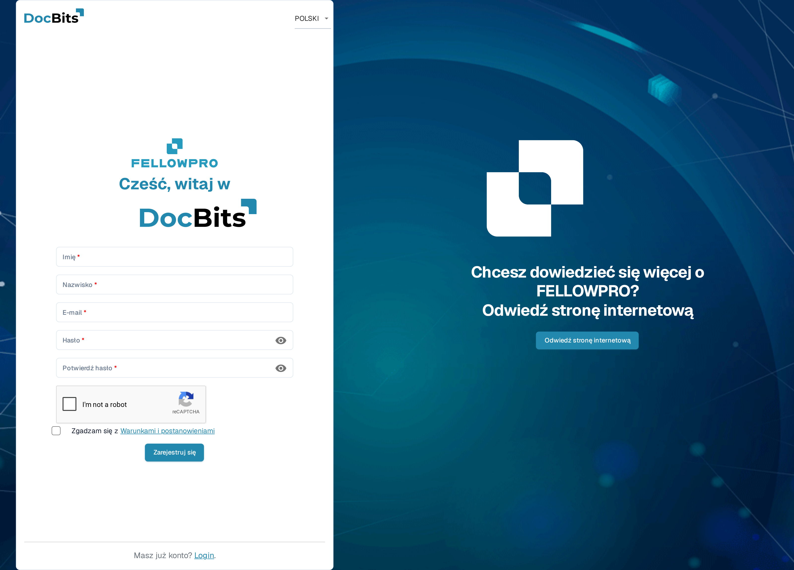
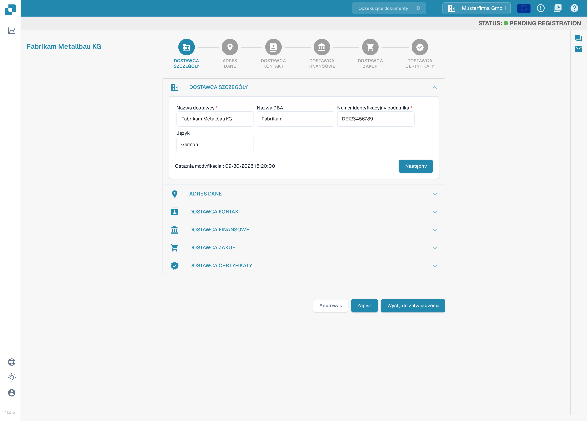
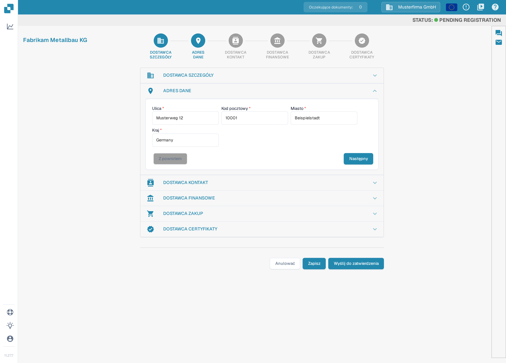
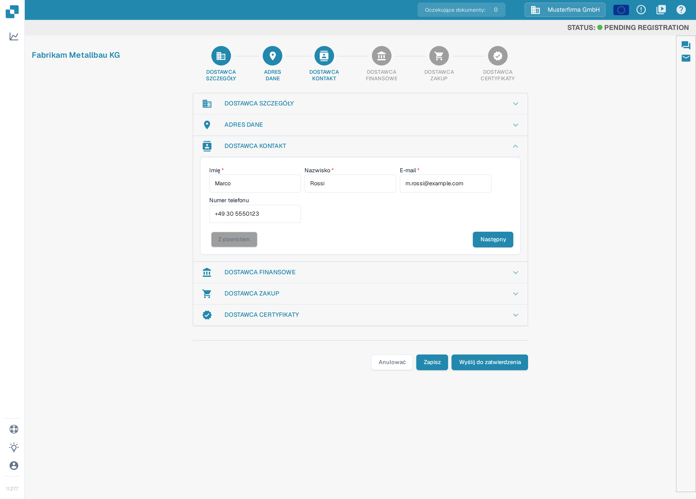
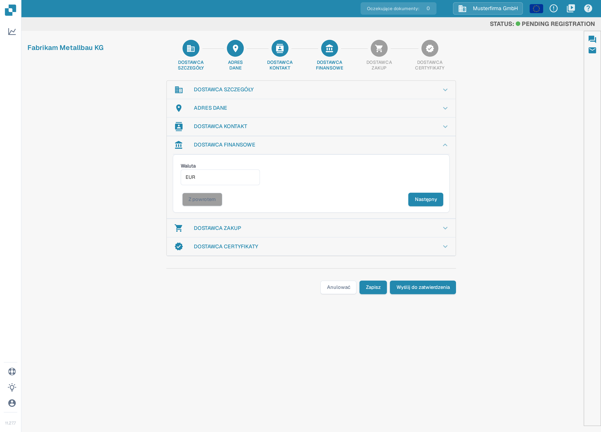
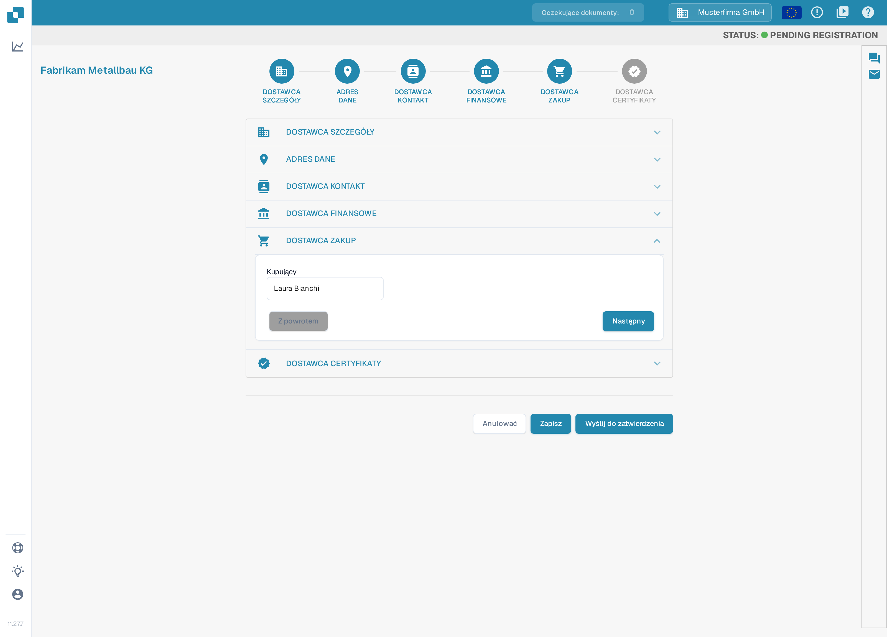
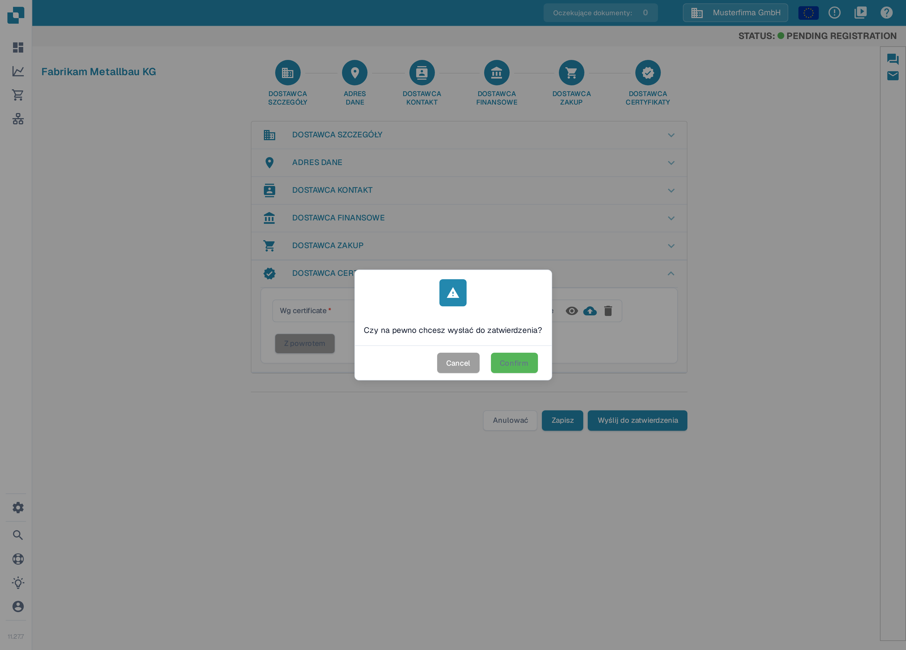

# Rejestracja dostawców

Ten przewodnik jest przeznaczony dla dostawców zaproszonych do portalu DocBits danej organizacji. Skorzystaj z linku z zaproszenia. Masz własne konto dostawcy; organizacja zapraszająca określa, jakie informacje są dostępne i jakie kroki rejestracji są wymagane. Gdy [portal dostawców](README.md) jest włączony, możesz zaprosić swoich dostawców do rejestracji; poniższe kroki opisują rejestrację, którą dostawca wykonuje po otrzymaniu zaproszenia. Jeśli zaproszenie wygasło lub zostało wysłane do niewłaściwej osoby, poproś organizację zapraszającą o nowe zaproszenie.

1.  Otrzymasz zaproszenie z linkiem rozpoczynającym proces rejestracji. Kliknij w wiadomości e-mail przycisk prowadzący do rejestracji, podaj wymagane informacje i zaakceptuj warunki, aby rozpocząć. Treść takich zaproszeń możesz tworzyć i testować samodzielnie w sekcji [Edytowanie szablonów e-maili](../../settings/supplier-setting/editing-email-templates.md).

    Link otwiera publiczny formularz rejestracji. Wpisz imię i nazwisko, adres e-mail oraz hasło, potwierdź hasło i zaakceptuj warunki. Następnie kliknij **Zarejestruj się**.

    <figure><figcaption>
Formularz rejestracji: wpisz imię i nazwisko, adres e-mail oraz hasło, zaakceptuj warunki i kliknij <strong>Zarejestruj się</strong>. Pola są puste; zaproszenie może wstępnie uzupełnić część danych.
</figcaption></figure>

2.  **DOSTAWCA SZCZEGÓŁY**

    Sprawdź, czy nazwa dostawcy jest prawidłowa. Jest to ważny element identyfikacji i danych prawnych, którego nie można później zmienić. Uzupełnij wszystkie wymagane informacje. Po zakończeniu kliknij **Następny**, aby przejść do sekcji ADRES DANE. Aby zapisać postęp i kontynuować później, kliknij **Zapisz**.

    <figure><figcaption>
Sekcja 1 z 6, <strong>DOSTAWCA SZCZEGÓŁY</strong>: sprawdź nazwę dostawcy i uzupełnij wymagane pola (<strong>Nazwa dostawcy</strong>, <strong>Numer identyfikacyjny podatnika</strong>). Sekcje są konfigurowane dla każdej organizacji, więc Twój kreator może pokazywać inne sekcje lub pola. Wszystkie wartości na zrzucie są przykładowe.
</figcaption></figure>

3.  **ADRES DANE**

    Uzupełnij wszystkie wymagane informacje. Po zakończeniu kliknij **Następny**, aby przejść do sekcji DOSTAWCA KONTAKT. Aby zapisać postęp i kontynuować później, kliknij **Zapisz**.

    <figure><figcaption>
Sekcja 2 z 6, <strong>ADRES DANE</strong>: wpisz ulicę, kod pocztowy, miasto i kraj, a następnie kliknij <strong>Następny</strong>. Wartości na zrzucie są przykładowe.
</figcaption></figure>

4.  **DOSTAWCA KONTAKT**

    Uzupełnij wszystkie wymagane informacje. Po zakończeniu kliknij **Następny**, aby przejść do sekcji DOSTAWCA FINANSOWE. Aby zapisać postęp i kontynuować później, kliknij **Zapisz**.

    <figure><figcaption>
Sekcja 3 z 6, <strong>DOSTAWCA KONTAKT</strong>: wpisz imię i nazwisko osoby kontaktowej oraz jej adres e-mail, a następnie kliknij <strong>Następny</strong>. Dane osoby na zrzucie są przykładowe.
</figcaption></figure>

5.  **DOSTAWCA FINANSOWE**

    Uzupełnij wszystkie wymagane informacje. Po zakończeniu kliknij **Następny**, aby przejść do sekcji DOSTAWCA ZAKUP. Aby zapisać postęp i kontynuować później, kliknij **Zapisz**.

    <figure><figcaption>
Sekcja 4 z 6, <strong>DOSTAWCA FINANSOWE</strong>: wybierz walutę, a następnie kliknij <strong>Następny</strong>. Waluta na zrzucie jest wartością przykładową.
</figcaption></figure>

6.  **DOSTAWCA ZAKUP**

    Uzupełnij wszystkie wymagane informacje. Po zakończeniu kliknij **Następny**, aby przejść do sekcji DOSTAWCA CERTYFIKATY. Aby zapisać postęp i kontynuować później, kliknij **Zapisz**.

    <figure><figcaption>
Sekcja 5 z 6, <strong>DOSTAWCA ZAKUP</strong>: wpisz osobę odpowiedzialną za Twoje konto (pole <strong>Kupujący</strong>), a następnie kliknij <strong>Następny</strong>. Nazwisko na zrzucie jest przykładowe.
</figcaption></figure>

7.  **DOSTAWCA CERTYFIKATY**

    Prześlij wszystkie wymagane certyfikaty (na przykład certyfikat podatkowy, polisę ubezpieczeniową i zaświadczenie o różnorodności dostawcy). Które certyfikaty są wymagane, określa organizacja zapraszająca. Zapisz postęp, jeśli chcesz wrócić do rejestracji później. Po zakończeniu kliknij **Wyślij do zatwierdzenia**.

    <figure><figcaption>
Sekcja 6 z 6, <strong>DOSTAWCA CERTYFIKATY</strong>: prześlij wymagane certyfikaty przyciskami z ikoną chmury, a następnie kliknij <strong>Wyślij do zatwierdzenia</strong>. Liczba pól zależy od konfiguracji organizacji; nazwy pól (<strong>Wg certificate</strong>, <strong>Supplier diversity certificate</strong>) są w tej wersji aplikacji w języku angielskim.
</figcaption></figure>

8.  Potwierdź, że chcesz przesłać swoją rejestrację. Twoje dane zostaną przekazane Twojemu klientowi do sprawdzenia, a Ty otrzymasz wiadomość e-mail potwierdzającą zakończenie procesu rejestracji.

    <figure><figcaption>
Kliknij <strong>Confirm</strong> w oknie potwierdzenia, aby przesłać rejestrację. Po sprawdzeniu przez Twojego klienta otrzymasz powiadomienie e-mailem. Przyciski okna (<strong>Cancel</strong>, <strong>Confirm</strong>) są w tej wersji aplikacji w języku angielskim.
</figcaption></figure>

## Jeśli nie możesz uzyskać dostępu

Skontaktuj się z organizacją zapraszającą, jeśli link z zaproszenia jest nieprawidłowy, brakuje uprawnień lub wymagane informacje są niejasne. Wewnętrzny rekord dostawcy nie zastępuje Twojej rejestracji ani niezbędnego zatwierdzenia dostępu.

[Konfiguracja portalu dostawców](README.md).

[Film: przygotowanie dostępu do portalu i rejestracji – z polskimi napisami](https://docbits-videos.fra1.cdn.digitaloceanspaces.com/settings-assistant/supplier-portal-access-admin/v1/pl.html)