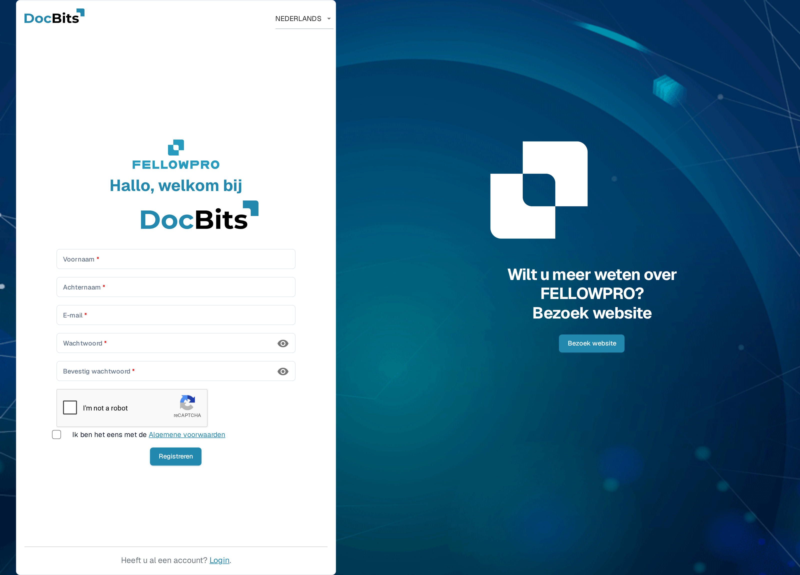
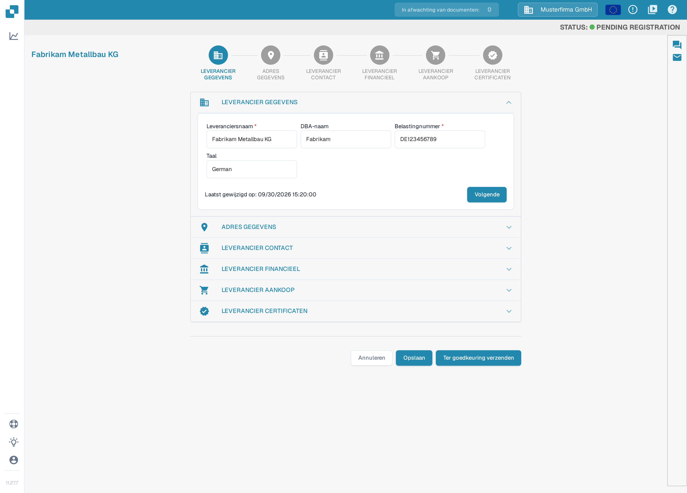
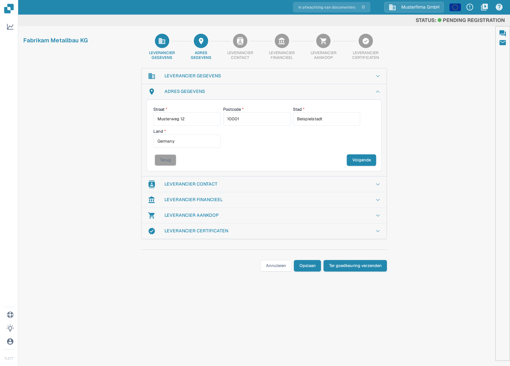
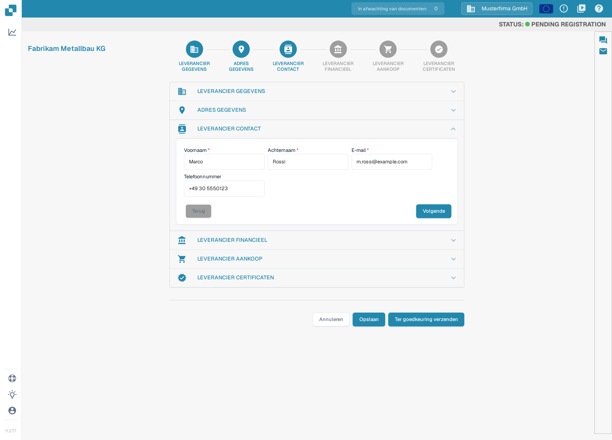
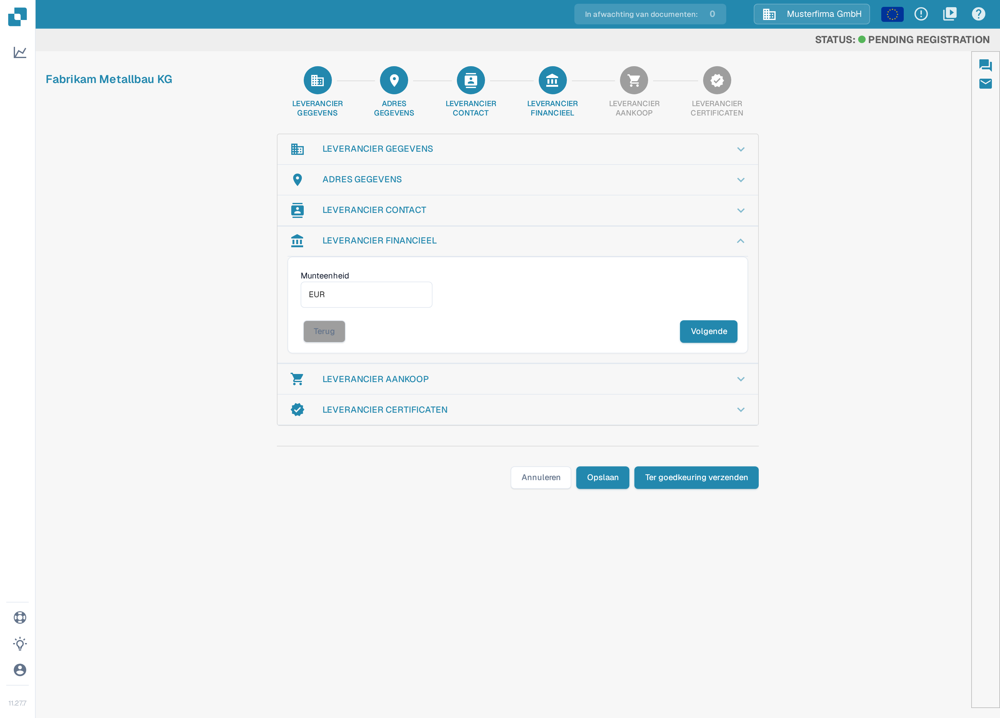
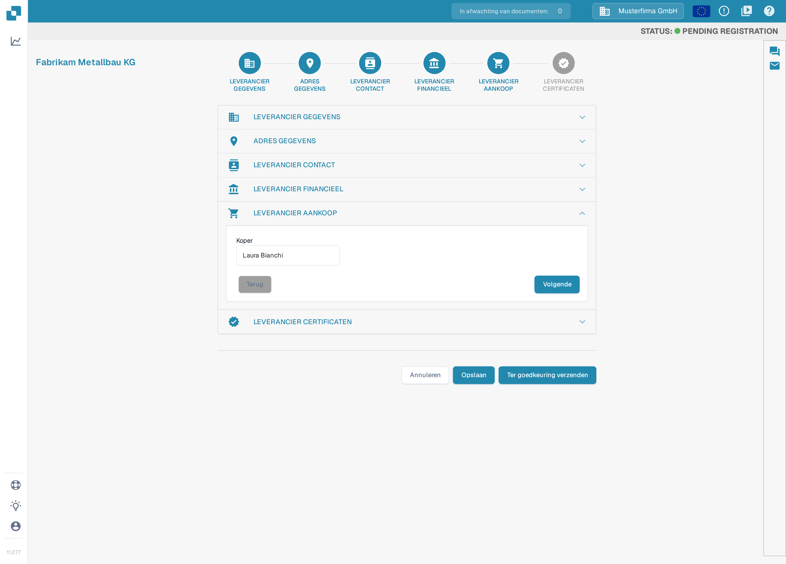
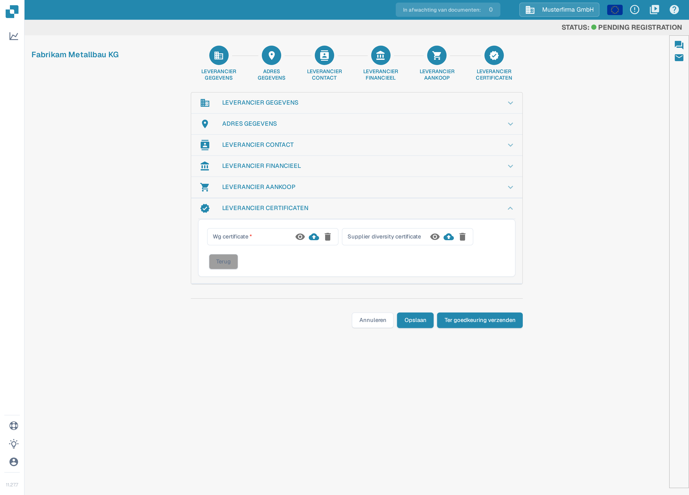

# Leveranciersregistratie

Deze handleiding is voor leveranciers die zijn uitgenodigd voor het DocBits-portaal van een organisatie. Gebruik de link in uw uitnodiging. U hebt een eigen leveranciersaccount; de uitnodigende organisatie bepaalt welke informatie beschikbaar is en welke registratiestappen nodig zijn. Wanneer het [leveranciersportaal](README.md) is ingeschakeld, kunt u uw leveranciers uitnodigen om zich te registreren; de stappen hieronder tonen de registratie die een leverancier na ontvangst van een uitnodiging doorloopt. Is een uitnodiging verlopen of naar de verkeerde persoon gestuurd, vraag de uitnodigende organisatie dan om een nieuwe uitnodiging.

1.  U ontvangt per e-mail een uitnodiging met een link om de registratie te starten. Hoe u deze uitnodigingsmails zelf maakt en test, leest u bij [E-mailsjablonen bewerken](../../settings/supplier-setting/editing-email-templates.md).

    De link opent het openbare registratieformulier. Vul uw voornaam en achternaam, uw e-mailadres en een wachtwoord in, bevestig het wachtwoord en accepteer de algemene voorwaarden. Klik daarna op **Registreren**.

    <figure><figcaption>
Het registratieformulier: vul uw naam, uw e-mailadres en een wachtwoord in, vink de algemene voorwaarden aan en klik op <strong>Registreren</strong>. De invulvelden zijn op deze opname leeg; de robotcontrole <em>I'm not a robot</em> is nog niet aangevinkt.
</figcaption></figure>

2.  **LEVERANCIER GEGEVENS**

    Controleer of de leveranciersnaam juist is. Deze informatie is bepalend voor de identiteit en voor juridische doeleinden en kan niet worden gewijzigd. Vul alle van toepassing zijnde gegevens in, inclusief de verplichte velden. Klik daarna op **Volgende** om door te gaan naar de sectie Adresgegevens. Wilt u uw voortgang opslaan en later verdergaan, klik dan op **Opslaan**.

    <figure><figcaption>
Stap 1 van 6, <strong>LEVERANCIER GEGEVENS</strong>: controleer de leveranciersnaam en vul de verplichte velden in (<strong>Leveranciersnaam</strong>, <strong>Belastingnummer</strong>), klik daarna op <strong>Volgende</strong>. De secties zijn per organisatie in te stellen; uw wizard kan andere secties of velden tonen. Alle zichtbare waarden zijn verzonnen voorbeeldgegevens.
</figcaption></figure>

3.  **ADRES GEGEVENS**

    Vul alle van toepassing zijnde gegevens in, inclusief de verplichte velden. Klik daarna op **Volgende** om door te gaan naar de sectie Leverancier contact. Wilt u uw voortgang opslaan en later verdergaan, klik dan op **Opslaan**.

    <figure><figcaption>
Stap 2 van 6, <strong>ADRES GEGEVENS</strong>: vul straat, postcode, stad en land in en klik op <strong>Volgende</strong>. Alle zichtbare waarden zijn verzonnen voorbeeldgegevens.
</figcaption></figure>

4.  **LEVERANCIER CONTACT**

    Vul alle van toepassing zijnde gegevens in, inclusief de verplichte velden. Klik daarna op **Volgende** om door te gaan naar de sectie Leverancier financieel. Wilt u uw voortgang opslaan en later verdergaan, klik dan op **Opslaan**.

    <figure><figcaption>
Stap 3 van 6, <strong>LEVERANCIER CONTACT</strong>: vul de naam en het e-mailadres van de contactpersoon in en klik op <strong>Volgende</strong>. Alle zichtbare waarden zijn verzonnen voorbeeldgegevens.
</figcaption></figure>

5.  **LEVERANCIER FINANCIEEL**

    Vul alle van toepassing zijnde gegevens in. Klik daarna op **Volgende** om door te gaan naar de sectie Leverancier aankoop. Wilt u uw voortgang opslaan en later verdergaan, klik dan op **Opslaan**.

    <figure><figcaption>
Stap 4 van 6, <strong>LEVERANCIER FINANCIEEL</strong>: kies uw munteenheid en klik op <strong>Volgende</strong>. Alle zichtbare waarden zijn verzonnen voorbeeldgegevens.
</figcaption></figure>

6.  **LEVERANCIER AANKOOP**

    Vul alle van toepassing zijnde gegevens in. Klik daarna op **Volgende** om door te gaan naar de sectie Leverancier certificaten. Wilt u uw voortgang opslaan en later verdergaan, klik dan op **Opslaan**.

    <figure><figcaption>
Stap 5 van 6, <strong>LEVERANCIER AANKOOP</strong>: vul de inkoper in die verantwoordelijk is voor uw account en klik op <strong>Volgende</strong>. Alle zichtbare waarden zijn verzonnen voorbeeldgegevens.
</figcaption></figure>

7.  **LEVERANCIER CERTIFICATEN**

    Upload alle vereiste certificaten. Welke certificaten nodig zijn, bepaalt de organisatie die u uitnodigt; in deze weergave is <em>Wg certificate</em> een verplicht veld en is <em>Supplier diversity certificate</em> niet als verplicht gemarkeerd. Wilt u de registratie later afronden, sla uw voortgang dan eerst op met **Opslaan**. Klik daarna op **Ter goedkeuring verzenden**.

    <figure><figcaption>
Stap 6 van 6, <strong>LEVERANCIER CERTIFICATEN</strong>: voeg de vereiste certificaten toe met het uploadicoon naast het betreffende veld en klik daarna op <strong>Ter goedkeuring verzenden</strong>. De namen van beide certificaten worden op dit moment nog in het Engels weergegeven.
</figcaption></figure>

8.  Bevestig dat u uw registratie wilt versturen. Uw gegevens gaan daarna naar uw klant voor controle en u ontvangt een e-mail die bevestigt dat u de registratie hebt afgerond.

    <figure><figcaption>
Klik op <strong>Confirm</strong> in de dialoog om uw registratie te versturen. De knoppen van deze dialoog worden op dit moment nog in het Engels weergegeven; met <strong>Cancel</strong> annuleert u het versturen. Na de controle door uw klant wordt u per e-mail geïnformeerd.
</figcaption></figure>

## Als u geen toegang krijgt

Neem contact op met de uitnodigende organisatie als uw uitnodigingslink ongeldig is, rechten ontbreken of verplichte gegevens onduidelijk zijn. Een interne leveranciersregistratie vervangt uw registratie of de noodzakelijke toegangsgoedkeuring niet.

[Leveranciersportaal instellen](README.md).

[Video: portaaltoegang en registratie voorbereiden – met Nederlandse ondertiteling](https://docbits-videos.fra1.cdn.digitaloceanspaces.com/settings-assistant/supplier-portal-access-admin/v1/nl.html)
