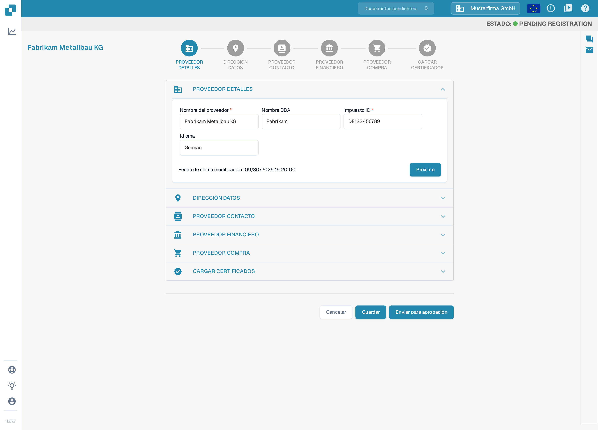
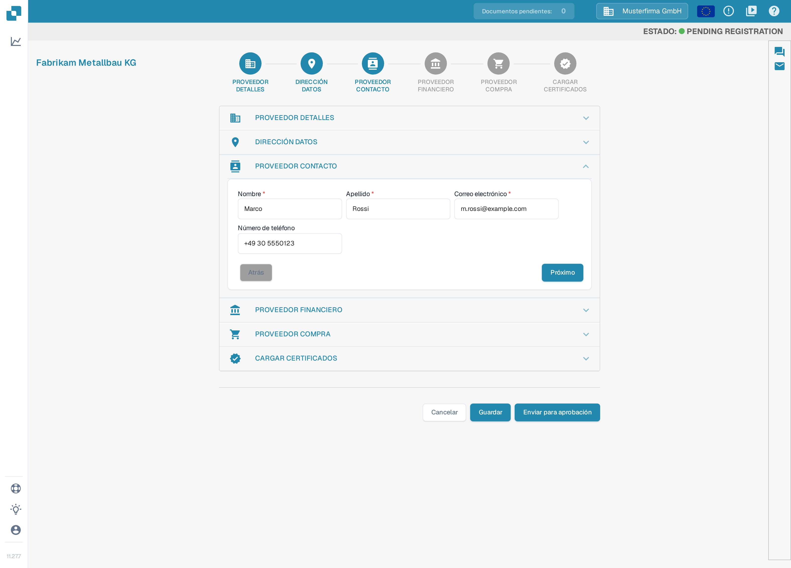
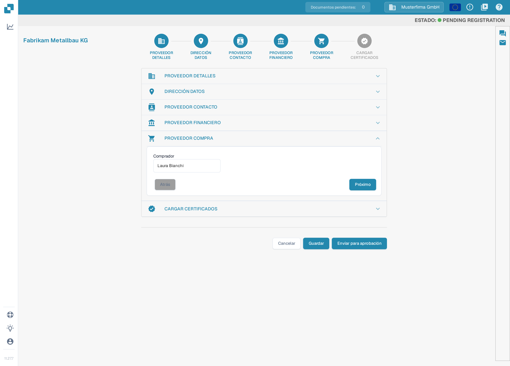

# Registro de proveedores

Esta guía está dirigida a los proveedores invitados al portal DocBits de una organización. Utilice el enlace de su invitación. Dispone de una cuenta de proveedor propia; la organización que le invita determina qué información está disponible y qué pasos de registro son necesarios. Cuando el [Portal de proveedores](README.md) está activado, puede invitar a sus proveedores a registrarse; los pasos siguientes muestran el registro que completa un proveedor tras recibir una invitación. Si una invitación ha caducado o se envió a la persona equivocada, solicite una nueva a la organización que le invita.

1.  Recibirá una invitación por correo electrónico con un enlace para iniciar el registro. El correo anuncia el portal de proveedores e incluye un botón que abre el formulario de registro. Puede crear y probar estos correos de invitación en [Plantillas de correo electrónico](../../settings/supplier-setting/editing-email-templates.md).

    El enlace abre el formulario público de registro. Introduzca su nombre de pila y su apellido, su correo electrónico y una contraseña, repita la contraseña y acepte los Términos y condiciones. A continuación, pulse **Registrarse**.

    <figure><figcaption>
El formulario de registro: introduzca su nombre, su correo electrónico y una contraseña, acepte los Términos y condiciones y pulse <strong>Registrarse</strong>.
</figcaption></figure>

2.  **PROVEEDOR DETALLES**

    Compruebe que el nombre del proveedor es correcto. Este dato es esencial para la identidad y para los fines legales, y no se puede modificar. Indique toda la información aplicable, incluidos los campos obligatorios. Cuando haya terminado, pulse **Próximo** para continuar con la sección **DIRECCIÓN DATOS**. Para guardar su progreso y continuar más tarde, pulse **Guardar**.

    <figure><figcaption>
Paso 1 de 6, <strong>PROVEEDOR DETALLES</strong>: compruebe el nombre del proveedor y rellene los campos obligatorios (por ejemplo <strong>Nombre del proveedor</strong> e <strong>Impuesto ID</strong>). Las secciones se configuran por organización, por lo que su asistente puede mostrar otras secciones o campos. El nombre de la empresa, la identificación fiscal y la fecha que aparecen en la imagen son datos de ejemplo inventados.
</figcaption></figure>

    En esta versión de la interfaz, algunas etiquetas de la aplicación todavía se muestran en inglés: la indicación de estado de la cabecera (por ejemplo «PENDING REGISTRATION») y, en el último paso, las etiquetas de los certificados y los botones del diálogo de confirmación.

3.  **DIRECCIÓN DATOS**

    Indique toda la información aplicable, incluidos los campos obligatorios. Cuando haya terminado, pulse **Próximo** para continuar con la sección **PROVEEDOR CONTACTO**. Para guardar su progreso y continuar más tarde, pulse **Guardar**.

    <figure><figcaption>
Paso 2 de 6, <strong>DIRECCIÓN DATOS</strong>: introduzca la calle, el código postal, la ciudad y el país y pulse <strong>Próximo</strong>.
</figcaption></figure>

4.  **PROVEEDOR CONTACTO**

    Indique toda la información aplicable, incluidos los campos obligatorios. Cuando haya terminado, pulse **Próximo** para continuar con la sección **PROVEEDOR FINANCIERO**. Para guardar su progreso y continuar más tarde, pulse **Guardar**.

    <figure><figcaption>
Paso 3 de 6, <strong>PROVEEDOR CONTACTO</strong>: introduzca el nombre y el correo electrónico de la persona de contacto y pulse <strong>Próximo</strong>.
</figcaption></figure>

5.  **PROVEEDOR FINANCIERO**

    Indique toda la información aplicable. Cuando haya terminado, pulse **Próximo** para continuar con la sección **PROVEEDOR COMPRA**. Para guardar su progreso y continuar más tarde, pulse **Guardar**.

    <figure><figcaption>
Paso 4 de 6, <strong>PROVEEDOR FINANCIERO</strong>: seleccione su moneda y pulse <strong>Próximo</strong>.
</figcaption></figure>

6.  **PROVEEDOR COMPRA**

    Indique toda la información aplicable. Cuando haya terminado, pulse **Próximo** para continuar con la sección **CARGAR CERTIFICADOS**. Para guardar su progreso y continuar más tarde, pulse **Guardar**.

    <figure><figcaption>
Paso 5 de 6, <strong>PROVEEDOR COMPRA</strong>: introduzca el comprador responsable de su cuenta y pulse <strong>Próximo</strong>.
</figcaption></figure>

7.  **CARGAR CERTIFICADOS**

    Cargue todos los certificados requeridos (por ejemplo certificados fiscales, de seguros o de diversidad de proveedores). Guarde su progreso si necesita volver más tarde para completar el registro. Cuando haya terminado, pulse **Enviar para aprobación**.

    <figure><figcaption>
Paso 6 de 6, <strong>CARGAR CERTIFICADOS</strong>: cargue los certificados obligatorios con los botones de subida y pulse <strong>Enviar para aprobación</strong>. Qué certificados son obligatorios lo define la organización que le invita; en esta versión las etiquetas de estos campos aún aparecen en inglés.
</figcaption></figure>

8.  Confirme que desea enviar su registro. Sus datos se envían entonces a su cliente para revisión y recibirá un correo electrónico que confirma que ha completado el proceso de registro.

    <figure><figcaption>
Pulse el botón de confirmación (<strong>Confirm</strong>) en el diálogo para enviar su registro. Tras la revisión por parte de su cliente recibirá una notificación por correo electrónico.
</figcaption></figure>

## Si no puede acceder al portal

Póngase en contacto con la organización que le invita si el enlace de la invitación no es válido, faltan permisos o no están claros los datos obligatorios. Una ficha de proveedor interna no sustituye su registro ni la aprobación de acceso necesaria.

[Configuración del portal de proveedores](README.md).

[Vídeo: preparar el acceso al portal y el registro – con subtítulos en español](https://docbits-videos.fra1.cdn.digitaloceanspaces.com/settings-assistant/supplier-portal-access-admin/v1/es.html)
