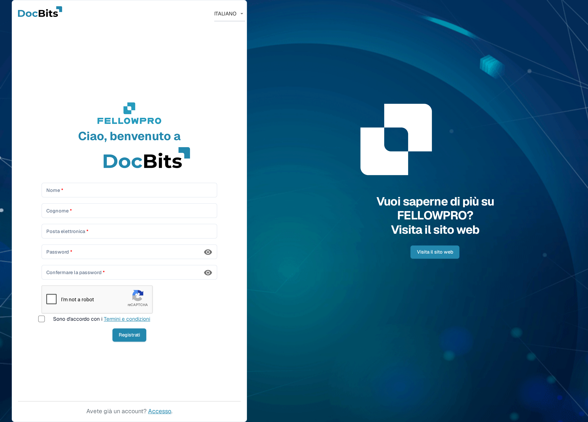
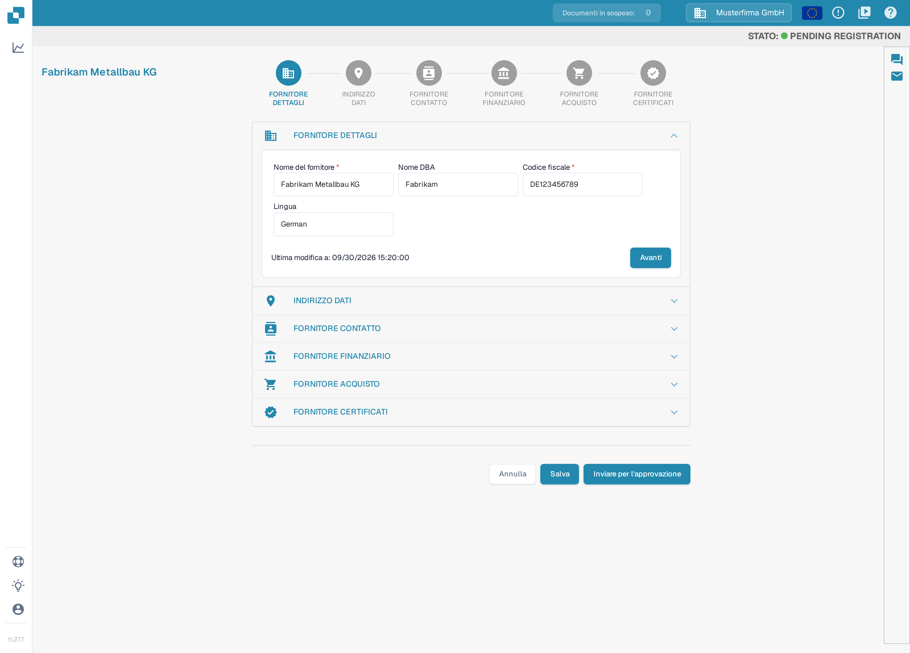
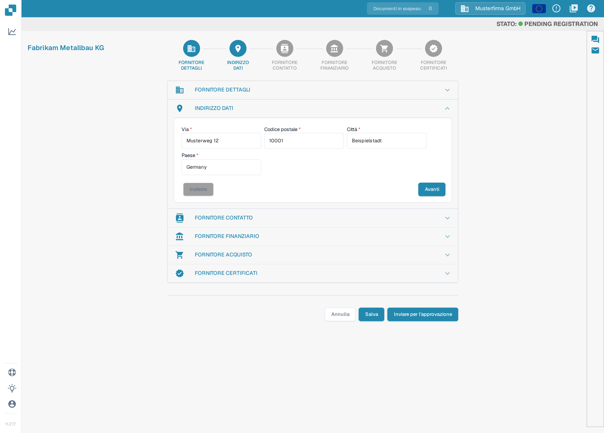
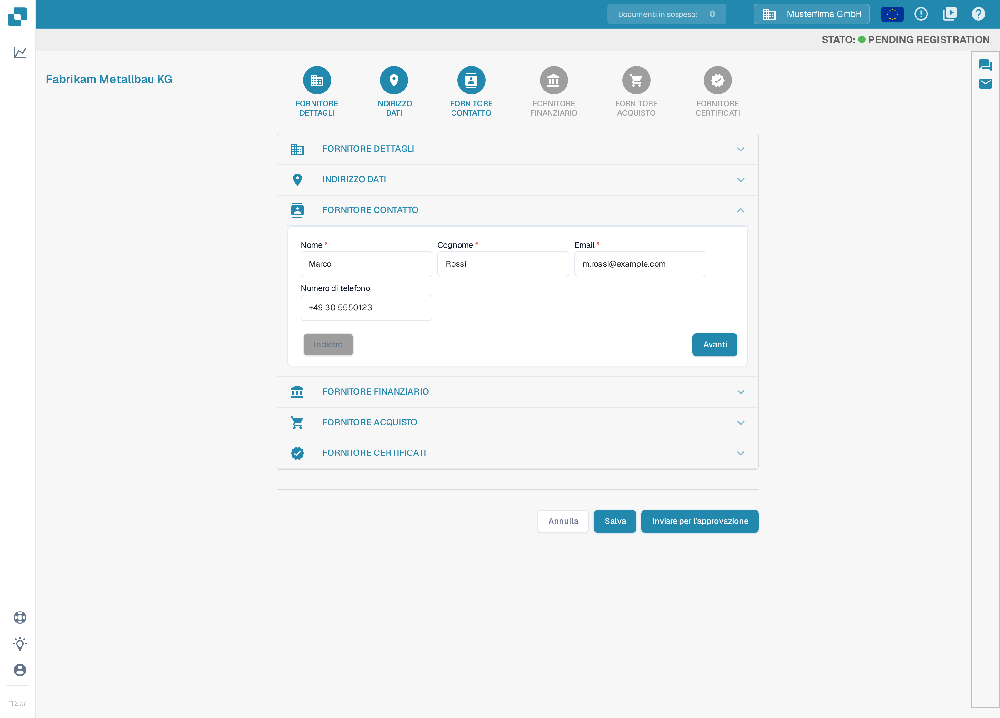
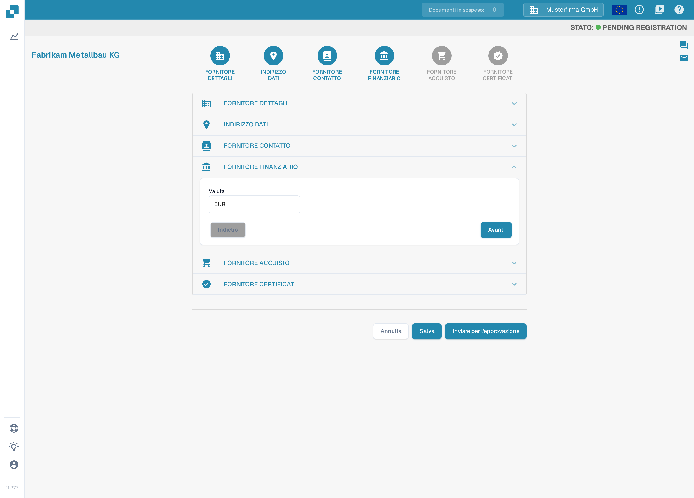
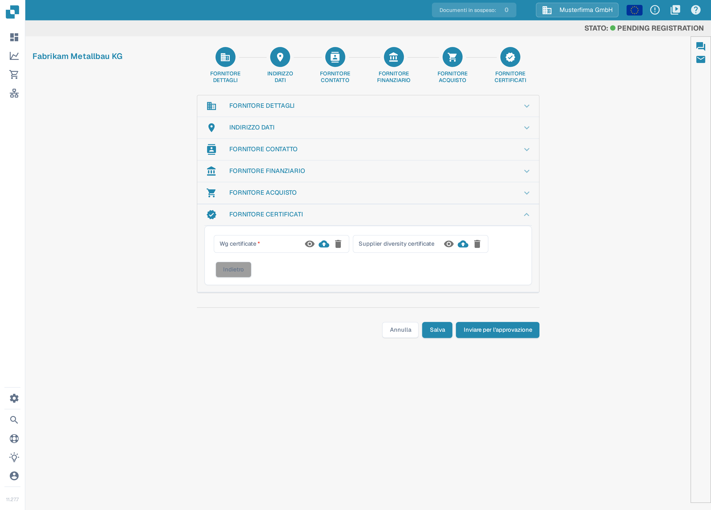
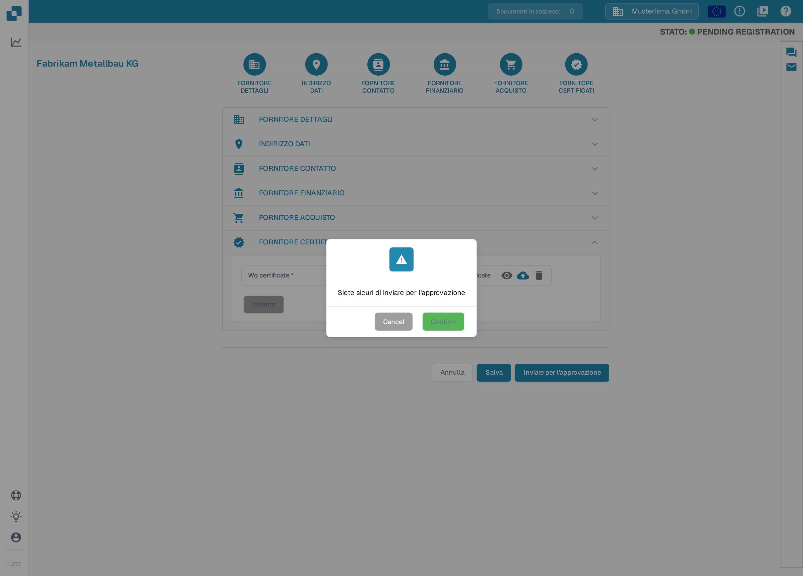

# Registrazione dei fornitori

Questa guida è destinata ai fornitori invitati al portale DocBits di un’organizzazione. Utilizzare il link contenuto nell’invito. Ogni fornitore dispone di un proprio account; l’organizzazione che invita stabilisce quali informazioni sono disponibili e quali passaggi di registrazione sono necessari. Quando il [Portale fornitori](README.md) è attivato, è possibile invitare i fornitori a registrarsi; i passaggi seguenti descrivono la registrazione che un fornitore completa dopo aver ricevuto un invito. Se un invito è scaduto o è stato inviato alla persona sbagliata, richiedere un nuovo invito all’organizzazione che lo ha inviato.

1.  Riceverà un invito via e-mail con un link per iniziare la registrazione. L’e-mail annuncia il portale fornitori e contiene un pulsante che apre il modulo di registrazione. È possibile creare e provare queste e-mail di invito in [Modelli di e-mail](../../settings/supplier-setting/editing-email-templates.md).

    Il link apre il modulo pubblico di registrazione. Inserire nome e cognome, l’indirizzo e-mail e una password, ripetere la password e accettare i Termini e condizioni. Poi fare clic su **Registrati**.

    <figure><figcaption>
Il modulo di registrazione: inserire nome, indirizzo e-mail e una password, accettare i Termini e condizioni e fare clic su <strong>Registrati</strong>.
</figcaption></figure>

2.  **FORNITORE DETTAGLI**

    Verificare che il nome del fornitore sia corretto. È un dato essenziale per l’identità e per gli scopi legali e non può essere modificato. Inserire tutte le informazioni applicabili, compresi i campi obbligatori. Al termine fare clic su **Avanti** per passare alla sezione **INDIRIZZO DATI**. Per salvare i progressi e continuare più tardi, fare clic su **Salva**.

    <figure><figcaption>
Passo 1 di 6, <strong>FORNITORE DETTAGLI</strong>: verificare il nome del fornitore e compilare i campi obbligatori (<strong>Nome del fornitore</strong> e <strong>Codice fiscale</strong>). Le sezioni sono configurabili per organizzazione, quindi l’assistente può mostrare sezioni o campi diversi. Il nome dell’azienda, il codice fiscale e la data visibili nell’immagine sono dati di esempio inventati.
</figcaption></figure>

    In questa versione dell’interfaccia alcune etichette dell’applicazione sono ancora in inglese: l’indicazione di stato nell’intestazione (ad esempio «STATO: PENDING REGISTRATION») e, nell’ultimo passaggio, le etichette dei certificati e i pulsanti della finestra di conferma.

3.  **INDIRIZZO DATI**

    Inserire tutte le informazioni applicabili, compresi i campi obbligatori. Al termine fare clic su **Avanti** per passare alla sezione **FORNITORE CONTATTO**; con **Indietro** si torna alla sezione precedente. Per salvare i progressi e continuare più tardi, fare clic su **Salva**.

    <figure><figcaption>
Passo 2 di 6, <strong>INDIRIZZO DATI</strong>: inserire via, codice postale, città e paese, poi fare clic su <strong>Avanti</strong>. L’indirizzo mostrato nell’immagine è un esempio inventato.
</figcaption></figure>

4.  **FORNITORE CONTATTO**

    Inserire tutte le informazioni applicabili, compresi i campi obbligatori. Al termine fare clic su **Avanti** per passare alla sezione **FORNITORE FINANZIARIO**. Per salvare i progressi e continuare più tardi, fare clic su **Salva**.

    <figure><figcaption>
Passo 3 di 6, <strong>FORNITORE CONTATTO</strong>: inserire nome, cognome, indirizzo e-mail e numero di telefono della persona di contatto, poi fare clic su <strong>Avanti</strong>. Il contatto mostrato nell’immagine è un esempio inventato.
</figcaption></figure>

5.  **FORNITORE FINANZIARIO**

    Inserire tutte le informazioni applicabili. Al termine fare clic su **Avanti** per passare alla sezione **FORNITORE ACQUISTO**. Per salvare i progressi e continuare più tardi, fare clic su **Salva**.

    <figure><figcaption>
Passo 4 di 6, <strong>FORNITORE FINANZIARIO</strong>: selezionare la valuta, poi fare clic su <strong>Avanti</strong>.
</figcaption></figure>

6.  **FORNITORE ACQUISTO**

    Inserire tutte le informazioni applicabili. Al termine fare clic su **Avanti** per passare alla sezione **FORNITORE CERTIFICATI**. Per salvare i progressi e continuare più tardi, fare clic su **Salva**.

    <figure><figcaption>
Passo 5 di 6, <strong>FORNITORE ACQUISTO</strong>: inserire l’acquirente responsabile del proprio account, poi fare clic su <strong>Avanti</strong>.
</figcaption></figure>

7.  **FORNITORE CERTIFICATI**

    Caricare tutti i certificati richiesti (ad esempio certificati fiscali, assicurativi o di diversità dei fornitori). Salvare i progressi se si deve tornare più tardi per completare la registrazione. Al termine fare clic su **Inviare per l'approvazione**. In fondo alla pagina restano disponibili anche **Indietro**, **Annulla** e **Salva**.

    <figure><figcaption>
Passo 6 di 6, <strong>FORNITORE CERTIFICATI</strong>: caricare i certificati obbligatori con i pulsanti di caricamento e fare clic su <strong>Inviare per l'approvazione</strong>. Quali certificati sono obbligatori lo stabilisce l’organizzazione che invita; in questa versione le etichette di questi campi sono ancora in inglese.
</figcaption></figure>

8.  Confermare di voler inviare la registrazione. I dati vengono quindi inviati al cliente per la verifica e si riceve un’e-mail che conferma il completamento della registrazione.

    <figure><figcaption>
Fare clic sul pulsante di conferma (<strong>Confirm</strong>) nella finestra per inviare la registrazione. Dopo la verifica da parte del cliente si riceve una notifica via e-mail.
</figcaption></figure>

## Se non si riesce ad accedere al portale

Contattare l’organizzazione che ha inviato l’invito se il link non è valido, mancano autorizzazioni o i dati obbligatori non sono chiari. Una scheda fornitore interna non sostituisce la registrazione né la necessaria approvazione dell’accesso.

[Configurazione del portale fornitori](README.md).

[Video: preparare l’accesso al portale e la registrazione – con sottotitoli in italiano](https://docbits-videos.fra1.cdn.digitaloceanspaces.com/settings-assistant/supplier-portal-access-admin/v1/it.html)
