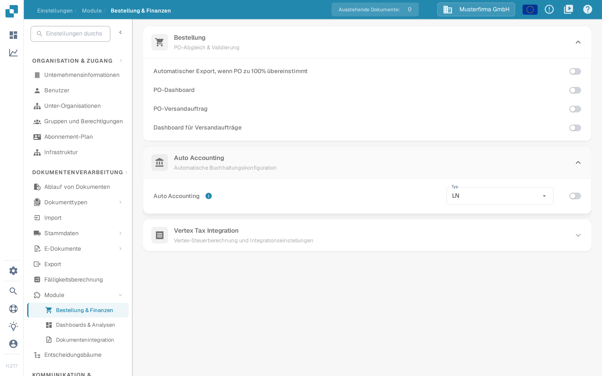
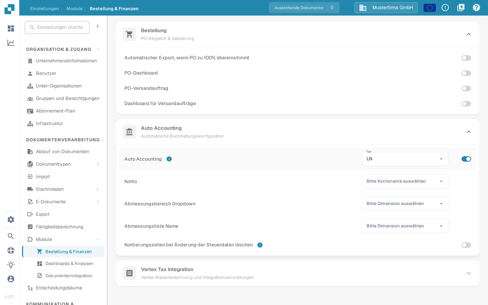

# Auto Accounting testen

Auto Accounting benötigt ein aktiviertes Modul, buchhalterische Stammdaten und eine Rechnung mit verwertbaren Beträgen oder Positionen. Dieser Leitfaden trennt die Einstellungen, die Sie vor dem Öffnen einer Rechnung prüfen können, von den Prüfungen, die eine eingerichtete LN- oder M3-Anbindung erfordern.

## Einstellungen des Moduls prüfen

1. Öffnen Sie **Einstellungen → Module → Bestellung & Finanzen** und klappen Sie **Auto Accounting** auf. Der ältere Pfad **Dokumentenverarbeitung → Module → Purchase Order / Auto Accounting** wird in der aktuellen Anwendung nicht mehr angezeigt.
2. Wählen Sie den **Typ** Ihres angebundenen Systems (**LN** oder **M3**). Schalten Sie **Auto Accounting** erst ein, wenn die erforderlichen Stammdaten und die Anbindung bereit sind.
3. Wählen Sie im aktivierten Zustand die **Konto**-Liste und die zu Ihrem System passenden Dimensionslisten. Bei LN sind darunter die Felder **Abmessungsbereich Dropdown** und **Abmessungsliste Name**. M3 hat andere Felder. Schalten Sie **Kontierungszeilen bei Änderung der Steuerdaten löschen** nur ein, wenn die Kontierungszeilen beim Bearbeiten der Steuerdaten bewusst geleert werden sollen.

<figure><figcaption>
Auto Accounting ist in der deutschen Sandbox-Testorganisation ausgeschaltet.
</figcaption></figure>

<figure><figcaption>
Die Felder, die bei aktivierter Einstellung sichtbar werden. Nach der Aufnahme wurde die Einstellung wieder ausgeschaltet; es wurden keine Konten oder Dimensionen konfiguriert.
</figcaption></figure>

## Test mit einer eingerichteten Rechnung

Verwenden Sie eine Rechnung, deren Positionen und buchhalterische Stammdaten verfügbar sind. Öffnen Sie sie im Validierungsbildschirm und wählen Sie **Auto Accounting**. Fehlt die Aktion, prüfen Sie die Moduleinstellung und ob diese Rechnung dafür infrage kommt. Validieren Sie die Rechnung vor der Navigation; die Anwendung speichert und validiert, sobald die Aktion ausgewählt wird.

Prüfen Sie auf dem Buchhaltungsbildschirm Folgendes mit Ihren eigenen LN- oder M3-Daten:

1. Führen Sie, wenn verfügbar, **Einrichtung validieren** aus und ergänzen Sie fehlende Konto- oder Dimensionskonfiguration, bevor Sie fortfahren. Ein grünes Ergebnis beschreibt nur die Prüfungen in Ihrer Umgebung.
2. Prüfen Sie, ob die Rechnung über den **Gesamtbetrag** oder über **einzelne Positionen** zugeordnet werden soll. Vergleichen Sie die Buchhaltungsbeträge mit der ursprünglichen Rechnung.
3. Wenn Sie einen Betrag aufteilen, wählen Sie für jede Aufteilungszeile das gewünschte Konto. Geben Sie Beträge oder Prozentsätze ein und prüfen Sie, dass die verteilten Werte den übergeordneten Betrag ergeben. Fügen Sie eine Zeile hinzu oder entfernen Sie eine nur, wenn nötig.
4. Prüfen Sie die Anzeige **Offener Betrag** oder eine Validierungswarnung und korrigieren Sie sie vor dem Speichern oder Exportieren. Bestätigen Sie das Ergebnis separat im angebundenen System.

### Mit Positionen arbeiten

Jede Position auf dem Buchhaltungsbildschirm hat in der Aktionsspalte die Schaltfläche **entfernen**. Damit lässt sich auch eine Hauptposition aus der Buchung nehmen und nicht nur die Aufteilungszeilen darunter. Das Entfernen einer Zeile berechnet die Summen sofort neu – prüfen Sie danach die Anzeige **Offener Betrag** und stellen Sie sicher, dass sie weiterhin zur Rechnung passt.

Hinzugefügte Zeilen werden nach der Zeile nummeriert, zu der sie gehören: Eine unter Position 1 hinzugefügte Zeile wird zu **1.1**, die nächste zu **1.2**. Die Nummerierung zeigt auf einen Blick, welche Aufteilungszeilen zu welcher Position gehören, wenn eine Position über mehrere Konten verteilt wird.

### Eine optionale Dimension leeren

Eine bereits gefüllte Dimension lässt sich wieder auf leer zurücksetzen: Öffnen Sie die Dimension und nutzen Sie dort **Löschen**. Das funktioniert nur bei **optionalen** Dimensionen. Eine Dimension, die in Ihrer Konfiguration Pflicht ist oder schreibgeschützt ist, behält ihren Wert und bietet keine Löschfunktion – tragen Sie dort den richtigen Wert ein, statt zu versuchen, sie zu leeren.

Die für die obigen Screenshots verwendete Sandbox-Testorganisation hat für diesen Ablauf keine konfigurierten Konto- und Dimensionslisten und keine Rechnungspositionen. Der Buchhaltungsbildschirm, das Aufteilen, die oben beschriebenen Bedienelemente für Positionen und Dimensionen und der Export wurden daher **hier nicht abgebildet**. Verwenden Sie die Einstellungs-Screenshots nicht als Nachweis dafür, dass die Verbuchung oder der Export erfolgreich war.

Für die systemspezifische Einrichtung fahren Sie mit dem [LN-Leitfaden](ln.md) oder dem [M3-Leitfaden](m3.md) fort.
