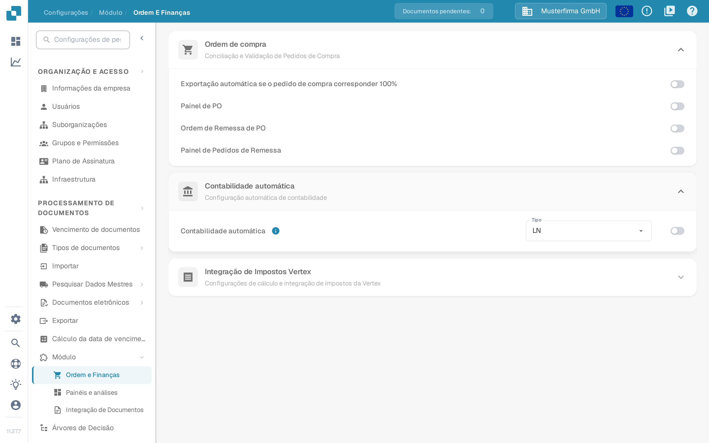
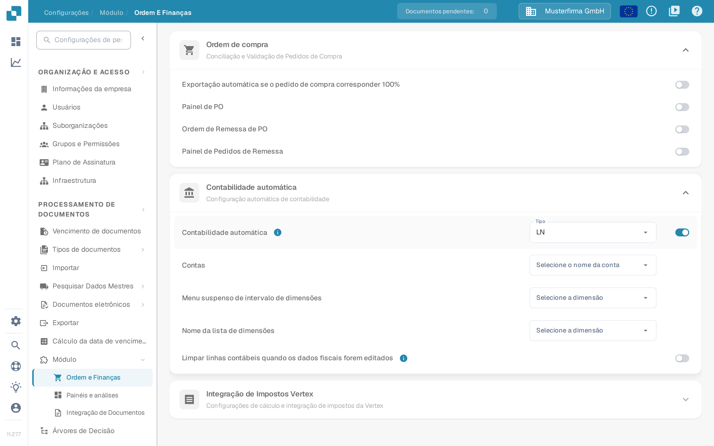

# Contabilidade automática — teste

Auto Accounting precisa de um módulo ativado, dados mestres contábeis e uma fatura com valores ou itens de linha utilizáveis. Este guia separa as configurações que você pode verificar antes de abrir uma fatura das verificações que exigem uma conexão LN ou M3 configurada.

## Verificar as configurações do módulo

1. Abra **Configurações → Módulo → Ordem e Finanças** e expanda **Contabilidade automática**. O caminho mais antigo **Processamento de Documentos → Módulo → Purchase Order / Auto Accounting** não é mais o caminho exibido na aplicação atual.
2. Escolha o **Tipo** do seu sistema conectado (**LN** ou **M3**). Ative a **Contabilidade automática** somente quando os dados mestres necessários e a conexão estiverem prontos.
3. Quando ativado, selecione a lista **Contas** e as listas de dimensões apropriadas ao seu sistema. Para LN, os campos visíveis incluem **Menu suspenso de intervalo de dimensões** e **Nome da lista de dimensões**. O M3 tem campos diferentes. A opção **Limpar linhas contábeis quando os dados fiscais forem editados** apaga as linhas contábeis já preenchidas quando os dados fiscais mudam; ative-a apenas se o recálculo depois de uma alteração for intencional.

<figure><figcaption>
A Contabilidade automática está desativada na organização de teste do Sandbox em português.
</figcaption></figure>

<figure><figcaption>
Os campos exibidos quando a configuração está ativada. Ela foi desativada novamente após esta captura; nenhuma conta ou dimensão foi configurada.
</figcaption></figure>

Os outros interruptores e cartões visíveis nestas capturas não pertencem a este fluxo: os interruptores de pedidos de compra estão descritos em [Correspondência de pedidos de compra](../po-matching.md), e a [Verificação de impostos Vertex](../../settings/global-settings/document-types/more-settings/vertex-tax-verification.md) tem a sua própria página.

## Testar com uma fatura configurada

Use uma fatura cujos itens de linha e dados mestres contábeis estejam disponíveis. Abra-a na tela de validação e selecione **Contabilidade automática**. Se a ação estiver ausente, verifique a configuração do módulo e se esta fatura é elegível. Valide a fatura antes de navegar; a aplicação salva e valida quando a ação é selecionada.

Na tela de contabilidade, verifique o seguinte com seus próprios dados LN ou M3:

1. Execute **Validate Setup** onde disponível e resolva a configuração ausente de contas ou dimensões antes de prosseguir. Um resultado verde descreve apenas as verificações do seu ambiente.
2. Verifique se a fatura deve ser atribuída pelo **total** ou por **itens de linha individuais**. Compare os valores contábeis com a fatura original.
3. Se você dividir um valor, selecione a conta pretendida para cada linha da divisão. Insira valores ou porcentagens e verifique se os valores alocados somam o valor principal. Adicione ou remova uma linha apenas quando necessário.
4. Revise qualquer **Unsettled amount** ou aviso de validação e corrija-o antes de salvar ou exportar. Confirme o resultado no sistema conectado separadamente.

### Trabalhar com itens de linha

Cada item de linha na tela de contabilidade tem um botão de excluir (ícone de lixeira) na coluna de ações, de modo que também é possível retirar um item de linha principal da contabilização, e não apenas as linhas de divisão abaixo dele. Ao remover uma linha, os totais são recalculados imediatamente — confira em seguida o valor em aberto e garanta que ele continua correspondendo à fatura.

As linhas adicionadas recebem um número depois da linha à qual pertencem: uma linha adicionada sob a posição 1 passa a ser **1.1**, a seguinte **1.2**. A numeração mostra de imediato quais linhas de divisão pertencem a qual item de linha quando uma posição é distribuída por várias contas.

### Limpar uma dimensão opcional

Uma dimensão preenchida pode voltar a ficar vazia: abra a dimensão e use o ícone de limpar dentro do campo. Isso funciona apenas para dimensões **opcionais**. Uma dimensão que é obrigatória na sua configuração, marcada com um asterisco vermelho, ou que é somente de leitura mantém o valor e não oferece controle de limpeza — preencha-a com o valor correto em vez de tentar esvaziá-la.

A organização de teste do Sandbox usada para as capturas de tela acima não tem listas de contas e dimensões configuradas nem itens de linha de fatura para este fluxo. Por isso, a tela de contabilidade, a divisão, os controles de itens de linha e de dimensões descritos acima e a exportação **não foram retratados aqui**. Não use as capturas de tela de configurações como prova de que a contabilização ou a exportação funcionou.

Para a configuração específica do sistema, continue com o [guia LN](ln.md) ou o [guia M3](m3.md).
