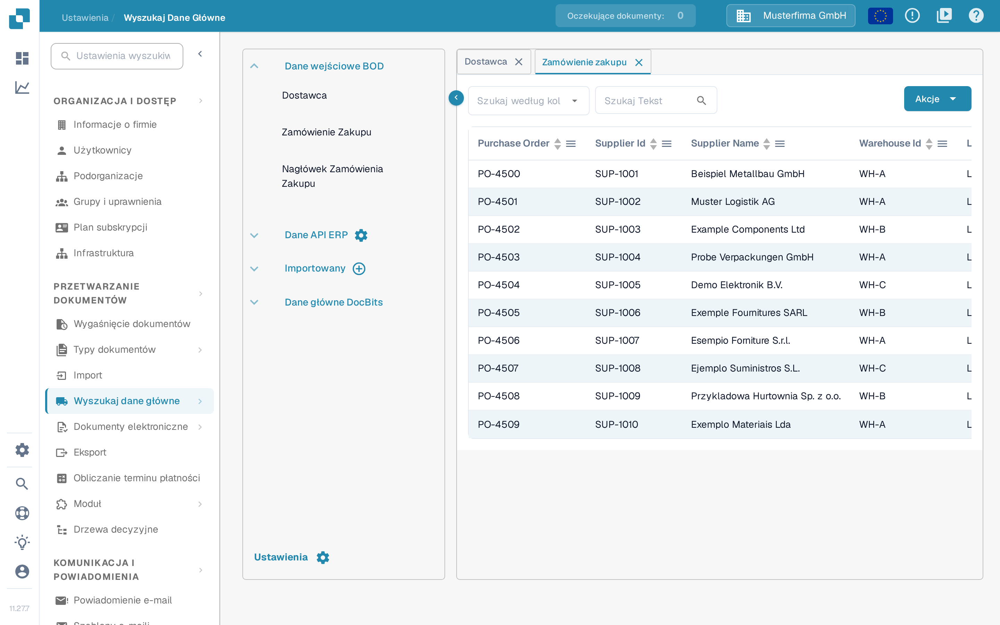

# Dopasowanie zamówień zakupu

Aby sprawdzić konfigurację dopasowania zamówień zakupu (PO Matching), utwórz zamówienie zakupu w systemie LN/M3 i sprawdź, czy INFOR jest zsynchronizowane z DocBits.

## Tworzenie zamówienia zakupu w INFOR

* LN: https://docs.infor.com/ln/10.4/en-us/lnolh/docs/ln\_10.4\_procpoug\_\_en-us.pdf
* M3: https://docs.infor.com/m3udi/16.x/en-us/m3beud/default.html?helpcontent=ois610.html

Po utworzeniu zamówienia zakupu przejdź do **Ustawienia → Wyszukaj dane główne** i wyszukaj numer właśnie utworzonego zamówienia. Powinien on pojawić się w danych podstawowych zamówień zakupu w DocBits. Jak korzystać z tej strony, opisuje strona [Wyszukiwanie danych podstawowych](../../settings/document-processing/master-data-lookup.md).

<figure><figcaption>
Zamówienia zakupu pojawiają się w wyszukiwaniu danych podstawowych.
</figcaption></figure>

Tutaj zobaczysz swój unikalny numer PO — oznacza to, że DocBits i INFOR są poprawnie zsynchronizowane.

Teraz prześlij fakturę odpowiadającą ilości i cenom jednostkowym utworzonego zamówienia zakupu. Zatwierdź dokument i na [ekranie walidacji](../../../end-user-and-partner-section/end-user-section/validation-screen/README.md) wybierz **Dopasowanie zamówień zakupu** (PO Matching).

Pozycje zamówienia zakupu i faktury powinny dopasować się automatycznie. Następnie wybierz eksport i sprawdź, czy dokument jest eksportowany bez błędów. Jeśli podczas eksportu pojawi się błąd, utwórz zgłoszenie do zespołu wsparcia DocBits — krok po kroku opisuje to strona [Utwórz zgłoszenie](../../../end-user-and-partner-section/end-user-section/technical-support-in-docbits/create-a-ticket.md).
